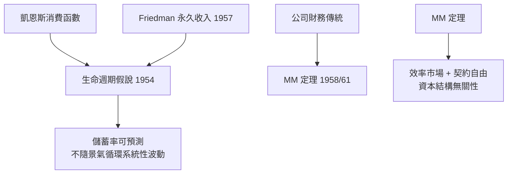

# 1985 · 懸案：儲蓄率與資本結構，是「偏好」還是「無效應」？

> **1985 諾貝爾經濟學獎（瑞典央行紀念獎）：佛朗哥·莫迪利安尼 Franco Modigliani（義大利出生／美國籍，1918–2003）— 表彰他「對儲蓄與金融市場分析的開創性貢獻」（for his pioneering analyses of saving and of financial markets）。**

---

## 懸案（案情提要）

戰後金融市場的第一批「謎案」：

1. **儲蓄率為什麼隨時間劇烈變動？** 二戰後美國的個人儲蓄率一度接近 20%，之後持續下滑——若儲蓄率只是「偏好」決定的，為何一個世代之內就翻轉？凱恩斯學派說：收入分配變了（戰後工會力量上升、利潤份額下降）$\rightarrow$ 邊際 propensity to consume 變了。莫迪利安尼說：**儲蓄率是生命週期的產物**，跟當期收入無關。
2. **公司的資本結構有意義嗎？** 財務經理說：槓桿有稅盾所以能省錢。另一派說：這只是把風險從股東轉到債權人，企業總值不變。到底誰對？
3. **股利政策有意義嗎？** 「MM 定理」說沒有——但這在實務上像瘋話。

莫迪利安尼的偵查以**定理**的姿態提出，卻帶著鮮明的實證動機：把這些「直覺規則」放進模型，看它們是否真的經得起檢驗。

---

## 前因

| 年份 | 事件 |
|---|---|
| 1939 | 莫迪利安尼移居美國；巴爾的摩貨幣學派受貨幣主義影響；他隨 Kuhn 學習貨幣理論 |
| 1944 | 芝加哥大學博士（貨幣理論與商業周期），論文受 Friedman 影響 |
| 1948–1952 | 巴爾的摩商業調查基金會（NBER 前身）研究消費函數與貨幣需求 |
| 1952 | 〈生活週期消費假說〉（與 Brumberg 合作）：儲蓄的「遺產動機」模型 |
| 1954 | New School 貨幣理論conference：Samuelson 評論莫迪利安尼的「平滑消費」思想 |
| 1956 | Hall 的「消費對當期收入意外變化的反應」研究，證實理性預期下的隨機遊走 |
| 1958 | 《資本結構、股利政策與公司價值》：MM 定理 I（無稅） |
| 1961 | MM 定理 II（帶稅盾）：槓桿提高股東收益的風險 |
| 1963 | Merton 的延續（ICLH 與 Merton 模型） |
| 1974 | 美國證券交易委員會放棄對註冊發行價格的管制（Reg A 改革） |
| 1985 | 得獎 |

---

## 調查

### 線索一：生命週期假說——把「一生」當成一張表

莫迪利安尼的偵查起點是一個不解：戰時與戰後美國儲蓄率的劇烈擺動。凱恩斯解釋說「邊際消費傾向」不穩定——但一個純粹的偏好參數在十年內翻轉，說不通。

他的解釋是：人不是每年重新決定消費，而是**一生只做一次總體規劃**。個體在年輕時（無勞動所得）借貸，中年時（收入最高）償還並儲蓄，年老時（退休金）動用儲蓄：

$$
C_t = \frac{Y_t + W_t - P_t}{(1 + r)(1 + \rho)^{T - t}}
$$

其中 $W_t$ 為初始財富、$P_t$ 為遺產遺產、$T$ 為壽命、$\rho$ 為主觀貼現率。核心性質：

$$
\frac{\partial C_t}{\partial Y_t} = \frac{1}{(1+r)(1+\rho)^{T-t}}
$$

**邊際消費傾向隨生命週期系統性變動**：年輕時高（借貸），中年時低（儲蓄），老年時再度升高（花掉儲蓄）。因此**總體儲蓄率**由**人口年齡結構**與**收入增長率**決定：

$$
\text{總體儲蓄率} = f(\text{人口結構}, \; g_Y)
$$

這解開了兩道懸案：

1. 戰後嬰兒潮進入壯年 $\rightarrow$ 儲蓄率上升；進入退休 $\rightarrow$ 儲蓄率下降（2020s 美國儲蓄率上升的「人口學解釋」即此案復刻）；
2. 景氣循環中儲蓄率**不必**系統性波動（此即「生命周期—永久收入假說」相對於簡單凱恩斯函數的關鍵差異）。

### 線索二：永久收入與生命週期的合流

與 Friedman（1976 案）並列時，莫迪利安尼的版本更「結構化」：Friedman 給的是**單期截面的無時間性假說**（永久收入 = 加權的過去與預期），莫迪利安尼給的是**跨期動態規劃**（一生一次決定）。兩者實證結果相近（儲蓄率對當期收入變化反應小），但後者能解釋**跨代遺傳動機**（為子女儲蓄）與**不動產購屋時點**。

### 線索三：MM 定理——資本結構的無效應性

莫迪利安尼與 Millawn Miller（美國西北大學教授）的 1958 年論文是史上被引用最多的財務學論文之一。其無稅版本的推理極簡：

**第一步（企業價值不變）**：假設企業價值 $V = D + E$（負債 $D$ + 權益 $E$），負債利率 $r_D$、權益成本 $r_E$。若改用權益融資，股東要求的回報率為 $r_E'$。無套利要求加權平均回報率不變：

$$
\frac{r_D D + r_E E}{D + E} = r_E' \quad \text{（若 } V \text{ 不變）}
$$

**第二步（權益風險上升）**：負債比例上升 $\rightarrow$ 權益的風險上升 $\rightarrow$ $r_E$ 上升。於是

$$
\frac{D}{D+E} \uparrow \;\Longrightarrow\; r_E \uparrow, \;\; r_D \text{ 不變（若有擔保）}
$$

**結論**：

$$
\boxed{V \;\; \text{與融資結構無關}}
$$

因為**風險只是被重新分配**給不同持有者，整體社會的風險成本未變。

**MM 定理 II（1961，加入公司稅）**：若公司利得稅率 $\tau$，則

$$
r_E = r_0 + (r_0 - r_D)(1 - \tau) \frac{D}{E}
$$

槓桿確實能**降低加權資本成本**（因為利息可抵稅）——這是「MM 定理 II 與其後的財政理論」的核心公式，也是 1960s–90s 資本結構理論的起點。

### 線索四：股利政策與「自由現金流難題」

MM 定理的延伸推論：既然價值與融資方式無關，那**股利政策**也無關（價值 = 投資機會的現值）。這引出「自由現金流難題」（Miller–Rock 命題）：

$$
\text{管理層} \;\text{可能} \; \text{過度投資} \;\Longrightarrow\; \text{派息作為承諾裝置}
$$

MM 定理因此並非「政策無用」的終審，而是**基準線**：任何「槓桿有價值」的主張，必須說明它突破了三個假設中的哪一個——

1. **稅**（MM II 與 Levine 1977 的稅盾理論）；
2. **破產成本**（Myers 1977 的「負債—紅利難題」）；
3. **資訊不對稱與代理成本**（Myers–Majluf 1984 的投資排序理論；Jensen–Meckling 1976 的代理成本）。

MM 定理因此成為整個公司財務學的「零點」：所有後續理論都是相對它的偏移量。

---

## 理論裁決

**裁決一**：消費與儲蓄由**一生規劃**決定，總體儲蓄率由人口結構與收入增長率決定，而非由短期景氣與邊際消費傾向決定：

$$
C_t = \frac{Y_t + W_t - P_t}{(1+r)(1+\rho)^{T-t}}
$$

**裁決二**：在**無稅、無破產成本、無代理成本、效率市場**下，企業價值與資本結構無關：

$$
V = D + E, \qquad \frac{\partial V}{\partial (D/E)} = 0
$$

**裁決三**：加入公司稅後，槓桿的價值來自**稅盾**，其大小可精確寫出：

$$
V = V_U + \tau D
$$

**裁決四**：理論的價值在於提供**基準線**——任何偏離都必須指認被放棄的假設。

**歷史注腳**：莫迪利安尼的晚年關注——「-lifetime consumption」與企業的「阿爾貝·卡爾愛因斯坦式企業家」、市場的倫理——顯示他對「經濟人」的道德維度始終敏感；MM 定理 50 週年（2008）曾有大量回顧文獻，其中也保留了它的「可證偽性」。

---

## 後果

| 領域 | 影響 |
|---|---|
| 政策應用 | 公共年金與儲蓄鼓勵政策的世代計算（養老金改革依賴生命週期模型）；1980s 美國 IRM（個人退休帳戶）的理論背書之一 |
| 公司財務 | MM 定理成為資本結構、股利政策、槓桿決策的標準起點；「MM 世界」成為教科書預設 |
| 宏觀 | 「永久收入—生命週期」成為消費函數的主導形式（與 Friedman 1976 案並列）；儲蓄率的可預測性成為消費研究主流 |
| 學術制度 | 莫迪利安尼在 MIT 商學院建立金融學的「模範系」；MM 論文成為史上引用最多的財務學文獻 |
| 後續諾獎 | 1976 Friedman（永久收入）、1990 Markowitz–Miller–Sharpe（金融經濟學，Miller 同獲）、1997 Merton–Scholes（定價）、2016 Hart–Holmstrom（契約與代理成本） |
| 爭議 | 稅盾的實證效果（是否有實質投資）、代理成本是否推翻無關性命題、2008 危機後「股東優先 vs 利益相關者」的重新角力——都是 MM 定理的延伸爭訟 |

---

## 關聯

- [1976-Friedman貨幣主義與永久收入](1976-Friedman貨幣主義與永久收入.md)：永久收入假說的另一版本，兩案同年並置。
- [1981-Tobin托賓q與金融市場](1981-Tobin托賓q與金融市場.md)：q 理論給投資行為一個價格錨，與生命週期投資決策互補。
- [1990-Markowitz-Miller-Sharpe金融經濟學](1990-Markowitz-Miller-Sharpe金融經濟學.md)：Miller 同年的另一份證詞（本書續寫中）。
- [1997-Merton與Scholes期權定價](1997-Merton與Scholes期權定價.md)：MM 與 Merton 的接續（本書續寫中）。
- [2016-Hart與Holmstrom契約理論](2016-Hart與Holmstrom契約理論.md)：代理成本如何成為偏離 MM 的主要理由（本書續寫中）。
- [2015-Deaton消費與貧困](2015-Deaton消費與貧困.md)：消費方程式的世紀翻修（本書續寫中）。
