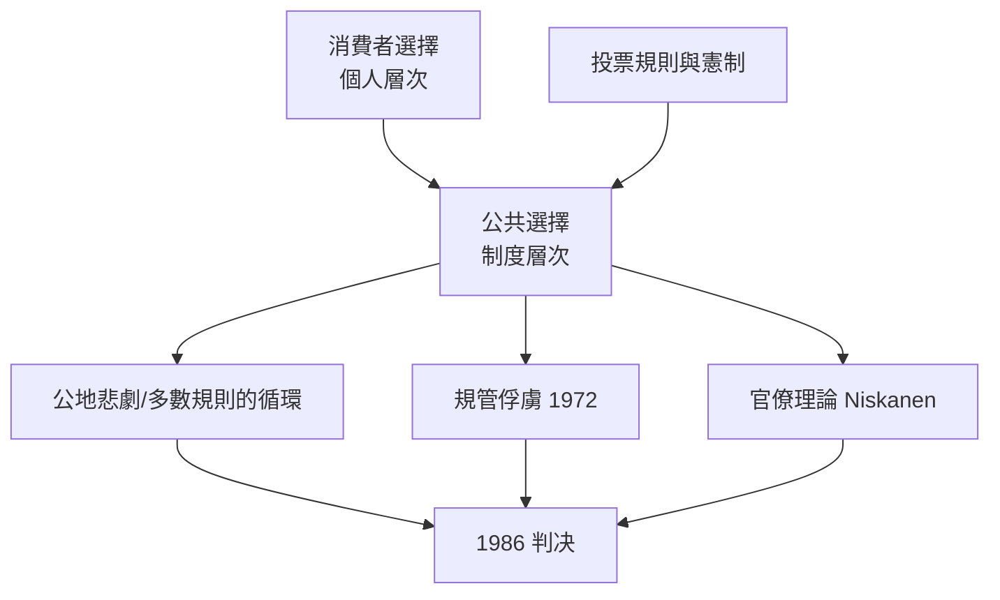

# 1986 · 懸案：選票如何變成經濟決策？政府也是「最大化效用」嗎？

> **1986 諾貝爾經濟學獎（瑞典央行紀念獎）：詹姆斯·麥克威爾·布坎南 James McGill Buchanan Jr.（美國，1919–2013）— 表彰他「對公共選擇的經濟學即政治經濟學的貢獻」（for his contributions to the political economy of public choice）。**

---

## 懸案（案情提要）

在 1950–60 年代，公共經濟學的主要問題是「**政府應該做什麼**」——這是福利經濟學的問題（分配與效率）。但布坎南追問的問題在另一層：**政府實際上怎麼做決定？**

疑點三連：

1. **選民的理性程度夠嗎？** 若選民理性且有信息，政治結果會有效率；但現實中投票有成本、信息不足——選民投票的邊際收益極低，於是**選舉結果與多數偏好無關**的「投票悖論」可能出現；
2. **利益團體如何「購買」政策？** 議案不是逐票買賣的，但選票可以交換（選票互投 trade）、遊說與資助可以影響代表性；
3. **官僚有沒有自己的目標函數？** 政府部門並非「最大化社會福利」，而是有自己的預算、職位與擴張傾向——「政府失靈」不是「市場失靈」的鏡像，而是有獨立機制的現象。

布坎南與 Tullock 1962 年的《同意的計算》（The Calculus of Consent）是本案的起訴書：把**投票規則本身**當作經濟學的合法研究對象。

---

## 前因

| 年份 | 事件 |
|---|---|
| 1949 | 布坎南任芝加哥大學經濟學助理教授；公共選擇理論的芝加哥學派基因 |
| 1950s | 他在「個人選擇」（消費者投票人）與「集體選擇」（選舉規則）之間建立對稱性 |
| 1954 | 在《Individual Choice in Voting》提出「投票作為個人消費決策」的處理 |
| 1957 | 《公共選擇理論的要素》發表 |
| 1960 | 密西根大學成立「政治經濟學研究中心」（Public Choice Center），布坎南任首任主任 |
| 1962 | 《同意的計算》（與 Gordon Tullock 合著）問世——公共選擇的聖經 |
| 1965 | 布坎南與 Tullock 對「限制定價」的分析：需求曲線的形狀決定管制效果 |
| 1969 | 「公共選擇的危機」（Tullock） |
| 1970s | 為智利與委內瑞拉的經濟改革顧問（Chicago Boys，見 1976 案爭議） |
| 1982 | 創立《Public Choice》期刊 |
| 1986 | 得獎：政治經濟學正式進入諾貝爾獎的視野 |

---

## 調查

### 線索一：投票作為個人消費決策

布坎南的第一個大膽動作：把**選民當成消費者**。投票是一種消費行為，其收益是「實現自己偏好的政策」：

$$
V_i = u_i(\text{實現的政策}) - C_i(\text{時間、金錢、信息成本})
$$

由於投票的私人收益（政策帶來的全體收益）遠小於私人成本，**理性選民的投票率低且鬆散**（Downs 的「經濟學人悖論」：所有人都認為自己的票不影響結果，於是理性地不投票，於是投票率崩潰）。

更關鍵的後果：既然投票對結果影響微弱，**選舉結果與「多數偏好」幾乎無關**（並非民主會把偏好誤傳給政策，而是投票根本沒有傳遞偏好）。這解釋了為何公共支出常超出「中位選民」想要的水平——不是因為選民錯，而是因為**投票的私人收益結構**。

### 線索二：投票悖論與規則的病理

把 Arrow 不可能性定理（1972 案）搬到選舉場合會得到更壞的結果：多數規則不滿足不一致性（不具傳遞性），於是出現 **Condorcet 悖論**：

$$
A \succ_B B, \quad B \succ_C C, \;\; \text{卻} \;\; A \succ_C C
$$

這不是瑕疵而是**結構性病理**。於是布坎南與 Tullock 的問題變成：**選擇哪一種投票規則，才能最小化集體決策的循環性與成本**。他們比較四個代表類型：

| 規則類型 | 決策者 | 循環風險 | 成本 |
|---|---|---|---|
| 一致同意（unanimity） | 全體 | 無循環 | 協商成本最高 |
| 雙重多數 | 選民 + 議會 | 極低 | 中 |
| 簡單多數 | 選民 | 高（循環） | 低 |
| 代表制（分權／有限任期） | 選民 | 由選區設計決定 | 視選區大小而定 |

結論令人反直覺：**民主的成本與效率可以由憲制設計（選區大小、任期、選舉規則）調整**，而不是靠「選民更理性」來改善。這把「好制度」變成可設計、可比較的工程問題。

### 線索三：公地悲劇——分散的小損與集中的大損

布坎南&Tullock 的公地悲劇模型（後由 Ostrom 2009 案接手）：共同資源的每個使用者獲得全部收益的一小份，卻承擔全部損失的一小份：

$$
\text{個體邊際收益} = \frac{1}{N} \cdot MB, \qquad \text{個體邊際成本} = MC
$$

因為 $\frac{1}{N} MB < MC$，理性個體會過度使用資源，導致集體崩潰（Hardin 1968 的「開放 Access」）。**這是市場失靈的經典版**，但本案把它翻轉過來：集體行動（協議、產權設計、投票機制）才是解決之道，而解決機制的選擇本身就是經濟學問題。

### 線索四：規管的公共選擇解剖——管制是誰要的？

布坎南把 Stigler（1982 案）的「管制俘虜」理論做成了嚴格模型：管制不是「為了公共利益」的外生給定，而是**產業與消費者在政治市場上的競爭產物**。這裡出現一個尖銳的對比：

- **經濟學家眼中的管制**：政府追求社會福利，受資訊不對稱限制；
- **公共選擇學派眼中的管制**：管制是**利益集團競爭的產物**，消費者作為分散的選民必然輸給組織化的產業。

1970s 的管制鬆綁運動（航空、卡車、銀行）在兩種解釋下都得到支持，但機制不同：前者說「解除不必要的管制」，後者說「讓市場規則取代政治規則」。這場解釋之爭一直延續到 2020s。

### 線線五：官僚的目標函數——Niskanen 與「最大化預算」

沿著「政府也是經濟人」的思路，Niskanen（1971）的官僚理論給出可檢驗的假說：官僚的目標函數不是社會福利，而是**預算最大化**：

$$
\max_{\text{budget}} \; B, \qquad \text{subject to} \;\; B \leq f(\text{生產者選單})
$$

官僚追求的產出規模（因而追求更大的預算）大於社會最優產出，因為**選民無法辨識成本**（資訊不對稱的政黨版本）：

$$
\frac{\text{生產者剩餘}}{\text{消費者剩餘}} \approx \frac{X^{*}}{Y^{*}}
$$

公共選擇由此發展出「政府失靈」的完整機制：選民鬆散 $\rightarrow$ 政黨競爭偏向高支出 $\rightarrow$ 官僚擴張 $\rightarrow$ 支出超過社會最優。這是與市場失靈**不對稱**的理論，第一次說明「政府失靈不需要陰謀，只需要規則」。

---

## 理論裁決

**裁決一**：政治是經濟的一部分；**投票、選舉、政黨、官僚都是經濟行為**，可以用效用最大化與約束下的最優來分析。

**裁決二**：制度的選擇（投票規則、選區大小、任期、憲制）本身就是經濟設計問題，效率與成本可被比較與優化：

$$
\text{制度選擇} \longrightarrow \min \{ \text{循環性} , \text{決策成本} , \text{外部性} \}
$$

**裁決三**：集體行動的失敗不必歸因於「群體無知」，而可歸因於**私人收益—私人成本結構**（公地悲劇、投票悖論）。

**裁決四**：政府失靈是一套獨立於市場失靈的機制：**分散的消費者 vs 組織化的產業**，加上官僚的預算最大化傾向。

**歷史注腳**：1986 年的授獎被部分評論視為「右派把政治經濟學武器化」的里程碑；而 2016 年 Trump 與 Brexit 的民粹浪潮，則讓「選民偏好被扭曲」的論題重回公共辯論前台——布坎納的框架正是那場辯論的語言。

---

## 後果

| 領域 | 影響 |
|---|---|
| 政策應用 | 管制改革、財政憲制（歐元Maastricht 赤字規則）、公地治理設計；公地悲劇理論直接支撐 2020s 的碳排放權、渔業配額設計 |
| 經濟學發展 | 公共選擇成為政治經濟學的主流分支，與公共經濟學（福利）分庭抗禮；「制度比較」成為一級研究議題 |
| 跨學科 | 影響法學（憲制經濟學）、政治學（選舉經濟學）、組織理論 |
| 後續諾獎 | 2009 Ostrom（公地與制度的實證治理）、2007 機制設計（把政治規則設計成最優機制）、2016 契約理論、2024 制度與繁榮 |
| 爭議 | 遭批「把民主當成需要效率檢驗的工程」；被指低估規範性理想與公共精神；亦被批與實際政治脫節（預測失準） |

---

## 關聯

- [1972-Arrow與Hicks一般均衡與福利](1972-Arrow與Hicks一般均衡與福利.md)：不可能性定理在選舉場合的變種——投票悖論。
- [1974-Myrdal與Hayek貨幣波動與制度](1974-Myrdal與Hayek貨幣波動與制度.md)：制度與市場的另一條主張路線。
- [1982-Stigler管制與資訊經濟學](1982-Stigler管制與資訊經濟學.md)：管制俘虜理論的公共選擇版本。
- [2009-Ostrom與Williamson治理](2009-Ostrom與Williamson治理.md)：公地悲劇的實證解方（本書續寫中）。
- [2007-機制設計三人組](2007-機制設計三人組.md)：把政治規則設計成最優機制（本書續寫中）。
- [2024-Acemoglu制度與繁榮](2024-Acemoglu制度與繁榮.md)：制度質量的經濟學度量（本書續寫中）。
