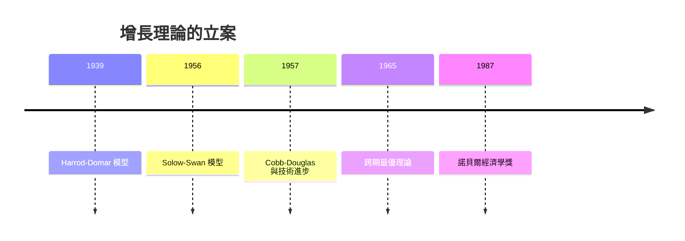

# 1987 · 懸案：增長的「引擎」在哪？為什麼窮國追不上富國？

> **1987 諾貝爾經濟學獎（瑞典央行紀念獎）：羅伯特·默頓·梭羅 Robert Merton Solow（美國，1924–2023）— 表彰他「對經濟增長理論的貢獻」（for his contributions to the theory of economic growth）。**

---

## 懸案（案情提要）

二戰後西方世界有一個無法掩飾的尷尬：**兩百年的差距沒有縮小的趨勢**。財富分布圖上，富國與窮國的相對差距停滯不前。而既有的增長理論（Harrod–Domar）解釋不了：

1. **為什麼增長率不會自動收斂？** 多數國家似乎落在「低trap」狀態，不因時間流逝而上升；
2. **資本累積是不是全部？** 若增長只靠資本累積，因資本邊際報酬遞減，收斂必然發生——事實上沒有（至少沒有無條件地）；
3. **「餘值」是什麼？** 對美國 1870–1970 的估計發現，產出增長中相當大一部分無法由資本與勞動投入解釋——這塊「黑箱」裡到底裝著什麼？技術進步？還是統計的幻覺？

梭羅的偵查報告（1956 年 Solow 模型，與 Swan 獨立提出）給出了現代增長理論的第一個可計算骨架。

---

## 前因

| 年份 | 事件 |
|---|---|
| 1948 | 梭羅在哈佛取得博士學位，導師是 Leontief（1973 案得主）——投入產出的 DNA 傳給增長理論 |
| 1949 | 麻省理工學院任教 |
| 1950–1955 | 美國國家經濟研究局（NBER）研究「資本形成對產出的影響」 |
| 1956 | 〈經濟增長的理論分析〉發表：Solow 模型問世（與 Swan 同年獨立提出） |
| 1957 | 〈技術進步與生產函數〉：為 Cobb–Douglas 生產函數設定技術進步形式 |
| 1958 | 《技術進步與生產函數》（美國經濟學會會長演說）：增長理論的數學整編 |
| 1962 | 《投資、產出與增長》（與 Phelps 合作）：模型進入主流教材 |
| 1965 | 〈每個經濟人的資本理論〉：消費者跨期最優與增長理論接軌 |
| 1970s | 「Solow 餘值」成為技術進步的代理變數；增長理論的實證爭議（「是否需要新古典模型」） |
| 1987 | 得獎；隔年（1988）Allais 案與「資本理論」的餘波仍在爭論 |

---

## 調查

### 線索一：Harrod–Domar 的漏洞

先前的偵查工具（Harrod 1939、Domar 1944）假定產出函數是**固定係數**的（資本與勞動不可替代）：

$$
Y = \min \{ a K, b L \}
$$

其「平衡增長」要求 $s = \sigma$（儲蓄率等於資本產出率），條件極為苛刻，一旦偏離就產生「不穩定」。更根本的是它**無法解釋不同國家增長率的差異**：若技術可以自由擴散，窮國應迅速追趕——但事實沒有。

### 線索二：Solow 模型——可計算的增長骨架

梭羅改用**替代性**的生產函數（Cobb–Douglas）：

$$
Y = A\, K^{\alpha} L^{1-\alpha}, \qquad 0 < \alpha < 1
$$

在完全競爭與利潤最大化的條件下，生產者均衡給出：

$$
\frac{K}{Y} = \frac{\alpha}{r - \delta}, \qquad \frac{L}{Y} = \frac{1-\alpha}{w}
$$

其中 $r$ 為資本報酬、$\delta$ 為折舊率——**增長率是產出與資本比率的函數**，這是全套模型的核心。

### 線索三：人均產出與「跨越效應」（收斂的條件與否）

在人口增長 $n$ 與技術進步 $g$ 下，人均產出 $y = Y/L$ 的增長率：

$$
\frac{\dot{y}}{y} = \frac{\dot{A}}{A} + \left( 1 - \frac{1}{\alpha} \right) \frac{\dot{K}}{K}
$$

結合資本累積方程 $I = sY$、$\dot{K} = I - \delta K$，可得人均產出的穩態路徑：

$$
\frac{\dot{y}}{y} = \frac{g - \delta - n - ng}{\alpha} + g
$$

**關鍵發現（跨國收斂）**：由於 $\alpha < 1$，資本報酬 $r = \alpha Y/K$ 隨 $K/L$ 上升而**下降**，窮國的資本報酬較高，因此**資本會從富國流向窮國**——這就是後來著名的**跨國收斂假說**：

$$
\frac{\partial \ln (K/Y)}{\partial \ln (Y/L)} < 0
$$

但梭羅同時給出「條件性收斂」的嚴格版本：**只有當國家共享同一技術進度 $g$ 時，收斂才發生**；若各國技術進步率不同（$g_i$ 各自為政），則可能出現**持續的差距甚至「貧者愈貧」**。這正是他 1965 年《跨國經濟增長的理論分析》的主題。

### 線索四：黃金律與最優儲蓄率

梭羅的又一項裁決：增長率與儲蓄率的關係不是單調的。資本回報 $r$ 隨儲蓄率上升而下降：

$$
\frac{\dot{y}}{y} = g \quad \text{當 } \delta + n + ng = r
$$

令 $r = \delta + n + ng$（即**黃金律**），消費（黃金律消費率 $c^* = 1 - \alpha$）達到最大：

$$
\frac{\dot{c}}{c} = 0 \quad \Longleftrightarrow \quad r = \delta + n + ng
$$

這給出一個強烈的政策含意：**儲蓄率不應被當成越高越好的旋鈕**；過度儲蓄會犧牲當期消費而不提高長期增長率。

### 線索五：Solow 餘值——「黑箱裡裝著什麼」

在 Cobb–Douglas 下，對生產函數取對數並對時間求導：

$$
\frac{\dot{Y}}{Y} = \frac{\dot{A}}{A} + \alpha \frac{\dot{K}}{K} + (1-\alpha)\frac{\dot{L}}{L}
$$

實證估計發現 $\frac{\dot{A}}{A}$ 的估計值（美國約 $1.5\%$–$2\%$）佔總增長的相當大部分——**這就是 Solow 餘值**。疑點立刻升級：這個餘值是真的「技術進步」，還是統計上的幻覺（因資本使用量無法直接觀測）？

梭羅的裁決是**中性偏審慎**的：餘值是「我們尚未解釋的部分」，把它直接稱為「技術進步」是過度解讀；而 1957 年他給出技術進步在 Cobb–Douglas 下的中性形式（Harrod 中性）：

$$
Y = A(t) K^{\alpha} L^{1-\alpha}
$$

從此「中性技術進步」成為標準假設，也成為後來 Romer（2018 案）「知識外部性」的理論靶心。

### 線索六：消費者與生產者的接頭

1965 年〈每個經濟人的資本理論〉把增長理論與跨期最優理論接合：家庭在終身資源限制下最大化

$$
\max \int_0^T u(c_t) e^{-\rho t} dt, \qquad \text{s.t.} \int_0^T c_t e^{-\rho t} dt \leq w_0 + \int_0^T y_t e^{-\rho t} dt
$$

私人跨期最優的儲蓄率必須與社會最優（黃金律）一致——這是「效率」與「增長」能對話的第一個正式場合，並為後來的動態優化方法與 Ramsey 型模型鋪路。

---

## 理論裁決

**裁決一**：長期增長由三個力量決定——**資本累積 $s$、勞動增長 $n$、外生技術進步 $g$**：

$$
\frac{\dot{y}}{y} = \frac{g - \delta - n - ng}{\alpha} + g
$$

**裁決二**：技術進步相同的國家之間存在**條件性收斂**；技術進步不同則差距可以持續甚至擴大：

$$
g_i = g \;\Rightarrow\; \text{收斂}; \qquad g_i \neq g_j \;\Rightarrow\; \text{可能發散}
$$

**裁決三**：最優儲蓄率由**黃金律**決定，而非越高越好：

$$
r = \delta + n + ng \quad \Longleftrightarrow \quad \dot{c}/c = 0
$$

**裁決四**：產出增長中存在一個無法由投入解釋的**餘值**，它可能是技術進步，但**不能直接等同於技術進步**（因產出結構與要素使用量的統計誤差）。

**裁決五（方法論）**：增長理論必須「接觸微觀基礎」（make contact with microeconomics）——這是梭羅對 Harrod–Domar 的關鍵超越：產出函數要從要素市場的均衡條件推導。

---

## 後果

| 領域 | 影響 |
|---|---|
| 政策應用 | 「趕上型發展」的理論基礎：落後國可透過高儲蓄＋技術轉移獲得高速增長；援助政策設計（世界銀行的發展理論） |
| 經濟學發展 | 增長理論成為 1980s–90s 宏觀經濟學的主軸（實際經濟週期、人力資本模型、內生增長理論） |
| 實證 | 巴爾—鮑威爾（Banolopyo）跨國收斂檢驗；增長回歸（Barro & Sala-i-Martin 1992）成為標配 |
| 後續諾獎 | 1995 Lucas（微觀基礎革命）、2004 Kydland–Prescott（實際週期）、2018 Romer（內生增長，把 $g$ 內生化） |
| 爭議 | 「是否需要新古典模型」與「Solow 模型可否被否證」的辯論（Jones 2002《Macroeconomics' Last Great Empirical Test》）；增長會計的餘值之謎；後續處理（Barro–Sala-i-Martin）對收敛速度的巨大分歧 |

---

## 關聯

- [1971-Kuznets國民帳戶與增長長卷](1971-Kuznets國民帳戶與增長長卷.md)：Solow 的「典型事實」清單即 Kuznets 的實證遺產。
- [1979-Lewis與Schultz發展經濟學](1979-Lewis與Schultz發展經濟學.md)：剩餘勞動與人力資本，是 Solow 模型中被內生化之前的外生力量。
- [1973-Leontief投入產出矩陣](1973-Leontief投入產出矩陣.md)：梭羅的導師與生產函數方法論的傳承。
- [1995-Lucas理性預期](1995-Lucas理性預期.md)：對 Solow 模型「結構深度」的正面質疑（本書續寫中）。
- [2004-Kydland與Prescott實際經濟週期](2004-Kydland與Prescott實際經濟週期.md)：技術衝擊成為內生週期的來源（本書續寫中）。
- [2018-Nordhaus與Romer長期增長](2018-Nordhaus與Romer長期增長.md)：把 $g$ 從外生解放出來的下一代（本書續寫中）。
