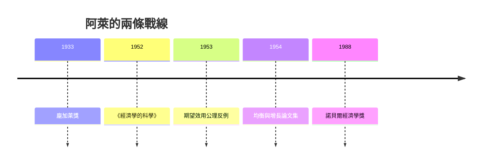

# 1988 · 懸案：經濟學的「位置」定出來了嗎？——從概率論的暗房走出來

> **1988 諾貝爾經濟學獎（瑞典央行紀念獎）：莫里斯·費利克斯·夏爾·阿萊 Maurice Félix Charles Allais（法國，1911–2010）— 表彰他「對市場理論與資源有效利用理論的開創性貢獻」（for his pioneering contributions to the theory of markets and efficient utilisation of resources）。**

---

## 懸案（案情提要）

阿萊的偵查對象不是「市場好不好」，而是**經濟學作為科學的位置**。三道難題：

1. **「多市場同時出清」的一般均衡真的能被證明嗎？** Arrow 與 Debreu（1972、1983 案）用不動點定理處理，但阿萊與他的巴黎學派（Centre de Mathématiques Économiques）認為：**證明的技術可以更精密**，而且在**多市場、多時期、多商品**的完整設定下依然成立。
2. **期望效用的公理化是否站得住？** von Neumann–Morgenstern 的期望效用表示定理依賴「混合偏好」的公理；阿萊提出**反例（Allais 悖論）**，顯示這些公理在經驗上可疑、且不同公理導出互相矛盾的結論。
3. **貨幣在均衡中扮演什麼角色？** 一般均衡模型常把「貨幣」當成第 $n+1$ 種商品或記賬單位；阿萊與另一些學者則主張：**貨幣是唯一的、特殊的、唯一被持有的商品**——貨幣的供需與一般商品不同，這改變了均衡的性質。

阿萊的答案最終指向一個大膽的主張：經濟學必須建立**自己的數學主體地位**，並以「有效利用資源的理論」回應凱恩斯主義對自發調節的批評。

---

## 前因

| 年份 | 事件 |
|---|---|
| 1911 | 阿萊生於巴黎；父親是百貨公司與法國運河公司的經理——他從小在「交換與數量」的氛圍中長大 |
| 1933 | 龐加萊獎（數學） |
| 1930s–40s | 巴黎大學統計學與概率論研究；與 Georges Darmois、Paul Lévy 同學 |
| 1943 | 建立法國經濟學數學化學派（Centre de Mathématiques Économiques，1954 正式成立） |
| 1953 | 與他的學生 Gérard Debreu 共同發展經濟學的公理化研究（Debreu 1959《價值理論》） |
| 1952 | 《經濟學的科學》（L'Économie et les sciences）：建立「經濟學的科學地位」宣言 |
| 1953 | 〈理性行為的經濟學基礎〉發表：提出對期望效用公理的系統性反例 |
| 1954 | 與 Debreu、Malinvaud 合編《經濟學的均衡與增長》（Colloque d'Arles） |
| 1960s | 國家計畫與公共投資理論（法國第五計畫）；Allais 悖論在 1970s 引起決策理論大辯論 |
| 1970s | 與 Debreu 的關係疏遠（哲學與政治分歧） |
| 1988 | 得獎——與已故的 Samuelson、Hicks 同被並列表彰，委員會稱其「使經濟學成為科學」 |

---

## 調查

### 線索一：期望效用的公理化與它的裂縫

von Neumann–Morgenstern 的定理說：若偏好滿足**完全性、超越性、連續性**與**期望效用公理（EU 4）**，則存在效用函數 $u$ 使

$$
u(x) = \mathbb{E}[u(x_i)]
$$

阿萊的偵查要問：這條公理在**經驗上**站得住嗎？他用「確定性等價法」設計了一組精確的選擇題：兩張彩票 $A$、$B$ 與一組確定性金額 $(x, y)$，受測者反覆被問「你願意用 $A$ 換 $B$ 嗎」「你願意用 $A$ 換 $x$ 嗎」，藉由交叉比較推出其風險偏好參數 $k$（相對風險厭惡程度）。

結果是殘酷的：受測者的回答**系統性地違反 EU 公理**，且在不同題組之間自相矛盾——同一個人被證明「偏好確定性」又「偏好風險」，取決於提問方式。這就是 **Allais 悖論**：

$$
\text{依 EU：} \;\; u(x) \geq u(A) \text{ 卻 } u(y) \geq u(B) \;\;\Longrightarrow\;\; \text{偏好關係不一致}
$$

阿萊由此提出大膽要求：**把期望效用的公理還原為「序數的可組合性」，或承認需要新的表示定理**。這場辯論引發了 Savage、Kahneman–Tversky（2002 案）等人的大混戰，最終由「**描述性**期望效用」（preference for sure gains 的線性近似）收場。

### 線索二：一般均衡的精密化——從 Brouwer 到「經濟的拓撲學」

阿萊與 Debreu 的巴黎學派把均衡存在性做成一套**完整的定理機器**：不只證明「存在」，還要證明

- 均衡的**唯一性**（在嚴格凸性下的局部唯一性）；
- 均衡集合的**上半連續性**（參數變動時均衡如何移動，這是後來均衡選擇理論的源頭）；
- 多市場、多商品、多時期的一般版本。

其中最著名的是**阿萊定理（兩國兩商品兩要素的一般均衡存在性）**：他與 Debreu 在 1950s 的合作把 Arrow–Debreu 定理推廣到**非對稱的生產技術**（一般均衡的完整形式），並用「需求函數的存在性」配合 Brouwer 定理完成證明。

### 線索三：貨幣在一般均衡中的地位

阿萊的第二條大膽主張：**貨幣不應被當作普通的第 $n+1$ 種商品**。理由：一般均衡中每一種商品都由「該商品的需求」與「該商品的供給」對接，而貨幣（記賬單位與支付手段）的需求幾乎是**彈性為一的價格接受者**——它的存在是為了「購買其他商品」，因此貨幣市場的出清是**恆等式**而非均衡條件。

這一「貨幣的特異性」立場，在 1970s 發展成與「新貨幣主義」的對話，也影響了法國學派對通脹與計價單位變革（currencies）的討論。

### 線索四：凱恩斯主義的回應與「自發調節」

阿萊是自發調節（marche spontané）的堅定辯護者。他的論證形式極簡：若經濟體系的目標函數是**資源的有效利用**，則在某些條件下自由競爭的結果優於干預。

他 1988 年獲獎時，委員會的說法即是：「他與希克斯、薩繆爾森一起，形式化了市場的自發調節，而凱恩斯曾反駁這一點——但凱恩斯也重述了阿萊的某些想法。」這句話把 1988 年的授獎定位成一場**大論戰的插曲**：凱恩斯（1936）主張市場不自動出清、需財政貨幣介入；阿萊主張市場在足夠條件下能自發達到資源有效利用。

### 線索五：凱恩斯與阿萊在「儲蓄的悖論」上正面交鋒

阿萊最具破壞力的著作之一，是對凱恩斯《通論》的**逐條數學檢驗**：從《通論》的 43 條命題中找出 18 條在數學上「錯誤或不可驗證」，並以兩位主角的對話形式重寫（〈凱恩斯主義者與經濟學家〉）。他的核心指控是：凱恩斯體系的「需求不足」結論並不構成對自發調節的反駁——若貨幣當局讓工資與價格充分靈活，「充分就業」並無特別地位。

這是 1980s 「新古典復興」在歐洲的思想底盤，也是 1980s 拉美與英美的改革方案的知識裝備之一。

---

## 理論裁決

**裁決一**：經濟學是一門**獨立的數學科學**，其對象是「在給定資源下有效利用的條件」；「經濟學的科學」不是經濟學的分支，而是它的自我定位宣言。

**裁決二**：期望效用的標準公理面臨**經驗反例**；任何基於它的理論都必須聲明其公理選擇，並在描述與規範之間劃清界線。

**裁決三**：一般均衡的存在性、唯一性與連續性可被完整證明，且必須以**一般情形**（非對稱技術、多時期）陳述。

**裁決四**：貨幣是**特異的**：它不是普通商品，其市場出清是恆等式；這一點必須進入均衡理論的內部。

**裁決五**：凱恩斯式的「需求不足常態」並非自發調節的反證；在**工資—價格靈活性與貨幣適應**的條件下，資源的有效利用仍是基準線。

---

## 後果

| 領域 | 影響 |
|---|---|
| 理論發展 | 期望效用與風險決策的百年辯論；阿萊悖論成為行為經濟學的起點之一（Kahneman–Tversky 2002 案） |
| 均衡理論 | 阿萊–Debreu 的一般均衡與均衡選擇理論（Eilenberg–Debreu 1970s）；競爭對手均衡的後續工作 |
| 政策應用 | 價格靈活性、貨幣適應、供給側政策的理論辯護；法國公共投資理論的應用 |
| 制度史 | 1988 年授獎被理解為對「經濟學的科學地位」的正式表彰——這在諾貝爾獎史上罕見 |
| 爭議 | 阿萊晚年捲入個人政治爭議（反對歐元、支持民族主義經濟政策），被批使榮譽蒙塵；其對凱恩斯體系的逐條駁斥被指選擇性引述 |
| 遺產 | 「經濟學的科學」一書是經濟學方法論的經典；阿萊悖論至今是風險決策教科書的標準反例 |

---

## 關聯

- [1972-Arrow與Hicks一般均衡與福利](1972-Arrow與Hicks一般均衡與福利.md)：存在性與福利定理的主戰場，阿萊是同一條戰線的平行推進者。
- [1983-Debreu一般均衡公理化](1983-Debreu一般均衡公理化.md)：阿萊的學生與合作者，巴黎學派的另一面旗幟。
- [1970-Samuelson數學化革命](1970-Samuelson數學化革命.md)：被阿萊逐條檢驗的對象。
- [2002-Kahneman與Smith行為與實驗](2002-Kahneman與Smith行為與實驗.md)：Allais 悖論的行為經濟學後裔（本書續寫中）。
- [1996-Mirrlees與Vickrey不對稱信息](1996-Mirrlees與Vickrey不對稱信息.md)：風險與資訊下的最優機制（本書續寫中）。
- [2024-Acemoglu制度與繁榮](2024-Acemoglu制度與繁榮.md)：自發秩序的另一個Modern 版本（本書續寫中）。
