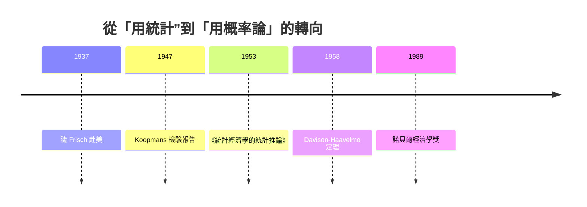

# 1989 · 懸案：估計出來的參數，究竟能不能信？

> **1989 諾貝爾經濟學獎（瑞典央行紀念獎）：特里格夫·馬格努斯·哈維爾莫 Trygve Magnus Haavelmo（挪威，1911–1999）— 表彰他「對計量經濟學的概率論基礎，以及對聯立經濟結構分析所做的開拓性貢獻」（for his contributions to the probability foundation of econometrics and his pioneering work in the analysis of simultaneous economic structures）。**

---

## 懸案（案情提要）

1969 年首獎頒給了「發展並應用動態模型」的弗里施與丁伯根，但二十年的實踐暴露了一樁更底層的危機：

1. **經濟學的定理是確定性的，資料是隨機的——兩者如何接軌？** 迴歸係數為什麼會有抽樣誤差？「估計值等於真值」的說法究竟在什麼條件下成立？
2. **如果經濟學家的定理本身有前提（母體模型），而前提未知，估計還有意義嗎？** 這正是 Haavelmo 的起訴核心：**經濟學的前提假設必須同時被當作經濟學的定理來檢驗**——「模型即假設，假設即定理」。
3. **聯立系統裡的參數，普通最小平方法為什麼會錯？** Koopmans 1947 年的檢舉（1969 案提到的「證物污染」）至今沒有被數學上徹底關閉。

哈維爾莫的裁決：把計量經濟學徹底建立在**概率論與決策理論**的公理之上，並證明大樣本估計的漸近性質——哪怕母體模型錯了，估計程序依然有**可證偽的統計含義**。

---

## 前因

| 年份 | 事件 |
|---|---|
| 1911 | 哈維爾莫生於挪威 Skedsmo；1929 年起在奧斯陸大學學習數學 |
| 1930s | Frisch 的學生（1969 案得主），進入經濟學的統計—數學傳統 |
| 1930s | 挪威統計局任職，處理人口普查與農業統計 |
| 1937 | 應 Frisch 之邀到美國，參與 NBER 的商業周期研究 |
| 1939 | 返回挪威；1940–45 年在戰時統計機構工作 |
| 1945 | 任挪威大學（奥斯陸）經濟學教授 |
| 1947 | Koopmans 對 Tinbergen 模型的統計檢驗報告——聯立性偏差問題被正式提出 |
| 1953 | 《統計經濟學的統計推論》（Statistical Inference in Economic Statistics）問世：把經濟統計學建立在概率論之上 |
| 1955 | 在芝加哥大學訪問（Friedman、Hart 一圈），擴散方法論 |
| 1958 | 與 Davison 合作發表經濟學中最基本的抽樣分佈定理之一（見下文） |
| 1973 | 與 J. K. Hotelling 等統計學社群密切往來 |
| 1989 | 得獎——為止唯一一位以「概率基礎」獲獎的經濟學家，填補了本獎史上的一塊空白 |

---

## 調查

### 線索一：起訴書——「模型即假設，假設即定理」

哈維爾莫 1953 年的著作是本案的骨架。他主張：經濟學模型不是现实的鏡像，而是**關於母體（population）的假設**。而經濟學家對母體的信念，例如「誤差項獨立同分配」、「係數不隨樣本改變」，本身就是**可以檢驗的命題**。

因此統計推論必須回答一個雙重問題：

$$
\text{若模型為真：} \;\; \text{估計程序有什麼性質（效率、一致性）？}
$$

$$
\text{若模型為假：} \;\; \text{估計程序還剩下什麼意義？}
$$

第二問是哈維爾莫的獨創。他證明：在模型錯誤時，最小二乘估計**依然收斂到某個偽參數（pseudo-true parameter）**，只要誤差有一致可預測的平均值。這把「模型錯了怎麼辦」從哲學問題變成技術問題——**偽參數可以被估計、被定義、被詮釋**。

### 線索二：Davison–Haavelmo 分佈定理——經濟學的「中央極限定理」

這是哈維爾莫最著名的單一結果，也是後世整個異質性處理模型（heterogeneity treatment effect）的祖先定理。

設定：處理組與對照組各為隨機樣本，觀察到「結果－處理」的樣本均值：

$$
\bar{D} = \bar{Y}_{T} - \bar{Y}_{C}
$$

在常態同方差下，

$$
\bar{D} \sim N\!\left( \mu_D,\; \sigma_D^2 \left( \frac{1}{n_T} + \frac{1}{n_C} \right) \right)
$$

而**關鍵的定理**是：即使母體本身是**非常態**（例如處理效應的分配是任意的），只要樣本數足夠大，這個平均差的抽樣分佈**仍然趨近常態**：

$$
\sqrt{n} \left( \bar{D} - \mu_D \right) \;\xrightarrow{d}\; N(0, \sigma_D^2)
$$

其證明需要用到**特異性（idiosyncraticity）假設**：個體層面的處理效應與結果變數彼此獨立，且效應分佈在個體間**變異**。這兩條假設被後來用於辨識：

1. 隨機化實驗的推論基礎（為何 RCT 的平均處理效應可用常態近似）；
2. **Imbens–Angrist 1994 的 LATE 定理**：即使處理分配與結果存在相關，只要觀察到的 $\left( Y(1), Y(0) \right)$ 獨立於 $D$，比率估計量 $\hat{\tau} = \frac{\bar{Y}_T - \bar{Y}_C}{\bar{D}_T - \bar{D}_C}$ 仍收斂到「局部平均處理效應」：

$$
\hat{\tau} \xrightarrow{a.s.} \text{LATE} = \text{對「受影響者」的效應}
$$

這條定理正是 2021 年 Angrist–Imbens 因果推斷得獎的技術源頭；而它的血統可直溯哈維爾莫 1958 年的分佈定理。

### 線索三：漸近理論——「樣本趨於無限」的經濟學

哈維爾莫系統化地把**一致性（consistency）與漸近正態性（asymptotic normality）**引進經濟學：

$$
\sqrt{n} (\hat{\boldsymbol{\theta}} - \boldsymbol{\theta}_0) \xrightarrow{d} N(0, \Sigma)
$$

這兩個性質是現代經濟學所有推論的基礎：檢定、置信區間、假設檢驗、因果識別的標準誤計算，全部建立在「估計量的抽樣分佈可以被寫下」之上。在此之前，經濟學的估計沒有可推論的抽樣理論——**統計推論的門檻，就是哈維爾莫鋪的**。

### 線索四：聯立結構的估計——工具變數與「辨識」

面對 Koopmans 1947 年的檢舉（聯立性偏差），哈維爾莫的貢獻是**給出正解的統計學地基**：

在結構方程

$$
\mathbf{B} \mathbf{y} = \mathbf{\Gamma} \mathbf{x} + \mathbf{u}
$$

中，若 $\mathbf{u}$ 與某些排除性工具 $\mathbf{z}$ 正交（$\mathbb{E}[\mathbf{z} \mathbf{u}^{T}] = 0$），則用 2SLS 估計的係數是**一致的**，即使模型本身誤定。於是「辨識」問題被明確地表述為：

$$
\text{一致性} \;\Longleftrightarrow\; \text{工具變數的排除性限制（exclusion restriction）}
$$

這句等價關係，是後來所有爭論的標準句式——從 1970s 的勞動供給彈性爭議，到 1990s 的最低工資與移民研究爭議，到 2020s 的因果推斷方法論爭論，句型完全一致。

### 線索五：經濟學作為「假設的科學」的方法論宣言

哈維爾莫留下的最深遺產，是一句可作為整個計量經濟學綱領的判詞：

> **經濟學的定理不僅是關於經濟世界的定理，也是關於經濟學家假設的定理。**

它的意思是：當模型被數據否定時，被否定的不是「世界」，而是「經濟學家對世界的心智模型」——這使「模型錯了」不再是災難，而是知識進步的正常機制。經濟學因此獲得一種科學的自我批判能力。

---

## 理論裁決

**裁決一**：經濟統計學必須建立在**概率論**之上；母體模型的假設要被明確寫出、被檢驗。

**裁決二**：即使模型誤定，最小二乘仍有**偽參數**意義——統計推論不會因模型錯誤而全盤崩塌。

**裁決三**：**Davison–Haavelmo 分佈定理**：處理效應的樣本均值在樣本增大時**趨近常態**，即使母體分佈任意，只要「特異性」條件成立：

$$
\sqrt{n}\left(\bar{D} - \mu_D\right) \xrightarrow{d} N(0, \sigma_D^2)
$$

**裁決四**：估計量的一致性與否，取決於**排除性限制**是否成立：

$$
\mathbb{E}\left[\mathbf{z} \mathbf{u}^{T}\right] = 0 \;\Longrightarrow\; \hat{\boldsymbol{\theta}} \to \boldsymbol{\theta}_0
$$

**裁決五**：經濟學的假設同時是「世界的主張」與「可被證偽的命題」——這是經濟學科學化的關鍵一步。

---

## 後果

| 領域 | 影響 |
|---|---|
| 統計實踐 | 漸近推論、標準誤、置信區間、面板固定效果估計的理論基礎；偽參數方法論成為「模型誤定」的標準回應 |
| 因果推斷 | LATE 定理、工具變數的檢驗統計量（過度識別檢驗）、合成控制法、雙重差分平行趨勢假設的統計語言 |
| 政策評估 | 世界銀行的「影響評估」方法論、隨機實驗與準實驗的統計規範 |
| 學術制度 | 諾貝爾獎史上唯一一次因「概率基礎」授獎——標誌實證經濟學進入主流 |
| 後續諾獎 | 1995 Lucas（結構參數的不變性）、2000 Heckman–McFadden（選擇模型）、2021 Card–Angrist–Imbens（因果推斷方法論） |
| 爭議 | 「模型即假設」的相對主義被批為削弱可證偽性；平行趨勢、排除性限制的「不可檢驗性」至今是方法論爭議核心 |

---

## 關聯

- [1969-Frisch與Tinbergen計量經濟破案術](1969-Frisch與Tinbergen計量經濟破案術.md)：哈維爾莫是 Frisch 的學生，本案是首獎的方法論正名。
- [1980-Klein宏觀計量模型](1980-Klein宏觀計量模型.md)：大型宏觀模型的估計問題，由本案提供概率地基。
- [2000-Heckman與McFadden選擇模型](2000-Heckman與McFadden選擇模型.md)：樣本選擇偏差的估計理論（本書續寫中）。
- [2021-Card-Angrist-Imbens因果推斷](2021-Card-Angrist-Imbens因果推斷.md)：Davison–Haavelmo 定理的直系後代（本書續寫中）。
- [1995-Lucas理性預期](1995-Lucas理性預期.md)：結構參數的可估性問題（本書續寫中）。
