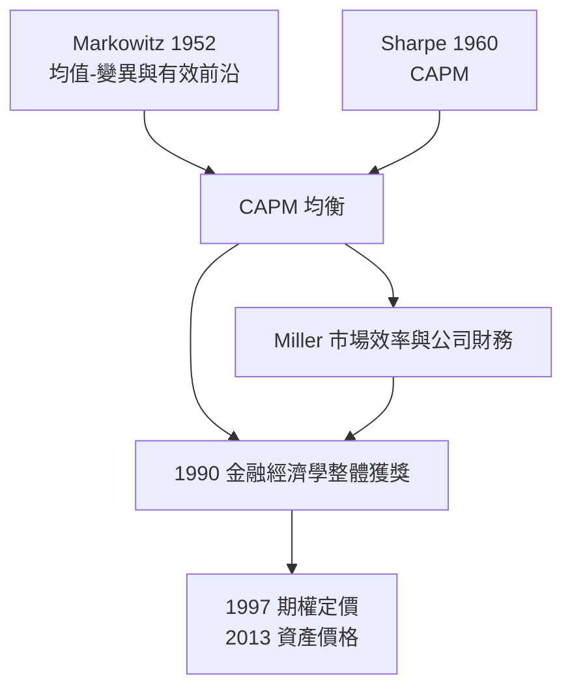

# 1990 · 懸案：金融市場的數學——風險、組合與價格

> **1990 諾貝爾經濟學獎（瑞典央行紀念獎）：哈里·馬科維茨 Harry Max Markowitz（美國，1927–2023）、默頓·霍華德·米勒 Merton Howard Miller（美國，1923–2000）、威廉·弗萊塞·夏普 William Forsyth Sharpe（美國，1928–2009）— 表彰他們「對金融經濟學理論的開創性貢獻」（for their pioneering contributions to the theory of financial economics）。**

---

## 懸案（案情提要）

戰後金融市場迅速膨脹，但經濟學對它的理解還停留在「中介機構的簿記」。三道必答題：

1. **風險如何量化、如何定價？** 收益不可預測，投資者要的不只是平均回報，還有「波動」的補償。沒有波動的語言，風險溢價無從談起。
2. **投資組合怎麼選？** 若把錢全押在最高回報的資產上，可能整體破產——分散化能降低風險，那麼「最佳組合」在哪？市場價格與個人最優選擇如何調和？
3. **資本市場如何運作？** 誰發行、誰定價、風險如何在市場與個體間重新分配？「市場組合」是什麼？當市場有效時，經理人還有什麼用？

Markowitz–Miller–Sharpe 三人的答案，恰好構成了現代金融經濟學的三塊積木：**組合選擇 $\rightarrow$ 均衡定價 $\rightarrow$ 市場效率**。

---

## 前因

| 年份 | 事件 |
|---|---|
| 1952 | Markowitz 在芝加哥大學《雜誌》發表〈均值—變異投資組合選擇〉，提出**均值—變異分析** |
| 1953 | Markowitz 訪芝加哥大學，與 Miller、Sharpe 结成「芝加哥金融學派」 |
| 1958 | Markowitz〈投資組合選擇〉；Sharpe 發展 **CAPM**；Miller 的 MM 定理（1985 案） |
| 1960 | Sharpe《資本市場理論》（Capital Market Theory）問世 |
| 1961 | 哈佛商學院設立首個金融學博士班 |
| 1964 | Sharpe 論證「資本市場線」的實證存在；60 年代的美國機構投資者（共同基金、養老金）大爆發 |
| 1965 | Black–Scholes 期權定價模型（1997 案的主線） |
| 1969 | Sharpe 與 Mossin（1966）論證組合理論的一致性；Mossin 1971 論證市場均衡下的最優決策 |
| 1970s | 有效市場假說（EMH）成為主流；CAPM 對個股收益的解釋力被爭議（1977 年的黑箱「$\beta$ 謎」） |
| 1990 | 三人共享經濟學獎——史上第一次「金融經濟學」整體獲獎 |

---

## 調查

### 線索一：Markowitz——均值—變異與「有效前沿」

馬科維茨的起訴書：投資者真正在意的是**收益的均值與變異**，而非單一資產。設權重 $\mathbf{w}$（$\sum_i w_i = 1$），則投資組合的期望收益與變異為：

$$
\mathbb{E}[R_p] = \mathbf{w}^{T} \boldsymbol{\mu}, \qquad \sigma_p^2 = \mathbf{w}^{T} \boldsymbol{\Sigma} \mathbf{w}
$$

其中 $\boldsymbol{\Sigma}$ 是資產收益的協方差矩陣——**風險不是資產的屬性，而是資產之間關係的屬性**。這是全案最深刻的物理學式洞察：兩項各高風險的資產，若負相關，組合風險可以低於任一單項。

在 $\mathbb{E}[R_p] \geq \mu_{\min}$ 的約束下最小化 $\sigma_p^2$，得到一組「有效前沿」組合：

$$
\min_{\mathbf{w}} \mathbf{w}^{T} \boldsymbol{\Sigma} \mathbf{w} \quad \text{s.t.} \;\; \mathbf{w}^{T} \boldsymbol{\mu} = \mu_p, \;\; \mathbf{1}^{T}\mathbf{w} = 1
$$

一階條件給出著名的權重公式：

$$
\mathbf{w}^{*} = \boldsymbol{\Sigma}^{-1} \boldsymbol{\mu} \cdot \frac{1}{\mathbf{1}^{T} \boldsymbol{\Sigma}^{-1} \boldsymbol{\mu}}
$$

**分散化的定理**：若有 $n$ 項資產的期望收益相同、風險（標準差）皆為 $\sigma$ 且彼此**獨立**，組合風險為

$$
\sigma_p = \frac{\sigma}{\sqrt{n}}
$$

——風險以 $\sqrt{n}$ 的速度下降。這就是「免費午餐」的來源，也是保險業、資產負債管理與風險資本模型的基礎。

### 線索二：Sharpe——資本市場線與 CAPM

夏普的問題是：分散化到極致會得到什麼？答案是**市場組合**：當允許借入無風險資產 $R_f$，投資者的最優組合沿一條直線（資本市場線 CML）移動：

$$
\mathbb{E}[R_p] = R_f + \frac{\mathbb{E}[R_p] - R_f}{\sigma_p} \sigma_p
$$

夏普接著問更難的：市場均衡時，**單項資產**的期望收益與風險什麼關係？他給出 **CAPM（資本資產定價模型）**：

$$
\mathbb{E}[R_i] = R_f + \beta_i \left( \mathbb{E}[R_M] - R_f \right), \qquad \beta_i = \frac{\operatorname{Cov}(R_i, R_M)}{\operatorname{Var}(R_M)}
$$

**$\beta$ 是對市場的系統性風險暴露**。CAPM 的三項假設：投資者為風險厭惡且均值—變異偏好；投資者為單一期間且可無限制借貸；所有投資者對期望收益與協方差有同質預期。

推論（CAPM 的效率命題）：任何資產都應位於**證券市場線（SML）**上：

$$
\frac{\mathbb{E}[R_i] - R_f}{\sigma_i^2} = \text{常數}
$$

否則存在套利組合。這把「均衡價格」的概念帶入金融：價格由風險與收益的均衡關係決定，個人風格選擇在市場中轉化為對市場組合的複製。

### 線索三：Miller——公司財務與市場有效性

Miller 的貢獻在兩處：

1. **MM 定理（1985 案）**：資本結構無關性，說明公司金融決策必須回到**真實投資決策**上——這是現代公司金融「投資決定論」的源頭；
2. **市場有效性與訊號**：Miller（1970,《金融雜誌》）提出，公司若掌握內部資訊，可以透過**股利政策**傳遞訊號；市場價格雖不反映全部資訊，但足以使管理層無法系統性誤導投資者——這是「半強式效率」的表述先聲。

Miller 還以「制度與金融創新」為題發表著名的市場有效性檢驗文獻，開啟了**事件研究**（event study）方法：檢驗股價在事件（如併購公告）前後的走勢以推斷市場是否已消化訊息。

### 線索四：CAPM 的實證難題與後續修正

CAPM 的最大實證問題是「$\beta$ 謎」：CAPM 預測單項收益只由 $\beta$ 決定，但實證上股票的超額收益對 $\beta$ 的解釋力極低（Black–Jensen–Scholes 1972）。修正方向包括：

- **Fama–MacBeth 橫截面回歸**：先算每一期的 $\lambda_t$，再對 $\beta$ 平均；
- **多因子模型**（APT, Ross 1976）：收益由多個因子暴露解釋；
- **APT 的無套利邏輯**：$n$ 資產的套利組合空間有 $n-1$ 個維度，零 $\beta$ 組合必須期望收益為零；
- 2013 年 Fama–Hansen–Shiller 案將回到這條線索（本書續寫中）。

---

## 理論裁決

**裁決一**：風險是**方差**，投資問題是均值—變異下的最優化；有效前沿由協方差矩陣決定：

$$
\min_{\mathbf{w}} \mathbf{w}^{T} \boldsymbol{\Sigma} \mathbf{w} \quad \text{s.t.} \;\; \mathbf{w}^{T} \boldsymbol{\mu} = \mu_p
$$

**裁決二**：分散化使風險以 $\sqrt{n}$ 速率下降（獨立情形），組合風險由協方差結構決定。

**裁決三**：市場均衡下，期望收益由**系統性風險暴露**線性定價：

$$
\mathbb{E}[R_i] = R_f + \beta_i \left(\mathbb{E}[R_M] - R_f\right)
$$

**裁決四**：價格與風險的均衡關係意味著**沒有免費的異常收益**（有效市場的第一原理）；公司金融決策的價值只能來自真實決策。

**裁決五**：制度與金融創新會持續製造新的可套利機會——市場有效是**動態的**，不是一次性定理。

---

## 後果

| 領域 | 影響 |
|---|---|
| 政策應用 | 退休基金的資產配置與風險預算；銀行與保險的資本充足與風險管理框架；1990s 金融改革與 2008 巴塞爾協定的風險模型基礎 |
| 學術 | 金融經濟學成為最大的新學科；事件研究成為企業金融與政策評估的標準工具 |
| 實務 | 指數基金與被動投資的理論依據（CAPM 的市場組合 $\rightarrow$ 追蹤誤差最小化）；風險平價與波動目標策略 |
| 後續諾獎 | 1985 Modigliani–Miller（資本結構）、1997 Merton–Scholes（期權定價）、2013 Fama–Hansen–Shiller（資產價格的實證）、2020 Milgrom–Wilson（拍賣理論） |
| 爭議 | CAPM 的 $\beta$ 謎、效率市場的三種形態（弱、半強、強）之爭、2013 年 Fama 與 Shiller 同時獲獎卻主張相反的「矛盾對決」 |

---

## 關聯

- [1981-Tobin托賓q與金融市場](1981-Tobin托賓q與金融市場.md)：分離定理與風險承受的制度安排，CAPM 的思想前輩。
- [1985-Modigliani生命週期與MM定理](1985-Modigliani生命週期與MM定理.md)：Miller 的一半證詞。
- [1997-Merton與Scholes期權定價](1997-Merton與Scholes期權定價.md)：從 CAPM 到動態定價（本書續寫中）。
- [2013-Fama-Hansen-Shiller資產價格](2013-Fama-Hansen-Shiller資產價格.md)：CAPM 的實證終審（本書續寫中）。
- [2020-Milgrom與Wilson拍賣理論](2020-Milgrom與Wilson拍賣理論.md)：市場機制設計的現代版（本書續寫中）。
- [1989-Haavelmo概率論基礎](1989-Haavelmo概率論基礎.md)：金融實證估計的統計地基（本書續寫中）。
