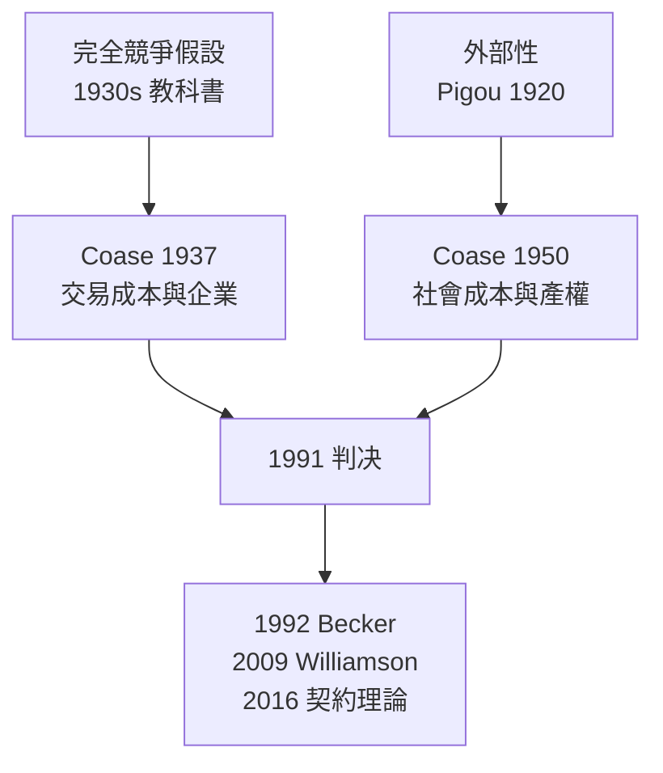

# 1991 · 懸案：市場在哪裡結束、公司從哪裡開始？

> **1991 諾貝爾經濟學獎（瑞典央行紀念獎）：羅納德·哈里·科斯 Ronald Harry Coase（英國，1910–2013）— 表彰他「對交易成本與產權理論的開創性貢獻，以及他對社會成本問題的論證」（for his pioneering contributions to the theory of transaction costs and property rights and for his work on the social cost problem）。**

---

## 懸案（案情提要）

科斯 1937 年的問題至今仍是經濟學最反直覺的一題：

> **如果市場如此神聖，為什麼還有公司？** 既然價格可以協調一切，為何工人不直接向顧客供應服務、股東不直接雇傭工人？

疑點還有兩層：

1. **交易有成本嗎？** 如果沒有交易成本，市場配置就是最優的——但現實中每一次交易都要「打電話、談合約、驗貨」。這些摩擦成本從何而來、量級多大？
2. **產權與外部性怎麼分配？** 一項活動（如工廠污染）影響他人，但市場不會自動把這部分影響計價；那麼**誰該負責、補償多少**？這是「社會成本」問題。

科斯的答案是：**市場不是無摩擦的，產權安排是有成本的，而制度選擇本身可以被經濟學分析**。

---

## 前因

| 年份 | 事件 |
|---|---|
| 1910 | 科斯生於英國 Willesden；1932 年獲 LSE 博士學位 |
| 1931–1933 | 受雇於倫敦經濟學院推廣委員會（現 LSE），研究工業與公共事業 |
| 1932 | 與 Black 的「壟斷與競爭」對話發表；提出「可競爭市場」的直覺 |
| 1934 | 工業與公共事業調查報告：著手研究**自然壟斷**（電信、供水） |
| 1937 | 〈論經濟學的問題〉（The Nature of the Firm）：「公司的性質」一文問世——**市場與組織的邊界** |
| 1950 | 〈社會成本問題〉發表：**外部性與產權** |
| 1960 | 《價格理論與經濟政策》；論「可競爭市場」與自然壟斷的管制 |
| 1964 | 移居美國，芝加哥大學法學院——跨學科位置 |
| 1982 | 中國制度改革的對話（1984 年 visits 中國是常被引用的事件） |
| 1991 | 得獎；1991 年 9 月《經濟學人》有專文訪談 |

---

## 調查

### 線索一：公司為何存在——「替代成本」與指揮

科斯的第一份證詞來自對工廠內部的觀察：一台機器放在工廠裡由操作員使用，和放在街上等著被買走，**成本不同**。前者不需要「找到交易對象」；後者需要廣告、談判、運輸、檢驗。於是：

$$
\text{企業存在的理由} = \text{市場交易的替代成本} > \text{內部協調成本}
$$

而企業內部的協調靠**指揮**（authoritative allocation of resources）——這是科斯對組織經濟學最根本的洞察：市場是**價格機制**，企業是**權力機制**。兩者的邊界由成本比較決定：

$$
\text{邊界：} \quad \text{內部化成本} = \text{外部市場成本}
$$

此外還有「界定企業邊界」的第二個原理（科斯 1937 的常被忽略部分）：企業規模的上限，由於某種要素的**供給價格**在一定規模後會上升（如管理人員的招募成本），以及企業內部協調成本的遞增。

### 線索二：交易成本是什麼——可辨識的四類成本

科斯後來把「交易成本」拆解成可辨認的項目（後由 Williamson 1999 案系統化）：

1. **搜尋成本**：找到合適的交易對象；
2. **議價成本**：談定價格與條件；
3. **決策成本**：在達成協議後仍需確認對方是否履約；
4. **執行成本**：確保履約、處理違約。

關鍵的量化洞見：**交易成本的存在意味著「權利」是有價值的**。若契約完全可執行、成本為零，權利分配無關緊要；正因為權利執行有成本，「**誰擁有權利**」才成為有意義的經濟設計問題。

### 線索三：社會成本問題——外部性不是外生，而是被界定的

1950 年《社會成本問題》的著名開篇：**蜜蜂與果樹**。養蜂人與果農都從鄰居的養蜂中受益，卻無人協調。這被稱為「正外部性」的經典例證。

科斯的論證過程分三步：

**第一步：問題的本質重述**。污染的「問題」不是「污染存在」，而是**誰有權利污染、誰承擔損失**。他把問題從技術層面（如何減少污染）轉到**權利層面**（誰該有權利、補償多少）。

**第二步：提出定理**（科斯定理）：若**交易成本為零**（或足夠低）且權利可以自由轉讓，則財富的最大化結果與初始權利分配**無關**：

$$
\text{若} \; T_c = 0 \;\Longrightarrow\; \text{資源配置效率與 } \text{權利分配無關}
$$

**第三步：承認現實，並轉向制度比較**。現實中交易成本為正，所以初始權利分配**確實影響**效率。此時問題變成：給定交易成本與在不同權利配置下的社會成本，**哪一種配置更好**：

$$
\min_{\text{權利配置}} \; \text{社會成本} = \text{交易成本}(\text{配置}) + \text{外部損害}(\text{配置})
$$

這就是把外部性內生化為**制度比較問題**——這正是 1990s 以後美國 Clean Air Act 排污權交易制度、美國聯邦土地「保育 vs 開發」聽證會背後的經濟學骨架。

### 線索四：可競爭市場與自然壟斷——管制經濟學的雛形

科斯 1974 年在《經濟學人》發表的「可競爭市場」思想，回答了 1930s 留下的難題：自然壟斷（供水、電信）該如何管制？若市場高度**可競爭**（潛在進入者很多、進入容易），即使在位者享有規模經濟，**威懾**也會把價格壓到平均成本：

$$
P = MC \quad (\text{可競爭市場的定價後果})
$$

這是 1980s 美國解除管制（天然氣、航空、電信）的理論底牌之一；也是 2014 年 Tirole 案（產業組織與管制）的直接前案。

### 線索五：科斯與中國——制度變革的經濟學

科斯 1992 年《經濟學人》訪問中國時提出：中國的改革之所以可能，是因為**地方試點**提供了制度試驗的機制（雙軌制、價格雙軌）——這是把科斯式「交易成本」思維直接套在制度轉型上。他主張：**制度是經濟分析的對象，而不是經濟分析的背景**。

---

## 理論裁決

**裁決一**：市場不是免費的。**交易成本為正**，因此「市場 vs 企業」是成本比較問題，而非效率教條問題：

$$
\text{企業邊界：} \quad \text{內部協調成本} \stackrel{?}{=} \text{外部交易成本}
$$

**裁決二**：組織（企業）是**權力機制**，市場是**價格機制**；兩者都是配置資源的可行技術。

**裁決三**：外部性的真正問題是**權利的初始界定與執行成本**，而非「污染本身」：

$$
\min \; \underbrace{T_c(\text{配置})}_{\text{交易成本}} + \underbrace{D(\text{配置})}_{\text{外部損害}}
$$

**裁決四**：**科斯定理**（交易成本為零時，效率與權利分配無關）是所有外部性理論的基準線；**科斯定律**（交易成本為正時，一切皆制度）是實務的起點。

**裁決五**：可競爭市場中，在位者的規模經濟並不必然導致高價格——潛在進入的威懾具有管制效果。

---

## 後果

| 領域 | 影響 |
|---|---|
| 政策應用 | 排污權交易、水權、頻譜拍賣（2020 案）、碳市場（2018 案）、美國保育聽證會的「補償標準」；網路 neutrality 與平台治理中的「守門人」議題 |
| 學術 | 交易成本經濟學（Williamson 1985《經濟制度與法律》、2009 得主）、產權經濟學（Demski 與 Foss 的產權經濟學學派） |
| 企業理論 | 企業邊界、縱向一體化、多層次公司的治理結構 |
| 爭議 | 科斯定理常被誤用為「外部性不是問題」；交易成本的**可測性**備受批評（Hardin 的「可測量的才是經濟學」）；Coase 定理在法學上被深化為「規範的效率基礎」（Kaplow 1992） |
| 跨學科 | 法與經濟學的整合；2010s 的「法與經濟學」課程體系化 |

---

## 關聯

- [1975-Kantorovich與Koopmans資源配置](1975-Kantorovich與Koopmans資源配置.md)：配置理論的線性版本，與產權理論互補。
- [1982-Stigler管制與資訊經濟學](1982-Stigler管制與資訊經濟學.md)：企業存在問題的接續提問者與管制理論對照。
- [2009-Ostrom與Williamson治理](2009-Ostrom與Williamson治理.md)：交易成本與治理結構的完整化（本書續寫中）。
- [2014-Tirole產業組織與管制](2014-Tirole產業組織與管制.md)：可競爭市場與自然壟斷的現代版（本書續寫中）。
- [2018-Nordhaus與Romer長期增長](2018-Nordhaus與Romer長期增長.md)：碳定價即科斯式產權設計的全球實踐（本書續寫中）。
- [2020-Milgrom與Wilson拍賣理論](2020-Milgrom與Wilson拍賣理論.md)：用拍賣分配稀缺的另一種產權實現（本書續寫中）。
