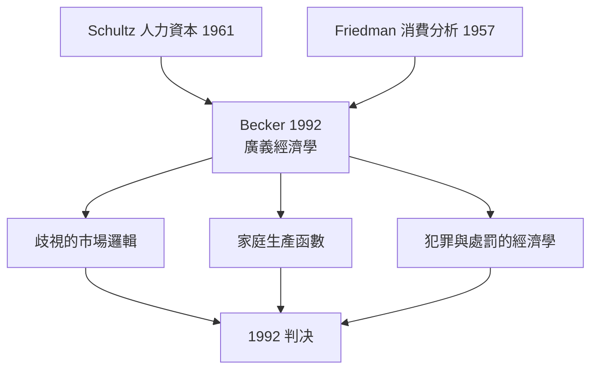

# 1992 · 懸案：歧視、家庭、犯罪與「非市場行為」，能用同一套經濟學偵查嗎？

> **1992 諾貝爾經濟學獎（瑞典央行紀念獎）：加里·斯坦利·貝克 Gary Stanley Becker（美國，1930–2014）— 表彰他「將經濟分析的新領域擴展到人類行為的廣泛層面，特別是歧視、家庭與人類資本的經濟學」（for extending the scope of economic analysis to a wide range of human behavior, notably discrimination, family and human capital）。**

---

## 懸案（案情提一）

經濟學的邊界一直有一條「不該踏入」的警戒線：**非市場行為**。歧視、家庭、犯罪、成癮——這些被劃給社會學、心理學、道德哲學。

貝克 1992 年的判詞打破這條線，方法是極其激進的：**只要行為人面對邊際收益與邊際成本的比較，經濟學的邏輯就適用**。由此他處理了四樁舊案：

1. **歧視**：市場歧視（麥當勞不僱用黑人）與非市場歧視（歧視性標籤）如何區分？歧視是否「不划算」因而被市場淘汰？
2. **家庭**：為何人們結婚生育？如何用「家庭生產函數」解釋？為何越是有錢的家庭孩子越多（貝克-curves）？
3. **人力資本**：教育與健康是消費品還是投資品？歧視的存在如何改變教育回報的性質？
4. **犯罪**：理性選擇模型能否解釋「為何犯罪率會變動」？

---

## 前因

| 年份 | 事件 |
|---|---|
| 1930 | 貝克生於賓州；父親從事穀物生意 |
| 1948 | 芝加哥大學學士（哲學與政治科學）；1951 年博士（經濟學） |
| 1955 | 貝克的「競爭性歧視」理論推翻純粹 tastes-based 歧視觀：歧視在市場中要付出代價 |
| 1956 | 賽車事故與駕駛員的「邊際效應」分析（risk-absorbing ability） |
| 1957 | 《人力資本與美國經濟：教育與經濟成長的理論與實證》（與 T. W. Schultz 合著） |
| 1960 | 博士論文《生產力的變化》（PhD thesis on productivity changes） |
| 1962 | 《勞動經濟學中的不歧視》（與 Ashenfelter 合著）；《教育與選擇》 |
| 1965 | 〈家庭行為與理性選擇的經濟學理論〉；「非市場行為」的經濟學綱領 |
| 1966 | 《犯罪與處罰：經濟學的初步研究》（Crime and Punishment: An Economic Approach） |
| 1970s | 貝克—博南（Bonner）的人力資本與犯罪研究；「反貧民化」的激進政策主張 |
| 1980s | 貝克關於家庭、歧視、種族偏見的演說引發爭議，被批「將人類苦難經濟化」 |
| 1992 | 得獎 |

---

## 調查

### 線索一：歧視——一個「殘酷但有效」的偵查

貝克的起訴：將歧視拆成兩類。

**市場歧視**（雇主拒絕僱用某族群）：雇主放棄**利潤**去歧視，因此是**自願且昂貴**的行為。若雇主成本為 $c$、被歧視者的生產力為 $E$（$E < c$），歧視是有利可圖的；若 $E > c$，歧視在競爭中不可持續：

$$
\text{競爭性歧視} \Rightarrow \text{歧視者必須是「非競爭者」}
$$

這解釋了 1960s 美國南部「白人卡車司機罷工抵制」等事件——當歧視者能聯合封鎖市場時，歧視得以持續。

**非市場歧視**（歧視性偏見滲入消費與社交）：雇主歧視的代價在「tastes」裡，市場無法根除。

更尖銳的一點（貝克 1970s–90s 的公共政策主張）：**歧視的存在會改變人力資本的性質**。若雇主歧視，黑人進入白人的高報酬職業受到阻礙，此時文憑的信號價值下降，人力資本投資的私人回報下降，於是投資不足——形成「歧視 $\rightarrow$ 低教育 $\rightarrow$ 低生產力 $\rightarrow$ 更高歧視」的**動態循環**（Myrdal 1944 的循環累積因果，微觀版）。貝克因此主張**平權行動（affirmative action）**在經濟上是合理的：它提高被歧視群體的人力資本投資回報。

### 線索二：家庭——「家庭生產函數」

貝克把家庭視為生產函数：成員的時間與商品投入，產出「健康的小孩」與「家庭服務」：

$$
\max_{z_i, t_i} \; U \big( z_1, z_2, \dots, z_n, h \big) \quad \text{s.t.} \; \sum_i t_i = T, \;\; \sum_i p_i z_i = w \cdot \sum_i t_i
$$

其中 $z_i$ 為商品（教育、健康、陪伴），$h$ 為小孩的「品質」（可用 IQ 或學校成績代理）。

推論（貝克最有名的經驗發現——「Becker curves」）：**母親的教育程度越高，孩子數越多**（與傳統貝克曲線在 1970s 的發現方向相反，後續研究顯示隨女性工資與避孕普及而反轉）。這一發現的政策含義重大：既然教育提高孩子的「品質」與母親的收入能力，公共政策不應只提供兒童服務（會提高婦女邊際收益），也應降低**受教育的婦女**的育兒成本。

家庭時間配置的一階條件給出「工資—時間影子價格」：

$$
\frac{\partial U}{\partial z_i} = \lambda p_i, \qquad \frac{\partial U}{\partial t_i} = \lambda w
$$

### 線索三：人力資本——投資品與消費品

貝克（與 Schultz 1964 合著）區分兩種人力資本支出：

- **消費型**（當期健康、娛樂、子女教育時間）：不影響未來生產力；
- **投資型**（學歷、職業訓練、醫療）：提高未來工資與產出。

判斷準則是**報酬率**：

$$
\text{人力資本投資} \Longleftrightarrow \text{未來工資流的現值} > \text{成本}
$$

在完美市場與完全信息下，人力資本投資率應滿足內部收益率等於市場利率：

$$
r_{\text{教育}} = r_{\text{其他投資}}
$$

貝克特別關注**歧視與不確定性如何扭曲這個等式**：若未來工資面臨歧視風險，教育投資的回報下降，人力資本投資不足——這是他主張「推翻歧視」的核心經濟學理由。

### 線索四：犯罪——把違法也當作效用最大化

《犯罪與處罰》的基本模型：個體在合法活動（工資 $w$）與犯罪（被捕機率 $p$、罰金 $f$、非法收益 $u$）之間比較期望效用：

$$
\mathbb{E}[U_{\text{合法}}] = w, \qquad \mathbb{E}[U_{\text{犯罪}}] = u - p f
$$

因此犯罪發生的條件：

$$
u > w + p f \quad \Longrightarrow \text{犯罪}
$$

關鍵的政策推論（1970s 美國的「防範性逮捕」實驗與貝克的「邊際打擊」建議）：**執法應集中在高機率、高收益的犯罪群體**（「三元組合」：容易逮捕、罪行嚴重、 criminals 常被逮捕），並非一律加重刑罰。貝克甚至論證：若逮捕率提高， criminals 會從「高收益低被捕」轉向「低收益高被捕」的領域——犯罪構成會變化，這是犯罪經濟學的供給側。

### 線索五：理性選擇的擴張與它的界線

貝克的方法論宣告：經濟學是「選擇的科學」，適用於一切有替代方案與機會成本的領域：

$$
\text{適用性判準：} \quad \text{目標} + \text{約束} + \text{選擇} + \text{機會成本}
$$

但他也明確畫出界線：無法用「成本效益」處理的是**規範問題**（應不應該 eugenics?），貝克本人在「優生學與種族歧視」的演講中曾主張經濟學分析優生學的「效率」，此舉在 1990s 引發激烈批判，被視為本獎史上最著名的爭議插曲之一。

---

## 理論裁決

**裁決一**：**市場歧視是有價格的**——它要由歧視者付錢，因此持續存在的歧視需要**市場力**（進入門檻或非競爭性結構）：

$$
\text{歧視持續} \Rightarrow \text{歧視者獲得非競爭性優勢}
$$

**裁決二**：家庭是**生產單位**；時間與商品是產出的投入；教育與健康是**對小孩品質的投資**。

**裁決三**：人力資本是**帶有歧視溢價與風險溢價的資產**；歧視降低其私人回報，因此反歧視具有經濟學的效率論證。

**裁決四**：犯罪是**邊際機會成本被低估**的結果；執法的最優配置是選擇性執法，而非普遍加刑。

**裁決五（範圍宣言）**：經濟學的分析對象是**一切選擇**；規範判斷不可被經濟學取代——但經濟分析可以為規範討論提供代價的帳單。

---

## 後果

| 領域 | 影響 |
|---|---|
| 政策應用 | 平權行動與歧視立法的經濟學論證；最低工資與婚姻效應（負面收入效應）的研究；教育與健康投資政策；「犯罪」的經濟學分析（貝克–古學 2014 書的翻譯引發的中國公共討論） |
| 學術 | 家庭經濟學、人力資本經濟學、歧視經濟學成為一級領域；時間使用調查（ATUS）與家庭生產函數模型 |
| 爭議 | 貝克的優生學與「族群IQ」相關言論（1994 年美國科學院公開信、1995 年貝克道歉）使本獎承受空前輿論壓力；「將歧視與家庭經濟化」的批評延續至今 |
| 方法論影響 | 2010s 的「因果推斷革命」大量使用家庭層面資料（兒童hood 長期追蹤、兄弟姐妹對照），正是家庭經濟學的資料傳統 |
| 後續諾獎 | 2015 Deaton（消費與貧困的家庭層面資料）、2016 契約理論、2019 RCT 三人組（家庭與健康）、2021 Card（勞動供給與歧視） |

---

## 關聯

- [1979-Lewis與Schultz發展經濟學](1979-Lewis與Schultz發展經濟學.md)：人力資本理論的直系前案（Schultz 是共同作者）。
- [1976-Friedman貨幣主義與永久收入](1976-Friedman貨幣主義與永久收入.md)：消費理論的同一貝克系譜。
- [1986-Buchanan公共選擇理論](1986-Buchanan公共選擇理論.md)：把經濟學推向家庭與市場之外的平行嘗試。
- [2015-Deaton消費與貧困](2015-Deaton消費與貧困.md)：家庭消費與福利的當代量測（本書續寫中）。
- [2021-Card-Angrist-Imbens因果推斷](2021-Card-Angrist-Imbens因果推斷.md)：歧視與勞動市場的因果識別（本書續寫中）。
- [2001-Akerlof-Spence-Stiglitz不對稱信息](2001-Akerlof-Spence-Stiglitz不對稱信息.md)：歧視作為信息問題的另一條線（本書續寫中）。
