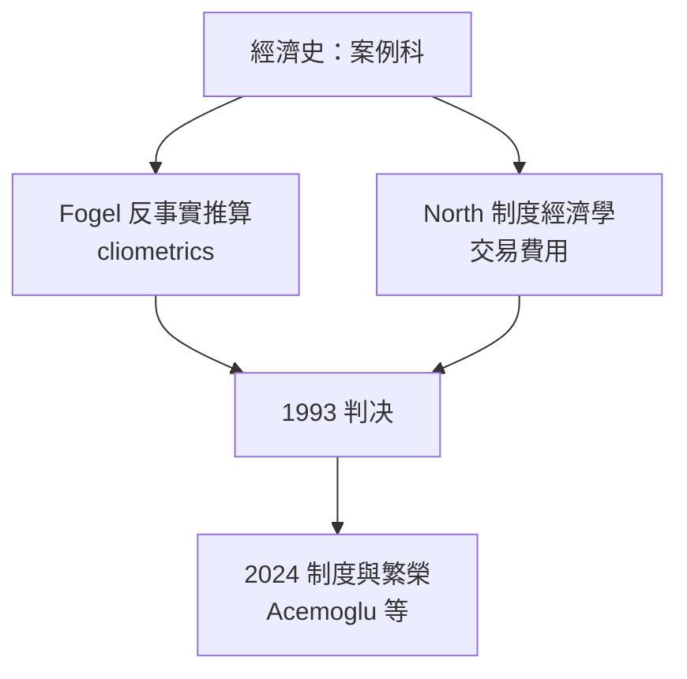

# 1993 · 懸案：歷史能不能被「檢驗」？制度是外生還是變因？

> **1993 諾貝爾經濟學獎（瑞典央行紀念獎）：羅伯特·威廉·福格爾 Robert William Fogel（美國，1926–2013）與道格拉斯·塞西爾·諾斯 Douglass Cecil North（美國，1920–2015）— 表彰他們「以經濟理論與數量方法重新開啟經濟史研究，用以解釋經濟與制度的變遷」（for having renewed research in economic history by applying economic theory and quantitative methods in order to explain economic and institutional change）。**

---

## 懸案（案情提要）

經濟史長期是經濟學的「案例科」：拿來做個案、教學案例，但**不產生可累積的知識**。兩位偵探面對的是同一組質問：

1. **歷史能被檢驗嗎？** 過去只發生一次，樣本量為一——如何做「可反駁的」研究？若是純敘事，「鐵路帶來鐵路時代」這類說法永遠無法被否證。
2. **制度是什麼？** 產權、法院、合約執行——這些「無形」的安排決定了經濟績效，卻難以測量、難以歸因。
3. **反事實問題**：如果沒有鐵路，美國的經濟會怎樣？如果奴隸制度被廢除，棉花產業會崩潰嗎？歷史的因果主張本質上是**反事實的**（counterfactual），必須能被構造與檢驗。

福格爾與諾斯分別給出答案：**福格爾**用「反事實推算」（cliometrics）把歷史變成可檢驗的因果命題；**諾斯**用「制度」把歷史變成可解釋的理論對象。

---

## 前因

| 年份 | 事件 |
|---|---|
| 1948–1950 | 諾斯在倫敦政治經濟學院（與科斯、Hayek 同校） |
| 1950–1952 | 諾斯參與《政治經濟學年鑑》Vol. 4 的價格史研究 |
| 1951 | 福格爾在約翰霍普金斯大學取得經濟學博士學位 |
| 1959 | 福格爾〈鐵路的興起與美國經濟成長〉：**「鐵路永遠必要」的傳統觀點被量化駁斥** |
| 1960 | 諾斯《美國經濟史新觀點》 |
| 1961 | 諾斯參與《經濟學報》「制度經濟學」專號；與 Thomas 合作〈美國經濟的制度結構〉 |
| 1963 | 福格爾與 Engerman 合著《Time on the Cross》——**奴隸制經濟的量化重估** |
| 1966 | 諾斯為《經濟學報》撰寫「制度經濟學」文章（1966，後收於 1968 年《經濟學中的制度與制度變遷》） |
| 1973 | 諾斯與 Thomas 編《制度變遷與經濟成長》 |
| 1974 | 福格爾與恩格曼《黑人與白人奴隸制度下的奴隸經濟》；諾斯《大躍進》 |
| 1981 | 福格爾《時間的十字架再檢視》；諾斯《經濟結構的變遷》 |
| 1986 | 諾斯《理解經濟變遷》（Structure and Change in Economic History） |
| 1993 | 得獎——經濟學獎史上首次由**經濟史學家**獲得 |

---

## 調查

### 線索一：福格爾的反事實——「鐵路真的必要嗎？」

傳統敘事：鐵路的興起帶動了美國農業與工業成長。福格爾的偵查方法：**不使用反事實，而是使用「經濟上有意義的比較對照」**——

1. **有鐵路的市場 vs 沒有鐵路的市場**（1817–1860 年約 2,000 個鄉鎮樣本）：有鐵路的鄉鎮農業生產力顯著更高——但這只是相關性；
2. **穀物價格的地區差異**作為工具：無鐵路地區的穀價較低（運輸成本高），穀價差反映「接駁鐵路的價值」；
3. **替代性假說的檢驗**：若鐵路帶來的是「一般性帶動效應」（任何帶來需求的技術都會），則「有鐵路的鄉鎮」與「有運河的鄉鎮」在生產力上應無差別。實證發現：**運河的效應遠小於鐵路**，鐵路的效應來自**降低運輸成本**這一特定機制。

他的統計方法後來被稱為「cliometrics」（cliometrics，計量經濟史）——把經濟學的推論與計量的識別技術帶進歷史。

### 線索二：奴隸制的經濟學——一次「人體經濟」的清算

《時間的十字架》（Time on the Cross, 1963）是本案的震央。福格爾以大量莊園記錄（ birth/death/marriage logs）計算：黑奴的經濟價值約等於其**養育至工作年齡的 costs** 加剩餘：

$$
\text{奴隸價值} = \sum_{t} \frac{(\text{成年後年均產出} - \text{養育成本})}{(1+r)^t} + \text{終身僱傭的殘值}
$$

發現：1860 年南方黑奴的年收入僅約 **$200**，遠低於北方自由勞動者（$700–$1,200）；且奴隸的營養、衣著與醫療支出極低，壽命遠低於自由人口。因此：

- **奴隸制在純粹經濟上並不「有效率」**——即便在「效率是唯一標準」的框架下，奴隸的邊際產出也低於自由勞動；
- 但奴隸制之所以延續，是因為**南方白人在政治上把奴隸的收益外部化**（奴隸的社會成本由全體黑人承擔）。

這是經濟學史上最有力的一次「把人當變數」的量化清算，也是後世奴隸制賠償討論與種族正義經濟學的基礎。

### 線索三：諾斯的「制度」——把治理結構放進模型

諾斯 1993 年的授獎辭詞中，「制度」被定義為「決定交易的規則與程序」。他的核心問題：**為什麼有些社會能創造出高水準的經濟活動，有些不能？** 答案不是資源、不是地理、不是文化，而是**制度**。

諾斯的分析起於一個顯著的對照：美國 1787 年憲法後，在**自然資源貧乏**（無煤鐵、缺耕地）的新 England 反而爆發出工業革命；同時在世界其他地區存在類似自然禀賦的地區卻停滯。他的解答：

$$
\text{長期增長} = f(\text{制度：產權保護、合約執行、交易費用})
$$

並提出制度變遷的**非漸進性**：制度不是被「工程師」設計出來的，而是在**交易費用下降 $\rightarrow$ 新交易機會出現 $\rightarrow$ 制度創新 $\rightarrow$ 收益重排 $\rightarrow$ 政治交易者阻撓或支持**的過程中演化。

### 線索四：交易費用與「路徑依賴」

諾斯把科斯（1991 案）的交易成本概念引入歷史分析，並加上時間維度：制度一旦建立，會產生**既得利益者**與**非市場依賴**，從而形成路徑依賴：

$$
\text{制度變遷} \text{ 的速度} \;<\; \text{環境變化的速度}
$$

這解釋了「為何有些國家長期停留在低績效制度」：新技術出現後，舊制度的補貼者聯盟會阻撓調整——這正是 2024 年 Acemoglu 案的「制度滯後（institutional inertia）」命題的先聲。

### 線索五：諾斯的政治經濟學——「暴力潛在」與資產專有權

諾斯強調：經濟交易嵌入在**政治交易**中，後者決定前者的規則。而政治交易由「暴力潛在（potential violence）」的壟斷者所支配。這一洞見在 2024 年 Acemoglu 等人的「政治壟斷 vs 壟斷危機」框架中被明確繼承：

$$
\text{制度品質} \longleftarrow \text{精英的權力分配與約束機制}
$$

### 線索六：史料批判——「資料就是模型」

兩人都強調經濟史家的特殊負擔：**史料是被製造的**（莊園記錄為管理服務、教會記錄為勸善、統計為治理宣傳）。因此經濟史方法論的核心是**對史料本身做經濟學分析**：記錄者的激勵如何扭曲了數據？這是一種「資料的經濟學」（economics of data），與 1989 年 Haavelmo 案的「模型即假設」遙相呼應。

---

## 理論裁決

**裁決一**：歷史研究可以是有因果力的實證研究，前提是使用**經濟學的機制假設**與**計量的識別策略**（福格爾的「反事實推算」）。

**裁決二**：價值的量化能改寫公共敘事：奴隸制在純經濟效率上並不划算，其延續靠的是**政治外部性**——這意味著奴隸制的廢除是可能的，且代價被當時的敘事嚴重誇大。

**裁決三**：增長的根源是**制度**而非資源或地理；制度決定交易費用，因而決定創新與投資的私人回報。

**裁決四**：制度變遷是**非漸進的、政治性的**；既有制度的受益者會阻撓調整，因此制度的持續性需要靠權力結構的平衡，而非「好制度自然勝出」。

**裁決五**：史料需要被批判地使用；資料生成過程本身就是經濟學對象。

---

## 後果

| 領域 | 影響 |
|---|---|
| 學術 | 經濟史從案例科升格為「測量與理論的學科」；cliometrics 與新制度主義經濟史兩大流派成形 |
| 政策應用 | 制度設計與「漸進 vs 激進改革」的辯論（世界銀行的制度優先順序）；發展中國家的產權改革、破壞性創新研究 |
| 公共討論 | 奴隸制的經濟學清算成為種族正義與賠償討論的經濟學基礎；殖民制度的經濟學評價 |
| 爭議 | 福格爾的「奴隸制效率較高」說法被指為替奴隸制辯護；諾斯的「制度優先」被批為**循環論證**（制度好不好用經濟績效衡量，績效好又說制度好）——2024 年案的核心方法論爭議由此發端 |
| 後續諾獎 | 2004 Kydland–Prescott、2009 Ostrom–Williamson、2014 Tirole、2024 Acemoglu 等——「制度決定績效」的主線 |

---

## 關聯

- [1991-Coase交易成本與產權](1991-Coase交易成本與產權.md)：諾斯把科斯的交易成本與產權概念引入歷史變遷。
- [1973-Leontief投入產出矩陣](1973-Leontief投入產出矩陣.md)：福格爾的生產力測量承襲其學術血脈（福格爾師承 Simon Kuznets）。
- [1986-Buchanan公共選擇理論](1986-Buchanan公共選擇理論.md)：政治交易與規則制定的經濟學。
- [2009-Ostrom與Williamson治理](2009-Ostrom與Williamson治理.md)：治理結構的當代實證版（本書續寫中）。
- [2024-Acemoglu制度與繁榮](2024-Acemoglu制度與繁榮.md)：制度經濟學的現代終審（本書續寫中）。
- [1984-Stone國民帳戶體系](1984-Stone國民帳戶體系.md)：歷史重建所依賴的統計基礎（本書續寫中）。
