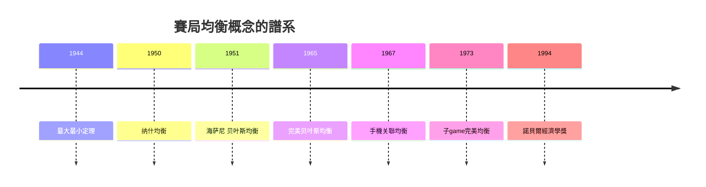

# 1994 · 懸案：幾個互相算計的人，會走向哪裡？

> **1994 諾貝爾經濟學獎（瑞典央行紀念獎）：約翰·福布斯·納什 John Forbes Nash Jr.（美國，1928–2015）、約翰·查爾斯·海薩尼 John Charles Harsanyi（匈牙利／美國，1920–2000）、萊因哈德·澤爾騰 Reinhard Selten（德國，1930–2016）— 表彰他們「對非合作賽局均衡理論的開創性貢獻」（for their pioneering contributions to the theory of non-cooperative equilibria）。**

---

## 懸案（案情提要）

舊經濟學的均衡是**一個人**面對價格。但現代經濟的許多場景是**多個人互相影響**：寡頭定價、軍備競賽、勞資談判、投標拍賣。此時「均衡」必須重新定義：

1. **什麼是均衡？** Walrasian 均衡是「沒有人能透過單方面改變決策獲利」。但在一個賽局裡，每個人的最優策略是相對於**他人的策略**而言的——於是均衡的定義要換成「沒有人能透過單方面改變策略而獲利」；
2. **均衡存在嗎？** 多人互動的均衡遠比單一市場的均衡難以證明，甚至可能**不存在**（澤爾騰的「最適回應對應」問題）；
3. **有許多均衡時，哪一個會實現？** 不同的均衡預測不同的結果（軍備競賽的高均衡與低均衡、銀行的擠兌均衡與流動性均衡）——需要「精煉」；
4. **信息結構如何影響？** 若一方比另一方更了解情況（海薩尼），均衡會怎樣改變？

1994 年的判決是本獎史上最具戲劇性的一次：**得獎者是數學家納什**（他本人當時已罹患嚴重的精神疾病，未能出席頒獎典禮），而委員會為此修改了獎項章程，把範圍從「經濟科學」改為涵蓋社會科學。

---

## 前因

| 年份 | 事件 |
|---|---|
| 1928 | 納什出生於美國藍田（Bluefield, West Virginia）；在《American Mathematical Monthly》發表兩篇博弈論論文（1950） |
| 1944 | von Neumann 與 Morgenstern《賽局理論與經濟行為》：零和賽局的極小極大定理 |
| 1950 | 納什發表〈多人賽局的均衡點〉（Equilibrium Points in N-Person Games）：**納什均衡定理** |
| 1951 | 海薩尼《Utility Theory for N-person Games》：**貝葉斯均衡**與不完全信息 |
| 1953 | 澤爾騰的「最優回應對應」與「手機關聯策略」 |
| 1965 | Harsanyi 與 Selten 合作建立**完美貝葉斯均衡**（PBE） |
| 1967 | 澤爾騰的**手機關聯策略**（ trembling-hand perfect equilibrium） |
| 1973 | 澤爾騰《A Generalization of the Nash Equilibrium Concept》：子game完美均衡（SPNE） |
| 1975 | Selten–Kreps 準perfect 均衡；J. Harsanyi 的「Bayesian 均衡」在拍賣與招標理論的應用 |
| 1980s | 實驗經濟學的興起（1982 芝加哥拍賣實驗）開始檢驗均衡預測 |
| 1994 | 得獎；委員會因 Nash 案修改章程，獎項範圍重新定義為社會科學；Nash 的故事成為全球性媒體事件（1998 年回憶錄《The Beautiful Mind》） |

---

## 調查

### 線索一：納什均衡——「沒有人能單獨獲益」的定義

納什的偵查起點：把賽局寫成**策略集合**的組合。$i$ 玩家的策略集 $S_i$、其他玩家的策略組合 $s_{-i}$；納什均衡是一組策略 $(s_1^{*}, \dots, s_n^{*})$，滿足：

$$
u_i(s_i^{*}, s_{-i}^{*}) \;\geq\; u_i(s_i, s_{-i}^{*}) \quad \forall s_i \in S_i, \;\forall i
$$

——**沒有人能靠單方面改變策略獲益**。

納什 1950 年的定理（以及他後來在 1951 年《美國數學月刊》的證明）：有限賽局必有納什均衡。證明路線是 **Kakutani 不動點定理**——把「最佳反應對應」$BR_i: S_{-i} \rightarrow S_i$ 組合成映射 $F$，在 $S = \prod_i S_i$ 上找不動點。

但納什真正的理論貢獻是**非合作與混合策略**：

1. **非合作**：每個玩家同時選擇，無法協商；
2. **混合策略**：允許隨機化，極大化「期望收益」。這解決了「猜拳」的悖論：純策略下沒有均衡，混合策略 $\left( \frac{1}{3}, \frac{1}{3}, \frac{1}{3} \right)$ 才是均衡。

這一整套架構後來發展出**潛在博弈（extensive form）**、**序列式理性（sequential rationality）**與**子博弈完美均衡（SPNE）**。

### 線索二：海薩尼——信息結構與「不完全信息賽局」

海薩尼的問題：納什均衡假設玩家知道彼此的「類型」（nature 抽籤後的私人信息）。但現實中每個人對情況的了解不同——**信息不對稱**。他用**貝葉斯式**方式建模：

- 自然（nature）先動作，選擇類型 $t_i \sim p(t_i \mid \theta)$；
- 每個玩家只看到自己的類型，形成** belief（信念）** $p(t_{-i} \mid t_i)$；
- 策略是「對每個可能的類型指定行動」的**完整計畫**。

海薩尼均衡：存在信念系統與策略，使得**在每一個類型上，策略是相對於信念的最佳反應**，且信念由貝葉斯法則更新（on-path）：

$$
u_i(a_i, t_i, p(t_{-i} \mid t_i)) \;\geq\; u_i(a_i', t_i, p(t_{-i} \mid t_i)) \quad \forall a_i'
$$

這個框架的經濟學果實是巨大的：**所有不對稱信息經濟學（保險市場、勞動市場、金融市場、拍賣）都建立在「類型—信念—行動」三層結構上**。2001 年 Akerlof–Spence–Stiglitz 案與 2007 年機制設計案都是這條線的直系後代。

### 線索三：澤爾騰——當均衡有很多個，「哪個會實現」？

澤爾騰指出：納什均衡的預測力不足，因為常常存在**許多**均衡（如「膽小鬼」博弈有兩個純策略均衡：高／低與低／高）。他提出兩套精煉：

**（一）子博弈完美均衡（SPNE, 1973）**：要求在每個**子博弈**（任何歷史節點之後的剩餘遊戲）都遵循納什均衡——即**序列式理性**：

$$
\text{SPNE} \Rightarrow \text{任何節點上都是最佳反應}
$$

這解決了「威脅的可信性」問題：如果某策略要求玩家在不可能到達的分支上做出非理性行為，該均衡被淘汰（例子：兒童話中的「誰先動」威脅）。

**（二）手機關聯均衡（trembling-hand perfect, 1967）**：均衡必須能由**微小的隨機誤差（hand trembling）**所產生的近似最佳反應極限得到。形式上，均衡 $\sigma$ 是 trembling-hand perfect，若存在一列完全混合策略序列 $\sigma^n$（每一份策略中每個行動都有一個趨於 0 但為正的機率），使得

$$
\sigma^n \in BR\left( \sigma^n \right), \qquad \sigma^n \to \sigma
$$

直觀：**每個策略都必須是「幾乎最佳反應」序列的極限**——這排除了那些只有在玩家願意犯下指定錯誤時才能維持的均衡。

### 線索四：均衡的「選擇」問題——設備選擇與貨幣

澤爾騰的另一個重要貢獻是**均衡選擇**：多均衡時哪一個被實現？他與 Selten 的「設備選擇裝置（device selection device）」給出制度性的答案：在特定歷史路徑下，一個均衡被選中；這套觀點在 2000s 被發展為**制度與貨幣**的理論。

### 線索五：實驗經濟學的檢驗（Vicky 與 1994 的現場）

1990 年代的實驗經濟學把賽局理論送上檢驗台：Ultimatum 博弈、囚徒困境、重複博弈。這些實驗結果既支持也挑戰均衡預測——特別是**最後通牒博弈中「太少也算太少」的拒絕**（對 $1/3$ 的分配有相當比例被拒絕），成為行為經濟學的重要證據（2002 年 Kahneman 案、2017 年 Thaler 案）。

---

## 理論裁決

**裁決一**：均衡的定義從「市場出清」改為「**最佳反應的不變性**」：

$$
u_i(s_i^{*}, s_{-i}^{*}) \geq u_i(s_i, s_{-i}^{*})
$$

並且**必然存在**（有限賽局）。

**裁決二**：不對稱信息必須以**類型—信念—行動**三層結構建模；均衡需滿足**信念更新**與**類型層面的最佳反應**（貝葉斯均衡）。

**裁決三**：多均衡必須被**精煉**：**子博弈完美**（序列式理性）排除不可信威脅；**手機關聯完美**排除依賴非理性微誤的均衡。

**裁決四**：均衡選擇是**制度與歷史**的函數；賽局論本身只給出可能性的集合。

**裁決五（歷史注腳）**：1994 年評審委員會因納什是數學家而備受批評，並因此修改章程，把經濟學獎的授獎範圍重新界定為涵蓋社會科學——這是本獎制度史上的一個轉折點。

---

## 後果

| 領域 | 影響 |
|---|---|
| 政策應用 | 拍賣與招標設計（2020 案）、壟斷與反壟斷中的策略互動分析、機制設計與公共品供給（2007 案）、談判與仲裁、碳排放配額的國際談判 |
| 學術 | 賽局論成為整個現代經濟學的共同語言；實驗經濟學的制度化；網路經濟學、機制設計、拍賣理論的興起 |
| 跨學科 | 政治學（投票賽局）、生物演化（演化穩定策略）、計算機科學（複雜適應系統） |
| 制度影響 | 1994 年後本獎範圍改為社會科學，隨後得主包含心理學（Kahneman）、政治學（Ostrom、Robinson）、數學（Nash）等背景 |
| 爭議 | 「均衡概念堆疊」使理論難以被否證；實驗結果與精煉預測的落差引發「賽局論是否真的解釋了任何事」的批評；澤爾騰本人曾主張經濟學獎應頒給數學 |

---

## 關聯

- [1972-Arrow與Hicks一般均衡與福利](1972-Arrow與Hicks一般均衡與福利.md)：Walrasian 均衡與 Nash 均衡的對照——一人市場 vs 多人策略。
- [1970-Samuelson數學化革命](1970-Samuelson數學化革命.md)：把最優化語法帶入賽局。
- [2001-Akerlof-Spence-Stiglitz不對稱信息](2001-Akerlof-Spence-Stiglitz不對稱信息.md)：海薩尼的類型—信念架構的經濟學果實（本書續寫中）。
- [2005-Aumann與Schelling冲突与合作](2005-Aumann與Schelling冲突与合作.md)：重複賽局與相互作用的延伸（本書續寫中）。
- [2007-機制設計三人組](2007-機制設計三人組.md)：從「均衡」到「設計均衡」（本書續寫中）。
- [2020-Milgrom與Wilson拍賣理論](2020-Milgrom與Wilson拍賣理論.md)：不完全信息拍賣的理論實踐（本書續寫中）。
