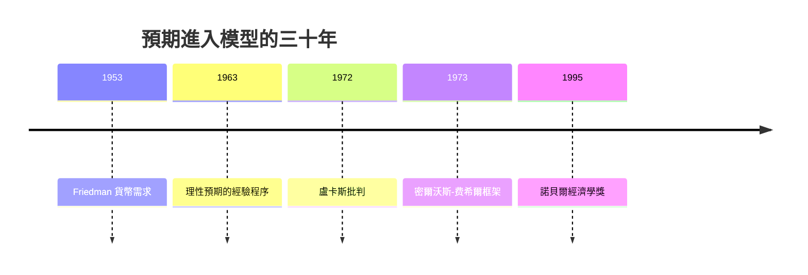

# 1995 · 懸案：政策能改變「人們怎麼預測政策」嗎？——盧卡斯批判

> **1995 諾貝爾經濟學獎（瑞典央行紀念獎）：羅伯特·埃默森·盧卡斯 Jr. Robert Emerson Lucas Jr.（美國，1937–2023）— 表彰他「發展並應用了理性預期假說，藉此轉變了宏觀經濟分析並深化了我們對經濟政策的理解」（for having developed and applied the hypothesis of rational expectations, and thereby having transformed macroeconomic analysis and deepened our understanding of economic policy）。**

---

## 懸案（案情提要）

1960–70 年代的宏觀經濟學（IS–LM + 貨幣主義）遭遇了一場「政策無效」的質疑：

1. **政策真的有效嗎？** 弗里德曼（1976 案）說長期貨幣是中性的；盧卡的問題更狠：**人們會預期到政策**，所以系統性貨幣政策只在「未被預期」時有效；
2. **模型裡的結構參數是什麼？** 貨幣學派模型用一個固定的「貨幣傳導機制」，但公眾的預期本身會隨政策規則改變——那參數就不是常數；
3. **「盧卡斯批判」**：任何**政策規則**的評估，必須先回答公眾如何形成預期、以及預期如何進入決策；用歷史資料估計的結構關係，未必能在新政策下持續（這正是 1980 年 Klein 案的模型遭質疑處）。

盧卡斯的答案是：**把預期放進模型，微觀基礎化宏觀經濟學**。1995 年的授獎辭詞直接點名這是「盧卡斯批判」的勝利。

---

## 前因

| 年份 | 事件 |
|---|---|
| 1936 | 凱恩斯《通論》：短期需求管理與「長期論證」問題 |
| 1953 | 弗里德曼〈貨幣數量的收入決定論〉；盧卡斯在芝加哥大學開始與 Friedman 合作 |
| 1961 | Friedman 的「貨幣需求函數」；盧卡斯的博士論文《物價與產量的預期》（1963） |
| 1963 | Lucas & Rapping（1963–64）：理性預期的經驗證（「灌注法」抽取預期） |
| 1968 | 密爾沃斯與 Schmitt-Grohe 與盧卡斯合著《宏觀經濟理論的評價》（與 Fisher 編） |
| 1972 | Lucas〈對理論經濟學評價的重新思考〉：**盧卡斯批判**的正式文本 |
| 1973 | 密爾沃斯—費希爾《貨幣與商業周期》（兩卷）：新古典宏觀的完整架構 |
| 1976 | Friedman 獲獎：自然率假說 |
| 1982 | Lucas 的「供給側經濟學」與「 prezident 的悲觀」演說 |
| 1995 | 得獎；盧卡斯當時是芝加哥大學教授，其後轉任政治學（2003 年起） |

---

## 調查

### 線索一：理性預期的假說——「預期」不是外生給定

盧卡斯的起訴書針對的是一個技術漏洞：宏觀模型裡的預期變數 $\mathbb{E}_t$ 是被**當作給定**放進方程式的。

**理性預期假說**：在時期 $t$ 的所有可得資訊集合 $\mathcal{F}_t$ 下，預期等於其條件數學期望：

$$
\mathbb{E}_t z_{t+1} = \mathbb{E}\left[ z_{t+1} \mid \mathcal{F}_t \right]
$$

關鍵推論（盧卡斯與米勒 1970s）：若預期是理性的，**只有預期外的變化（surprises）才影響當期結果**：

$$
z_t = \mathbb{E}_t z_t + \varepsilon_t, \qquad \mathbb{E}_t \varepsilon_t = 0
$$

於是「貨幣是中性的」這個結論，其精確版本是：**系統性（可被預期的）貨幣變動對實體變數沒有影響**，但**未預期的貨幣變動有實時效果**（在短期，因為人們無法即時調整價格與工資）。

### 線索二：盧卡斯批判的正式表述

1972 年那篇論文的起訴內容，可以寫成一個簡單的「比較靜態—參數變化」論證：

1. 經濟體系有結構方程（貨幣需求、勞動供給、價格設定），其中含參數 $\theta$（如貨幣傳導速度、價格調整速度）；
2. 歷史上估計出的 $\hat{\theta}$ 是**當時政策規則下**的特徵；
3. 若政策規則改變，$\theta$ 本身會變（因為它是公眾預期的函數）；
4. 因此：**用歷史資料估出的政策效果，不能外推到新政策**——模型在「結構深處」缺少一層。

盧卡斯的著名例子：**_workers 對貨幣供給的短期反應與長期反應不同**（勞動的需求彈性與供給彈性在短期不同），因此菲爾普斯曲線的斜率不是結構常數。

這條批判的殺傷力在 1976 年被具體展示：Friedman–Schwartz 的《美國貨幣史》發現 1929–1933 貨幣收縮三分之一、1934–1941 擴張三成五，兩段時期的實體反應**極不對稱**——貨幣主義不能解釋差異，理性預期可以：因為 1930 年代的政策是**意外的**，而 1930s 末的政策是**被預期的**。

### 線索三：微觀基礎——盧卡斯供給曲線

盧卡斯（1973 年密爾沃斯–費希爾框架）的核心模型是一條**微觀基礎化的供給曲線**。家庭在既定工資 $w$ 下選擇勞動 $N$ 與休閒：

$$
\max_{N} \; \sum_{t=0}^{\infty} \beta^t \left[ u(c_t) + v(1 - N_t) \right]
$$

私人部門的邊際替代決定「跨期替代彈性」對工資的反應；企業的利潤最大化決定產出：

$$
Y_t = F(N_t, K_t)
$$

在長期（彈性充分調整）與短期（工資粘性）之間，兩者結合給出**盧卡斯供給曲線**：

$$
Y_t = Y^{P} + \alpha (P_t - P_t^{e}) + \varepsilon_t
$$

即短期產出偏離潛在產出的**缺口**，只由**價格意外**驅動。這條曲線是 1980s 宏觀經濟學的骨架，也是 1995 年後「新凱恩斯」與「實際經濟週期」兩大陣營的共同出發點。

### 線索四：預期的經驗測量

盧卡斯與 Rapping 的「**灌注法（proxy）**」把預期放進可估計的框架：用對未來通脹預測的調查資料（Livingston survey、Morgan Stanley 預測）作為 $\mathbb{E}_t \pi_{t+1}$ 的代理：

$$
y_t = \alpha + \beta \mathbb{E}_t y_{t+1} + \gamma x_t + u_t
$$

由此估計**產出的前瞻性係數 $\beta$**，檢驗「消費者是否根據產出預測做消費決策」。這套方法後來擴展為**消費者信心的實證測量**（Card 1990）、**風險態度的實證測量**（Barsky 與 Shea 1997），成為 2010s「主觀預期」的先聲。

### 線索五：政策規則與時間不一致性（通向 2004 案）

盧卡斯的框架讓「政策該如何制定」變成可形式化的問題：若政策制定者本身也有預期與激勵，最優政策不是「最優反應函數」，而是**動態承諾問題**：

$$
\max_{\{u_t\}} \; \mathbb{E}_0 \sum_{t=0}^{\infty} \beta^t \pi(x_t, u_t)
$$

這條線在 1980s 由 Kydland 與 Prescott（2004 案）接續：時間不一致性使「事後最優」與「事前可信」分離，理性預期下的政策會系統性地被預期抵銷——這是盧卡斯批判的政策理論後果。

---

## 理論裁決

**裁決一**：預期是**內生於資訊集**的，不是外生參數；經濟體系只對**預期外**的衝擊反應：

$$
\mathbb{E}_t z_{t+1} = \mathbb{E}\left[ z_{t+1} \mid \mathcal{F}_t \right]
$$

**裁決二（盧卡斯批判）**：政策評估必須回答兩個問題——公眾如何形成預期，以及預期如何進入決策；**結構參數在政策規則改變時會變**，歷史估計不可直接外推：

$$
\hat{\theta}_{\text{舊規則}} \neq \theta_{\text{新規則}}
$$

**裁決三**：短期產出波動由**價格意外**驅動；長期由要素與技術決定：

$$
Y_t = Y^{P} + \alpha (P_t - P_t^{e}) + \varepsilon_t
$$

**裁決四**：預期可被**測量**（調查法與代理法），使理性預期假說成為可檢驗命題而非信仰。

**裁決五（後果）**：這套理論把宏觀經濟學的難題從「如何預測」轉移到「**如何建立可信的承諾機制**」——這是 1990s 央行的「可信度（credibility）」革命、1995 年後通脹目標制的理論源頭。

---

## 後果

| 領域 | 影響 |
|---|---|
| 政策應用 | 央行可信度與前瞻性指引（forward guidance）、通脹目標制、財政規則；「政策無效論」在 1970s–80s 對減稅與管制政策的影響 |
| 學術 | 新古典宏觀（Real Business Cycle）、新凱恩斯經濟學（1990s 末）的共同前提；預期的可測性成為獨立研究分支 |
| 實證 | 前瞻性需求方程式的估計（消費、貨幣需求、勞動供給）；Lucas critique 對結構參數穩定性的檢驗成為常規 |
| 爭議 | 理性預期被批過度理性化；不同模型對「需求管理是否有效」給出相反建議（而政策制定者仍照做）；1995 年授獎時被批為「美國學派主導的偏見」 |
| 後續諾獎 | 1996 Mirrlees–Vickrey（不對稱信息下的激勵，與盧卡斯的「盧卡斯式」計畫同題）、2004 Kydland–Prescott、2011 Sargent–Sims（宏觀因果的實證） |

---

## 關聯

- [1976-Friedman貨幣主義與永久收入](1976-Friedman貨幣主義與永久收入.md)：自然率假說與理性預期的共同完成者。
- [1974-Myrdal與Hayek貨幣波動與制度](1974-Myrdal與Hayek貨幣波動與制度.md)：預期與貨幣的另一條解釋路線。
- [1980-Klein宏觀計量模型](1980-Klein宏觀計量模型.md)：盧卡斯批判的直接靶標。
- [2004-Kydland與Prescott實際經濟週期](2004-Kydland與Prescott實際經濟週期.md)：時間不一致性與政策可信度（本書續寫中）。
- [2011-Sargent與Sims宏觀因果](2011-Sargent與Sims宏觀因果.md)：理性預期框架的實證再檢驗（本書續寫中）。
- [1996-Mirrlees與Vickrey不對稱信息](1996-Mirrlees與Vickrey不對稱信息.md)：海薩尼式信息結構的稅制與拍賣應用（本書續寫中）。
