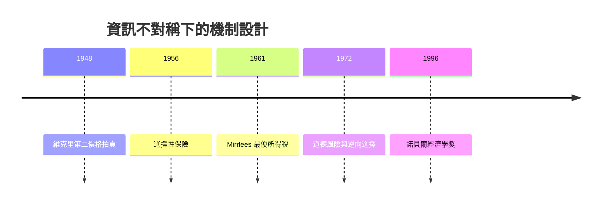

# 1996 · 懸案：資訊不對稱時，最優稅制與拍賣該怎麼設計？

> **1996 諾貝爾經濟學獎（瑞典央行紀念獎）：詹姆斯·亞歷山大·米里利斯 Sir James Alexander Mirrlees（英國，1936–2018）與威廉·維克里 William Vickrey（美國，1914–2004）— 表彰他們「對不對稱信息下的經濟激勵理論的開創性貢獻」（for their fundamental contributions to the economic theory of incentives under asymmetric information）。**

---

## 懸案（案情提要）

新古典經濟學的教科書有個尴尬的漏洞：**資訊是完全的**。但現實裡，賣方比買方更了解商品（車況、房子），納稅人比國家更了解自己的能力，競標者比賣方更了解自己的估值。於是：

1. **契約如何設計，才能讓自利的對方「自己說出真相」？** 傳統契約（固定價格、固定工資）在此失效：賣方會隱瞞，投保人會隱瞞。
2. **稅制該怎麼設計？** 若稅率取決於能力，納稅人會隱瞞能力（否則被多徵稅）——那麼「越能者多繳」的願望如何實現？這是 Mirrlees 問題。
3. **拍賣該怎麼設計？** 若以「支付方式」揭示估值（維克里拍賣），賣方會**策略性延遲**；第二價格拍賣在關聯買方（substitutes）存在時又會失靈。

維克里與米里利斯用同一套工具——**機制設計**——回答：如何在資訊不對稱下設計規則，使自利行為自動導向社會想要的結果。

---

## 前因

| 年份 | 事件 |
|---|---|
| 1914 | 維克里出生於美國科羅拉多州；1935 年入耶魯 |
| 1937–1947 | 維克里在華盛頓的財政專家委員會工作，設計財政制度 |
| 1948 | 維克里〈交通的計價理論〉提出「維克里第二價格拍賣」 |
| 1956 | 維克里〈風險的選擇〉提出**選擇性保險**（deductible）與**限額保險** |
| 1961 | Mirrlees 在劍橋提出最優所得稅理論（《Essay in the Theory of Optimum Income Taxation》）；1967 年《Theorie der optimalen Besteuerung》 |
| 1963 | Mirrlees 與 Vickrey 合作研究資訊結構下的資源配置 |
| 1972 | Mirrlees 揭示「道德風險」與「逆向選擇」的區分（與 Rothschild–Stiglitz 的分工） |
| 1976 | 「moral hazard」一詞進入保險經濟學文獻 |
| 1980s | 頻譜拍賣（1984–1995 美國、1997 歐洲）成為維克里式拍賣的最大實踐；MIME 與 ITQ 的拍賣設計 |
| 1996 | 得獎 |

---

## 調查

### 線索一：維克里拍賣——讓價格說話，但別騙人

第一價格拍賣（最高出價者得標、付自己的出價）會誘發**策略性低報**。維克里的替代方案：**第二價格拍賣（維克里拍賣）**——最高出價者得標，但只付**第二高報價**：

$$
\text{支付} = \text{第二高報價} \quad (\text{勝者}), \qquad \text{獲利} = v - \text{第二高報價}
$$

此時「贏標」的價值與自己的出價無關，於是**誠實報價成為最佳策略**：

$$
\text{出價 } = v \quad \Longrightarrow\; \mathbb{E}[v - \text{支付}] \text{ 最大化}
$$

這是「機制設計」的第一個基本範例：**設計支付函數，讓真實類型成為最優的揭露策略**。維克里還推廣了這套思想到公共資源配置：**維克里–克拉克稅制**——公共品的有效需求表由個人對公共品與私人物品的邊際支付意願構成，理論上可達成**最優配置**（這正是 1918 年 R.F. Kahn 與 1928 年 Samuelson 公共支出理論的實現路徑）。

### 線索二：維克里第二價格的弱點——關聯買方與「無赢家」

但維克里很快發現自己的拍賣有致命弱點：**當買方彼此是替代品（substitutes）**時（頻譜拍賣正是如此），沒有第二高報價，於是**沒有人願意出價**，拍賣流標。修正方案：

- **英式拍賣**：逐步降價，第一個接受者得標（解決關聯買方，但無法揭示估值）；
- **拍賣設計的重新表述**（1990s Myerson）：把問題寫成**線性程式**——找機制 $F(\mathbf{b}) \in \{0,1\}^n$ 與支付 $x(\mathbf{b})$，使：

$$
\max_{F, x} \; \text{預期賣方收入} \quad \text{s.t.} \quad \text{IC（激勵相容）} + \text{IR（個體理性）}
$$

**IC 約束**（真實報價是占優策略）：

$$
\mathbb{E}[x(\mathbf{b}) \mid b_i = v_i] \geq \mathbb{E}[x(\mathbf{b}) \mid b_i = b_i'], \quad \forall b_i'
$$

**IR 約束**（參與者願意加入）：

$$
\mathbb{E}[x(\mathbf{b}) \mid b_i = v_i] - v_i \geq 0
$$

這套「直接機制」的語言正是 2007 年 Hurwicz–Maskin–Myerson 案的骨架。

### 線索三：米里利斯問題——「如何讓藏不住的能力自己浮出水面」

米里利斯 1961 年的問題是最純粹的資訊經濟學難題：要徵收「越多者多繳」的所得稅，但納稅人知道自己的能力而稅率取決於能力——於是他會**隱瞞**。若稅率固定，則無法實現累進原則。

米里利斯的解法極為精妙：用**線性稅率**配合**主觀自陳**，使個人在「多報能力」與「少報能力」之間的取捨被設計成中性：

$$
T(w) = a + b w, \qquad b \in (0,1)
$$

在線性稅率下，任何微小的自陳扭曲都帶來**恰好相抵**的稅負與福利損失（一階條件為零），因此個體**沒有強烈動機**扭曲自陳，於是激勵相容幾乎自動成立：

$$
\frac{dT}{dw} \cdot w - T(w) = 0 \;\Rightarrow\; \text{中性}
$$

同時，若納稅人的能力分布是**單峰**（single-peaked，社會上存在唯一的中位能力者），則存在一個線性稅率，使**最優稅制**恰好讓每個人都如實自陳：

$$
\text{存在 } (a, b) \text{ 使所有類型如實申報} \quad (\text{單峰分布下})
$$

這就是 **Mirrlees 定理**，它第一次證明了「才能稅（optimal income tax）」在資訊不對稱下是**可實施**的（implementable），而不是只能作為天真的效率命題。

米里利斯還給出「頂高稅率」的重要直覺：最有效率的高收入稅率不是 100%，而是讓高能力者**不願意偽裝成中等能力者**的那一點：

$$
\frac{dT}{dw} \bigg|_{w = w_{max}} \;=\; \text{該處的所得替代彈性}
$$

### 線索四：道德風險與逆向選擇——兩種資訊問題的分野

維克里與米里利斯把保險市場的兩類問題分開命名，這組術語改變了整個保險經濟學：

| | **逆向選擇（adverse selection）** | **道德風險（moral hazard）** |
|---|---|---|
| 資訊問題 | 交易**之前**：賣方（投保人）比買方了解風險類型 | 交易**之後**：行為在保險後改變 |
| 對策 | **篩選與信號**：自陳、遺傳檢驗、選擇性保單 | **契約設計**：自留額、共保、限額、誘因相容條款 |

維克里的選擇性保險（deductible）是最早的道德風險對策：若保險全額赔付，保險人沒有就醫的誘因；若設定自留額 $d$：

$$
\Pr(\text{就醫}) = \Pr(\text{成本} > d)
$$

就醫的邊際成本從零變為邊際醫療成本，保險覆蓋率下降但**支出與保費都下降**，社會福利提高——這是「道德風險存在時，保險不是越多越好」的第一個嚴格證明。

### 線索五：機制的幾何與「最優機制存在」的準備

1990 年代的 Myerson 與 Maskin 的工作把個案系統化：給定一個可行的經濟環境（可行的分配集合 $\mathcal{X}(n)$），機制設計問題是

$$
\max_{\text{mechanism}} \; \text{收益} \quad \text{s.t. IC, IR}
$$

並證明在**經濟環境良好（benign）**時最優機制存在。維克里與米里利斯開出的兩條路——拍賣與所得稅——正是這個框架的原型實例。

---

## 理論裁決

**裁決一**：當資訊不對稱時，**規則設計本身**是最主要的政策工具；支付函數可以設計成使真實類型揭露成為占優策略。

**裁決二（維克里拍賣）**：第二價格拍賣使誠實報價成為占優策略：

$$
\text{勝者支付} = \text{第二高報價} \quad \Rightarrow \quad \text{IC 自動成立}
$$

**裁決三（Mirrlees 定理）**：在能力分布單峰的條件下，**線性最優稅率**可以實現「越多者多繳」，因為扭曲自陳的收益與成本恰好相抵：

$$
\max_{T} \; \text{社會福利} \quad \text{s.t. IR} + \text{IC}
$$

**裁決四**：資訊問題有兩種，必須用不同工具：**交易前的逆向選擇**用篩選與信號；**交易後的道德風險**用契約設計（自留額、共保、限額）。

**裁決五**：公共品的「有效需求表」與維克里–克拉克稅制說明，**公共品的有效配置在理論上可由個人自陳意願達成**——這是福利經濟學與公共選擇之間的橋樑。

---

## 後果

| 領域 | 影響 |
|---|---|
| 政策應用 | 所得稅與社會保險制度設計（稅率曲線、頂高稅率）；醫保與車險的 deductible/co-payment 設計；頻譜拍賣（1994–97 美國、1997–98 歐洲）；醫療拍賣機制；環境許可拍賣 |
| 學術 | 機制設計成為一門獨立的經濟學（2007 案）；不對稱信息經濟學（2001 案）與委託—代理理論（2016 案） |
| 實證 | 移民與教育選擇中的信號（Spence）、健康與醫療市場的隱藏行動、稅制改革的行為反應 |
| 爭議 | 米里利斯定理的**單峰假設**被批不現實（能力分布通常不是單峰）；所得稅「最優」在規範上被質疑（Rawls 式批評）；道德風險的存在使社會保險的效率結論難以接受 |
| 交叉 | 維克里與米里利斯分別代表「拍賣—專案」與「稅制—所得分配」兩條應用線，2016 年契約理論把二者統一在「不完全合約」框架下 |

---

## 關聯

- [1994-Nash-Harsanyi-Selten非合作賽局均衡](1994-Nash-Harsanyi-Selten非合作賽局均衡.md)：類型—信念—行動的理論語言（海薩尼）的來源。
- [2001-Akerlof-Spence-Stiglitz不對稱信息](2001-Akerlof-Spence-Stiglitz不對稱信息.md)：逆向選擇的市場後果（本書續寫中）。
- [2007-機制設計三人組](2007-機制設計三人組.md)：把 IC/IR 條件一般化的正式理論（本書續寫中）。
- [2016-Hart與Holmstrom契約理論](2016-Hart與Holmstrom契約理論.md)：不完全合約與道德風險的現代版本（本書續寫中）。
- [2020-Milgrom與Wilson拍賣理論](2020-Milgrom與Wilson拍賣理論.md)：維克里拍賣的現代實作（本書續寫中）。
- [2015-Deaton消費與貧困](2015-Deaton消費與貧困.md)：所得分配與稅制的經驗基礎（本書續寫中）。
