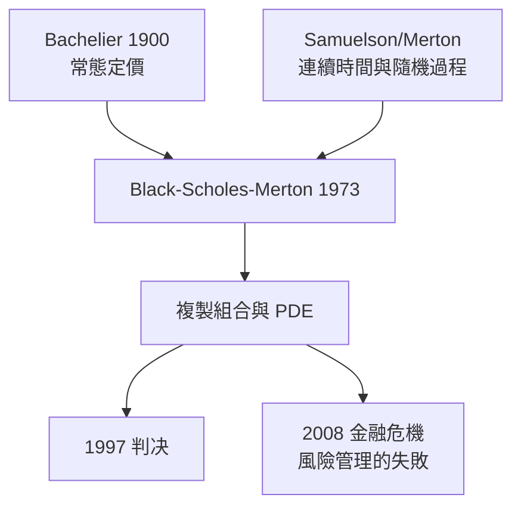

# 1997 · 懸案：一份「看不見的合約」，能不能被定價？

> **1997 諾貝爾經濟學獎（瑞典央行紀念獎）：羅伯特·考克斯·默頓 Robert Cox Merton（美國，1944– ）與邁倫·索肖爾斯 Myron Samuel Scholes（美國，1941– ）— 表彰他們「對衍生品定價方法的新拓撲」（for a new method to determine the value of derivatives）。**

---

## 懸案（案情提要）

1970 年代的金融市場出現了一類「看不見的東西」：**衍生性金融商品**——期權、期貨、交換（swap）、可轉債。契約本身沒有現金流，它的所有價值來自**未來不確定收益的分配權**。於是三道難題：

1. **沒有歷史價格可比**：一張 1975 年發行的 IBM 認股權在 1975 年沒有市場報價——它該值多少錢？
2. **沒有「均衡價格」可套**：若用供需均衡定價，需要「該商品的供給曲線」——但衍生品的供給由造市者設計，不是外生給定；
3. **風險如何被分解？** 一張複雜期權的收益，同時依賴標的價格、波動、利率、時間；哪一種風險該被「對沖」，哪一種該被「賣出」？

默頓與斯科爾斯的答案是**一條革命性的替換**：把「衍生品定價」化約成「複製組合的定價」——用股票與債券**動態複製**衍生品的收益，於是定價問題變成一個**偏微分方程的邊值問題**。

---

## 前因

| 年份 | 事件 |
|---|---|
| 1900 | Poincaré 的隨機微分方程理論 |
| 1900s | Bachelier《投機理論》（1900）：以布朗運動為基礎的期權定價先驅（但假設常態收益） |
| 1965 | Samuelson 論文的引子：連續時間的隨機漫步與擴散過程 |
| 1967 | Samuelson、Samuelson 與 Merton 家族：連續時間金融理論的先驅工作（Merton 的「隨機過程」方法） |
| 1970 | Black 與 Scholes 在《Journal of Political Economy》發表〈期權定價理論〉 |
| 1973 | Fischer Black 去世；Scholes 與 Merton 各自獨立發展連續時間版本（《Banking and Financial Markets》與《Theory of Rational Option Pricing》） |
| 1973 | 石油危機與股債崩盤；期權市場在芝加哥 商品交易所（CBT）與費城交易所（PHLX）迅速成長 |
| 1983 | 芝加哥期貨交易所推出 S&P 100 與 NYSE 指數期權 |
| 1987 | 股災；波動率成為市場的核心變數 |
| 1997 | 得獎；同年發生 LTCM 危機（8 月）與亞洲金融風暴（10 月）——獎項隔天（10 月 14 日）揭曉，諾貝爾委員會原本考慮因金融危機而延後公布 |

---

## 調查

### 線索一：把「沒有價格」變成「有替代品」

默頓與斯科爾斯的起訴書第一頁就是偵查轉向：**不要再問期權本身值多少，要問「我能用別的東西做出同樣的收益嗎？」**——這就是**複製組合**思想。

設標的股票價格 $S_t$ 遵循幾何布朗運動：

$$
dS_t = \mu S_t \, dt + \sigma S_t \, dW_t
$$

（幾何布朗運動的選擇來自「股票價格不能為負」與「對數價格是隨機漫步」的啟發）。歐洲式看漲期權的收益為：

$$
C = \left( S_T - K \right)^{+}
$$

### 線索二：無套利方程與複製組合的動態構造

默頓的基本洞見：**無套利 + 連續交易 = 期權價格必須滿足一個線性微分方程**。

建立自融資組合（持有 $\Delta$ 股股票與 $B$ 美元債券），使其收益與期權收益完全相同。由 Itô 引理，期權價格的隨機微分為：

$$
dC = \left[ \frac{\partial C}{\partial t} + \mu S \frac{\partial C}{\partial S} + \frac{1}{2} \sigma^{2} S^{2} \frac{\partial^{2} C}{\partial S^{2}} \right] dt + \sigma S \frac{\partial C}{\partial S} \, dW_t
$$

股票的漂移項為 $\mu S \Delta$。**匹配 $dW_t$ 項**（消除隨機性）給出複製組合的持股數：

$$
\Delta = \frac{\partial C}{\partial S}
$$

**匹配 $dt$ 項**給出 Black–Scholes 偏微分方程（風險中性定價的核心）：

$$
\frac{\partial C}{\partial t} + r S \frac{\partial C}{\partial S} + \frac{1}{2} \sigma^{2} S^{2} \frac{\partial^{2} C}{\partial S^{2}} - rC = 0
$$

邊界條件為：

$$
C(S, T) = \left( S - K \right)^{+}, \qquad C(0, T) = 0
$$

**默頓的重要補充**：這套方程給出的價格是**唯一的**，因為它滿足無套利條件；任何偏離此價格的報價都可用複製組合製造套利。

### 線索三：風險中性測度與定價公式

透過**測度變換**（Girsanov 定理），把漂移 $\mu$ 換成無風險利率 $r$，價格方程變成一個**期望值**問題。在風險中性測度 $\mathbb{Q}$ 下：

$$
C = e^{-r(T-t)} \mathbb{E}^{Q}\left[ \left( S_T - K \right)^{+} \right]
$$

解 PDE 得封閉形式（Black–Scholes 公式）：

$$
C = S \, N(d_1) - K e^{-r\tau} N(d_2)
$$

$$
d_1 = \frac{\ln(S/K) + (r + \frac{1}{2}\sigma^{2})\tau}{\sigma \sqrt{\tau}}, \qquad d_2 = d_1 - \sigma \sqrt{\tau}
$$

其中 $N(\cdot)$ 為標準常態累積分配函數，$\tau = T - t$。

**這就是「波動率的價格」的證明**：期權價格對波動率的敏感度（vega）：

$$
\frac{\partial C}{\partial \sigma} = S \phi(d_1) \sqrt{\tau} > 0
$$

更高的不確定性 = 更高的期權價值，因為期權的收益是**凸性**的（保險性質）。

### 線索四：默頓的推廣——連續時間下的跨期選擇

默頓把整套系統推到極致：個體在連續時間中選擇消費與投資以最大化終身效用：

$$
\max \mathbb{E}\left[ \int_0^T u(c_t) e^{-\delta t} dt \right]
$$

給出 Merton 消費函數與投資組合：

$$
c^{*} = \frac{m}{\delta} w, \qquad \text{資產權重} = \frac{m - \delta r}{\sigma^2} \quad (\text{常數槓桿})
$$

並提出著名的「Merton 問題」：個人應持有多少股權？答案是**固定比例的風險資產**（與 Shapiro–Mertin 的終身投資理論同源），並成為 2010s 退休規劃文獻的基礎。

### 線索五：定價革命後的現場——1997 年的兩場危機

得獎的當年八月，長期資本管理公司（LTCM）因俄羅斯違約與 1998 盧布崩潰而幾乎倒閉——其模型正是「定價模型 + 巨額槓桿」。這場危機暴露了定價模型的三個盲點：

1. **參數估計的不確定性被嚴重低估**（波動率在 1998 年被低估）；
2. **相關性在危機中趨於 1**（分散化失效）；
3. **槓桿 + 同質模型 = 同步平倉**（被讚為「金融界的隕石」）。

因此 1997 年的授獎具有諷刺性的雙面性：**數學的完成**與**風險管理的失敗**同年發生。諾貝爾委員會甚至一度討論因金融危機而延後公布——最後仍如期頒獎，因為委員會認為「科學的正確性不因市場的災難而改變」。

---

## 理論裁決

**裁決一**：**無套利 + 動態複製**足以唯一決定衍生品價格；定價問題化為 PDE 的邊值問題：

$$
\frac{\partial C}{\partial t} + rS\frac{\partial C}{\partial S} + \frac{1}{2}\sigma^{2}S^{2}\frac{\partial^{2} C}{\partial S^{2}} - rC = 0
$$

**裁決二**：定價不必知道偏好（風險厭惡程度）——因為定價在**風險中性測度**下進行，偏好在定價中被「風險中性化」抹去：

$$
C = e^{-r\tau} \mathbb{E}^{Q}\left[ (S_T - K)^{+} \right]
$$

**裁決三**：期權價格是**波動率**的遞增函數（凸性），因此「不確定性」本身具有價格：

$$
\frac{\partial C}{\partial \sigma} = S\phi(d_1)\sqrt{\tau} > 0
$$

**裁決四**：連續時間下的個人最優投資是**常數比例的風險資產**（Merton 投資組合），消費與投資分離求解。

**裁決五（歷史注腳）**：科學的完成不等於應用的成功；模型風險（參數、槓桿、拥挤交易）成為 1997 年之後金融經濟學的核心議題。

---

## 後果

| 領域 | 影響 |
|---|---|
| 市場與政策 | 全球衍生品市場的定價基準；1990s–2000s 的金融衍生品、抵押貸款證券（CDO）、結構性產品全部建立在此模型之上；巴塞爾協議的市場風險資本要求以 VaR 與模型為基礎 |
| 學術 | 連續時間金融成為金融經濟學的主軸；數學金融學院系建立；2008 危機後的「模型風險」研究 |
| 實務 | 風險平價與波動率交易（volatility risk premium）、VIX 指數、每日風險因子模型 |
| 爭議 | 1997 年 LTCM 危機、2008 金融危機使「模型崇拜」成為公共議題；物理學家與經濟學家共治的定價方法被批為隱藏了「誰能承受尾部風險」的問題 |
| 後續諾獎 | 2013 Fama–Hansen–Shiller（資產價格的實證與泡沫）、2020 Milgrom–Wilson（拍賣理論，含譜拍賣的機制）、2014 Tirole（產業組織） |

---

## 關聯

- [1981-Tobin托賓q與金融市場](1981-Tobin托賓q與金融市場.md)：風險與金融市場的行為基礎。
- [1990-Markowitz-Miller-Sharpe金融經濟學](1990-Markowitz-Miller-Sharpe金融經濟學.md)：組合選擇與 CAPM——BSM 之前的金融經濟學。
- [1996-Mirrlees與Vickrey不對稱信息](1996-Mirrlees與Vickrey不對稱信息.md)：拍賣定價與衍生品定價的共同方法論（無套利）。
- [2013-Fama-Hansen-Shiller資產價格](2013-Fama-Hansen-Shiller資產價格.md)：效率市場與泡沫的實證爭議（本書續寫中）。
- [2020-Milgrom與Wilson拍賣理論](2020-Milgrom與Wilson拍賣理論.md)：現代定價機制的理論統一（本書續寫中）。
- [2022-Bernanke銀行與金融危機](2022-Bernanke銀行與金融危機.md)：模型風險與危機的現代案例（本書續寫中）。
