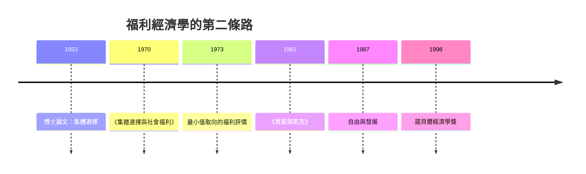

# 1998 · 懸案：福利是「效率」嗎？飢荒為何在民主國家發生？

> **1998 諾貝爾經濟學獎（瑞典央行紀念獎）：阿馬蒂亞·庫馬爾·森 Amartya Kumar Sen（印度，1933– ）— 表彰他「對福利經濟學的貢獻」（for his contributions to welfare economics）。**

---

## 懸案（案情提要）

森接手了 1972 年 Arrow–Hicks 案留下的兩具屍體，並拋出了更尖銳的問題：

1. **福利能不能被量化？** 帕累托標準只能處理「所有人都變好或有人變差」的案子；一旦需要**在人之間比較**（有人多得多、有人少一點），如何比較？「邊際效用」的可比性假設（牛津的 Oxford 方法）站得住嗎？
2. **效率與公平能不能分開？** 主流福利經濟學把效率（allocation）與分配（distribution）分成兩塊：市場負責效率，政府負責分配。森的質疑：**分配其實影響效率**（貧窮會降低勞動生產力、教育投資與健康），反之亦然。
3. **最刺的問題：為什麼民主國家會發生飢荒？** 1981 年森的《飢荒與數學論》（Poverty and Famines）提出驚人答案：真正因「糧食不足」而死的飢荒，幾乎都發生在**沒有民主自由**的國家；民主國家的飢荒（1983 衣索比亞、1984 薩摩亞）都是**內戰或人為政策**造成的。這把「市場失靈」的鏡像翻轉成「自由與治理的失靈」。

---

## 前因

| 年份 | 事件 |
|---|---|
| 1953 | 森在劍橋完成博士論文（Edward S. Mason 指導）：〈福利經濟學的某個基本問題〉——**集體選擇與帕累托原理的關係** |
| 1956 | 森與薩繆爾森合著《經濟分析與社會福利》（1950 年新版） |
| 1960s | 森在德里建立「印度統計與計畫研究院」；實際參與印度的發展計畫與扶貧政策 |
| 1970 | 〈 Collective Choice and Social Welfare〉出版：社會選擇理論的里程碑 |
| 1973 | 森在《Economic Journal》發表〈Some Notes on the Concept of Value〉：提出「**最小 值取向的福利評價**」（minimal value approach），用**權重基礎加總**繞開可加性假設 |
| 1977 | 《飢荒與數學論》（第一版 Poverty and Famines, 1981 Oxford） |
| 1983 | 《經濟學與社會選擇的關係》 |
| 1987 | 〈標準：為什麼我們需要甚麼？〉：**發展 = 擴大人的實際自由**（capabilities） |
| 1990 | 《發展的議程》（Development as Freedom）出版；1999 年諾貝爾獎的核心文本 |
| 1997–1998 | 亞洲金融危機：韓國、印尼、泰國的崩潰與「金融開放過快」之爭 |
| 1998 | 得獎；委員會稱其「以經濟學方法探討社會選擇與福利的基礎」，並特別提及飢荒研究 |

---

## 調查

### 線索一：帕累托原理的侷限——「多數原則」與「一致性」

森的起訴書從 Arrow 不可能性定理（1972 案）的延伸開始。他指出帕累托標準在實務上幾乎無用：多數政策（多數人略好、少數人略差）無法被判定為改善。於是必須有**跨個人的福利比較**，這要求一個**社會評價函數**：

$$
W = \sum_{i} w_i \, u_i(y_i), \qquad \sum_i w_i = 1
$$

但這裡有個技術難題（1973 年的最小值取向）：福利的加總要求**邊際效用的可加性**，而真實的效用函數不可加（不同人的效用尺度無法定義）。森的解決是**權重基礎加總（weighted aggregation）**：

$$
W(\mathbf{y}) = \sum_{i} w_i u_i(y_i)
$$

——用一組**權重** $w_i$ 代替對效用的直接比較，權重代表「多少權重給一單位某個人的福利」，由社會選擇程序決定。這把福利經濟學從「精確但無用」拉回「粗略但可操作」。

### 線索二：偏好的完整性、單調性與最小值取向

森在 1973 年的論文中提出三個關鍵洞見，用以拆解「福利經濟學的基本問題」：

1. **偏好的完整性（completeness of preferences）**：社會評價不需要對所有分配做完整排序，只需能對「某些社會狀態 A 優於 B」做出判斷；
2. **最小值取向（minimal value approach）**：只對**部分標準**（如最低收入者的狀況、某些權重）做要求，而非全部權重同時達成；
3. **弱化版一致性（weak consistency）**：可用不同的權重組合對同一維度做判斷。

由此他指出：**福利經濟學的基本問題不是「如何加總效用」，而是「哪些加總規則能被社會接受」**——把福利理論從最大化問題轉化為**社會選擇的可行性問題**。

### 線索三：能力（capability）與「實際自由」

森 1987 年起最著名的貢獻：對「發展」的重新定義。純粹的國民收入或 GDP 不是福利，因為同一筆收入能帶來多大的自由，取決於市場供給與公共品：

$$
\text{實際自由} = f(\text{能力集合 } \mathcal{C}(x), \text{個人轉換函數 } d_i)
$$

其中 $x$ 是商品與服務 bundle，$\mathcal{C}(x)$ 是個人能把商品轉換成「做什麼、有什麼樣子的人生」的可行集合。

關鍵的偵查式反例（森 1990 年的經典提問）：

> **為什麼一個 rich but disabled man 比一個 poor but healthy man 福利更差？**

在純收入框架中前者顯然更好；但若加入**殘障與健康**這個維度，兩人的福利無法比較。於是：

$$
\text{福利} \neq \text{收入}; \qquad \text{發展} \equiv \text{擴大能力集合}
$$

這解釋了為何「國民收入相同但嬰兒死亡率不同」的兩個國家，發展程度不同；也解釋了為何同一收入在不同性別、不同健康狀況下意義不同。

### 線索四：飢荒的經濟學解剖——「飢荒不是因糧食短缺」

森的《飢荒與數學論》是最具衝擊力的實證研究。他提出判別式：

$$
\text{飢荒} \;=\; \text{饑餓} + \text{因營養不良造成的死亡} + \text{嚴重社會動盪}
$$

並用**時間序列方法**檢驗歷史上各大飢荒：糧食供給（產量、進口量、存量）與營養不良的死亡人數之關係。他發現：

1. **真正由糧食總量不足造成的飢荒極少**——多數「饑荒」其實是**分配問題**（窮人買不到糧食）或**宏觀政策問題**（城市飢荒、戰爭封鎖）；
2. **民主與言論自由的存在，使得饑荒無法長期隱藏**——政府必須回應受災者的投票與輿論壓力；
3. 因此：**飢荒是「政治經濟學事件」，不是「自然經濟學事件」**。

這個發現與 1974 年 Myrdal 案的「制度—發展」主線直接接軌，也構成 1997–98 亞洲金融危機後「開放速度與民主制度孰先」大辯論的核心（見 1999 年 Mundell 案與 2008 年 Krugman 案）。

### 線線五：性別平等與「缺失的變數」

森對性別分工（division of labour）的經濟學分析：市場與家庭的分界並非自然，而是被**報酬結構與偏好社會化**共同塑造。當市場報酬（尤其育兒的機會成本）不對稱時，家庭內部分工會自我強化：

$$
\text{市場歧視} \to \text{女性收入低} \to \text{家庭分工固化} \to \text{市場歧視持續}
$$

這一循環正是 2023 年 Goldin 案（性別工資差距的世紀分析）所要破解的對象。

---

## 理論裁決

**裁決一**：福利經濟學的基本問題是**社會選擇的可行性**，不是效用的機械加總；加權加總規則與最小值取向使福利判斷成為可操作的程序：

$$
W(\mathbf{y}) = \sum_i w_i u_i(y_i), \qquad \min_i w_i \cdot u_i \text{ 為關鍵指標}
$$

**裁決二**：**能力**（而非收入或商品）是福利的適當空間：

$$
\text{發展} = \text{擴大可行能力集合 } \mathcal{C}
$$

**裁決三**：分配與效率**不可分**——貧窮影響生產力與人力資本投資，效率成果也必須透過分配才能轉化為能力。

**裁決四**：飢荒是**治理與自由的失敗**，不是糧食的失敗；自由與言論自由是預防饑荒的制度性保障：

$$
\text{民主與自由} \Rightarrow \text{饑荒難以長期存在}
$$

**裁決五**：發展政策的評價標準應是「人的實際自由的擴大」，包括健康、教育、性別平等等「缺失的變數」。

---

## 後果

| 領域 | 影響 |
|---|---|
| 政策應用 | 人類發展指數（HDI）、多維貧窮指數（MPI）、能力方法對公共政策的影響；「性別平等」納入發展議程；1990 年《發展議程》成為聯合國綱領的理論底色 |
| 學術 | 能力方法成為福利經濟學與發展經濟學的主框架；Sen 的「不可能三角」（Income, Equality, Liberty 三者不可同時最佳化）成為設計公共政策的核心直覺 |
| 實證 | 健康、壽命、教育、性別參與作為發展指標；1990s 的人力資本與貧困研究 |
| 爭議 | 能力方法難以貨幣化、被批無法用於政策成本效益比較；「諾貝爾獎頒給經濟學家」的整體批評常以森為例；森本人是印度「绿色革命」與婦女教育的政策顧問 |
| 後續諾獎 | 2015 Deaton（消費與福祉：從收入到福利的量化）、2023 Goldin（性別勞動市場）、2019 RCT 三人組（隨機實驗的福利評估） |

---

## 關聯

- [1972-Arrow與Hicks一般均衡與福利](1972-Arrow與Hicks一般均衡與福利.md)：福利兩大定理與不可能性定理——森接手的那兩具屍體。
- [1974-Myrdal與Hayek貨幣波動與制度](1974-Myrdal與Hayek貨幣波動與制度.md)：制度與發展的另一條線（森在飢荒研究中接續 Myrdal）。
- [2015-Deaton消費與貧困](2015-Deaton消費與貧困.md)：把「福利」變成可估計的消費與支出（本書續寫中）。
- [2023-Goldin女性勞動市場](2023-Goldin女性勞動市場.md)：性別作為發展的缺失變數（本書續寫中）。
- [1999-Mundell最優貨幣區](1999-Mundell最優貨幣區.md)：國際金融秩序與發展的制度條件（本書續寫中）。
- [2019-Banerjee-Duflo-Kremer RCT反貧困](2019-Banerjee-Duflo-Kremer RCT反貧困.md)：能力的隨機實證（本書續寫中）。
