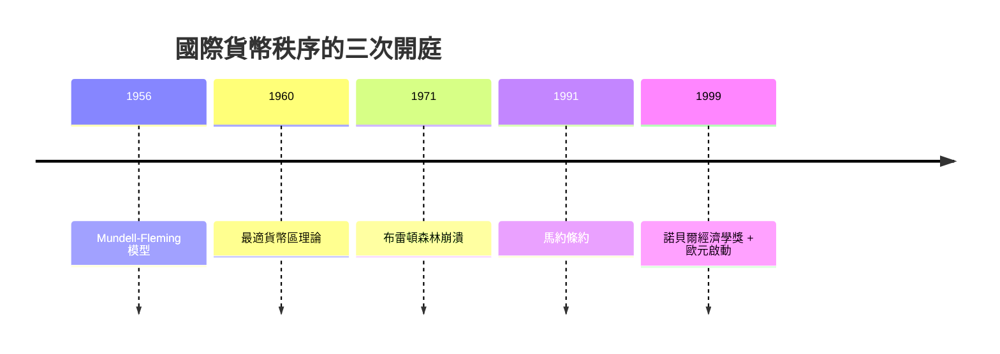

# 1999 · 懸案：匯率該盯住誰？貨幣聯盟該幾個國家一起辦？

> **1999 諾貝爾經濟學獎（瑞典央行紀念獎）：羅伯特·亞歷山大·蒙代爾 Robert Alexander Mundell（加拿大，1932–2021）— 表彰他「對貨幣動態與最優貨幣區理論的開創性貢獻」（for his pioneering contributions to monetary dynamics and optimum currency areas）。**

---

## 懸案（案情提要）

1971 年布雷頓森林體系崩潰後，世界掉進「匯率無序」的年代：固定匯率與浮動匯率各有一大堆支持者，兩邊都能舉出史實：

1. **固定匯率派**：浮動匯率帶來貨幣投機、匯率波動傷害貿易；1970s 的「貨幣混亂」是罪魁。
2. **浮動匯率派**：固定匯率迫於維持匯率而犧牲國內政策（1973 年石油危機的「美元兩難」）。
3. **第三條路**：區域貨幣聯盟（歐元）——但**哪些國家該聯合？** 蒙代爾的問題正是：最優貨幣區的**成員資格標準**是什麼？
4. **政策的指派問題**：在開放經濟裡，同一個政策工具（貨幣）是否應該對不同地區一體適用？若是，誰是「小經濟」？

蒙代爾用一個簡單得驚人的模型（商品市場與要素市場的相對價格）回答了這四題。

---

## 前因

| 年份 | 事件 |
|---|---|
| 1949 | 蒙代爾在芝加哥大學取得博士學位（師承 Friedman、Stone、Samuelson 一系） |
| 1950s | 在華盛頓任國際貨幣基金組織工作人員，接觸布雷頓森林體系的設計問題 |
| 1956 | 〈國際貨幣基金組織與匯率的穩定〉（IMF Staff Papers）：提出 Mundell–Fleming 模型 |
| 1958 | 蒙代爾在加拿大提出「最優貨幣區」理論；同年在《美國經濟學評論》發表「蒙代爾–弗萊明模型」的正式論述 |
| 1958 | Mundell–Fleming 模型成為國際宏觀經濟學的標準框架 |
| 1960 | 蒙代爾提出**最適貨幣區理論**：生產要素的可移動性、內部穩定、財政與貨幣政策的一致性 |
| 1971 | 尼克森衝擊，布雷頓森林體系解體 |
| 1973 | 石油危機與「浮动汇率時代」的開始 |
| 1985 | 廣場協議（Plaza Accord）：美元貶值的協調 |
| 1987–1990 | 歐洲單一市場計畫（Single Market）；德國統一（1990） |
| 1991–1992 | 《馬約條約》（Maastricht Treaty）確立歐元計畫與「最優貨幣區」條件 |
| 1999 | 歐元啟動；蒙代爾獲獎（同年亞洲金融風暴席捲） |

---

## 調查

### 線索一：蒙代爾–弗萊明模型的解剖

模型的基本結構：**小型開放經濟**（價格黏性、匯率浮動）。四個方程：

**產品市場均衡**（IS 曲線）：

$$
Y = C(Y - T) + I(r) + G + NX(e)
$$

其中 $NX(e) = N(e, Y, Y^{*})$，匯率 $e$ 上升（貶值）使淨出口增加。

**貨幣市場均衡**（LM 曲線）：

$$
\frac{M}{P} = L(r, Y)
$$

**外匯市場均衡**（BP 曲線）：

$$
NX(e) = K + N(\overline{r} - r)
$$

（$K$ 為貿易餘額，資本流動取決於國內外利差。）

**價格方程**（浮動匯率下由貨幣市場決定）：

$$
P = \frac{M}{L(r, Y)}
$$

三條曲線的斜率決定了政策的全部結論：

| 情形 | 貨幣擴張 $M \uparrow$ 的效果 |
|---|---|
| 浮動匯率、IS 陡（低資本流動性） | 貶值 $\rightarrow$ 淨出口上升 $\rightarrow$ **產出上升**（政策有效） |
| 浮動匯率、IS 平（高資本流動性） | 貶值 $\rightarrow$ 進口增加 $\rightarrow$ **BP 惡化、貨幣擴張被完全抵銷**（政策無效） |
| 固定匯率 | 央行必須順應供給貨幣以維持匯率 $\rightarrow$ **國內貨幣完全被外匯干預抵銷**（政策失效） |

**蒙代爾–弗萊明的三個定律**：

1. 在浮動匯率下，**貨幣政策有效、財政政策無效**（高資本流動性時）；
2. 在固定匯率下，**貨幣政策無效、財政政策有效**；
3. 在**完美資本流動 + 浮動匯率**時，**財政政策也無效**（ Mundell–Fleming–Smets 命題，1990s 加入預期）。

這四道定理，是國際宏觀的第一套「完整菜單」，統治了 1970s–2000s 的匯率與政策爭論。

### 線索二：最適貨幣區的三個條件

1960 年蒙代爾提出的問題：若各國放棄貨幣主權、固定彼此匯率（或干脆用同一貨幣），什麼樣的經濟體適合合併？他的三項標準：

1. **生產要素的高度流動性**（勞動與資本能自由跨境移動）：若有要素流動，衝擊會透過要素市場自動調整，匯率變動的必要性下降；
2. **區域內部價格與工資的靈活調整**（各國能自行調整工資與價格以吸收需求衝擊）；
3. **財政與貨幣政策目標的一致性**（避免「一個貨幣、許多財政」造成的衝突）。

第一項是「**最適貨幣區理論**」（Mundell 1960），第二項後來被 **Krugman（1991 的風險分散論）**與 **De Grauwe（1990s 的「紅利論」）**修正與擴充：純粹的要素流動性並非必要——

$$
\underbrace{\text{貨幣區的收益}}_{\text{消除匯率風險與交易成本}} \;>\; \underbrace{\text{成本}}_{\text{喪失的宏觀政策自主性}}
$$

De Grauwe 的「紅利論」用蒙代爾自己的模型證明：**即使沒有要素流動，貨幣區仍可能有利**，因為放棄貨幣政策自主性只是「小」的成本（對小經濟而言，匯率變動本來就無效）。

這正是歐元在 1999 年啟動、而 2009–2015 歐債危機中「主權債務與匯率無法調整」之痛的理論坐標。

### 線索三：匯率決定論的歷史四階段

蒙代爾在《國際貨幣的理論與政策》（1998 年的諾貝爾演講）中梳理匯率理論的演化：

1. **購買力平價階段**（1860–1914）：匯率由相對物價決定；
2. **金本位與固定匯率階段**（1870–1914）：匯率由官方平價維持；
3. **布雷顿森林階段**（1944–1971）：可調整的釘住匯率（中心匯率 ± 10% 波幅）；
4. **浮動匯率階段**（1973– ）：匯率由市場決定，貨幣政策自主。

他並提出「**匯率的動態調整（dynamic adjustment）**」概念：在浮動匯率下，匯率變動本身就是**調整機制**（相對於停滯的工資物價），因此「匯率的過度波動」與「匯率的調整不足」是同一枚硬幣的兩面——這是 1990s「貨幣聯盟內部匯率」爭議的核心命題。

### 線線四：三元悖論（ Mundell–Fleming 的政策學總結）

蒙代爾與弗萊明模型的政策含義，被總結為「**不可能三角**」：

$$
\text{資本自由流動} + \text{固定匯率} + \text{獨立貨幣政策} \quad \text{三者至多得其二}
$$

- 資本自由流動 + 固定匯率 $\rightarrow$ 貨幣政策放棄獨立性（歐元區）；
- 資本自由流動 + 獨立貨幣政策 $\rightarrow$ 匯率必須浮動（美元、歐元對第三國）；
- 固定匯率 + 獨立貨幣政策 $\rightarrow$ 必須實施資本管制（Bretton Woods 時代的 IMF 條款；1997–98 亞洲危機後的馬來西亞、資本管制）。

這個三角是 1997–98 亞洲金融風暴（同一年度）與 2008 危機後資本管制討論（2012 年後的資本流動管理）的共同框架。

### 線索五：作為央行設計師的蒙代爾

蒙代爾在 1990s 是國際貨幣體系的積極設計者： proposes 國際貨幣基金組織的「強勢貨幣提案」、參與歐元制度的設計討論、主張設立「國際清算銀行式」的亞洲貨幣機制。他反對過早的歐元（主張先有貨幣聯盟再談單一貨幣），這個立場在 1990s 的歐元辯論中極具影響力。

---

## 理論裁決

**裁決一**：開放經濟的政策效果由**資本流動性**決定；小經濟的貨幣政策可能完全失效：

$$
\text{浮動匯率} + \text{高資本流動} \;\Rightarrow\; \text{貨幣政策無效、財政政策無效}
$$

**裁決二**：匯率是**調整機制**：在三國（實體經濟、價格、匯率）中，浮動匯率吸收了真實變數調整的負擔。

**裁決三**：最適貨幣區的成立條件是**要素流動性、內部價格調整、政策目標一致**三者的某種組合；其收益與成本可比較：

$$
\text{淨收益} = \text{消除匯率風險與交易成本} - \text{貨幣政策自主性的價值}
$$

**裁決四（不可能三角）**：資本流動性、匯率固定、貨幣政策獨立三者不可兼得——這是國際貨幣制度設計的基本約束。

**裁決五**：匯率理論的歷史演化顯示，**匯率制度是制度選擇而非技術細節**，每一種安排都對應特定的衝擊分擔與風險分擔方式。

---

## 後果

| 領域 | 影響 |
|---|---|
| 政策應用 | 歐元區的制度設計與歐債危機（2010–15）的理論診斷；1997–98 亞洲金融危機後的資本管制與匯率干預；QE 與匯率傳導；2020 年後的美元霸權討論 |
| 學術 | 國際宏觀經濟學以 Mundell–Fleming 為共同骨架；開放經濟的動態一般均衡（ Obstfeld–Rogoff）模型化；匯率決定論（匯率 puzzling）成為專門課題 |
| 制度史 | 歐元的「先經濟後貨幣」路徑、歐元區的「經濟政治一體化」需求、2010s 的「財政聯盟」討論，皆引用蒙代爾的成本收益框架 |
| 爭議 | 蒙代爾與 Krugman 在「歐元應否加速」與「匯率在危機中是否必要」上意見相左（2013 年公開論戰）；AGJM（2013）與蒙代爾在貨幣聯盟理論上的分歧是 2010s 最重要的一場學術公案 |
| 遺憾 | 1998 年蒙代爾主張的「亞洲貨幣基金」未落實；2020 年後的美元主導與人民幣國際化討論再度引用其設計思路 |

---

## 關聯

- [1976-Friedman貨幣主義與永久收入](1976-Friedman貨幣主義與永久收入.md)：貨幣政策有效性的經典辯論；自然率與匯率。
- [1977-Ohlin與Meade國際貿易與資本流動](1977-Ohlin與Meade國際貿易與資本流動.md)：內外平衡與政策搭配的前案。
- [1998-Sen福利與社會選擇](1998-Sen福利與社會選擇.md)：民主與自由的制度保障（本書續寫中）。
- [2008-Krugman新貿易與經濟地理](2008-Krugman新貿易與經濟地理.md)：蒙代爾模型最大的理論擴建者（本書續寫中）。
- [2001-Akerlof-Spence-Stiglitz不對稱信息](2001-Akerlof-Spence-Stiglitz不對稱信息.md)：金融市場的信息崩潰（亞洲危機的機制）（本書續寫中）。
- [2022-Bernanke銀行與金融危機](2022-Bernanke銀行與金融危機.md)：國際金融危機的宏觀解剖（本書續寫中）。
