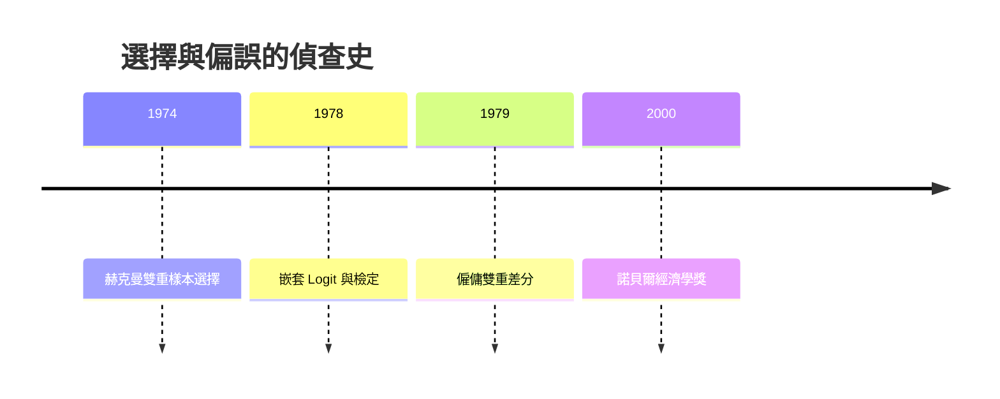

# 2000 · 懸案：只觀察到「已選擇者」的資料，結論還能成立嗎？

> **2000 諾貝爾經濟學獎（瑞典央行紀念獎）：詹姆斯·約瑟夫·赫克曼 James Joseph Heckman（美國，1944– ）與丹尼爾·麥克法登 Daniel L. McFadden（美國，1937– ）— 表彰他們「對微觀計量經濟學的開創性貢獻，特別是發展了選擇、檢定與估計理論的方法」（for their pioneering contributions to microeconometrics, especially the development of theory and methods for the analysis of choice, and the econometrics of discrete choice and limited dependent variables）。**

---

## 懸案（案情提要）

經濟學的大多數估計都建立在一個隱含前提：**樣本是隨機的**（每個觀察被抽到的機率相同）。但真實資料經常違反它：

1. **只有「選擇進入」的人被觀察到**：只有上大學的人有教育年限，只有工作者有工時，只有移民有移民後的收入——**樣本選擇不是隨機的**；
2. **因變數是「離散的」**：是否購買、是否遷移、是否投票、是否犯罪——不是 0.5，而是 0 或 1；
3. **因變數是「受限的」**：工時不能為負、所得有上下限、儲蓄率在 $[0, 1]$ 內——普通最小平方法會產生「不存在的值」；
4. **是否參與本身與結果相關**（樣本選擇偏差）：能力強的人更可能上大學，因此「上大學者的收入」高於「隨機人的收入」——即使教育無效。

赫克曼與麥克法登分別給出兩把刀：**雙重樣本選擇模型**（Heckman，選擇方程 + 結果方程的聯立結構）與**離散選擇模型**（McFadden，隨機效用與個體特定變數）。

---

## 前因

| 年份 | 事件 |
|---|---|
| 1944–1946 | 赫克曼在美國海岸防衛隊從事成本分析（線性規劃的實務應用，1975 案的方法論） |
| 1948–1950 | 赫克曼在芝加哥大學學習，師承 Friedman、Samuelson、Stone |
| 1950s | 赫克曼關於「專利引用的經濟價值」與「技術進步的經濟學」的研究 |
| 1960s | 麥克法登在加州大學伯克利分校建立**加州大學洛杉磯分校交通經濟模型**；1965 年提出用**離散選擇模型**預測交通方式與路線選擇（換乘模型） |
| 1972 | 赫克曼統計學與經濟學的理論整合 |
| 1974 | 赫克曼的「**雙重樣本選擇**」（two-tier sample selection）：專利引用的經濟價值（引用的市場價值 vs 引用的社會價值） |
| 1978 | 麥克法登與_FL（Florida）的工作：替代「多元 Logit」的**嵌套 Logit**（nested logit）與**違規嵌套檢定**（violated nested logit test） |
| 1979 | 赫克曼與馬爾金森的**僱傭雙重差分**（employment double-difference）：匹配方法的前身 |
| 1980s | 麥克法登的「**條件 Logit**」與「隨機效用模型」的系統化；McFadden 1981 年在《經濟學雜誌》的〈經濟計量模型中的選擇與分析〉成為教科書 |
| 1990s | 赫克曼關於「幼年投資的長期回報」（1990s 芝加哥的實驗研究，2000 年後成為政策主流） |
| 2000 | 得獎；委員會特別強調「選擇、檢定與估計理論」的發展 |

---

## 調查

### 線索一：McFadden 的離散選擇模型——隨機效用與「邊際替代」

麥克法登的起訴：個體在有限的選項集合中選擇一個效用**最大**者，但效用包含**不可觀察的部分**（隨機項）：

$$
U_{ij} = V_{ij} + \varepsilon_{ij}
$$

其中 $V_{ij}$ 是可觀察的系統性效用，$\varepsilon_{ij}$ 是 i.i.d. 的極值型（type I extreme value）隨機項。此時「選 j」的機率有封閉形式（multinomial logit）：

$$
P_{ij} = \frac{\exp(\lambda V_{ij})}{\sum_{k} \exp(\lambda V_{k})}
$$

**關鍵的經濟學意涵**：對一個成本變數求導，

$$
\frac{\partial P_{ij}}{\partial V_{ik}} = P_{ij} \left( \delta_{jk} - P_{ik} \right)
$$

這是**替代效應的直接表達**：某一選項的系統性效用上升，其他選項的機率必然下降（總和為一）。更重要的推論是**IIA（independence of irrelevant alternatives）**：選項 $j$ 與 $k$ 的相對機率只取決於它們的效用差，與第三個選項無關：

$$
\frac{P_{ij}}{P_{ik}} = \frac{\exp(\lambda V_{ij})}{\exp(\lambda V_{ik})}
$$

**IIA 是可檢驗的假設，而其失敗正是「嵌套 Logit」的動機**：麥克法登與 FL 證明，若 IIA 不成立，應將相似的選項分組放入**嵌套結構**：

$$
P_{ij} = P_{i \mid g(i)} \cdot P_{g(i)}
$$

並給出**違規嵌套檢定**（violated nested logit test）作為統計判別工具。

**規模數據的估計**：交通模型的估計需要處理數百萬的個體決策；McFadden 的方法讓這類大樣本**離散選擇**估計在計算上可行（他因此獲得 1985 年的「Neur Award」與交通工程界的多項獎項）。

### 線索二：赫克曼的樣本選擇模型——把「未被觀察」放回模型

赫克曼的偵查起點：**為何觀察到的平均收入高於真實平均？** 因樣本不是隨機的（選擇了工作者、選擇了上大學者）。

他的建模：個體 $i$ 先決定「參與」$d_i$（上大學、參觀、進入某市場），再決定結果 $y_i$：

$$
\text{選擇方程：} \quad d_i^{*} = z_i^{T} \gamma + u_i, \qquad d_i = \mathbf{1}(d_i^{*} > 0)
$$

$$
\text{結果方程：} \quad y_i = x_i^{T} \beta + v_i
$$

**關鍵假設（排除性限制，exclusion restriction）**：$z$（選擇方程的工具）**只影響選擇、不直接影響結果**：

$$
\mathbb{E}[v_i \mid z_i, x_i] = 0
$$

此時，僅觀察 $d_i = 1$ 者的結果會產生**選擇偏誤**：

$$
\mathbb{E}[y \mid d = 1] \neq \beta^{T} x
$$

因為 $\mathbb{E}[v \mid d = 1] \neq 0$——被選擇者中，$v$ 的均值不為零。

**赫克曼的解法（1974 的關鍵步驟）**：用**偏態常態（skew-normal）**假設把兩個方程聯合起來：

$$
u \sim N(0,1), \qquad v = \rho u + \sqrt{1 - \rho^2} \, w, \quad w \sim N(0,1)
$$

於是條件期望有閉形式：

$$
\mathbb{E}[v \mid u > -\gamma] = \sigma_v \, \lambda\left( \alpha \right)
$$

其中 $\alpha = \gamma / \sigma_u$，$\lambda(\cdot) = \frac{\phi(\cdot)}{1 - \Phi(\cdot)}$ 是逆 Mills 比。於是**被選擇者的偏誤可被估計、也可被校正**：

$$
\hat{\beta}_{Heckman} = \hat{\beta}_{OLS} - \hat{\sigma} \hat{\rho} \delta \left( \frac{\hat{\gamma}}{\hat{\sigma}_u} \right)
$$

**識別的關鍵**：選擇方程必須有一個**只影響選擇的變數**（排除性限制），或**選擇方程的分布假定**（如偏態常態）。赫克曼強調：**排除性限制是經濟學判斷，不是統計學假設**——這是 1989 年 Haavelmo 案的方法論精神在微觀層的落實。

### 線索三：赫克曼–麥克法登「二合一」與三重差分

兩人的方法可以結合處理**雙向選擇**（既有樣本選擇，又有離散結果）。而 1979 年的「僱傭雙重差分」示範了如何在沒有排除性限制時，用**兩個市場的組合**構造對照：

$$
\hat{\beta}_{DD} = \frac{\left( \Delta Y_{A, \text{treat}} - \Delta Y_{A, \text{control}} \right) - \left( \Delta Y_{B, \text{treat}} - \Delta Y_{B, \text{control}} \right)}{\Delta (\text{treatment intensity})}
$$

這套「雙重差分 + 選擇修正」的組合工具箱，是 2020s 因果推斷方法論（Angrist–Pischke 與 Card）的直系祖先。

### 線索四：受限因變數與 Tobit（連接 1981 案）

赫克曼的選擇模型與托賓的 Tobit（1981 案）構成「非觀察選擇」的兩大類型：

| | 資料結構 | 統計機制 | 經濟學例子 |
|---|---|---|---|
| **Tobit** | 所有觀察都有結果變數，但結果被截斷於 0 | 結果為負時被設為 0 | 家庭是否買車、工時下限 |
| **Heckman 兩階段** | 只有被選擇者的結果可觀察 | 選擇與結果聯合決定 | 進入勞動市場、大學教育 |

Heckman 也發展了**廣義 Tobit**（有內生解釋變數的截斷模型），統一處理「參與 + 數量」兩步決策。

### 線索五：麥克法登的隨機效用與「需求的經濟學」

麥克法登的模型不只是一個統計工具，而是把「選擇」放回經濟學的核心：消費者不是「有需求函數」，而是「有選擇」；需求的導出來自隨機效用下的選擇機率。於是：

$$
\text{需求} = \text{選擇機率} \times \text{規模}
$$

這使得**價格變化對結構的影響**可以被計算（例如交通方式轉換與專案評估），並成為 1990s–2000s 交通、能源、住宅市場的標準工具。

---

## 理論裁決

**裁決一（McFadden）**：離散選擇由**隨機效用最大化**決定；logit 是極值型隨機項的產物，其核心經濟學內容是**替代效應**：

$$
P_{ij} = \frac{\exp(\lambda V_{ij})}{\sum_k \exp(\lambda V_{k})}, \qquad \text{IIA 可檢驗}
$$

**裁決二（Heckman）**：樣本選擇是一種**經濟學機制**，必須被模型化；其偏誤可被校正，校正的前提是**排除性限制**或**聯合分布假設**：

$$
\mathbb{E}\left[ y \mid d = 1, z \right] = x^{T}\beta + \sigma \rho \lambda\left( \frac{\gamma}{\sigma_u} \right)
$$

**裁決三**：受限因變數與選擇問題共享同一套框架（Truncated / Censored / Sample Selection），選擇哪一種模型取決於**資料生成過程**，不是取決於哪個模型更容易跑出顯著係數。

**裁決四**：識別的來源必須被清楚標示——統計假設（偏態常態）或經濟學限制（排除性工具）；二者不可混為一談。

---

## 後果

| 領域 | 影響 |
|---|---|
| 政策應用 | 勞動供給（工時與參與的聯合決定）、教育回報（選擇進入大學）、移民研究（選擇遷移）、醫療利用（選擇就醫與醫療結果）、退休規劃 |
| 學術 | 微觀計量經濟學的三大支柱之一（與「設計的實驗」並列）；交通與城市經濟學的定量傳統；面板數據的選擇修正 |
| 方法論影響 | 「識別」成為經濟學的中心詞；排除性限制的辯論成為實證研究的核心規範（2021 年 Card–Angrist–Imbens 案的起點） |
| 後續諾獎 | 2010 Diamond–Mortensen–Pissarides（搜尋與選擇）、2017 Thaler（選擇與偏誤）、2019 RCT 三人組（隨機化解決選擇問題）、2021 Card–Angrist–Imbens（自然實驗的因果推斷） |
| 爭議 | 排除性限制的可信度爭議（教育與移民研究中最嚴重）；「選擇修正」的模型選擇誤用風險；赫克曼本人關於幼年投資回報的研究則被用於反對「遺傳決定論」的政策辯論 |

---

## 關聯

- [1981-Tobin托賓q與金融市場](1981-Tobin托賓q與金融市場.md)：受限因變數的 Tobit 工具。
- [1989-Haavelmo概率論基礎](1989-Haavelmo概率論基礎.md)：排除性限制與識別的統計地基（本書續寫中）。
- [1992-Becker人力資本與經濟分析](1992-Becker人力資本與經濟分析.md)：教育與歧視的選擇問題（本書續寫中）。
- [2021-Card-Angrist-Imbens因果推斷](2021-Card-Angrist-Imbens因果推斷.md)：選擇偏誤的現代解法（本書續寫中）。
- [2010-Diamond-Mortensen-Pissarides搜尋摩擦](2010-Diamond-Mortensen-Pissarides搜尋摩擦.md)：選擇與匹配的理論化（本書續寫中）。
- [2019-Banerjee-Duflo-Kremer RCT反貧困](2019-Banerjee-Duflo-Kremer RCT反貧困.md)：用隨機化繞開選擇問題（本書續寫中）。
