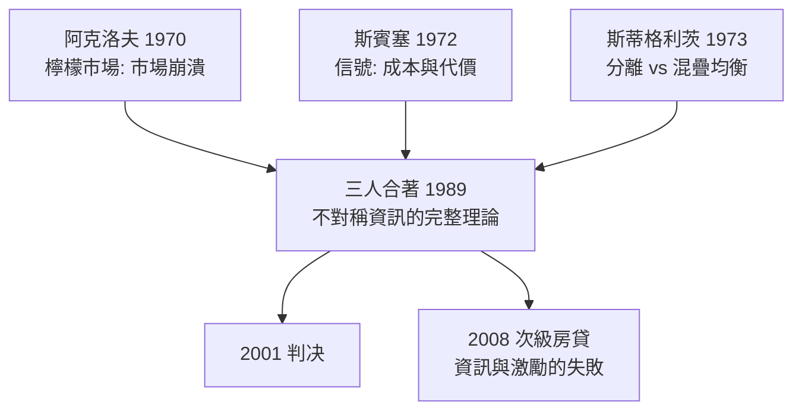

# 2001 · 懸案：市場為什麼會自己「壞掉」？——檸檬市場的證詞

> **2001 諾貝爾經濟學獎（瑞典央行紀念獎）：喬治·阿瑟·阿克洛夫 George Arthur Akerlof（美國，1940– ）安德魯·麥可·斯賓塞 Andrew Michael Spence（加拿大／美國，1943– ）與約瑟夫·尤金·斯蒂格利茨 Joseph Eugene Stiglitz（美國，1943– ）— 表彰他們「對不對稱資訊市場的分析」（for their analyses of markets with asymmetric information）。**

---

## 懸案（案情提要）

新古典經濟學的基本場景中，買賣雙方都有（或可取得）資訊，價格引導資源流向。但現實中：

1. **賣方知道車況，買方不知道**——二手車市場的成交價應該反映好車與壞車的加權平均。於是：好車的賣家覺得「賣低了，不賣」，市場上只剩壞車，價格再跌，好車更不賣——**市場可能完全崩塌**。這是 Akerlof 1970 年《檸檬市場》的場景。
2. **賣方能不能證明自己？** 若「證明成本高於收益」，好車的賣家永遠無法顯示品質——市場連好車都賣不掉。**解法是制度**：教育文憑（Spence）、保證、擔保、認證機構。
3. **買方也不是白紙**：若是賣方資訊多於買方（教育市場、醫療市場、金融市場），**買方**會被騙——逆向選擇的方向反轉；而且賣方有動機隱瞞（道德風險）。
4. **市場會自己修復嗎？** 在某些條件下，**分離（separating equilibrium）**可以存在（高學歷者與低學歷者分開定價）；但在另一些條件下，唯一均衡是**Pooling**（所有人同價），而此時高能力者的教育投資回報為零——**證據被摧毀**。

三人合著的《市場的不對稱資訊》（*Markets with Asymmetric Information*, 1989）是這樁案的完整卷宗。

---

## 前因

| 年份 | 事件 |
|---|---|
| 1970 | Akerlof〈「檸檬」市場：市場的不對稱資訊〉（《QJE》）：**本案的第一份證詞** |
| 1972 | Spence〈市場信號的可置信性〉（《QJE》）：**信號理論** |
| 1973 | Stiglitz〈競爭市場中的資訊〉（《QJE》）：**信號的均衡分析**（分離與混疊均衡） |
| 1974 | Spence〈市場信號：理論與實證研究〉；Stiglitz〈市場資訊與經濟理論的關鍵假設批判〉 |
| 1976 | Milgrom–Roberts 的「信號成本模型」：Stiglitz–Spence 均衡的對偶 |
| 1979 | Stiglitz 與 Weiss 在評審期刊上發表〈信號與資訊結構〉（評審期刊的絕佳例子） |
| 1980s | 金融市場的資訊經濟學（Jensen–Meckling、Myers–Majluf）；保險市場的資訊問題 |
| 1989 | 三人合著《市場的不對稱資訊》 |
| 1990s | 1996–97 美國住房抵押貸款市場的次級房貸危機（資訊不對稱 + 代理問題的實戰）；1997–98 亞洲金融危機（Stiglitz 對 IMF 處置的批評） |
| 2001 | 得獎；三位得主在觀點上並非一致（Stiglitz 反對全球化、Spence 反對大學價值貶值、資訊社會的樂觀論），委員會特意以「互補」而非「一致」描述 |

---

## 調查

### 線索一：Akerlof——檸檬市場與「市場的蒸發」

模型：賣方有車況 $s \in \{G, B\}$（好／壞），買方願付 $p$。好車的期望價值 $\frac{3}{4} \cdot v_G + \frac{1}{4} v_B$、壞車 $v_B$（$v_G > v_B$）。

若買方無法辨識，全部車以同質價格 $p$ 出售：

$$
p = \mathbb{E}[v \mid s] = \frac{3}{4} v_G + \frac{1}{4} v_B
$$

好車賣家的保留價格 $v_G > p$，因此**好車退出市場**。剩下的全是壞車，買方把價格下修到 $v_B$；壞車賣家也退出——**市場歸零**。這是經濟學史上最著名的「市場自發崩潰」場景。

**Akerlof 的政策含義**：**信任是經濟學的變數**。制度的作用是「還原資訊」——認證、保證、擔保、監管、品牌、專業化市場（如「只賣品質」的專賣店）——每種制度都在解決同一個問題：**誰能證明自己**。

關鍵的直覺：**平均價格低到某個點時，好品質的供給就完全退出**——這不是漸變，而是門檻效應（threshold effect），也是為何小額的制度干預（保證計畫、認證制度）能帶來不成比例的市場效果。

### 線索二：Spence——信號理論與「代價的權衡」

Spence 的偵查起點：教育的功能是什麼？傳統說「提高生產力」（人力資本，Becker 1992 案）；Spence 說：**教育也可以是純粹的信號（signal）——即使它不提高任何人的生產力**。

模型：個體類型 $\theta$（高／低能力），選擇行動 $a$（教育水準 $e$），成本 $c(e)$，收益是市場對 $a$ 的信念 $\mu(a)$ 所決定的工資：

$$
\max_{e} \; \mu(e) - c(e, \theta)
$$

**關鍵洞見——「代價（costliness）」才是信號有效的條件**：若高能力者接受教育的成本**比低能力者低**（Spence 的「成本反向假設」，即能力越高、學習越容易，邊際成本遞減），則高能力者選擇更多教育：

$$
c_e(e, \theta_H) < c_e(e, \theta_L)
$$

於是分開的（separating）均衡成立：**高能力者選高教育**（即使教育無生產力），因為高教育伴隨高工資；**低能力者不模仿**，因為模仿成本太高。

這解釋了為何「文憑inflation」會發生（所有人都去讀大學，學歷的訊號價值下降——Spence 與 Krueger 2010 年對美國大學回報的估計正是這種「教育的選擇性價值」）。

### 線索三：Stiglitz——分離與混疊均衡的嚴格分析

Stiglitz 1973 年的貢獻是**把信號理論放進一般均衡**，並給出**分離均衡的存在條件與不可能性條件**。

**分離均衡**（separating equilibrium）：

$$
\text{若 } e_H > e_L, \quad \text{則 } \mathbb{E}[\theta \mid e_H] > \mathbb{E}[\theta \mid e_L]
$$

**Pooling 均衡**（所有類型選同一水準教育 $e^*$）：

$$
\mu(e^*) = \mathbb{E}[\theta], \quad \text{且低能力者不偏離}
$$

**決定性定理（Stiglitz 的核心貢獻）**：若存在一個可能的**分離均衡**，則通常也存在一個 **Pooling 均衡**；而且在某些參數條件下，**Pooling 是唯一的均衡**。此時：

$$
\text{教育對高能力者的私人回報} = 0 \quad (\text{因為所有人的期望工資相同})
$$

$\rightarrow$ **教育作為信號的社會價值為零**，市場無法自己產生證據。這就是「教育的資訊外部性」問題，也是政府介入（強制教育、認證、統編教科書）的經濟學理由。

Stiglitz 還給出**政策含義的細分**：

- 若是**Pooling**（證據浪費）：**補貼教育**有正的社會收益；
- 若是**Separating**（證據有效）：補貼只補貼了那些本來就能獲得回報的人，社會收益為零甚至為負（純粹的平等化補貼）。

### 線索四：道德風險——合約之後的資訊問題

三人的框架還涵蓋了第二種不對稱：**合約簽訂後**的行為改變（道德風險）。Stiglitz–Weiss（1981）在信用市場的模型給出經典結果：在借貸市場上，**均衡可能無法配置資金給高風險高收益的借款人**（因為提高利率使平均收益更高，反而吸引更壞的借款人——逆選擇的惡性循環）：

$$
\text{提高利率} \;\Rightarrow\; \text{吸引更壞的借款人} \;\Rightarrow\; \text{市場效率下降}
$$

這解釋了為何存在配給（credit rationing）與抵押品要求。

### 線索五：制度解法總表

| 問題 | 制度解法 | 案例 |
|---|---|---|
| 賣方資訊多 | **第三方認證** | 食品檢驗、藥品批准、車輛檢驗 |
| 賣方資訊多 | **擔保與保固** | 產品保固、房屋檢驗報告 |
| 賣方資訊多 | **第三方托管** | 第三方託管支付、Escrow |
| 賣方資訊多 | **分拆市場** | 專賣店、專業市場 |
| 買方資訊多 | **信號** | 學歷、認證、排名、保單 |
| 雙方 | **契約與揭露要求** | 上市財報揭露、保險契約中的誠信條款 |
| 合約後 | **誘因相容條款** | 自留額、共保、里程碑付款 |

---

## 理論裁決

**裁決一**：當資訊不對稱時，**市場可能無法自發達到有效配置**——「檸檬市場」不是比喻，而是均衡的存在性與唯一性結果：

$$
\text{Pooling 均衡：} \quad p = \mathbb{E}[v], \quad \text{高類型退出} \;\Rightarrow\; \text{供給崩潰}
$$

**裁決二**：信號只有在**取得成本對不同類型不對稱**時才有效：

$$
c_e(e, \theta_H) < c_e(e, \theta_L) \;\Longrightarrow\; \text{分離均衡可能}
$$

**裁決三**：當分離均衡不存在（唯一均衡為 Pooling）時，**信號的社會價值為零**，此時教育補貼具有正的外部性；反之則補貼只是純再分配。

**裁決四**：**合約前**的資訊問題（逆向選擇）需要**篩選/信號/認證**；**合約後**的問題（道德風險）需要**誘因相容的契約設計**；兩者不可混用。

**裁決五**：**信任是一種經濟資產**；制度存在的理由之一，就是把「無法證明的品質」轉化為「可交易的信任」。

---

## 後果

| 領域 | 影響 |
|---|---|
| 政策應用 | 金融監管（2008 危機後的消費者保護、可疑活動報告）、醫療資訊與保險承保、學歷與證照制度、勞動市場的「信號 vs  productivity」之爭、二手車與房屋市場 |
| 學術 | 「資訊經濟學」成為一級領域；Stiglitz 的分離／混疊分析成為所有市場設計研究的起點；這也是 2007 年機制設計案的理論底座 |
| 實證 | Stiglitz 的「教育回報中多少是信號」估計；Pischke–Sipöcki 的選擇性測試；2010s 關於學歷通膨與技能溢價的爭論 |
| 爭議 | Stiglitz 對 IMF、全球化與 WTO 的批評使他成為全球爭議人物；反對者指其理論與政策主張「不一致」；Spence 與 Stiglitz 在大學教育價值上的公開分歧尤為轟動 |
| 跨獎 | 2016 契約理論（Hart–Holmström）、2007 機制設計、2020 拍賣理論、2022 銀行與危機——資訊問題是這幾案的共同核心 |

---

## 關聯

- [1996-Mirrlees與Vickrey不對稱信息](1996-Mirrlees與Vickrey不對稱信息.md)：IC/IR 條件下的機制設計——把本案的市場分析轉為規則設計。
- [1992-Becker人力資本與經濟分析](1992-Becker人力資本與經濟分析.md)：教育的「人力資本」解釋——Spence 對手方的解釋。
- [1978-Simon有限理性決策](1978-Simon有限理性決策.md)：資訊限制與搜尋成本的行為基礎（本書續寫中）。
- [2007-機制設計三人組](2007-機制設計三人組.md)：分離與混疊的制度化（本書續寫中）。
- [2016-Hart與Holmstrom契約理論](2016-Hart與Holmstrom契約理論.md)：道德風險的合約理論（本書續寫中）。
- [2022-Bernanke銀行與金融危機](2022-Bernanke銀行與金融危機.md)：資訊不對稱在金融系統的放大（本書續寫中）。
