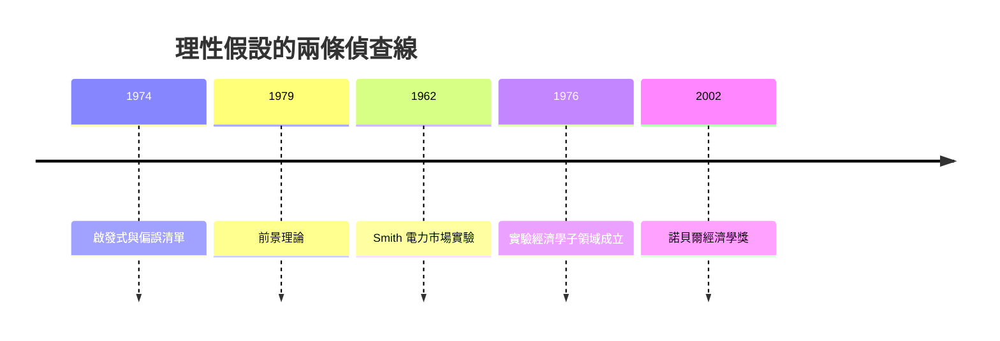

# 2002 · 懸案：人在不確定性下真的「理性」嗎？市場機制能被放進實驗室嗎？

> **2002 諾貝爾經濟學獎（瑞典央行紀念獎）：丹尼爾·卡尼曼 Daniel Kahneman（以色列／美國，1934–2024）與弗農·洛梅克斯·史密斯 Vernon Lomax Smith（美國，1927– ）— 表彰他們「對行為經濟學的貢獻，以及在實驗經濟學領域的工作，該工作確立了『實驗室實驗』作為經濟學實證分析的工具，特別是在研究替代市場機制方面」（for their contributions to behavioural economics and for their work in the field of experimental economics, which helped establish laboratory experiments as a tool in empirical economic analysis, especially in the study of alternative market mechanisms）。**

---

## 懸案（案情提要）

1970–90 年代，經濟學界的爭論有一條看不見的戰線：**理性假設該被當作真實描述，還是當作方便的假設？**

- **正方**（Samuelson、Friedman）：理性假設不必為真；只要能預測，就夠用了——「 Friedman 巨龍」的主張；
- **反方**（Simon 1978 案、Kahneman、Tversky）：心理學家累積的大量證據顯示，人在概率判斷與風險決策上系統性地偏離最優。

疑點三連：

1. **偏誤能否被精確描述並寫成公式？** 若是模糊的「人不理性」，就無法進入經濟模型；
2. **基準線從哪來？** 幾乎所有偏誤的度量都是「與理性答案的偏離」——**理性基準必須被明確寫出**；
3. **偏誤與不確定性的關係**：同樣的資訊，在**風險**（已知概率）下與**模糊性**（概率未知）下，判斷是否不同？

史密斯的偵查提供了另一條平行線：**市場能否被帶進實驗室？** 若能，經濟學家就能像物理學家做實驗那樣，在受控條件下觀察價格機制的運作。

---

## 前因

| 年份 | 事件 |
|---|---|
| 1954 | Kahneman 與 Tversky 相遇；1956–1973 合作研究直覺判斷與偏誤 |
| 1958 | Kahneman《注意與Effort的分配》 |
| 1969 | Kahneman 與 Tversky 發表第一篇《科學》期刊論文（信念量表） |
| 1971 | Kahneman 與 Tversky 論壇：人類在轉型期的風險選擇（前景理論的前身） |
| 1974 | Tversky & Kahneman〈判斷與決策的啟發式與偏誤〉（《科學》）：**系統性偏誤清單** |
| 1979 | Kahneman & Tversky〈前景理論：經濟行為的風險決策分析〉（《Econometrica》）：**本案的核心公式** |
| 1982 | Tversky & Kahneman〈The Simulation Heuristic》：**可得性啟發式** |
| 1983 | Kahneman & Tversky〈有限理性與回顧偏誤〉 |
| 1962 | Smith 在芝加哥大學完成第一個實驗經濟學實驗：**電力市場的拍賣設計**（隨後有著名的小型拍賣市場實驗） |
| 1965 | Smith〈實驗經濟學導論〉（《Fortune》） |
| 1976 | Smith 與 Cournot 網絡結合，開創「實驗經濟學」子領域 |
| 1980s–90s | 實驗經濟學制度化：芝加哥、紐約大學、普林斯顿、聖地牙哥（Smith、Thaler 的加州大學） |
| 2002 | 得獎；委員會的措辭特別強調「實驗室實驗作為實證分析工具」——這是本獎史上第一次為**方法論**（而非命題）立碑 |

---

## 調查

### 線索一：卡尼曼與特沃斯基的基準線——決策的兩個階段

卡尼曼的偵查起點是一個方法論問題：要說人「不理性」，必須先說清「理性」是什麼。他們提出**兩階段決策模型**：

$$
\text{（第一階段）} \; \text{選擇（值不值得賭）} \quad \longrightarrow \quad \text{（第二階段）} \; \text{對應（選哪個）}
$$

**第一階段用前景理論的價值函數**（對收益是凹的、對損失是凸的），**第二階段用概率加權函數 $\pi$** 對前景進行主觀加權。完整表達：

$$
V(x) = \sum_{i} \pi(p_i) v(x_i)
$$

其中 $v$ 是參考點 $z$ 相對的價值函數：

$$
v(x) = \begin{cases} x^{1-\alpha}, & x \geq 0 \\ -\lambda (-x)^{1-\alpha}, & x < 0 \end{cases}
$$

（$\alpha \approx 0.88$，$\lambda \approx 2.25$ 是典型估計值；$x = z + \text{變動}$，$z$ 為參考點。）

**概率加權函數**是全案最具顛覆性的部分：

$$
\pi(p) = \frac{p^{\gamma} \left[ p^{\gamma} + (1-p)^{\gamma} \right]^{1/\gamma - 1}}{\left[ p^{\gamma} + (1-p)^{\gamma} \right]^{1/\gamma}}
$$

（$\gamma \approx 0.61$）。它有四個性質：小概率被**放大**（$p$ 小時 $\pi(p) > p$）、中等概率被**高估**、大概率被**低估**、$\pi(0)=0$、$\pi(1)=1$。

### 線索二：四大偏誤的「證物清單」

Kahneman 與 Tversky 1974 年的清單至今仍是教科書骨幹，每一條都有實驗任務與經濟含義：

| 偏誤 | 實驗任務 | 經濟含義 |
|---|---|---|
| **代表性啟發式** | 描述某人的出生地，判斷其職業為「農夫」或「律師」的機率 | 忽略**基準率**（base rate neglect）$\rightarrow$ 稀有事件的過度判斷 |
| **可得性啟發式** | 從一個列表中挑出「更常見的死亡原因」 | 高頻但易被想起的事件被高估 $\rightarrow$ 保險定價、彩票賭注偏誤 |
| **錨定與調整** | 轉盤任意停在 10 或 65，再問估值 | 任意起點影響判斷 $\rightarrow$ 談判、拍賣保留價、房價參考點 |
| **框架效應** | 同一結果用「存活／死亡」或「獲得／失去」表述 | 語言框架改變選擇 $\rightarrow$ 衛生政策、退休帳戶的預設選項 |

其中**基準率忽視**有最直接的經濟學意義：醫療檢測的陽性預測值問題。

$$
P(\text{有病} \mid \text{陽性}) = \frac{P(\text{陽性} \mid \text{有病}) P(\text{有病})}{P(\text{陽性})}
$$

即使檢測靈敏度 99%，若患病率只有 $1\%$，則陽性預測值只有約 50%——而醫生與公眾常犯「代表性啟發式」的錯誤。這正是「市場失靈」在資訊與風險溝通上的具體版本。

### 線索三：損失 aversion 與「現成的參考點」

$\lambda \approx 2.25$ 的意義：**失去 100 元的痛苦約等於得到 225 元的快樂**。這解釋了：

1. **風險厭惡的來源不是對波動的厭惡，而是對損失的厭惡**（同樣的變動幅度，以「損失」框定會被強烈拒絕）；
2. **現狀的特權地位**（status quo bias）——不改變任何事，在心理上被當作「不選」，因此被偏好；
3. **損失厭惡如何扭曲投資決策**：投資者不實現虧損（disposition effect），導致「賣出者比例」遠低於理性模型的預測。

### 線索四：Smith 的實驗經濟學——把市場搬進實驗室

史密斯的偵查起點：市場機制的效果（如拍賣規則的差異）**在真實市場裡難以對照實驗**——無法讓同一個城市用兩種規則。他提出的替代方案：**實驗室市場**。

實驗經濟學的設計三要素：

1. **主體**：真實的人（學生、消費者），在激勵下做真實決策（有真錢）；
2. **制度**：由實驗者設定的市場規則（拍賣、招標、協商、網路實驗）；
3. **控制**：其他條件（資訊結構、參與者數、成本）被刻意操縱，形成**可對照的樣本**。

第一個實驗（1962 年）：**電力市場拍賣**。史密斯把真實電力市場（需報價、複雜費率的傳統招標）搬進實驗室，簡化為統一費率的拍賣，觀察價格與成交量的行為——結果顯示**簡化制度帶來顯著效率提升**。這成為「機制設計的實驗證據」的里程碑。

後續經典實驗：公共品實驗（Olson 的邏輯 vs 邊際收益分攤）、「最後通牒」實驗（拒絕不平等分配）、Ultimatum 與 Dictator 實驗（市場與階層的效率—公平取捨）、巴西南部「抽籤實驗」（Chamberlin 與 Smith 1987：佃農面對抽籤配給的反應是**破壞農具**——這是「反市場」行為的最著名證據）。

### 線索五：偏誤可否被「經濟學化」——三種可能

卡尼曼 2002 年的諾貝爾演講《Maps of Bounded Rationality》提出偏誤研究的定位問題：偏誤可以

1. 是**理性的無關細節**（rationality 之外的小瑕疵）；
2. 導致**系統性偏差但可被學習抵銷**（如農業專家的判斷，Kahneman & Tversky 2006 的「噪音」研究）；
3. 導致**持久的市場扭曲**（如處方過度、泡沫、歧視性差異）。

他本人的立場是第三種的溫和版本：**制度可以設計來減少偏誤的後果**——這正是 2017 年 Thaler 案「助推」的起點。

---

## 理論裁決

**裁決一（前景理論）**：人在風險下的選擇不是期望效用的線性加總，而是**參考點依賴**的價值函數 $\times$ **概率扭曲**：

$$
V(x) = \sum_i \pi(p_i) v(x_i), \qquad \pi(p) \neq p, \qquad v'' > 0 \ (x>0), \ v'' < 0 \ (x<0)
$$

**裁決二**：價值函數在損益兩側**不對稱**（$\lambda > 1$），因此「損失的權重高於等額收益」。

**裁決三**：決策分為「選擇」與「對應」兩階段，各自遵循不同規則——這解釋了為何人們的選擇與加權的直覺不一致。

**裁決四（偏誤清單）**：代表性、可得性、錨定、框架是可重複、可檢驗、可教導的系統性偏誤。

**裁決五（實驗經濟學）**：**實驗室是經濟學的合法現場**：真實動機、真實貨幣、可控制度，使市場機制的效果可以被**因果地**比較。

**裁決六（對稱性）**：理性偏差在**賣方**同樣存在——實驗顯示賣方也會被資訊與框架影響（例如「錨定」出現在工資談判中）；故偏誤不是市場的例外，而是市場的常態。

---

## 後果

| 領域 | 影響 |
|---|---|
| 政策應用 | 「助推」與預設選項（2017 案）、退休帳戶的自動加入（美國 2006 年《雇主退休收入保障法》）、器官捐獻的預設選項制度、醫療與菸草的政策溝通、GDPR 的隱私預設 |
| 學術 | 行為經濟學成為主流分支；實驗經濟學制度化為一級領域（Smith 的學生遍佈全球）；2010s 的行為公共政策研究 |
| 實證 | 偏好誤差的量測（time-lottery 等方法）；市場經紀人的偏誤（disposition effect）；經濟學家自己在預測中的偏誤 |
| 爭議 | 「軟性」vs「硬性」科學之爭；行為經濟學被批「把心理學的無關發現硬套進經濟」；Samuelson 式的「但模型不必為真」辯論再起 |
| 跨獎 | 2017 Thaler（助推）、2013 Shiller（行為金融）、2004 Kydland–Prescott（有限理性與政策）、2024 制度與繁榮（制度能否抵銷偏誤） |

---

## 關聯

- [1978-Simon有限理性決策](1978-Simon有限理性決策.md)：有限理性的先聲——本案給出可計算的版本。
- [1976-Friedman貨幣主義與永久收入](1976-Friedman貨幣主義與永久收入.md)： Friedman「模型不必為真」的辯論，是本案的靶心。
- [1994-Nash-Harsanyi-Selten非合作賽局均衡](1994-Nash-Harsanyi-Selten非合作賽局均衡.md)：實驗對均衡預測的檢驗（最後通牒博弈）。
- [2017-Thaler行為經濟學與助推](2017-Thaler行為經濟學與助推.md)：偏誤的制度對策（本書續寫中）。
- [2013-Fama-Hansen-Shiller資產價格](2013-Fama-Hansen-Shiller資產價格.md)：行為金融學與效率市場的對決（本書續寫中）。
- [2019-Banerjee-Duflo-Kremer RCT反貧困](2019-Banerjee-Duflo-Kremer RCT反貧困.md)：行為偏誤在發展政策中的運用（本書續寫中）。
