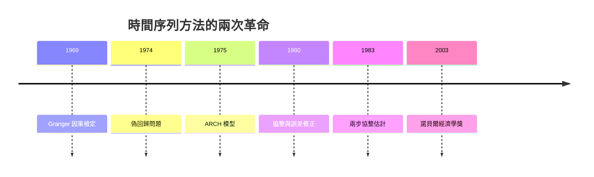

# 2003 · 懸案：經濟數據會「自己製造」波動嗎？兩個變數是否真的一起走？

> **2003 諾貝爾經濟學獎（瑞典央行紀念獎）：羅伯特·弗萊·恩格爾 Robert Fry Engle III（美國，1942– ）與克萊夫·威廉·約翰·格蘭傑 Sir Clive William John Granger（英國，1934–2009）— 表彰他們「對經濟時間序列分析方法，特别是對時變波動率（ARCH）與協整的貢獻」（for their methods of analyzing economic time series with time-varying volatility (ARCH) and cointegration）。**

---

## 懸案（案情提要）

1980 年代前的經濟計量學，處理時間序列有兩個難以忍受的假設：

1. **波動率是固定的**：迴歸的同方差假設 $\operatorname{Var}(u_t) = \sigma^2$ 意味著「大蕭條與太平年份的雜訊一樣大」——但股市的日波動與戰時的通脹顯然不同。恩格爾的問題：**波動率本身是否是隨機的？**
2. **兩個變數同向移動，不代表有因果關係**：股價與物價、GDP 與消費長期同向——這是**趨勢**造成的（共同單調性），還是真正的經濟關係？若只是趨勢，任何兩個變數都會「高度相關」——迴歸的 $R^2$ 會虛高。格蘭傑的問題：**怎麼區分「真實關係」與「共同趨勢」？**

兩人的答案分別是 **ARCH 家族**（波動率建模）與**協整**（長期關係的辨識），共同重寫了經濟學家處理時間序列的方式。

---

## 前因

| 年份 | 事件 |
|---|---|
| 1962 | Granger 在劍橋完成博士；1965 年發表「因果檢定」的統計方法 |
| 1969 | Granger 的〈經濟變數間的因果關係〉（《Econometrica》）：**因果檢定**（Granger causality） |
| 1974 | Granger & Newbold 的「偽回歸」論文：兩個隨機遊走的迴歸會產生顯著係數——**協整問題的引爆點** |
| 1975 | Engle 的 ARCH 論文發表於《美國經濟學評論》 |
| 1978 | Engle 的「波動性的ARCH檢定」 |
| 1980 | Engle & Granger 的「協整與誤差修正表示」：《長期關係與誤差修正》的經典論文（Econometrica） |
| 1982 | Engle《ARCH：時間序列的波動性預測》教科書 |
| 1983 | Engle–Granger 兩步協整估計法問世 |
| 1986 | Engle 與 Granger 共同獲得諾貝爾獎提名級的「諾貝爾獎候選」稱譽（Frisch Medal） |
| 1990s–2000s | ARCH 家族擴展（GARCH、EGARCH、Realized Volatility）；協整分析成為宏觀經濟的標準工具（單位根檢定、Phillips–Perron、Engle–Granger 檢定） |
| 2003 | 得獎；委員會特別指出兩項成果「根本改變了經濟學家分析金融與宏觀資料的方式」 |

---

## 調查

### 線索一：恩格爾——波動率是隨機的，而且可預測

恩格爾的偵查起點：觀察股票報酬的「波動聚集（volatility clustering）」現象——大波動之後往往接著大波動。這與同方差假設完全不符：若波動固定，「大波動聚集」只是隨機巧合，但實證上它極為顯著。

**ARCH 模型**（$p$ 階）：

$$
u_t = \sigma_t \varepsilon_t, \qquad \varepsilon_t \sim (0,1) \text{ i.i.d.}
$$

$$
\sigma_t^2 = \omega_0 + \alpha_1 u_{t-1}^2 + \alpha_2 u_{t-2}^2 + \cdots + \alpha_p u_{t-p}^2
$$

（$\varepsilon_t$ 為標準化創新；常態下 $u_t$ 服從 $t$ 分布，這提供ARCH 模型的**峰度與厚尾的統計理由**。）

**ARCH 的經濟含義**：**波動率有記憶**——今天的高波動提高了明天的波動預期。而這是**可預測的**，因此波動率成為可交易的對象（波動率衍生品、VIX），並為風險管理提供基礎。

**ARCH 的隱含統計推論**：若正確設定了 ARCH 模型，則 $u_t / \sigma_t$ 應為白噪聲——這給出**檢驗假設的方法**（ARCH-LM 檢定、殘差平方的相關性檢定）。恩格爾因此獲得 1980 年的諾貝爾提名與 2003 年的諾貝爾獎。

**GARCH 的擴展**（Bollerslev, 1986）：把平方項換成遞推的方差：

$$
\sigma_t^2 = \omega_0 + \alpha u_{t-1}^2 + \beta \sigma_{t-1}^2
$$

其中 $\alpha + \beta < 1$ 保證方差平稳，$\alpha + \beta \to 1$ 對應「**持續性（persistence）**」——這正是 2008 危機中波動率持續性急劇上升的量化描述。

### 線索二：格蘭傑——因與果的統計定義

格蘭傑 1969 年的貢獻：給「因果」一個可操作的統計定義。

**Granger 因果**：$X$ Granger 導致 $Y$，若對 $Y$ 的預測中，加入 $X$ 的**過去值**會改善預測表現：

$$
Y_t = \sum_{i=1}^{p} \alpha_i Y_{t-i} + \sum_{j=1}^{q} \beta_j X_{t-j} + \varepsilon_t
$$

檢驗原假設 $H_0: \beta_1 = \beta_2 = \cdots = \beta_q = 0$。

其重要性在於把「因果」從哲學爭論搬進統計檢驗——儘管它**不**處理真正的結構因果（這是 1995 年 Lucas 批判與 2021 年因果推斷革命要補的課）。

### 線索三：偽回歸與單位的根——協整問題的完整診斷

格蘭傑與紐博爾 1974 年的發現：兩個獨立的隨機遊走

$$
y_t = y_{t-1} + \varepsilon_t, \qquad x_t = x_{t-1} + \eta_t
$$

之間的回歸會產生**高度顯著**的係數與虛高的 $R^2$——因為分母中有一個共同趨勢。這是「偽回歸（spurious regression）」。

診斷工具是**單位根檢定**（Dickey–Fuller、Phillips–Perron）：

$$
\Delta y_t = \alpha + \gamma y_{t-1} + \sum \delta_i \Delta y_{t-i} + \varepsilon_t
$$

若 $\gamma < 0$ 且顯著，則 $y_t$ 是**平穩過程（stationary）**；否則是單位根（I(1)）過程。

### 線索四：協整——「長期關係」的精確定義

**協整（cointegration）**：$y_t$ 與 $x_t$ 各自是 I(1)（各自都含趨勢、都不平穩），但它們的某個線性組合是平穩的：

$$
y_t - \beta x_t = u_t, \qquad u_t \sim \text{stationary}
$$

這意味著：**兩者之間存在不隨時間漂移的長期關係**——它們「一起走路」，但步幅不同步。經濟學的例子：

- 消費與收入（永久收入假說）；
- 短期與長期利率（期限結構）；
- 兩國的貿易與相對價格（真實匯率的單位根）；
- 股票價格與股利。

**Engle–Granger 兩步估計法**：

1. **第一步**：迴歸 $y_t$ 對 $x_t$（用 OLS 或 DOLS），得 $\hat{\beta}$；
2. **第二步**：對殘差 $\hat{u}_t = y_t - \hat{\beta} x_t$ 做單位根檢定（ADF）。

**Engle–Granger 檢定統計量**：

$$
t = \hat{\tau}_{ADF}(\hat{u}_t)
$$

**Johansen 方法**（1991）：用系統的向量自回歸（VECM）與特徵值檢定，可處理多個變數並同時檢定協整秩。

### 線索五：誤差修正表示（ECM）——把長期與短期接起來

協整關係的存在意味著變數不能「跑得太遠」。Engle 與 Granger 1980 年的**誤差修正表示（ECM）**是本案的收官之作：

$$
\Delta y_t = \lambda (y_{t-1} - \beta x_{t-1}) + \sum \phi_i \Delta x_{t-i} + \cdots + \varepsilon_t
$$

其中 $\lambda$ 是**修正速度**（$0 < \lambda < 1$）：偏離長期關係的部分，每期被「拉回」$\lambda$ 的比例。$\lambda$ 越大，均衡調整越快。

ECM 的決定性優點：**所有變數都以差分形式進入**（平穩），卻保留了長期關係的資訊——避免了偽回歸，同時不丟失經濟結構。

### 線索六：實踐的應用場景

- **風險管理**：ARCH–GARCH 驅動的 VaR 與預期短缺（Expected Shortfall），成為 1990s 巴塞爾協定的基礎；
- **宏觀預測**：匯率、股價與利率的預測模型；
- **檢定單位根**：1990s 亞洲金融危機後的「東亞神話」檢驗（資本流入是否帶來實質匯率變化）；
- **2010s**：協整與結構斷點（structural breaks）結合，用於「單位根 vs 趨勢斷點」的檢驗辯論。

---

## 理論裁決

**裁決一（恩格爾）**：**波動率本身是隨機的、持久的、可預測的**；ARCH 給出其動態方程，並解釋了厚尾與波動聚集：

$$
\sigma_t^2 = \omega_0 + \sum_{i=1}^{p} \alpha_i u_{t-i}^2
$$

**裁決二（格蘭傑）**：「因果」可用**預測的增量**來定義與檢驗（Granger 因果），使經濟學的因果語言具有可操作內容。

**裁決三**：**共同趨勢會製造假的關係**；變數必須先做單位根診斷，兩個 I(1) 變數只有在協整時才存在真實的長期關係：

$$
y_t, x_t \sim I(1), \qquad y_t - \beta x_t \sim I(0)
$$

**裁決四**：誤差修正表示把長期關係（協整向量）與短期動態（差分形式）統一在同一模型中：

$$
\Delta y_t = \lambda (y_{t-1} - \beta x_{t-1}) + \cdots
$$

**裁決五**：方法論上的雙重要求——**診斷先行**（平穩性與單位根）、**再建模**；任何時間序列回歸若未做單位根檢定，其結果不可信。

---

## 後果

| 領域 | 影響 |
|---|---|
| 政策應用 | 風險管理與資本充足（VaR/ES）、外匯與利率的風險管理、央行資產負債表分析、債務可持續性分析（協整檢定與斷點） |
| 學術 | 宏觀經濟學的經驗研究全面採用 VECM/ARDL/局部投影；2010s 隨機趨勢與局部投影（local projections）方法成為主流 |
| 數學 | 單位根與協整的檢定統計量（ADF、PP、Johansen）、斷點檢定（Bai–Perron）、非線性與非對稱 ARCH（EGARCH、GJR） |
| 後續諾獎 | 2009 Ostrom–Williamson（治理）、2011 Sargent–Sims（向量自回歸與宏觀因果）、2013 Fama–Hansen–Shiller（資產價格的實證）、2015 Deaton（時間序列與消費波動） |
| 爭議 | 「協整結果對檢定方法敏感」；單位根檢定的低檢定力（1990s 大批判）；Engle–Granger 兩步法在多變數情形下有偏；2010s 「單位根 vs 斷點」大辯論至今未平 |

---

## 關聯

- [1969-Frisch與Tinbergen計量經濟破案術](1969-Frisch與Tinbergen計量經濟破案術.md)：計量經濟學的起點；本案的統計工具正是它的技術深化。
- [1989-Haavelmo概率論基礎](1989-Haavelmo概率論基礎.md)：抽樣理論與漸近推論的地基（本書續寫中）。
- [2011-Sargent與Sims宏觀因果](2011-Sargent與Sims宏觀因果.md)：VAR 與結構因果的接續（本書續寫中）。
- [2013-Fama-Hansen-Shiller資產價格](2013-Fama-Hansen-Shiller資產價格.md)：波動與泡沫的實證（本書續寫中）。
- [2022-Bernanke銀行與金融危機](2022-Bernanke銀行與金融危機.md)：ARCH 與風險管理在危機中的失效（本書續寫中）。
- [1986-Buchanan公共選擇理論](1986-Buchanan公共選擇理論.md)：格蘭傑因果在政策評估中的應用（本書續寫中）。
