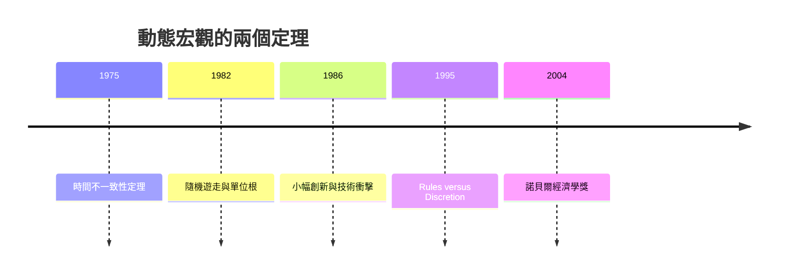

# 2004 · 懸案：政策制定者會「違約」嗎？景氣循環到底是誰在推？

> **2004 諾貝爾經濟學獎（瑞典央行紀念獎）：芬恩·厄林·基德蘭 Finn Erling Kydland（挪威，1943– ）與愛德華·克里斯蒂安·普雷斯科特 Edward Christian Prescott（美國，1940–2022）— 表彰他們「對動態宏觀經濟學的貢獻：經濟政策的時間一致性與驅動景氣循環的力量」（for their contributions to dynamic macroeconomics: the time consistency of economic policy and the driving forces behind business cycles）。**

---

## 懸案（案情提要）

1990 年代的宏觀經濟學有兩個懸而未決的問題，正好互為表裡：

1. **政策可信度**：政府宣布「未來不放寬貨幣」，但到了通脹的時候卻忍不住放寬——公眾會相信嗎？如果不信，政策本身是否自我否定？即使政府**想**遵守承諾，**能不能**？（時間一致性問題）
2. **景氣循環的來源**：波動究竟是「需求不足」（凱恩斯式，需要貨幣與財政刺激）還是「供給衝擊」（技術進步一時難以吸收，需要工時與工資的調整）？這兩種解釋導出**完全相反的政策處方**。

基德蘭與普雷斯科特用同一套工具——**動態規劃與隨機過程**——回答了兩題，並因此重寫了 1990 年代的宏觀教科書。

---

## 前因

| 年份 | 事件 |
|---|---|
| 1967–1970 | 普雷斯科特在芝加哥大學商學院任教（與盧卡斯同期），研究隨機過程與動態規劃 |
| 1970 | Kydland 在挪威的「經濟政策計畫」委員會工作（Ok 等 15 人委員會），實務上遭遇「政策缺乏可信度」的問題 |
| 1970 | Prescott 與 Husso（1971）論證：**前瞻性政策無法以狀態變數規則執行**（政策必須是時間一致的） |
| 1973 | Kydland 在《政治經濟學》發表〈經濟政策不具時間一致性〉 |
| 1975 | Kydland 與 Prescott〈時間一致性與最優控制理論〉（《公共選擇》）：**時間不一致性定理** |
| 1976 | Prescott 論證：**小家庭（small family）壞處**——跨代存摺是福利上的「不幸」，因為無後代的個人無法為子孫犧牲 |
| 1982 | Prescott 的實證經濟學革命（Time Series Properties of Macroeconomic Data）：**單位根與隨機遊走**的系統檢定，撼動了當時的主流結構模型 |
| 1986 | Prescott 的「**節省 durum 與小事（small things）**」：技術進步的邊際貢獻來自小幅度的不規則創新，而非大型研發 |
| 1988–1990 | **實際經濟週期（Real Business Cycle）**理論成型：Prescott 的「技術衝擊說」；1990 年他與一些學者發起「RBC 的復興」宣言 |
| 1995 | Kydland–Prescott 的教科書《規矩、跨期均衡與貨幣政策》（*Rules versus Discretion*）問世；盧卡斯批判的檢驗問題 |
| 1996–2002 | 諾貝爾委員會曾反覆檢視 RBC 理論是否「too good to be true」；2003 年終於通過 |
| 2004 | 得獎 |

---

## 調查

### 線索一：時間不一致性定理——政策制定者的「違約」是結構性的

基德蘭的偵查起點是 1970 年挪威的實務：他參與的委員會面對「工資—物價螺旋」與政府不斷改變政策的問題。理論化如下。

政策制定者最大化：

$$
\max_{\{u_t\}} \; \mathbb{E}_0 \sum_{t=0}^{\infty} \beta^t \pi(x_t, u_t)
$$

其中 $x_t$ 是狀態變數。關鍵在於**時間點**：在時期 1，政策制定者重新最佳化，並且**不再受時期 0 的承諾約束**（無可信的自我約束機制）。

**定理（時間不一致性）**：若存在一個狀態 $\hat{x}$，使得

$$
\pi(\hat{x}, u^f) > \pi(\hat{x}, u^s) \quad \text{（事後最優 $u^f$ 優於事前宣告的 $u^s$）}
$$

則事前宣告的政策**不是**最優政策；且事後最優政策隨狀態變動，**不具時間一致性**。直觀例子：央行宣布「為抑制通脹，通脹率將上升至 $x\%$ 時收緊貨幣」——一旦通脹真的達到 $x\%$，央行發現「收緊」不如「容忍」更合算，於是違約；公眾於是理性地預期違約，宣告從一開始就無效。

**解方：規則或信譽**。基德蘭與普雷斯科特給出三種可執行方案：

1. **事前承諾（commitment）**：央行放棄裁量權，採用事先公開的規則（如固定的貨幣成長率）；
2. **聲譽（reputation）**：反覆博弈中，違約的收益若小於未來收益，則可信；
3. **授權（delegation）**：交給不受選舉壓力的獨立機構（央行獨立性的理論基礎）。

政策含義：**貨幣政策必須「rule-like」**——不是因為裁量必然壞，而是因為**時間不一致性使得裁量的宣布無法被相信**。

### 線索二：Kydland–Prescott 的最優政策規則

在設定「央行關心的是通脹與產出的加權」，最優政策規則為（線性二次近似）：

$$
y_t - y^* = \phi (y_{t-1} - y^*) + \varepsilon_t + \mu \left( \pi_t - \pi^* \right)
$$

即：**產出缺口對通脹有反應**（Phillips 曲線的動態形式），且政策具有「前瞻性」。這條規則成為 **Taylor 規則**（John Taylor 1993）的理論原型：

$$
i_t = r^* + \pi_t + \alpha (\pi_t - \pi^*) + \beta (y_t - y^*)
$$

**Taylor 規則**（1993 年的一篇備忘錄）後來成為全球央行的事實上的政策反應函數，並帶來「盧卡斯（1993）評論」的相關性——這正是「時間一致性」從理論走向政策實務的橋樑。

### 線索三：普雷斯科特的隨機遊走革命——「傳統」被證偽

1982 年，普雷斯科特用當時罕見的樣本外檢驗能力，對當時主流的巨觀結構模型（ consumption smoothing 型的 IS–LM 模型）做統計檢驗，結論：**多數巨觀時間序列是隨機遊走**。

$$
y_t = y_{t-1} + \varepsilon_t
$$

若成立，則盧卡斯式的「永久收入」假說得到支持，**平滑消費與貨幣的積極作用都被否定**。這場「實證經濟學革命」讓兩個截然不同的理論（新的古典實際經濟週期與新的凱恩斯）**站在了同一塊共同地基上**：

$$
\text{所有變數都是隨機遊走} \;\Longrightarrow\; \text{唯一的驅動力量是隨機衝擊}
$$

普雷斯科特因此獲得 2003 年的諾貝爾獎提名（與 Engle 同時被提名）。

### 線索四：實際經濟週期——波動來自技術衝擊

RBC 的核心命題：**技術衝擊同時解釋了產出波動與要素報酬波動**，而不需要貨幣或需求擾動。

具體機制：技術進步提高邊際產出，於是工時上升、工資上升、利潤上升；但由於要素市場的調整需要時間，產出在上升的過程中**過度波動**。形式上，在隨機技術 $A_t$ 下：

$$
Y_t = A_t F(N_t, K_t), \qquad N_t = N^{d}(w_t / A_t^{1/(1-\alpha)})
$$

關鍵的「**時間不一致的要素價格**」：技術衝擊的**永久部分**（長期生產力）與**過渡部分**（要素價格的調整）交疊，使得產出波動幅度遠大於技術本身的波動——這就是「**過度波動的悖論（paradox of increasing returns）**」，RBC 理論最尖銳的技術難題。

Prescott 的「小幅創新」說（1986）：技術進步並非來自重大研發突破，而是來自**不規則、難以預測的小幅改良**——因此技術衝擊是**永續的**：

$$
A_t = A_{t-1} e^{\mu + \varepsilon_t}, \qquad \varepsilon_t \sim N(0, \sigma^2)
$$

這解釋了為何產出波動可以在**沒有任何貨幣擾動**的情況下出現，也解釋了為何產出與股價同向波動（q 理論，1981 案）。

### 線索五：跨代學說與「小家庭」問題

普雷斯科特另一條重要支線（1976）：儲蓄的代際外部性。一個沒有子女的人無法從子孫的消費中獲得效用，因此他會**過度儲蓄**；這對社會是淨損失（子孫本可消費更多）：

$$
\max \; \sum_{t=0}^{\infty} \beta^t u(c_t) \quad \text{vs.} \quad \text{社會最優（含對子孫的關心）}
$$

普雷斯科特因此主張**跨代-transfer**（遺產激勵、遺囑），並認為**年金**（annuity）是解決這個問題的制度——這與 2020 年代的「退休與遺產」研究直接相關。

---

## 理論裁決

**裁決一（時間不一致性）**：若政策制定者在未來可以重新最佳化，則**事前宣布的政策無法被相信**；政策必須透過承諾、信譽或授權以獲得可信性：

$$
\pi(\hat{x}, u^f) > \pi(\hat{x}, u^s) \;\Longrightarrow\; u^s \text{ 不是時間一致的政策}
$$

**裁決二**：可信的最優政策規則是**線性反應函數**（泰勒規則的原型）：

$$
i_t = r^* + \pi_t + \alpha (\pi_t - \pi^*) + \beta (y_t - y^*)
$$

**裁決三（隨機遊走）**：宏觀變數的**多數是隨機遊走**，因此貨幣的積極作用在資料中找不到蹤跡——這是對盧卡斯批判的經驗回應（1995 案）。

**裁決四（實際經濟週期）**：**技術衝擊**（永續的小幅創新）足以解釋產出與要素報酬的波動，不需要需求擾動：

$$
A_t = A_{t-1} e^{\mu + \varepsilon_t}
$$

**裁決五**：跨代儲蓄存在**代際外部性**，需要制度（年金、遺產激勵）校正。

**裁決六（方法論）**：理論必須經得起**統計檢驗**——普雷斯科特對傳統模型的重裝備，使 1990 年代的宏觀經濟學進入「模型競爭」時代。

---

## 後果

| 領域 | 影響 |
|---|---|
| 政策應用 | 央行獨立性、通脹目標制、前瞻性指引（把貨幣政策變成「規則」）、財政規則與主權基金（規則化的財政政策） |
| 學術 | 實際經濟週期與新凱恩斯經濟學的雙寡頭格局；DSGE 模型的興起；校準（calibration）取代估計成為宏觀的主流方法 |
| 實證 | 隨機遊走與單位根的普及；RBC 的跨國實證檢驗（Prescott 的「全要素生產力」（TFP）的實證測量成為跨國生產率比較的標準） |
| 爭議 | 「RBC 是否太漂亮」；工資剛性與貨幣非中性上的長期分歧；2008 危機後 RBC 被批無法解釋金融加速器；Kydland–Prescott 與 Mundell（1999 案）在「資本流動性對政策效果的影響」上公開論戰（2000 年 NBER 研討會的著名交鋒） |
| 跨獎 | 1995 Lucas（理性預期）、2003 Engle–Granger（隨機遊走的方法基礎）、2011 Sargent–Sims（宏觀因果）、2018 Romer（技術進步的內生化） |

---

## 關聯

- [1995-Lucas理性預期](1995-Lucas理性預期.md)：盧卡斯批判的提出與本案的經驗回應。
- [1999-Mundell最優貨幣區](1999-Mundell最優貨幣區.md)：Kydland 與 Mundell 關於資本流動性的著名論戰。
- [1987-Solow增長理論](1987-Solow增長理論.md)：外生技術進步的版本；本案把技術衝擊變成波動的來源。
- [2003-Engle與Granger時間序列](2003-Engle與Granger時間序列.md)：隨機遊走檢定的技術基礎（本書續寫中）。
- [2011-Sargent與Sims宏觀因果](2011-Sargent與Sims宏觀因果.md)：結構宏觀的實證工具（本書續寫中）。
- [1981-Tobin托賓q與金融市場](1981-Tobin托賓q與金融市場.md)：q 理論解釋股價與產出的同向波動（本書續寫中）。
