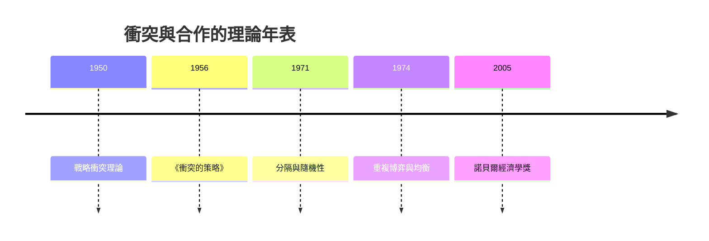

# 2005 · 懸案：囚徒困境裡的「理性人」為何無法合作？分隔線如何形成？

> **2005 諾貝爾經濟學獎（瑞典央行紀念獎）：羅伯特·約翰·奧曼 Robert John Aumann（以色列／美國，1930– ）與湯瑪斯·克朗普比·謝靈 Thomas Crombie Schelling（美國，1921–2016）— 表彰他們「對衝突與合作賽局理論的開創性貢獻」（for their pioneering contributions to the analysis of conflict and cooperation）。**

---

## 懸案（案情提要）

納什（1994 案）告訴我們：在囚徒困境中，**納什均衡是「你背叛我、我背叛你」**。但現實中，兩個人反覆互動的場合（國際軍備控制、貿易談判、勞資協約、社區互助）卻經常出現合作。疑點四連：

1. **合作為什麼可能？** 若理性人必然背叛，重複博弈將無合作——但實證上重複博弈實驗裡合作率很高；
2. **分隔線如何形成？** 明明是同質的個體、對稱的處境，為什麼會自發分成「這邊」與「那邊」——種族分隔、社區分裂、選舉地盤？既然沒有天生差異，**分裂是從哪裡長出來的**？
3. **強制與自願的界線在哪？** 麥克漢–索克（Michael–Soule）自願管理協定、聯合國自願減排、軍備控制條約——自願承諾為何有效、何時崩潰？
4. **策略的「模糊性」是好是壞？** 故意讓對方無法確定你的行動（randomization、threats），是威懾策略還是自毀？

奧曼與謝靈的偵查，把「合作／衝突」從道德問題轉成**策略互動的幾何學**。

---

## 前因

| 年份 | 事件 |
|---|---|
| 1944 | 謝靈在哈佛；其博士論文《國民經濟的貨幣理論》（1944）成為新古典綜合的組成部分 |
| 1946–1950 | 謝靈在芝加哥大學商學院；開始研究**戰略互動** |
| 1950 | 謝靈〈擴展經濟穩定性的 Toward a Theory of Strategic Conflict》 |
| 1956 | 謝靈《The Strategy of Conflict》問世：**最小規模威懾、威懾與承諾、仲裁的經濟學** |
| 1960s | 謝靈因越南戰爭與軍備控制研究獲諾貝爾和平提名（未得獎） |
| 1970s | 謝靈的「分隔與隨機性」研究（1971 年 RAND 論文〈動態系統中的分隔與隨機性〉） |
| 1970 | 奧曼在以色列希伯來大學；開始研究**重複博弈與通訊** |
| 1973–1974 | 奧曼〈反覆博弈的延伸與完全競爭理論〉（*Extending the Theory of Repeated Games*）：**「觸發策略（grim trigger）」的均衡** |
| 1980s | 奧曼的**重複博弈的連續極限**（continuous-time repeated games）與**共同監控（monitoring）** |
| 1990s | 奧曼與「以色列的和平協議」——他的「理性和平論」與實際外交的關係引發爭議 |
| 1997 | 奧曼與 Maschler 與各種公共政策的建議信 |
| 2005 | 得獎；委員會稱讚他們「以數學與分析的方法，重新塑造了對衝突、合作與人類互動的理解」 |

---

## 調查

### 線索一：謝靈的「最小規模威懾」——權力的幾何學

謝靈的第一個大發現：**權力的大小與「威懾的有效邊界」有關，而不是與資源的總量有關**。

在「膽小鬼博弈」（Chicken）的結構中，玩家 $i$ 有兩條邊界線：其一是「願意承受的最大損失」$c_i$（超過就寧可被撞），其二是「願意發動的最小報復」$d_i$（低於就無法形成可信威懾）。威懾區是一個**帶狀區域**：

$$
\text{威懾條件：} \quad d_i \;<\; |x_i - x_j| \;<\; c_i
$$

**威懾區的寬度隨「斜率」變化**：若 $d_i$ 很小而 $c_i$ 很大，威懾區寬，則玩家 $i$ 權力大。**權力是幾何性的，不是數量的**——這解釋了為何小國有時能對大國施壓（Gibraltar、越南），也解釋了冷戰中「膽小鬼博弈」的重複版本。

謝靈還提出**「威懾的代價」（the costs of coercion）**與**「仲裁」（arbitration）**：第三方作為仲裁者的角色，以及「仲裁規則」（誰來仲裁、爭議的提交方式）如何影響權力格局。

### 線索二：分隔（Segregation）——從同質個體長出的分裂線

謝靈 1971 年的研究是全案最漂亮的模型之一。起點是一個**同質**的個體模型：每個人對「與自己同類的人聚在一起」的效用有微弱偏好（微小種族偏好 $\varepsilon$），但**沒有任何天生差異**。

結果：**模型自發產生完全分隔**。機制如下：

1. 個體在空間上選擇位置，效用 = 同類鄰居比例的函數 + 距離成本的函數；
2. 微小的偏好差異被**正反饋**放大：稍微偏向同類 $\rightarrow$ 同類密度上升 $\rightarrow$ 同類的效用更高 $\rightarrow$ 更多人偏向同類；
3. 最終達到**完全分隔**的穩態，即使初始位置完全隨機、偏好完全相同。

形式化上，動力系統可寫成：

$$
\dot{x}_i = \sum_{j} \left[ f(y_j - x_i) - f(x_j - x_i) \right]
$$

其中 $f$ 為偏好的核函數；此方程的**分隔均衡是吸引子**——即使初始只有隨機的微小擾動。

**經濟學含義極大**：

- 這個模型**不需要歧視的經濟基礎**就能產生分隔——分隔可以純粹是**居住與選擇的幾何結果**；
- 這解釋了為何「去隔離政策」（integration）常失敗：只要偏好微小且非零，市場自發交易就會持續製造分隔（Milgrom–Segal 的市場設計模型亦證明此點）；
- 同一邏輯解釋了政黨地理（Geranios–Wald 2018 的政黨分離模型）、城市學校的隔離、語言群落的形成。

### 線索三：奧曼的重複博弈與「無條件合作」的均衡

奧曼 1973–74 年的核心成果：在無限重複的囚徒困境中，存在**「觸發策略（grim trigger）」**作為納什均衡——

$$
\text{策略：} \; \text{第一期合作；若對方任何一期背叛，之後永遠背叛}
$$

均衡的關鍵是**未來懲罰的現值超過背叛的一次性收益**：

$$
\frac{\delta}{1-\delta} \cdot (\text{合作流）} > \text{背叛的一次性收益}
$$

更深的結果（奧曼 1981 年的「重複博弈的連續極限」）：當重複的間隔 $\Delta t \to 0$（博弈連續進行）時，**均衡收益趨近於「階段賽局」的最大合作收益**——這是「重複博弈的極限定理」，把離散重複與連續時間理論接軌。

奧曼的第二個關鍵概念：**共同監控（public vs private monitoring）**。在私人監控下，策略必須對「被觀察到的行動歷史」做出反應，懲罰機制只能是「看到背叛才報復」；在共同監控下，公共訊號可以觸發對所有人的聯合行動——這開啟了「網路公共品」（公共品提供者設計人類合作機制）的現代研究。

### 線索四：奧曼的「重複博弈與實際外交」

奧曼的「理性和平論」主張：以賽局論的觀點，理性的行為者之間的衝突可以透過**可信的承諾機制**（把未來的收益結構寫入條約）而被避免——他的公式化建議是設計**「參與者的保留價格」機制**，使和平對雙方都比戰爭更有利。

此主張在以色列與巴勒斯坦的和解進程中被實際引用（1990s 的「土地換和平」與安全協議設計），但也受到批評（被指低估非理性與歷史情感的力量；也被批其「均衡」在實務上難以達成）。

### 線索五：謝靈的「混雜策略」與戰爭的經濟學

謝靈的另一大貢獻是**戰爭的經濟學**：

- 戰爭是**風險不對稱**下的策略（可能「意外爆發」）；
- **動員的經濟學**：戰爭的代價取決於時間與經濟結構（佔領成本、後勤、士氣）；
- **承諾的困境**：可信的承諾需要「PEGI 與賽局」的機制（bait-and-switch、自破壞裝置），而這些機制有成本；
- 1960 年代他關於越南戰爭的分析（Cost of the Vietnam War, 1982）主張談判而非升級——這使他獲得 1972 年的諾貝爾和平獎提名。

---

## 理論裁決

**裁決一（謝靈）**：權力由**威懾區的幾何**決定，而非資源總量；威懾的有效性取決於最小報復與最大承受損失之間的落差：

$$
d_i < |x_i - x_j| < c_i
$$

**裁決二（謝靈）**：**分隔是幾何的必然**——即使個體完全同質，微小的偏好加上自由選擇與正反饋，就足以自發產生完全分隔：

$$
\text{同質} + \text{微小偏好} + \text{自由選擇} \;\Longrightarrow\; \text{完全分隔}
$$

**裁決三（奧曼）**：在**無限重複**且貼現因子足夠高的博弈中，「永遠合作」可以是均衡——合作由**未來的懲罰**支撐：

$$
\frac{\delta}{1-\delta} \cdot V_{\text{cooperate}} > \pi_{\text{defect}}
$$

**裁決四**：重複博弈的連續極限顯示，**完全合作**在連續時間下可作為均衡（有限時間的極限）。

**裁決五**：合作的可持續性取決於**監控結構與資訊結構**（私人監控 vs 共同監控）與**懲罰的可信度**；設計好的機制可以系統性地促進合作——這是「制度設計促進合作」的理論基礎。

---

## 後果

| 領域 | 影響 |
|---|---|
| 政策應用 | 軍備控制與可信承諾；美西關係的「實力政治」與「保證」；環際公約（京都、巴黎協定）的可信性分析；重複談判中的「以牙還牙」策略 |
| 學術 | 賽局論從一次性互動擴展到**動態與重複**；公共品的私人提供（Iglesias–Zerolo 2006 的實驗）；網路公共品與機制設計（2010s 的重要課題） |
| 城市與社會 | 分隔模型的應用：學區隔離、移民融入、種族居住格局、城市 segregation 指數（2015 年美國最高法院的 Myrdal 案 $S$ 指數） |
| 爭議 | 奧曼的「理性和平論」被批天真；謝靈的冷戰政策主張被批過度簡化；「分隔幾何」模型被批忽略結構性因素（收入、學歷、房屋供給） |
| 跨獎 | 2007 機制設計（把合作寫進規則）、2012 Roth–Shapley（匹配的效率與公平）、1994 Nash 案（賽局均衡的地基）、2024 制度與繁榮（制度如何避免社會撕裂） |

---

## 關聯

- [1994-Nash-Harsanyi-Selten非合作賽局均衡](1994-Nash-Harsanyi-Selten非合作賽局均衡.md)：一次性賽局的均衡語言——本案的動態延伸。
- [2007-機制設計三人組](2007-機制設計三人組.md)：把合作機制寫成可設計的規則（本書續寫中）。
- [2012-Roth與Shapley匹配市場](2012-Roth與Shapley匹配市場.md)：重複市場與摩擦下的匹配（本書續寫中）。
- [2024-Acemoglu制度與繁榮](2024-Acemoglu制度與繁榮.md)：制度作為社會凝聚的裝置（本書續寫中）。
- [1986-Buchanan公共選擇理論](1986-Buchanan公共選擇理論.md)：公共品的集體行動問題（本書續寫中）。
- [2002-Kahneman與Smith行為與實驗](2002-Kahneman與Smith行為與實驗.md)：重複博弈與實驗中的合作（本書續寫中）。
