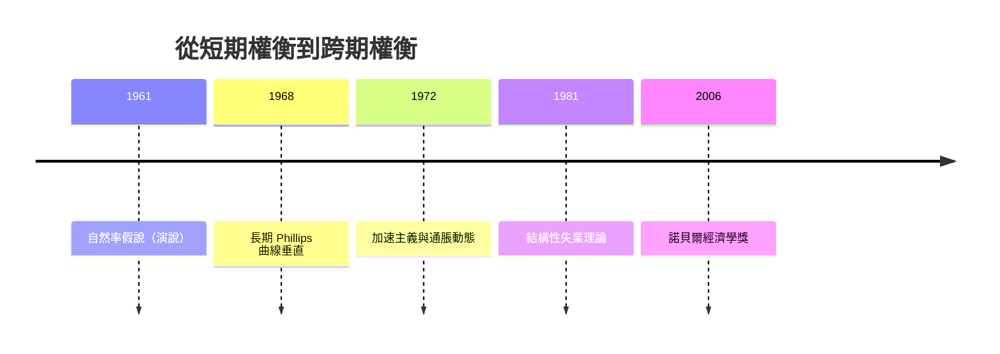

# 2006 · 懸案：通脹與失業，真的只能二選一嗎？——自然率與黃金律

> **2006 諾貝爾經濟學獎（瑞典央行紀念獎）：埃德蒙·斯特羅瑟·菲爾普斯 Edmund Strother Phelps（美國，1933–2026）— 表彰他「對跨期 macro 經濟權衡的分析，尤其是關於通脹與失業之權衡的分析」（for his analysis of intertemporal tradeoffs in macroeconomic policy, especially concerning the tradeoff between inflation and unemployment）。**

---

## 懸案（案情提要）

1970 年代的滯脹撕毀了菲利普斯曲線（1958）——「通脹與失業可互相替代」是戰後宏觀經濟學最堅固的信念，而 1970s 的雙高並存讓它當場失效。弗里德曼（1976 案）與菲爾普斯（1968 年，獨立提出）給出的解釋是：**短期權衡是幻象**。

但菲爾普斯 2006 年的得獎理由不是重提自然率，而是另一個更具建設性的命題：

1. **通脹與失業的「短期權衡」是幻象**——長期 Phillips 曲線垂直於自然率；
2. **那麼，宏觀政策到底在權衡什麼？** 菲爾普斯的答案是：**跨期權衡**——把通脹在時間上重新分配（現在通脹 vs 未來通脹），把增長與福利在世代間分配；
3. **社會的「黃金律」**：存在一個特定的通脹率與增長率的組合，使**真實產出的跨期配置**最有效率——這不是「零通脹」也不是「追求成長」，而是一個可計算的最適點。

---

## 前因

| 年份 | 事件 |
|---|---|
| 1933 | 菲爾普斯出生於美國密西根；1960 年獲耶魯博士學位，導師為 James Tobin（1981 案得主） |
| 1950s | 在耶魯、MIT 任教；研究微觀經濟理論與貨幣理論 |
| 1961 | 菲爾普斯在美國統計學會發表演說（後成 1968 年 NBER 論文）：**自然率假說**，與弗里德曼同年獨立提出 |
| 1962 | 菲爾普斯與加爾布雷斯（Gary Calabresi）合著《The Time Value of Money》 |
| 1965 | 菲爾普斯在《美國經濟學評論》發表〈貨幣與對貨幣的期待〉 |
| 1968 | NBER 論文〈貨幣的短期與長期影響〉：**長期 Phillips 曲線垂直**的正式論證 |
| 1972 | 〈通脹與失業理論〉（《美國經濟學評論》）：**加速主義**與通脹螺旋的動態 |
| 1981 | 菲爾普斯出席白宮經濟顧問委員會（CEA）報告：**「結構性失業理論」**——把失業問題從需求面轉向制度面（工資結構、最低工資、效率工資、聯合壟斷） |
| 1990s | 「黃金律」的提出與發展（與亞當·波森（Adam Posen）的對話）；「三個事實」的教學綱領 |
| 2001 | 諾貝爾委員會因「自然率」已於 1976 年授予弗里德曼而**拒絕**授予菲爾普斯（爭議事件） |
| 2006 | 終於得獎，表彰其「跨期權衡」與「自然率」整體貢獻 |

---

## 調查

### 線索一：自然率——短期權衡是幻象

菲爾普斯的起訴書核心：**預期**是關鍵。若工人與企業對通脹的預期為 $\pi^e$，則失業與通脹缺口之間存在短期關係：

$$
u_t - u^{N} = -\alpha \left( \pi_t - \pi_t^{e} \right), \qquad \alpha > 0
$$

**長期**：預期調整（適應性或理性預期）使 $\pi^e = \pi$，因此：

$$
u_{\text{長期}} = u^{N}, \qquad \text{（長期 Phillips 曲線垂直）}
$$

而 $u^{N}$ 由**結構性因素**決定：勞動市場的搜尋與匹配效率、技能結構、剛性（最低工資、效率工資、集體議價）、移民與人口、偏好。**因此失業問題的答案是制度設計，而不是需求刺激**——這是 1981 年 CEA 報告的主張，也是「結構性失業理論」的正式提出。

### 線索二：加速主義——通脹不是一次性的

1972 年的貢獻：政策制定者若想靠「一次性通脹」把失業壓到自然率以下，會遇到兩道阻力：

1. **預期形成**：公眾會把當前通脹納入未來預期（適應性預期下有滯後，理性預期下立即）；
2. **加速的通脹**：一旦預期形成並要求通脹持續在 $\pi^e$ 之上以維持失業低於自然率，通脹率本身必須**加速**：

$$
\pi_t = \pi_t^{e} + \alpha (u^{N} - u_t) \;\Longrightarrow\; \text{要維持 } u_t < u^N, \text{ 需 } \frac{d\pi}{dt} > 0
$$

這就是**加速主義（accelerating inflation）**：短期權衡不是免費的，而是**以不斷加速的通脹為代價**。1970s 的實際數據（Friedman–Schwartz 的貨幣史）恰好印證：美國 1970s 的 Phillips 曲線不是上移，而是**向右旋轉**（螺絲釘型的垂直關係）。

### 線索三：跨期權衡——宏觀政策的真正對象

2006 年得獎辭詞的關鍵詞是「**跨期**」。菲爾普斯指出，長期的宏觀政策並非在「通脹 vs 失業」之間取捨，而是在**時間上**配置福利：

1. **通脹的跨期分配**：現在的高通脹把購買力從固定收入者轉移到借款人（老年人 hurt），但也**降低真實利率**，刺激投資與住房與存貨累積；
2. **增長的跨期分配**：黃金律（golden rule）要求**消費的跨期配置**最有效率：

$$
\text{黃金律：} \quad \frac{\dot{c}}{c} = 0 \quad \Longleftrightarrow \quad r = n + g
$$

（1987 年 Solow 案的公式，菲爾普斯把它從「儲蓄率」推廣到整個宏觀政策層面。）

3. **真實利率**：通脹 $\pi$ 與名目利率 $i$ 的關係 $r = i - \pi$ 揭示：**通脹率是政策用來影響真實利率的工具**——通脹率本身是「橫跨世代的稅」（它把儲蓄者的一部分購買力轉移給借款人，且不可逆）。

### 線索四：三個事實與「宏觀政策的統一視野」

菲爾普斯 2000s 提出的教學綱領，把宏觀政策的所有爭論歸結為三個基本事實：

| 事實 | 內容 | 政策含義 |
|---|---|---|
| **事實一：增長事實** | 生產率與人均產出長期增長（約 2%／年） | 增長是可能的，但機制是供給側的 |
| **事實二：通脹與失業的關係** | 短期 Phillips 曲線存在，長期垂直 | 短期可以「花錢買失業」，代價是通脹預期與可信度 |
| **事實三：黃金律與跨期效率** | 存在使跨期消費配置最優的產出路徑 | 政策應以跨期效率為標準，而非單期成長率 |

這三個事實構成「**動態宏觀經濟學的統一架構**」，把 1990s–2000s 的分歧（新凱恩斯 vs RBC）放在同一張圖上比較。

### 線索五：結構性失業理論與「職業結構」

1981 年 CEA 報告的核心是把失業分解為：

$$
u = u^{frictional} + u^{structural} + u^{cyclical}
$$

並主張**結構性失業是主要部分**，且其根源在制度：

- **最低工資**：若高於效率工資，會創造失業（青年、缺乏經驗者）；
- **工資結構與集體議價**（union wage structure）：造成「核心—外圍」兩段市場；
- **需求管理政策的副作用**：抬高工資與價格，卻不帶來永久的失業下降——因為勞動市場結構未改。

政策含義：**用需求管理處理結構性問題是無效的**；要透過制度改革（工資制度、教育與訓練、勞動流動資訊）來處理。這一論點在 1990s 美國的「福利改革」（1996 年個案責任制）與「最低工資研究」（Card 2021 案）中被反覆引用——Card 的自然實驗證明了菲爾普斯的論點方向。

---

## 理論裁決

**裁決一**：長期的通脹—失業關係是**垂直的**，宏觀政策不能長期以失業換通脹；失業的解方在**結構與制度**，不在需求：

$$
u_{\text{長期}} = u^{N}(S), \qquad S = \text{制度與結構}
$$

**裁決二**：短期權衡存在，但**代價是通脹的加速**；因此「先通脹後擰緊」的策略在動態上自我毀滅：

$$
\pi_t = \pi_t^{e} + \alpha (u^N - u_t) \;\Longrightarrow\; \frac{d\pi}{dt} > 0
$$

**裁決三**：宏觀政策的真正對象是**跨期權衡**——通脹在世代間的分配、真實利率的設定、以及消費的跨期配置效率（黃金律）：

$$
\text{黃金律：} \quad r = n + g
$$

**裁決四**：增長來自供給側（生產率），不是需求側；貨幣需求管理對長期失業與增長無能為力。

**裁決五**：制度的選擇（工資設定、議價結構、勞動市場資訊）是失業理論的核心變數——經濟學第一次為「結構性失業」提供了可操作的診斷與政策清單。

---

## 後果

| 領域 | 影響 |
|---|---|
| 政策應用 | 央行可信度經營（通脹目標制的共識）；「產出缺口」與自然率的政策意義；最低工資與工資結構改革的理論依據；2010s 的「把通脹目標提得比潛在成長稍高」（Fed 2012 聲明） |
| 學術 | 動態宏觀的統一敘事（RBC 與新凱恩斯的對話框架）；黃金律與跨期福利分析的復興 |
| 實證 | 自然失業率的估計（u-star 的實證爭議）、NAIRU 的概念化；結構性失業的議題化 |
| 爭議 | 2010–13 年「通脹目標高於潛在成長」的主張被批為「追求失業率過低」的變本加厲（2013 年菲爾普斯本人發表反駁文章，強調自然率估計不確定性）；2018 年後菲爾普斯的保守貨幣主義立場再度成為爭議焦點 |
| 跨獎 | 1976 Friedman（自然率的共同發現者）、1987 Solow（黃金律）、1995 Lucas（理性預期）、2021 Card（最低工資的自然實驗） |

---

## 關聯

- [1976-Friedman貨幣主義與永久收入](1976-Friedman貨幣主義與永久收入.md)：自然率假說的同年同源發現；弗里德曼與菲爾普斯的恩怨。
- [1987-Solow增長理論](1987-Solow增長理論.md)：黃金律與增長的供給側理論（本書續寫中）。
- [1995-Lucas理性預期](1995-Lucas理性預期.md)：預期形成機制的理論基礎（本書續寫中）。
- [1996-Mirrlees與Vickrey不對稱信息](1996-Mirrlees與Vickrey不對稱信息.md)：激勵相容與最優稅制的跨期延伸（本書續寫中）。
- [2004-Kydland與Prescott實際經濟週期](2004-Kydland與Prescott實際經濟週期.md)：時間不一致性與政策可信度（本書續寫中）。
- [2021-Card-Angrist-Imbens因果推斷](2021-Card-Angrist-Imbens因果推斷.md)：最低工資與結構性失業的實證檢驗（本書續寫中）。
