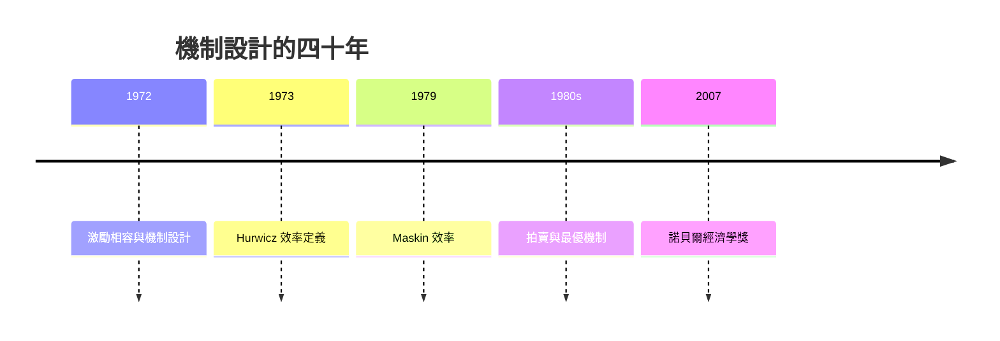

# 2007 · 懸案：制度能不能被「設計」成人人如實說出真相？

> **2007 諾貝爾經濟學獎（瑞典央行紀念獎）：列昂尼德·赫維茨 Leonid Hurwicz（波蘭／美國，1917–2008）、艾瑞克·史塔克·馬斯金 Eric Stark Maskin（美國，1950– ）與羅傑·布魯斯·邁爾森 Roger Bruce Myerson（美國，1953– ）— 表彰他們「奠定了機制設計理論的基礎」（for having laid the foundations of mechanism design theory）。**

---

## 懸案（案情提要）

機制設計要回答的問題，是經濟學裡最像「工程」的一題：

> **如果我們不能命令經濟人做對的事，能不能設計一套規則，使他們為了自己的利益去做對的事？**

疑點五連：

1. **分散資訊的問題**：設計者（政府、拍賣商、選舉規則制定者）不知道個人的真實類型（估值、能力、成本、偏好），甚至不知道自己的目標函數是什麼；
2. **IC 與 IR 兩個硬約束**：規則必須（a）讓說真話成為占優策略（激勵相容 IC），（b）讓參與者願意參與（個體理性 IR）；
3. **有時無解**：某些分配目標**無法**用任何機制實現——例如社會選擇的「不可能三角」；
4. **有時太多解**：許多機制都能實現同一目標，哪一個更好？效率、對抗操縱、公平該如何權衡？
5. **資訊的最小化**：最好的機制往往只需要很少的資訊，甚至「不詢問任何私人資訊」就能達成目標。

三人的工作把這五題逐一處理，並成為 1990s 以來經濟學最活躍的分支。

---

## 前因

| 年份 | 事件 |
|---|---|
| 1939–1946 | 赫維茨在波蘭（佔領期），1939–45 年被囚於戰俘營；1946 年逃出並移居德國後前往美國 |
| 1948 | 赫維茨在芝加哥大學取得學位；1950s 在芝加哥大學、1960s 起在加州大學柏克萊分校 |
| 1972 | 赫維茨發表〈對資訊經濟學的貢獻〉：**激勵相容（incentive compatibility）**概念與**機制設計**一詞的誕生 |
| 1973 | 赫維茨與席夫（H. Schif）〈選擇、分配與市場的效率〉：把效率重新定義為「**資源的利用是否被個人所偏好**」 |
| 1979 | 馬斯金在《美國經濟學評論》發表〈配置與競爭政策〉：**效率的一般定義（Maskin 效率）** |
| 1980s | 邁爾森在「Hurwicz–Maskin–Myerson 效率」框架下研究壟斷、拍賣、投票理論 |
| 1983 | 邁爾森的單一參數拍賣分析；**最優拍賣設計** |
| 1990s | 邁爾森的「效率的經濟環境（economic environment）」理論；Myerson–Maskin 的條件 |
| 1993 | 邁爾森的「收入與財富的分配理論」 |
| 1998–2007 | 機制設計成為拍賣理論、網路設計、縱向限制、行為拍賣、新公共品理論的主導框架 |
| 2007 | 得獎；赫維茨以 90 歲高齡獲獎（史上最年长得主） |

---

## 調查

### 線索一：赫維茨——問題的重新表述與「激勵相容」

赫維茨的起訴書：傳統經濟學的問題是「給定偏好與資源，求最優配置」；機制設計的問題是**反過來**：

> **給定一個可行的經濟環境（可能的分配集合），求一個規則，使得自利的個人在其中自願地選擇，結果達到社會想要的目標。**

三個基本要素：

1. **機制（mechanism）**：一套溝通規則，把「訊息 $\mathbf{m}$」映射到「結果 $x(\mathbf{m})$」與「支付 $p(\mathbf{m})$」；
2. **經濟環境（economic environment）**：可能的狀態與結果的集合 $\mathcal{X}(n)$；
3. **目標函數**：社會福利 $F(x)$。

**激勵相容（IC）**：真實類型 $\theta$ 如實報告 $m = \theta$ 是占優策略：

$$
\mathbb{E}[u_i(x(m), p(m)) \mid m_i = \theta_i] \geq \mathbb{E}[u_i(x(m'), p(m')) \mid m_i = \theta_i] \quad \forall m'_i
$$

**個體理性（IR）**：參與者願意接受：

$$
\mathbb{E}[u_i(x(\theta), p(\theta))] \geq \bar{u}_i
$$

**最優機制（optimal mechanism）**：

$$
\max_{\text{mechanism}} \mathbb{E}\left[ F(x(\theta)) \right] \quad \text{s.t. IC, IR}
$$

### 線索二：Maskin 效率——「效率」的一般定義

馬斯金的貢獻是把「效率」從福利經濟學的 Pareto 定義，推廣為一個**適用於任何經濟環境**（含壟斷、外部性、公共品）的定義：

**Maskin 效率**：配置 $x^{\text{out}}$ 是 Maskin 效率的，若且唯若不存在另一個可行配置 $x^{\text{res}}$（相對於同一經濟環境的其他參數配置而言）使得：

$$
F(x^{\text{res}}) > F(x^{\text{out}}) \;\;\text{對所有 } F \text{ 成立}
$$

其經濟含義：**資源配置不允許任何「所有人都更好」的 Pareto 改進，且這些改進在環境中是可行的**——它把效率從「結果的性質」改為「結果與可行集合的關係」。

**逆選擇定理（Maskin 1986）**：若經濟環境不滿足「**擁擠（congestion-free）**」條件（任何結果對某個狀態都是可行的），則**不存在任何完全分配結果的機制能達到 Maskin 效率**。這是一個極重要的**不可能性定理**：它說明在某些環境下，**不存在**能同時達成效率與資訊揭露的機制——機制設計因此有「可設計性」的邊界。

### 線索三：Myerson——拍賣的幾何學與「虛擬值」

邁爾森的工作把機制設計用於**具體的市場**：拍賣、通訊市場、投票。

**單一參數拍賣**（每位買方一個私人估值 $v_i$，賣方價值 0）：

- 第二價格拍賣（維克里）：賣方收入 = 第二高估值；
- 第一價格拍賣：誠實報價不是占優策略。

**收入等價定理（revenue equivalence）**：在**相同資訊結構**下，任何滿足 IC 與 IR 的拍賣，其賣方期望收入相同。因此選擇拍賣規則不是為了收入，而是為了其他目標：**資訊揭露、對抗操縱、參與率、均衡選擇**。

**虛擬值（virtual value）**：

$$
\phi(v) = v - \frac{F(v)}{f(v)}
$$

其中 $F$ 為估值的累積分配、$f$ 為密度。最優拍賣規則：**只向虛擬值非負的買方分配物件**（Myerson 最優拍賣定理）：

$$
\text{分配給 } i \;\iff\; \phi(v_i) \geq 0
$$

這解釋了**收入分享條款（revenue sharing）** 的設計原理，也解釋了為何第一價格拍賣在高密度估值分布下收入更高（因為其虛擬值結構不同）。

**不對稱拍賣**（訊號競標、頻譜拍賣——邁爾森的「隨機化共軛」設計）：買方的私人型號影響成本（$c_i(s)$），需設計「**隨機化共軛（randomized conjugate）**」來揭露型號：

$$
\text{分配規則} \;\text{以}\; \phi_i(\theta_i) \text{為依據，且以隨機方式打破平手}
$$

### 線索四：Maskin 的「不可能性」與「第三定理」——制度設計的邊界

三人的理論合起來構成一幅地圖：

| 結果 | 內容 |
|---|---|
| **不可能定理**（Maskin 逆選擇定理） | 在擁擠的經濟環境中，不存在達成 Maskin 效率的完全結果機制 |
| **樂觀定理**（Hurwicz–Maskin–Myerson） | 在**凸性**的經濟環境中，存在一個機制（直接機制）能達成 Maskin 效率，且是唯一的 |
| **第三定理**（Maskin–Fudenberg–Tirole） | 效率 + 對抗均衡選擇（no deficit）⇒ 預算平衡；效率 + 預算平衡 ⇒ 唯一均衡 |

這三條定理把「能不能設計」「設計出什麼」「能不能防禦操縱」一次講清——這是機制設計成為獨立理論學科的標誌。

### 線索五：機制設計的實踐地圖

| 領域 | 應用 |
|---|---|
| 拍賣 | 頻譜拍賣（1994–97 美國、1997–98 歐洲）、FCC 2000 年「auction 51」、Google 廣告拍賣、Vickrey 捐獻拍賣 |
| 市場設計 | 電力市場與容量市場（England–Wales 拍賣）、碳排放權拍賣、機場起降權拍賣 |
| 公共品 | 維克里–克拉克稅制、匹配補助（matching grants）、機制設計用於公共品供給 |
| 政治 | 選舉規則（ plurality、單記可讓渡）、議會規則、憲制設計（Buchanan 1986 案的接續） |
| 組織內部 | 拍賣式內部資源分配、績效薪酬、Tirole 的產業組織 |

---

## 理論裁決

**裁決一**：經濟學的問題可以**反向表述**——不是求最優配置，而是**設計使最優配置自願出現的規則**：

$$
\max_{\text{mechanism}} \mathbb{E}[F(x(\theta))] \quad \text{s.t. IC + IR}
$$

**裁決二**：**激勵相容**是規則設計的核心約束；真實類型的揭露必須靠**支付函數**（而非命令）來誘導。

**裁決三**：效率必須相對於經濟環境定義（Maskin 效率），否則無法處理壟斷、外部性與公共品。

**裁決四**：**存在不可能定理**——在擁擠環境下不存在有效率的完全結果機制（可設計性有邊界）；但**在凸環境下存在且唯一**（樂觀定理）。

**裁決五（防禦性設計）**：有效率的機制未必能抵禦操縱與均衡選擇；「第三定理」給出達成防禦性的條件。

**裁決六**：拍賣的最優規則可由**虛擬值**決定；收入等價定理說明拍賣形式的選擇是關於資訊與公平，而非收入。

---

## 後果

| 領域 | 影響 |
|---|---|
| 政策應用 | 頻譜與資源配置的現代化；碳市場與電力市場的設計；公共品供給機制；選舉規則改革 |
| 學術 | 機制設計成為一級理論；激勵相容性成為公共經濟學、產業組織、拍賣理論、網路經濟學、平台經濟學的通用語言 |
| 跨學科 | 與計算機科學（機制設計與演算法）、政治學（選舉設計）、法律（合約設計）深度融合 |
| 爭議 | 1994 年後委員會曾因「社會科學」邊界爭議（納什案）而重新界定獎項範圍；機制設計被批「把政治問題化約為激勵問題」；2010s 對平台與數位市場的機制設計建議引發「效率凌駕公平」的辯論 |
| 跨獎 | 1996 Mirrlees–Vickrey（IC/IR 的原型）、2012 Roth–Shapley（匹配市場的效率—公平權衡）、2020 Milgrom–Wilson（拍賣理論的現代版）、2016 契約理論（不完全合約） |

---

## 關聯

- [1996-Mirrlees與Vickrey不對稱信息](1996-Mirrlees與Vickrey不對稱信息.md)：IC/IR 條件與拍賣、稅制的原型實例。
- [1994-Nash-Harsanyi-Selten非合作賽局均衡](1994-Nash-Harsanyi-Selten非合作賽局均衡.md)：機制設計的賽局語言基礎。
- [2005-Aumann與Schelling冲突与合作](2005-Aumann與Schelling冲突与合作.md)：合作機制與激勵相容（本書續寫中）。
- [2012-Roth與Shapley匹配市場](2012-Roth與Shapley匹配市場.md)：匹配問題的效率—公平—策略穩定性的三角（本書續寫中）。
- [2020-Milgrom與Wilson拍賣理論](2020-Milgrom與Wilson拍賣理論.md)：拍賣理論的現代實戰（本書續寫中）。
- [1986-Buchanan公共選擇理論](1986-Buchanan公共選擇理論.md)：投票規則作為機制（本書續寫中）。
