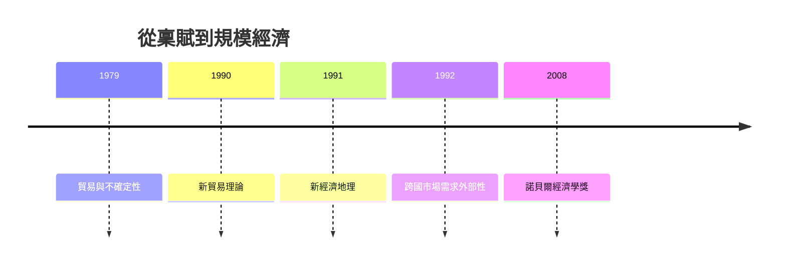

# 2008 · 懸案：為什麼產業會「群聚」在某個城市？為什麼同樣的技術在不同國家產出不同？

> **2008 諾貝爾經濟學獎（瑞典央行紀念獎）：保羅·羅賓·克魯格曼 Paul Robin Krugman（美國，1953– ）— 表彰他「對新貿易理論與新經濟地理的貢獻」（for his contributions to new trade theory and new economic geography）。**

---

## 懸案（案情提要）

1977 年 Ohlin 案（要素稟賦）解釋了「為何國家之間會貿易」，但解釋不了三樁舊案：

1. **同類國家之間大量的雙向貿易**（美國與歐洲互相出口汽車與化工品）——稟賦模型解釋不了；
2. **產業為什麼集中在特定國家**（半導體在台灣與韓國、汽車在德國與日本、軟體在美國）——難道是稟賦？
3. **為什麼相似的技術在不同國家帶來不同的收入水準？** 一國的工資可以比另一國低，但若生產率相同，低工資只帶來低消費——**除非生產率不同**。

克魯格曼的答案是一整套新機制：**規模經濟、多樣性偏好（Love of Variety）與「運輸成本＋市場規模」的張力**，再加上**地理與運輸成本**——這就是「新貿易理論」與「新經濟地理」。

---

## 前因

| 年份 | 事件 |
|---|---|
| 1975 | Krugman 加入 MIT；1978 年博士學位（國際貿易理論，師承 Solow 與 Krugman 的導師 Richard Stern） |
| 1979 | 〈國際貿易與不確定性〉：以風險分擔解釋貿易 |
| 1980 | 《國際貿易與不確定性》出版 |
| 1982–1983 | 與 Obstfeld 合作「跨期理論」的文獻綜述 |
| 1990 | 〈規模經濟、產品差異化與貿易模式〉（《Econometrica》）：**新貿易理論** |
| 1991 | 《經濟地理與貿易理論》（與 Obstfeld 合著）：**新經濟地理** |
| 1992 | 「Increasing Returns, Monopolistic Competition, and International Trade」：跨國市場需求外部性的模型 |
| 1994 | 關於北美自由貿易協定的論證（NAFTA 的經濟學辯護） |
| 1995 | 「Monopolistic Competition and Product Diversity」；與 Obstfeld 關於「電子時代」的貿易理論 |
| 1997–1998 | 亞洲金融危機：克魯格曼的 「「Third World」辯護」與對 IMF 的批評（他主張「髒手」論） |
| 2000–2017 | 《紐約時報》專欄作家；2008 年金融危機期間對主流經濟學的批評最為著名（2010 年《紐約時報》「撕裂的經濟學」一文引發公案） |
| 2008 | 得獎——**首位在美國獲頒的、以「公共論述」聞名的經濟學家**；也是本獎史上少數由單人獲得的年份 |

---

## 調查

### 線索一：新貿易理論——異質產品的壟斷競爭

克魯格曼的第一個起手式：把「產品」變成連續譜。消費者不是要買「汽車」，而是要買**多樣性**：若只有一種車，你會想換成機車或自行車；你願意為多樣性付錢。

模型骨架（Dix–Stiglitz 的擴充）：

- 每個消費者有對多樣性的偏好（CES 指數效用），願意為多樣性付「多樣性溢價」；
- 每個企業生產一種變體，固定成本高、規模報酬遞增（平均成本遞減）；
- 企業在一國市場上追求**利潤最大化時的規模**（因固定成本需攤提）。

**核心機制：貿易利益來自「更大的市場」**。國内市場太小 $\rightarrow$ 企業無法達到最適規模 $\rightarrow$ 成本高 $\rightarrow$ 價格高；貿易開放後，企業可以面向更大的市場，**規模報酬遞增**讓貿易帶來收益——即使兩國的生產率、稟賦完全相同：

$$
\text{貿易利益} = \underbrace{\text{規模經濟}}_{\text{成本下降}} + \underbrace{\text{多樣性}}_{\text{消費者的效用提升}} - \underbrace{\text{運輸成本}}_{\text{抵銷}}
$$

**異質性產品的「重力法則」**：貿易量隨兩國的經濟規模增加、隨地理距離減少：

$$
X_{ij} \propto (Y_i Y_j)^{\theta} d_{ij}^{-\phi}, \qquad \phi > 1
$$

這條公式（貿易重力模型）如今是國際貿易研究的標準工具。

### 線索二：新經濟地理——集聚的自我強化

克魯格曼與 Obstfeld 1991 年的核心問題：**為什麼產業會集中？** 傳統模型中，集聚是外生的（城市有港口、有資源）；新經濟地理要解釋**集聚本身如何產生**。

**核心機制（兩個「市場規模外部性」的乘積）**：

1. **需求側外部性**：若消費者住在某地，那裡就有市場；市場大 $\rightarrow$ 企業願意設廠；
2. **供給側外部性**：若企業集中在某地，中間投入與 skilled labor 的可得性提高 $\rightarrow$ 生產成本低 $\rightarrow$ 企業更願意設廠。

把兩者連結起來（**CEP 機制：核心—邊緣—核心**）：

$$
\text{需求外部性} \times \text{供給外部性} \;\Longrightarrow\; \text{集聚的自我強化}
$$

在兩國模型（核心國與邊緣國）中，典型的「核心—邊緣」均衡：

$$
\text{若 } \frac{\text{市場規模差}}{\text{運輸成本差}} > 1 \;\Longrightarrow\; \text{產業全部集聚於核心國}
$$

**關鍵的非線性與多重均衡**：運輸成本 $\tau$ 下降時，均衡會從**分散**跳到**集聚**，並且在臨界點之後**回落很難**（歷史依賴）。這解釋了：

- 為何歐洲的產業帶在某些國家、某些產業在另一些國家；
- 為何「中等距離的國家」（如義大利北部與德國南部）最難趨勢；
- 為何全球化會加劇核心國與邊緣國的差距（1990s 的「全球貧民化」論爭）。

### 線索三：跨國市場需求外部性——Krugman 的 1992 論文

克魯格曼 1992 年的論文處理一個關鍵延伸：即使**沒有用到任何運輸**（服務業貿易），也有貿易利益——因為企業可以透過**跨國服務需求**擴大市場。

其模型（Hotelling–Krugman 的市場份額競爭）：

- 兩國，企業的產品有差異；
- 消費者效用包含**每一國市場的產品 variety**；
- **每一國的市場份額**對企業的收益有外部性 $\rightarrow$ 即使是服務業也有規模報酬。

這解釋了 1990s 的「電腦與通訊業：軟體與服務的貿易幾乎不涉及運輸成本，卻是美國巨大的順差」。

### 線索四：貿易政策的重新評估——「貿易的收益從哪裡來」

新貿易理論對政策含義的衝擊是根本性的：既然貿易利益來自**規模經濟與多樣性**，則：

1. **關稅的福利代價**在規模報酬存在時**被高估**（因為關稅下企業可獲得更多保護）；
2. **產業政策**（定向補貼）可能有理論依據——這正是克魯格曼 1990 年代為「飛機、Semiconductor、製藥補貼」辯護的理論基礎，也是 2020s 半導體補貼（CHIPS 法案）爭議的源頭；
3. **「不公平貿易」與匯率**：在規模報酬下，匯率貶值的政策效果與傳統模型不同。

### 線索五：克魯格曼的「公共經濟學家」角色

本案的另一面是科學社會學的：克魯格曼是史上第一位以**報紙專欄與公共辯論**聞名的諾貝爾經濟學家得主。他在 2008 年金融危機中的作為（駁斥「市場自動修正」的敘事、批評銀行家的「病毒式理性」）引發兩個後果：

1. **對經濟學界本身的重審**：2010 年《紐約時報》〈The Economic Crisis and Its Critics〉一文引發「克魯格曼是否代表了一個不負責任的經濟學派」的大論戰（Robert Lucas 等人發文反駁）；
2. **對公共論述的影響**：他把「經濟學是一門可以用於公共辯論的學問」示範給全世界。

---

## 理論裁決

**裁決一**：貿易利益不必來自要素稟賦；**規模經濟與多樣性偏好**本身就能創造貿易利益：

$$
\text{Trade gain} = \text{Scale} + \text{Variety} - \text{Transport cost}
$$

**裁決二**：異質性產品的貿易服從**重力法則**；貿易流量由規模與距離決定：

$$
X_{ij} \propto (Y_i Y_j)^{\theta} d_{ij}^{-\phi}
$$

**裁決三**：產業集聚是**內生**的——需求外部性與供給外部性相乘，產生自我強化的核心—邊緣結構；運輸成本的下降可觸發**不連續的跳躍**：

$$
\frac{\text{市場規模差}}{\text{運輸成本差}} > 1 \;\Longrightarrow\; \text{完全集聚}
$$

**裁決四**：即使沒有運輸成本，跨國市場的規模外部性也能帶來貿易利益。

**裁決五（政策含義）**：在規模報酬下，**保護主義的代價被傳統模型高估**，而**定向產業政策有理論空間**——這既是政策機會，也是 2010s–20s 貿易戰爭的理論爭點。

**裁決六（方法論）**：理論應當解釋**真實世界的顯著事實**（貿易模式、產業地理、收入差異），而非在封閉模型中精確化抽象假設。

---

## 後果

| 領域 | 影響 |
|---|---|
| 政策應用 | 2010s–20s 的貿易戰爭與產業補貼（半導體、綠能、稀土）有理論辯護空間；FTA 的效應評估改用重力模型；區域發展政策（歐盟基金）的依據 |
| 學術 | 新貿易理論成為國際貿易的兩大支柱之一（另一為 H–O）；新經濟地理開啟城市與區域經濟學的「集聚」文獻；貿易的異質性企業模型（H–O–Melitz） |
| 實證 | 貿易引力方程的估計；區域工資差距與集聚的因果檢驗（Ellison–Glaeser 1997 的 Q 值）；2010s 的「區域溢價」（Autor, Dorn, Hanson 2016） |
| 爭議 | 與 Mundell（1999 案）關於資本流動性與匯率的論戰；被批忽視技術差異與匯率（Gabaix 的「致命的引力」與匯率之謎的辯論）；作為公共評論者的他被批在 2008 危機中過度政治化 |
| 跨獎 | 1999 Mundell（開放經濟宏觀）、2004 Kydland–Prescott（實際週期）、2018 Romer（新技術與內生增長） |

---

## 關聯

- [1977-Ohlin與Meade國際貿易與資本流動](1977-Ohlin與Meade國際貿易與資本流動.md)：稟賦模型——本案要超越的舊偵查框架。
- [1999-Mundell最優貨幣區](1999-Mundell最優貨幣區.md)：開放經濟宏觀的骨架，與本案共同構成 1990s 的國際經濟學（本書續寫中）。
- [2018-Nordhaus與Romer長期增長](2018-Nordhaus與Romer長期增長.md)：規模報酬與創新地理（本書續寫中）。
- [2024-Acemoglu制度與繁榮](2024-Acemoglu制度與繁榮.md)：核心—邊緣格局的制度根源（本書續寫中）。
- [2004-Kydland與Prescott實際經濟週期](2004-Kydland與Prescott實際經濟週期.md)：技術衝擊與集聚的互動（本書續寫中）。
- [2007-機制設計三人組](2007-機制設計三人組.md)：貿易政策作為機制設計問題（本書續寫中）。
