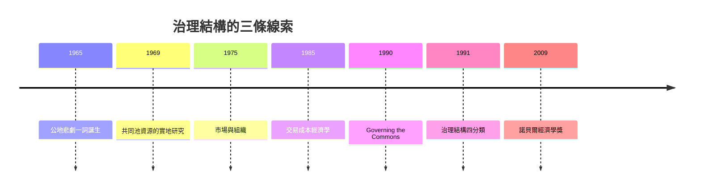

# 2009 · 懸案：共有資源該「私有化」還是「集體化」？企業的邊界又該畫在哪？

> **2009 諾貝爾經濟學獎（瑞典央行紀念獎）：埃莉諾·克萊爾·奧斯特羅姆 Elinor Claire "Lin" Ostrom（美國，1933–2012）與奧利弗·伊頓·威廉姆森 Oliver Eaton Williamson（美國，1932–2020）— 表彰他們「對經濟治理的分析，尤其是對公共資源的分析」（for their analyses of economic governance, especially the commons）。**

---

## 懸案（案情提要）

2009 年是本獎史上第一次由**兩位制度經濟學家**共享，也是**第一位女性得主**（奧斯特羅姆）。

疑點四連：

1. **公地悲劇真的無解嗎？** 傳統答案只有兩條路：**私有化**（Hardin 的「公地悲劇」，Ostrom 1968）或**政府所有與管制**（Coase 1964 式的批評）。但現實中，瑞士高山牧場、灌溉系統、漁業、地下含水層、程式碼倉庫、知識共享——這些資源被**數千人**長期、穩定地管理著，**既非私有也非政府所有**。這些「第三種制度」是怎麼運作的？
2. **企業到底是什麼？** 科斯（1991 案）問「市場與企業的邊界在哪」；威廉姆森的答案是：**交易成本**——但更根本的問題是：企業與市場都是**合約**的集合，那麼**合約為什麼不完全**？當合約無法完全寫下時，「治理結構」就成為關鍵。
3. **公共品與私人物品的邊界**（Ostrom 的「公-pool 與私-pool」分析）；
4. **多中心治理**：大規模複雜系統的治理不能靠單一中心，需要**多中心、多層次的制度安排**。

---

## 前因

| 年份 | 事件 |
|---|---|
| 1933 | 奧斯特羅姆出生於美國加州；1954 年取得政治學學士 |
| 1965 | 奧斯特羅姆（與 F. Queen）發表〈Governance in Commons〉：**公地悲劇**一詞的誕生 |
| 1968 | Garret Hardin〈公地悲劇〉（《Science》）：主張私有化或管制 |
| 1969 | 奧斯特羅姆與丈夫 Vincent Ostrom（系譜學研究的開創者）共同出版《公共事物的治理之道》（*Governing the Commons*）——對尼泊爾、瑞士等地實地研究的經典 |
| 1980 | 奧斯特羅姆《集體行動與社區》（Governing the Commons 的英文版出版於 1990） |
| 1990 | 奧斯特羅姆的《Governing the Commons》英文版出版；「設計原則」被系統整理 |
| 1990 | 奧斯特羅姆、E. Ostrom & R. Parks 的「元分析」：全球共有資源管理制度資料庫 |
| 1975 | 威廉姆森在《市場與組織》（Markets and Hierarchies）問世：交易成本經濟學 |
| 1985 | 威廉姆森《經濟制度與法律》（*The Economic Institutions of Capitalism*）：**交易成本經濟學**的完整表述 |
| 1991 | 威廉姆森〈Comparative Economic Organization: The Analysis of Discrete Structural Alternatives》（《Administrative Science Quarterly》）：提出**治理結構**的分類 |
| 1992 | 威廉姆森《制度與經濟組織》 |
| 1999 | 威廉姆森的「**有限理性的事實性**」（economic organization under bounded rationality） |
| 2009 | 得獎 |

---

## 調查

### 線索一：奧斯特羅姆的田野——破解「公地悲劇」的兩難

奧斯特羅姆的偵查方法是**實地研究**：到瑞士高山、印尼灌溉村莊、西班牙安達盧西亞的灌溉會、菲律賓的地下水、尼泊爾的森林，觀察實際的制度。

她發現的制度不是「私有」也不是「政府管制」，而是**受規則約束的共同管理**。這些制度具備八項設計原則（Ostrom 1990）：

1. **清晰界定的邊界**（appropriations）：哪些資源屬於這個群體、哪些使用者有權提取；
2. **與地方條件相稱的規則**：規則應適應當地的資源條件與使用規模；
3. **集體選擇機制**：受影響者能參與規則的制定與修改；
4. **監督**：既有社區內部的監督，也有外部政府機關的監督（多層監督）；
5. **漸進式的制裁**（graduated sanctions）：違規者先受輕罰，累犯才升級；
6. **低成本的衝突解決機制**：本地調解優先於國家法庭；
7. **低認同度者的認可**：外來者與低頻使用者也能被接納；
8. **多層次的企業組織**：社區有內部治理，國家有大尺度治理。

**核心發現（推翻二選一）**：

$$
\text{共有資源} \;\not\Rightarrow\; \text{悲劇}
$$

條件在於：群體規模適中、使用者能相互認識、規則能自主演化、有監督與漸進制裁。

### 線索二：制度分析的「IAD 框架」（Ostrom 的方法論）

奧斯特羅姆提出的**制度分析與發展（IAD）框架**是本案的理論骨架：

- **行動場合（action arena）**：參與者（action arenas）與決策規則；
- **行動結果**：經濟結果、生物—物理結果、社會結果；
- **評估**：效率、公平、/accountability（可問責性）、可持續性。

制度分析的通用語法：

$$
\text{規則} \rightarrow \text{行動場合} \rightarrow \text{結果} \rightarrow \text{評估}
$$

這使「制度」成為可分析、可比較的對象，而非文化的別名。

### 線索三：威廉姆森——合約的不完全性與治理結構

威廉姆森的偵查起點是**合約的不完全性（incomplete contracts）**：由於未來狀態無法完全枚舉、合約條款無法窮盡，契約必然留下「**剩餘控制權**」。

在不完全合約下，交易成本不只來自**事前**的搜尋、議價、決策，也來自**事後**的爭議與執行。於是**治理結構的選擇**成為核心：不同的交易需要不同的保護機制。

**威廉姆森的治理結構四分類**（由「資產專有性」與「交易的不確定性」兩個維度決定）：

| | 交易不確定性低 | 交易不確定性高 |
|---|---|---|
| **資產專有性高** | **市場**（古典契約；價格調整） | **一體化組織**（統一指揮、內部勞動市場） |
| **資產專有性低** | **專屬中間組織**（長期契約、關係治理） | **鬆散的組織形式／網路**（第三方治理、仲裁、關係治理） |

**核心洞見**：**不存在普遍最优的治理結構**；最佳選擇取決於資產的專有性、交易的不確定性、頻率與治理結構本身的交易成本：

$$
\text{選擇原則：} \; \text{選擇使 } \Delta(\text{治理成本}) \text{ 最小化的結構}
$$

這解釋了為什麼「市場 vs 企業」是錯問法——真實的答案是一個**連續譜**：合約、關係治理、聯合組織、網路。

### 線索四：威廉姆森的事後契約觀與「不透明」

威廉姆森最具穿透力的一句命題（引自 Grossman–Hart 的表述）是：

> **契約是無法在事後完全履行的「護城河（moat）」**——它的價值在於**放棄某些權利**，從而使對方願意 investments 專用化。

因此契約的功能不是「規定所有事」，而是：

$$
\text{契約} = \text{對未來爭議的權利分配（事前）} + \text{剩餘控制權}
$$

這也解釋了「自營化（vertical integration）」的邏輯：當專用性投資很關鍵且合約不可靠時，把交易內部化（用指揮替代合約）是理性的——這是對「市場失靈」與「交易成本」兩種解釋的綜合。

### 線索五：奧斯特羅姆與威廉姆森的匯流——治理結構的層次

兩人的工作可合併成一張圖：

| 層次 | 問題 | 對應理論 |
|---|---|---|
| 社群 | 共有資源如何被可持續地使用 | Ostrom 的設計原則 |
| 交易 | 一筆交易由誰治理 | Williamson 的治理結構四分類 |
| 組織 | 企業的邊界在哪 | 交易成本與剩餘控制權 |
| 系統 | 全球公共品（氣候、疫情）如何治理 | 多中心治理、網路治理 |

奧斯特羅姆的「**多中心治理（polycentric governance）**」是其中的關鍵概念：許多大小不一的治理單位各自負責自己管轄範圍的事，互不隸屬但互相影響——這被視為處理全球性問題（氣候、疫情、生物多樣性）最現實的架構，也是 2010s 從「全球政府」轉向「全球治理」的理論基礎。

---

## 理論裁決

**裁決一（Ostrom）**：**公地悲劇不是必然**；在清晰邊界、適切規則、參與式選擇、多層監督、漸進制裁、低成本衝突解決的條件下，共有資源可被可持續地管理：

$$
\text{自組織治理} \in \{\text{可行制度}\}, \qquad \text{不只是私有化或國家管制}
$$

**裁決二**：**公共品與私人物品的區分不是二元對立**，而是「**pool**」的連續譜：從私-pool（完全分割、可排除）到公-pool（共用但可排除）再到完全公共品；不同資源需要不同的制度匹配。

**裁決三（Williamson）**：合約必然不完全；**剩餘控制權的分配**與**治理結構的選擇**是交易的經濟學核心：

$$
\text{治理結構} = f(\text{資產專有性}, \text{不確定性}, \text{頻率})
$$

**裁決四**：不存在普遍最优的治理結構；**市場、企業與混合形式**是依交易特徵選擇的連續譜，判準是治理成本最小化。

**裁決五**：治理必須是**多中心、多層次**的；單一中心的全能政府既不可行也不必要。

**裁決六**：**制度的目的是可問責性**——不只是效率，還有公平、透明與可問責；這是 IAD 框架的評估維度。

---

## 後果

| 領域 | 影響 |
|---|---|
| 政策應用 | 共有資源的治理（漁業配額、灌溉、地下含水層、社群林業）；碳排放權與氣候治理的多中心架構；程式碼開源、知識共享（ licensing、commons 的重構）；2009 年後全球公約的多中心實踐 |
| 學術 | 新制度經濟學成為主流分支；IAD 框架與多中心治理；交易成本經濟學成為組織理論、治理理論、網路經濟學的共同語言 |
| 企業理論 | 企業邊界、垂直一體化、外包、平台治理、共享經濟（Airbnb 的「trust」問題） |
| 爭議 | 奧斯特羅姆被批「過度樂觀、忽略集體行動失敗」；威廉姆森的制度分析被批「不可證偽、缺乏操作化」；2010s 社群主義與國際治理的實務困難 |
| 跨獎 | 1991 Coase（交易成本與產權）、1986 Buchanan（集體行動與公地悲劇）、2008 Krugman（集聚與治理）、2013 Shiller（數位時代的信任） |

---

## 關聯

- [1991-Coase交易成本與產權](1991-Coase交易成本與產權.md)：威廉姆森所承接的交易成本命題。
- [1986-Buchanan公共選擇理論](1986-Buchanan公共選擇理論.md)：公地悲劇與集體行動的原始命題（本書續寫中）。
- [1975-Kantorovich與Koopmans資源配置](1975-Kantorovich與Koopmans資源配置.md)：配置理論與產權制度（本書續寫中）。
- [2007-機制設計三人組](2007-機制設計三人組.md)：治理規則作為機制的設計（本書續寫中）。
- [2008-Krugman新貿易與經濟地理](2008-Krugman新貿易與經濟地理.md)：集聚與治理的空間對應（本書續寫中）。
- [2018-Nordhaus與Romer長期增長](2018-Nordhaus與Romer長期增長.md)：全球公共品的治理經濟學（本書續寫中）。
