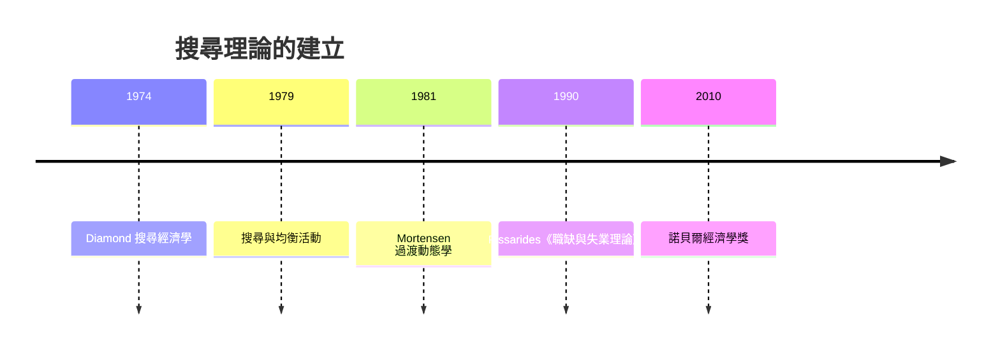

# 2010 · 懸案：為什麼有人長期找不到工作？「摩擦」能不能被量化？

> **2010 諾貝爾經濟學獎（瑞典央行紀念獎）：彼得·阿瑟·戴蒙德 Peter Arthur Diamond（美國，1940– ）、戴爾·托馬斯·莫滕森 Dale Thomas Mortensen（美國，1939– ）與克里斯托弗·安提尼奧·皮薩里德斯 Sir Christopher Antoniou Pissarides（塞浦路斯／英國，1948– ）— 表彰他們「對帶有搜尋摩擦的市場的分析理論的貢獻」（for their contributions to the theory of markets with search frictions）。**

---

## 懸案（案情提要）

經濟學教科書說失業是「總需求不足」或「結構性失業」。但 2010 年這樁案子問的是更底層的問題：

1. **為什麼「工作」與「求職者」不能瞬間配對？** 市場上明明有大量工作職缺與求職者同時存在，卻長期並存——這不是「總需求不足」，也不是技能完全不匹配；
2. **時間怎麼消失在求職過程裡？** 被解僱的人不是立刻找到下一份工作，而是經歷一段**無業期**——這段時間是社會成本的巨大來源（技能退化、士氣、財政）；
3. **即使技能完全匹配，為何還有失業？** 因為搜尋是**隨機的**（雙邊不知道對方存在），資訊到達是隨機的（看到哪個職缺廣告是隨機的），面試是隨機的。**搜尋摩擦**才是失業的根源；
4. **失業率如何被「制度」影響？** 失業保險、找工作成本、職缺資訊的流通——這些制度參數會決定均衡的失業率與「貝殼」的厚度。

三人用**搜尋與匹配理論**給出了可計算的答案，並且證明了**貨幣政策在失業中的作用**。

---

## 前因

| 年份 | 事件 |
|---|---|
| 1959–1960 | Diamond 在耶魯（與 Modigliani 同校，1962 年 AAS–Modigliani 論文提出新古典勞動市場理論） |
| 1960s | Mortensen 在卡內基梅隆；Pissarides 在 LSE 讀博士（師從 Richard Nickell） |
| 1970 | Pissarides 完成博士論文〈職缺、搜尋與勞動市場流動〉 |
| 1974 | Diamond 論「搜索的經濟學」（"Search Theory"） |
| 1979 | Diamond 與 Pissarides 的先驅論文〈聚合搜尋與經濟活動水平〉（*Aggregate Search and Equilibrium Activity*, 1979） |
| 1980 | Pissarides 出版《職缺與失業理論》（*The Theory of Job Vacancies and Unemployment*, 1990 英文版）：**搜尋與匹配理論的奠基之作** |
| 1981 | Mortensen 的「搜尋理論的動態學」系列論文，建立**過渡的動態理論** |
| 1984 | Diamond–Yellen 的「效率工資」模型 |
| 1985–1986 | Diamond 與 Yelen 的「效率工資、產出與就業水平」的理論框架 |
| 1990s | 搜尋與匹配模型成為新凱恩斯勞動市場理論的核心（Akerlof–Yellen 1990 的收集競賽） |
| 2001–2007 | 搜尋摩擦進入央行模型（EUR/美國的「小型模型」；Fed 的 DSGE 勞動市場模組） |
| 2010 | 得獎；委員會指出他們「發展並應用了搜尋摩擦的理論」 |

---

## 調查

### 線索一：搜尋與匹配的建模——三種摩擦

搜尋匹配的模型要處理三個隨機性（搜尋理論的「摩擦三要素」）：

1. **職缺的到達**：求職者以隨機方式遇見職缺（外生搜尋）；
2. **資訊的傳播**：職缺資訊（報紙、網站、推薦）以隨機方式到達求職者；
3. **面試的隨機性**：即使雙方都知道對方存在，面試結果也是隨機的（因為無法完美了解對方）。

Pissarides 的核心模型設定：

- 求職者 $i$ 與職缺 $j$ 相遇的機率與**匹配函數** $m(u, v)$ 成正比：

$$
m(u, v) = m_0 u^{\eta} v^{1-\eta}
$$

其中 $u$ 為失業率、$v$ 為職缺率（Vacancy rate），$0 < \eta < 1$。

- 分離率 $s$（separation rate，僱傭者解僱或主動辭職率）與匹配率決定「失業流入」與「就業流入」：

$$
\dot{u} = s(1-u) - m(u, v)
$$

**分離率 $s$ 是關鍵參數**：它同時決定失業的**流量**與**存量**。Diamond–Pissarides 的「效率工資」框架指出：**長期失業率由分離率決定**（因為摩擦使流動需要時間）。

### 線索二：福利與政策——「匹配」與「失業」的福利成本

Diamond–Yellen（1985）的關鍵文獻：從福利的角度看，**匹配與失業的社會成本不同**：

- **匹配**（把求職者與職缺配對）創造**新增的產出**（因為匹配的邊際產出高於平均產出）；
- **失業**則浪費了「本來可以發生」的產出。

因此，把失業者的**求職努力**從閒置轉向「更有效率的搜尋」是雙贏；而**降低分離率**（避免解僱）與**降低摩擦**同樣有效。宏觀政策含義：

$$
\text{降低 } s \text{ 或 } \eta \text{ 摩擦} \;\Longrightarrow\; \text{提高產出、降低失業}
$$

這解釋了為何**求職津貼**（提高求職的邊際收益 $z$）可能改善福利，而**提高失業保險**（提高 $b$）若超過某個臨界值則有害。

### 線索三：Mortensen 的過渡動態學——求職是一個「投資決策」

Mortensen 的貢獻是把搜尋放進**連續時間的動態選擇**：求職者每時每刻都在「工作」與「求職」之間選擇，最優解是一個**價差方程（HJB）**。

求職者在職位上的終身價值 $V_E$ 與求職期間的價值 $V_U$ 滿足：

$$
\rho V_U = w + \theta (V_E - V_U)
$$

$$
\rho V_E = w_E + (1 - s) (V_E - V_U) + s V_U
$$

其中 $\theta$ 是搜尋的單位時間報酬（找到職缺的機率 $\times$ 面試 offer 的價值）。兩式相減，得到**求職的價值**：

$$
V_E - V_U = \frac{w_E - w + s V_U}{\rho + s}
$$

**關鍵結果：更長的失業期會降低求職的未來價值**（因為累積的技能退化、雇主對長期失業者的評價下降、匹配質量下降），形成**「持續性（duration dependence）」**——這解釋了為何失業有「疤痕效應」，也解釋了為何求職津貼與「積極的勞動市場政策」（訓練、職位介紹）能改善結果。

### 線索四：效率工資與「自然失業率」的內生決定

Diamond–Yellen 的效率工資框架：企業僱傭的邊際條件是「效率工資」——為了防止工人偷懶或流動，工資必須高於市場出清工資：

$$
w = w^{e} > w^{c}
$$

於是失業成為**降低工資的替代機制**：企業若面臨需求下降，可以選擇「裁員並付較低工資」或「保留員工但工資粘性」。

這給出「自然失業率」的**微觀基礎**：它由分離率、匹配函數與效率工資的設定共同決定——**失業率不是貨幣現象，而是制度與摩擦的產物**（呼應 2006 年 Phelps 案的結構性失業理論）。

### 線索五：匹配市場的效率——第一個定理

Pissarides 的「匹配效率定理」：在同質求職者與同質職缺的市場中，**自由競爭的匹配是有效率的**（社會福利最大化）：

$$
\max_{m} \; \left[ \text{匹配產出} - \text{未匹配成本} \right]
$$

但關鍵是：**在異質（heterogeneous）市場中，匹配的「分配」問題出現**——高生產力的求職者與高生產力的職位的配對，需要一個**機制**（如1912 Roth 的 Deferred Acceptance，見 2012 案）。Pissarides 與 Diamond 的理論因此直接連到 2012 年的匹配市場理論。

### 線索六：宏觀經濟的應用——失業與貨幣政策

搜尋摩擦進入宏觀模型的過程（2000s）：

1. **Euler 方程的導數**：在求職者選擇的邊際條件中，求職的報酬 $\theta$ 與工資 $w$ 決定失業率：

$$
\frac{\partial \text{失業}}{\partial \theta} < 0
$$

2. **貨幣政策的影響**：降息提高職缺的「等待成本」（失業保險的實際值下降）$\rightarrow$ 求職積極性提高 $\rightarrow$ 失業下降。這給出了**短期總需求政策影響失業的微觀通道**——不需要「錯誤的」IS–LM，也能解釋 Phillips 曲線。
3. **凱恩斯ian 失業的存在**：在搜尋模型中，即使工資完全粘性，只要存在**有效需求不足**導致的職缺需求下降，失業仍會出現——「效率工資 + 搜尋摩擦」的組合同時解釋了「自然率」與「需求不足」。

---

## 理論裁決

**裁決一**：失業的根源是**搜尋摩擦**（資訊不完美與隨機相遇），而非總需求不足或技能完全不匹配；因此政策應針對摩擦：

$$
\dot{u} = s(1-u) - m(u,v), \qquad m(u,v) = m_0 u^{\eta} v^{1-\eta}
$$

**裁決二**：**分離率 $s$ 是長期失業率的決定者**；降低解僱（穩定僱傭）與提高匹配效率同樣重要。

**裁決三**：**福利最大化不追求「零失業」**，而是追求「有效率的匹配」；求職津貼、職位介紹、再訓練的評價標準是「匹配社會利得減去財政成本與扭曲」：

$$
\Delta W = \underbrace{\Delta(\text{匹配產出})}_{> 0} - \underbrace{\text{成本}}_{> 0}
$$

**裁決四**：失業有**持續性與疤痕效應**；早期介入（失業保險的設計、積極勞動市場政策）的回報高於晚期介入。

**裁決五**：貨幣政策能透過「求職的機會成本」影響失業——短期 Phillips 曲線在搜尋模型中獲得微觀基礎。

**裁決六（效率與分配的張力）**：自由競爭的匹配在同質市場中有效率；在異質市場中，**如何分配稀缺的「good matches」**成為新的制度問題——這是 Roth–Shapley（2012 案）的主題。

---

## 後果

| 領域 | 影響 |
|---|---|
| 政策應用 | 失業保險的設計（道德風險 vs 消費平滑）；求職津貼與積極勞動市場政策的成本效益評估；歐盟的失業政策改革；疫情後的「職業轉換」政策 |
| 學術 | 搜尋與匹配成為勞動經濟學的主軸；新凱恩斯 DSGE 的勞動市場模組；「工作」作為延遲享有的投資品（2010s 的職業選擇理論） |
| 跨學科 | 婚姻與家庭（配偶搜尋）；移民與安置；教育與專業選擇（2014 Tirole 的產業組織結合）；醫療市場的「醫生—醫院」匹配 |
| 爭議 | 搜尋模型的政策含義（如失業保險的道德風險、是否應提高求職強度）被批過度依賴同質性假設；「效率工資」模型的經驗支持薄弱；Hicks 的青年失業論與本案的對話 |
| 跨獎 | 1994 Nash 案（搜尋是一個動態博弈）、2006 Phelps（結構性失業）、2012 Roth–Shapley（匹配的效率與公平）、2019 RCT 三人組（求職介入的隨機實證） |

---

## 關聯

- [2006-Phelps跨期宏觀權衡](2006-Phelps跨期宏觀權衡.md)：自然失業率與結構性失業——本案給出微觀基礎（本書續寫中）。
- [2012-Roth與Shapley匹配市場](2012-Roth與Shapley匹配市場.md)：匹配效率與分配的下一站（本書續寫中）。
- [2019-Banerjee-Duflo-Kremer RCT反貧困](2019-Banerjee-Duflo-Kremer RCT反貧困.md)：求職介入的隨機實證（本書續寫中）。
- [2014-Tirole產業組織與管制](2014-Tirole產業組織與管制.md)：產業與職業選擇的結合（本書續寫中）。
- [1994-Nash-Harsanyi-Selten非合作賽局均衡](1994-Nash-Harsanyi-Selten非合作賽局均衡.md)：搜尋作為動態策略互動（本書續寫中）。
- [2000-Heckman與McFadden選擇模型](2000-Heckman與McFadden選擇模型.md)：選擇模型與搜尋理論的接續（本書續寫中）。
