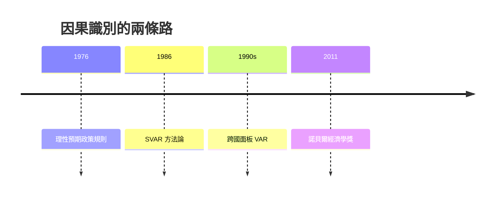

# 2011 · 懸案：宏觀經濟的「因果關係」能被資料證明嗎？

> **2011 諾貝爾經濟學獎（瑞典央行紀念獎）：湯瑪斯·約翰·薩金特 Thomas John Sargent（美國，1943– ）與克里斯托弗·艾伯特·西姆斯 Christopher Albert Sims（美國，1942–2026）— 表彰他們「對宏觀經濟學中因果與效應的實證研究」（for their empirical research on cause and effect in the macroeconomy）。**

---

## 懸案（案情提要）

宏觀經濟學的整套說法都是**因果**的：貨幣政策影響產出，財政政策影響消費，技術進步影響成長。但統計上的「相關」能支持因果嗎？

1. **內生性問題**：貨幣政策是**對經濟狀況的反應**（央行在衰退時寬鬆），因此「寬鬆$\rightarrow$產出上升」的相關性可能是**反向因果**（衰退$\rightarrow$寬鬆）；
2. **遺忘的前提**：傳統的結構模型基於「盧卡斯批判」（1995 案）——**結構參數在政策改變時會變**，所以用歷史資料估出的關係無法外推到新政策；
3. **動態的一般均衡是共同的起點**：一套能解釋資料、又不束縛政策的模型，需要**能對所有資訊集合做出反應**（理性預期），且其**結構**必須是可估計的。

薩金特與西姆斯的答案是**統計學的兩條路**：

- **薩金特**：用**結構 VAR（SVAR）**與**系統的理性預期模型**識別因果，並用**微觀（跨國面板）證據**檢驗結構參數；
- **西姆斯**：用**向量自回歸（VAR）**與**局部投影（local projections）**等方法，在不依賴嚴格結構假設下估計動態反應函數。

---

## 前因

| 年份 | 事件 |
|---|---|
| 1975–1976 | Sargent 在芝加哥大學（盧卡斯、Wallis 的理性預期課堂），與 Wallace 開始「理性預期與政策」的系列工作 |
| 1976 | Sargent & Wallace〈理性預期與貨幣政策的理論〉（《Journal of Monetary Economics》）：**理性預期下的盧卡斯–薩金特政策規則** |
| 1980s | Sargent 與 Wallace 的「牛鞭效應」理論；Sargent 的《新古典宏觀經濟學論文集》（1987） |
| 1986 | Sargent 〈Stock & Bond Market Activity and the New Monetary Regime〉：理性預期下的**股債替代與金融市場的資訊角色** |
| 1986 | Simis 發表 SVAR 方法論論文〈Tools for the Study of Macroeconomic Time Series〉 |
| 1980s–90s | Simis 的「跨國多國模型」：用 13 國的資料做**面板 VAR**；長期被拒稿的經歷（他的方法論論文歷經多次退稿，最終發表時已是經典） |
| 1990s | Simis 對「回應偏誤（respondent causality）」的系統性處理；Jordà 的局部投影方法（2005）普及 Simis 的思想 |
| 2001 | Simis 的 Nobel 講座《Macroeconomics and Reality》 |
| 2011 | 得獎；委員會稱讚兩人「發展了可靠的實證方法，用以辨識宏觀經濟中的因果關係」 |

---

## 調查

### 線索一：薩金特的 SVAR——用長期限制識別結構

在 VAR 系統

$$
\mathbf{y}_t = \mathbf{A}_1 \mathbf{y}_{t-1} + \cdots + \mathbf{A}_p \mathbf{y}_{t-p} + \boldsymbol{\varepsilon}_t
$$

中，衝擊 $\boldsymbol{\varepsilon}_t$ 的識別（衝擊對變數的動態反應）取決於**限制**。薩金特的 SVAR 引入**長期限制（long-run restrictions）**：

若在長期，**貨幣是中性**的（長期 Phillips 曲線垂直），且**財政對貨幣無長期影響**，則可以給出一組長期限制：

$$
\text{限制：} \quad \text{貨幣變數的長期累積反應 = 0}
$$

從而識別出結構衝擊 $\mathbf{u}_t$（對 $\mathbf{y}_t$ 的結構性衝擊）。

**SVAR 的優點與代價**：能回答「貨幣政策收緊後，產出與物價如何反應」這類政策問題；但代價是**必須對模型施加經濟假設**（如長期中性），而這些假設本身需要檢驗——薩金特本人強調，**限制的經濟內容必須明確說出並被經驗支持**。

### 線索二：薩金特的第二條路——微觀證據與跨國檢驗

薩金特最被低估的貢獻是**用微觀與歷史資料檢驗宏觀結構**：

1. **市場份額與競爭**：1986 年的〈Stock & Bond Market Activity and the New Monetary Regime〉——在理性預期政策下，**貨幣政策的消息會立即反映在債券與股票價格中**，因為市場參與者比央行更早知道政策路徑（價格「領先」央行）。
2. **跨國的實證檢驗**：用國家的實際利率資料檢驗各種貨幣政策規則（Taylor 規則、盧卡斯–薩金特規則），發現**真實數據更支持某類規則**；
3. **跨國的儀式**：與 Cecilia Ratto 一類的跨國研究，檢驗「同樣的央行規則在不同國家是否產生不同結果」。

這些工作共同確立了一個原則：**結構參數必須有經濟內容，且能被獨立的證據（微觀、歷史、跨國）檢驗**——這是對 1995 年盧卡斯批判的直接回應。

### 線線三：西姆斯的 VAR 與「識別的樸素主義」

西姆斯的 SVAR 貢獻（1986 論文）是**方法論的奠基**：他提出用**長期限制**識別結構衝擊的系統方法（VAR 本身則來自 Sims 1980 年的《Macroeconomics and Reality》）。

西姆斯的另一個關鍵貢獻是**面板 VAR**：用 13 個國家的資料估計同一套參數，放棄「同質性」假設：

$$
\mathbf{y}_{it} = \mathbf{A}_1 \mathbf{y}_{i,t-1} + \cdots + \mathbf{B} \mathbf{f}_{it} + \boldsymbol{\varepsilon}_{it}
$$

這使得「政策效果」可以在**不同制度、不同央行反應函式的國家**間比較——成為 1990s–2000s 跨國政策研究的標準工具。

### 線索四：西姆斯的「回應偏誤」——識別問題的精確表述

西姆斯的核心問題陳述（本案的哲學核心）：

> **當研究者用『經濟體系對研究者行為的反應』來識別政策效果時，會系統性地偏誤。**

形式化：觀測到的 VAR 係數反映的是

$$
\text{估計的政策反應函數} = \text{央行的真實反應函數} + \text{經濟體系對研究者的回應}
$$

若研究者（如央行）本身在根據經濟狀況行動（**respondent causality**），則估出的「貨幣對產出的效果」混合了政策效果與經濟對政策的反應。

西姆斯的解方是**識別的假設必須明確**：限制、工具變數、外部工具（instrumental variables）、**符號限制（sign restrictions）**——每一種都必須交代其經濟內容與代價。

### 線索五：局部投影——不必假定完整動態結構的因果估計

1990s 起（由 Jordà 2005 推廣）流行的方法是**局部投影（local projections）**：對任意給定的 shock 水平 $h$，直接估計

$$
y_{t+h} - y_{t-1} = \alpha_h + \beta_h \text{shock}_t + \boldsymbol{\Gamma}_h \mathbf{X}_t + \varepsilon_{t+h}
$$

其優點：**不需要**假定整個 VAR 結構正確，也不需要所有衝擊的完整排序；可加入豐富的 controls，並對各種識別假設（iv、符号）反覆估計以檢驗穩健性。2010s 的宏觀實證（尤其在歐洲央行與聯準的工作）幾乎全面轉向此法。

### 線索六：理性預期的建模與「政策規則的檢驗」

薩金特 1976 年與 Wallace 的模型是現代貨幣政策的起點：

$$
\pi_t = E_t \pi_{t+1} - \kappa (y_t - y_t^{e}) + \nu_t, \qquad
i_t = E_t \pi_{t+1} + \phi (y_t - y_t^{e}) + \varepsilon_t
$$

第一式是**新凱恩斯 Phillips 曲線**（預期通脹與產出缺口），第二式是**盧卡斯–薩金特政策規則**。其深意：

$$
\text{央行不設定通脹水準，而設定「通脹的預期路徑」}
$$

薩金特後來與 Kydland（2004 案）合作的「時間一致性與政策規則」研究，正是這套框架的延伸；而他在 2010s 關於「央行溝通」與「前瞻性指引」的研究，則是它的實務延伸。

---

## 理論裁決

**裁決一**：宏觀因果的識別**必然依賴經濟假設**；SVAR 用長期限制（如貨幣長期中性）提供這些假設的明確版本：

$$
\text{識別} = \text{統計模型} + \text{經濟限制}
$$

**裁決二**：存在**回應偏誤**——經濟體系對研究者行動的反應會系統性地偏誤估計；因此「央行規則」必須與「政策效果」分開估計。

**裁決三**：**結構參數應有獨立的經濟內容，並能以微觀、歷史與跨國證據檢驗**；宏觀估計的結果必須能被宏觀以外的證據交叉驗證。

**裁決四**：**局部投影等方法降低了對完整結構假設的依賴**，但並未消除識別問題——估計結果必須報告其識別假設（限制、工具、符號）與穩健性。

**裁決五**：理性預期框架下的政策設計本質是**設定預期路徑**，而非設定當期數值；這是 2010s 前瞻性指引的理論基礎。

---

## 後果

| 領域 | 影響 |
|---|---|
| 政策應用 | 央行的模型與預測系統（FRB/US model 與紐約聯儲的 DSGE VAR）；前瞻性指引的設計；歐洲央行的 VAR 系統；「宏觀審慎政策效果」的估計 |
| 學術 | SVAR 與局部投影成為宏觀實證的兩大主流；「識別」的說明義務成為期刊審稿的常態；宏觀經濟學的「可信度危機」 |
| 爭議 | 薩金特本人發動的「**科學戰爭**」（Cochrane 2007《The Price of Influence》之後的 Replication Movement、Sargent 與 Cochrane 的公開論戰、Christiano–Eichenbaum 的「反對科學」系列）是 2010s 實證經濟學最激烈的一場內訌；2011 年的授獎被視為這場戰爭的插曲 |
| 跨獎 | 1995 Lucas（理性預期與結構參數）、2004 Kydland–Prescott（政策規則）、2003 Engle–Granger（時間序列基礎）、2013 Fama 等（資產價格的實證） |

---

## 關聯

- [1995-Lucas理性預期](1995-Lucas理性預期.md)：盧卡斯批判與結構參數的不變性問題（本書續寫中）。
- [2004-Kydland與Prescott實際經濟週期](2004-Kydland與Prescott實際經濟週期.md)：理性預期的政策規則與可信度（本書續寫中）。
- [2003-Engle與Granger時間序列](2003-Engle與Granger時間序列.md)：VAR 與隨機遊走的統計地基（本書續寫中）。
- [2013-Fama-Hansen-Shiller資產價格](2013-Fama-Hansen-Shiller資產價格.md)：SVAR 在資產價格上的應用與爭議（本書續寫中）。
- [2015-Deaton消費與貧困](2015-Deaton消費與貧困.md)：結構性問題在微觀資料中的重估（本書續寫中）。
- [2022-Bernanke銀行與金融危機](2022-Bernanke銀行與金融危機.md)：SVAR 對貨幣政策與危機的診斷（本書續寫中）。
