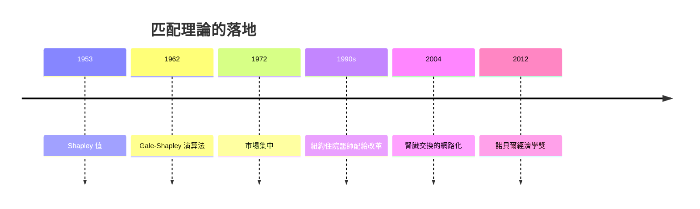

# 2012 · 懸案：市場應該「配給」誰？——效率、穩定與公平的三角

> **2012 諾貝爾經濟學獎（瑞典央行紀念獎）：阿爾文·艾略特·羅斯 Alvin Eliot Roth（美國，1951– ）與勞埃德·斯托威爾·夏普利 Lloyd Stowell Shapley（美國，1923–2016）— 表彰他們「對穩定配置理論與市場設計實踐的貢獻」（for the theory of stable allocations and the practice of market design）。**

---

## 懸案（案情提要）

2012 年的案子處理一個所有人都遇過、卻從未被經濟學好好回答的問題：

> **當「好位置」有限時，應該配給誰？**

具體場景：醫院實習名额、大學錄取、器官捐贈、配偶（配偶搜尋）、學校（選校）、庇護申請。疑點四連：

1. **效率**：配給的目的當然是「把資源配給最需要它的人」——但「最需要」如何定義？用錢買、抽籤，還是排隊？
2. **穩定性**：若「好交易」（雙方都滿意）會被更偏好的人搶走，市場就無法運作——這就是**分配的脆弱性**；
3. **公平與尊嚴**：抽籤（腎臟交換）救了人，但對被抽中者意味著「靠運氣」；優先權（學生優先享有老師）保護努力，但可能違反需求；
4. **資訊**：市場設計若要同時達成效率與穩定，通常需要**知道偏好**——但在真實市場裡偏好是私人的、分散的。

沙普利與羅斯把這些問題變成了可計算、可實作的理論，並且**真的改了世界**：器官交換系統、醫學院錄取演算法、學校選校平台。

---

## 前因

| 年份 | 事件 |
|---|---|
| 1940s | 沙普利在普林斯顿；博士後在 RAND 從事博弈論研究（與 Kuhn、 Tucker 同時） |
| 1953 | Shapley《A Value for n-Person Games》發表：**Shapley 值**（合作博弈的解概念） |
| 1962 | Gale–Shapley 演算法（《 college admissions 的穩定配對》）：**遞延接受演算法** |
| 1973 | Shapley 與 Scarf 的「隨機分配」（random assignment）：**隨機分配的公理化** |
| 1962–1968 | Roth 在麻省理工（研究純數學與數理經濟學），後轉入經濟學 |
| 1972 | Roth 論「市場的集中」：證明**多數雙邊市場**（如大學錄取）會高度集中於少數「精英機構」（Ivy League 的市場份額） |
| 1980s | Roth 與 Sotomayor 對** Gale–Shapley 演算法**的策略性質分析（是否可被操縱） |
| 1984–1988 | Roth 對**公共資源分配機制**（頻譜拍賣、住房配給）的實證研究 |
| 1988 | Roth 與.Postlewaite 的「策略穩定」理論 |
| 1990s | Roth 與 VandeVate 的市場設計研究；紐約市**專科醫生住院訓練**的市場設計（1990s 紐約市 hospital allocation） |
| 1994–2005 |  kidney exchange：Roth 參與設計美國與歐洲的腎臟交換系統 |
| 2004 | Roth 與 Shapley 的〈The Internet and the Market for Kidney Exchange〉 |
| 2012 | 得獎；委員會特別提到「市場設計的實踐」——這是諾貝爾獎史上首次為「制度工程」立碑 |

---

## 調查

### 線索一：Gale–Shapley 演算法——Deferred Acceptance 的算術

問題設定：$n$ 個男性（提案者）與 $m$ 個女性（接收者），每人有嚴格偏好排序 $m$ 個配對。目標是找到**穩定配對**（stable matching）：不存在「彼此都更喜歡彼此」的未被配對組合。

**Gale–Shapley（男提案）演算法**：

1. 每個男性先提案給他最喜歡的女性；
2. 每個女性若收到多個提案，暫時保留最喜歡的一個，拒絕其餘；
3. 被拒絕者再向下一位提案；
4. 重複直到沒有新提案。

**關鍵定理（Deferred Acceptance）**：該演算法終止（有限步內），且給出的配對是**穩定的**；並且對提案者而言是**個體理性**的。

**關鍵的不對稱性**（沙普利 1962 年已證明，羅斯 1982 年補上策略分析）：

- 男提案時，得到的結果對**女性**是**最差的可能穩定配對**（pessimal for the receivers）；
- 女性提案時，得到的結果對**男性**是最差的可能穩定配對。

因此：

$$
\text{市場設計的槓桿} = \text{誰主動提案}
$$

——這就是 2010 年 New York 出現「醫院 vs 住院醫師」誰該提案的策略博弈的起點：Roth 團隊的答案是**讓需求方（醫院）提案**，因為這對醫院更有利。

### 線索二：Roth 的策略穩定性分析——演算法能不能被操縱？

Roth 的貢獻是**策略分析**：當前的配對機制會不會被參與者聯盟操縱？

經典結果：

- **Gale–Shapley 演算法不可能被操縱**（manipulation-proof）：任何聯盟都無法透過策略性提案獲得更好的結果（Roth–VandeVate 2008）；
- 某些其他機制（例如「Boston 機制」）**可以被操縱**（Roth–Sotomayor 1988 的著名結果）。

因此：

$$
\text{選擇正確的演算法} = \text{選擇防禦性（manipulation-proof）的市場設計}
$$

### 線索三：公不公平——「Roth–VandeVate 的十字路口」與隨機分配

羅斯 2012 年的核心貢獻之一是指出：**效率與公平在匹配市場中可能衝突**，而衝突點可被精確定義為「一個申請者同時被兩個市場選擇」。

他在 2012 年的 Nobel 講座中提出了著名的「**紐約市住房配給等待名單實驗（NYU housing lottery, 2011）**」：

- 隨機把等待名單上的申請者分組，給予不同的配給政策（例如「先到先得」vs「抽籤」）；
- 觀察申請者的**再申請行為**與**資訊蒐集行為**（花多少時間研究政策）。

結果：**抽籤制**讓人更少花時間研究規則、且更多「策略性申請」（同時投多個單位）；**先到先得**則誘發大量「排隊時間」投資（甚至在凌晨 4 點排隊）。

結論：**不同的配給規則會誘導不同的、社會上未必值得的策略性行為**——這是「機制設計」在真實城市政策中的實證展演。

### 線索四：Shapley 值與隨機分配的公理化

沙普利 1953 年的 **Shapley 值**處理的是**合作博弈**：$n$ 個玩家組成的聯盟，每個聯盟有價值 $v(S)$，如何分配？

Shapley 值的定義：玩家 $i$ 的份額是其**隨機加入順序下的期望邊際貢獻**：

$$
\phi_i(v) = \sum_{S \subseteq N \setminus \{i\}} \frac{|S|!(n-|S|-1)!}{n!} \left[ v(S \cup \{i\}) - v(S) \right]
$$

其公理化特徵：**效率**（總份額等於總價值）、**對稱性**、**虛擬玩家（null player）為零**、**加法性**。

Shapley 值後來成為**成本分攤**（核電廠、航空、加盟連鎖、醫療集團）與**隨機分配**（1973 年 Shapley–Scarf）的基礎；在隨機分配中，它給出唯一滿足「匿名性 + 效率 + 對稱性」的機制。

### 線索五：腎臟交換——把匹配理論變成救命的制度

這是本案的實踐高潮。問題：某些腎衰竭病人有健康的腎但與捐贈者**血型不相容**；若能交換（用另一人的不相容捐贈者配對），就能救更多人。

Roth 與其合作者設計的**腎臟交換**系統（kidney exchange）：

1. 建立「**配對池（pairing pool）**」：不相容的雙方把資料登錄在中央系統；
2. 系統搜尋**最長的相容交換鏈（cycle）**（用計算機求解，本質是組合最佳化）；
3. 執行交換並更新血型與醫療相容性資料。

效果：顯著增加了移植數量（數千人）；並成為 2000 年美國 kidney allocation 系統（**PAI**）與多國交換網路的基礎。這是「市場設計」四個字最著名的實例。

### 線索六：醫學院錄取與選校平台

羅斯與沙普利還把匹配演算法用於：

- **醫學院錄取（residency match）**：美國的「住院醫師匹配計畫」（NRMP）自 1998 年起每年清空並重跑；
- **選校平台（school choice platforms）**：紐約、芝加哥、波士頓等地的統一選校平台，讓家庭透過平台提交排序，取代「先到先得」與私立中介；
- **住房配給**：上面提到的等待名單實驗。

---

## 理論裁決

**裁決一**：**穩定配對**是市場設計的核心目標，且可以用**多邊市場演算法**達成：

$$
\text{遞延接受} \;\Longrightarrow\; \text{穩定 + 個體理性} + \text{策略不可操縱}
$$

**裁決二**：**誰提案**決定了分配的方向——提案方得到其「最差可能穩定結果」，接收方得到「最佳可能穩定結果」：

$$
\text{男提案} \Rightarrow \text{女性得 worst; 女提案 } \Rightarrow \text{男性得 worst}
$$

**裁決三**：**效率與公平可能衝突**，且衝突可被定義為「被兩個市場同時爭取的申請者」；制度的選擇本質上是在選擇**哪一種扭曲被接受**。

**裁決四**：配給規則會誘導**策略性行為**（排隊、資訊投資、多重申請），因此市場設計必須把行為反應納入評估：

$$
\text{機制} \;\Longrightarrow\; \text{策略行為} \;\Longrightarrow\; \text{社會成本}
$$

**裁決五**：**隨機分配**在資訊不足或需要尊嚴／平等時是合法的制度選項，且有唯一性公理（Shapley 值）；**隨機本身可以被設計**（輪候、抽籤、優先權）。

---

## 後果

| 領域 | 影響 |
|---|---|
| 政策應用 | 器官交換系統（美國、歐洲、澳洲）；住院醫師匹配（NRMP）；城市選校平台；住房配給改革；學校招生（多所城市的 central admissions systems） |
| 學術 | 市場設計成為一門「工程經濟學」；策略分析成為標準；2010s 的「演算法治理」討論 |
| 跨領域 | 器官移植的倫理與法律（交換的合法性）；教育政策的公平與效率；2010s 平台與演算法配對的應用（醫院—醫生、住院醫師） |
| 爭議 | 「抽籤是懶惰的分配」的倫理批評；羅斯 2012 年為牲畜拍賣設計市場的輿論（轟動一時，其「尊嚴」論述被批為把經濟學當道德說教）；匹配演算法與既有菁英制度的正當性衝突（醫學院偏好名單的訴訟） |
| 跨獎 | 2007 機制設計三人組（IC/IR 與最優機制）、1994 Nash 案（穩定均衡的賽局語言）、2010 搜尋摩擦（匹配的宏觀版本） |

---

## 關聯

- [1994-Nash-Harsanyi-Selten非合作賽局均衡](1994-Nash-Harsanyi-Selten非合作賽局均衡.md)：穩定配對的賽局語言（1994 案的延伸閱讀）。
- [2007-機制設計三人組](2007-機制設計三人組.md)：IC/IR 與機制最優性——本案的理論框架（本書續寫中）。
- [2010-Diamond-Mortensen-Pissarides搜尋摩擦](2010-Diamond-Mortensen-Pissarides搜尋摩擦.md)：匹配問題的宏觀與動態版本（本書續寫中）。
- [1986-Buchanan公共選擇理論](1986-Buchanan公共選擇理論.md)：配給規則作為公共選擇的產物（本書續寫中）。
- [1996-Mirrlees與Vickrey不對稱信息](1996-Mirrlees與Vickrey不對稱信息.md)：拍賣與配給的機制比較（本書續寫中）。
- [2020-Milgrom與Wilson拍賣理論](2020-Milgrom與Wilson拍賣理論.md)：拍賣作為市場設計的另一支（本書續寫中）。
