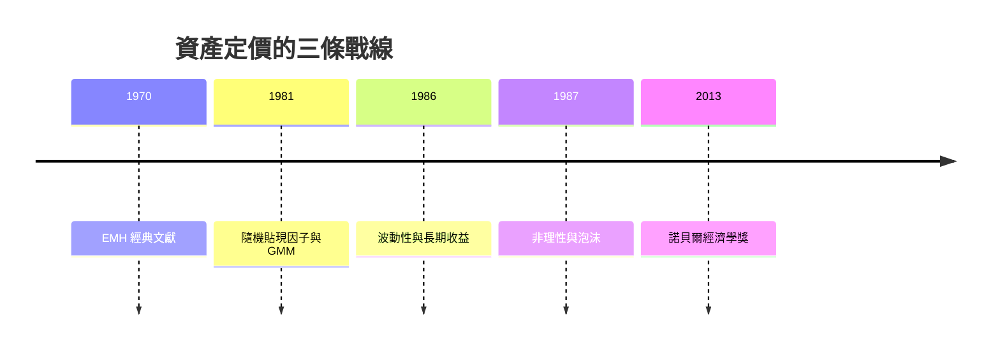

# 2013 · 懸案：股價是「噪音」還是「訊號」？泡沫能不能被事先看穿？

> **2013 諾貝爾經濟學獎（瑞典央行紀念獎）：尤金·法馬 Eugene Francis Fama（美國，1939– ）、拉斯·彼得·漢森 Lars Peter Hansen（美國，1955– ）與羅伯特·詹姆斯·席勒 Robert James Shiller（美國，1946– ）— 表彰他們「對資產價格的實證分析」（for their empirical analysis of asset prices）。**

---

## 懸案（案情提要）

2013 年是本獎史上最「自我矛盾」的一次授獎：三人中，法馬是**效率市場假說（EMH）**的主要捍衛者，席勒則是**泡沫與市場非理性**的主要證據提供者——兩人對市場是否可預測的立場幾乎相反，卻同時獲獎。委員會的措辭刻意只說「實證分析」。

疑點四連：

1. **風險與收益的關係是什麼？** CAPM（1990 案）說：預期超額收益與 $\beta$（系統性風險）成正比。實證上卻是「低 $\beta$ 異常收益高、高 $\beta$ 異常收益低」——著名的 **$\beta$ 謎**；
2. **股價可預測嗎？** 變動性（波動）有極強的持續性——用已实现的波動預測未來波動，效果遠勝用股價；那麼**價格本身**呢？
3. **泡沫能被偵測嗎？** 席勒的實證顯示：股價相對基本面（股息、盈利）的偏離在頂點前幾乎**無法**被即時辨認（同月回報對長期回報的預測力幾乎為零）——泡沫只有事後才看得出來；
4. **定價模型該檢驗什麼？** 席勒提出了動態定價的檢驗框架（若價格是正確的，長期超額收益應與真實利率相關）；漢森則給出了**可檢驗的風險模型**（Merton 的隨機貼現因子，1997 案）與**估計方法**（GMM）。

---

## 前因

| 年份 | 事件 |
|---|---|
| 1965 | Fama 加入芝加哥大學；1968 年發表〈股票市場的效率與隨機遊走〉：**EMH 的三種形式**（弱式、半強式、強式）與「價格吸收資訊」的表述 |
| 1970 | Fama 與 Jensen（與 Miller）合著《理性期望與效率市場理論》（*Efficient Capital Markets: A Review of Theory and Empirical Work*, 1970）：EMH 的經典文獻 |
| 1973 | Fama 論「數量論的定價方法」與「事件研究方法」的系統化 |
| 1976 | Fama 的《信息與資本市場》（*Information and Capital Markets*） |
| 1981 | Hansen 與 Singleton 的〈估計一般化現值模型的參數〉：**GMM 的估計方程**；**隨機貼現因子**模型 |
| 1982 | Hansen 與 Jarociński 的「因子定價模型」與**因子風險溢價的檢定** |
| 1986 | Shiller 的股票價格的研究（《Stock Prices and the Volatility of Random Walks》）：**變動性與長期收益關係的檢驗** |
| 1987 | Shiller 的《金融市場的非理性》（*Irrational Exuberance*）：**泡沫的系統性研究與心理學機制** |
| 1990 | Shiller 與 Summers 的「股價的波動性與合理價值」（Cyclic Price Movements in Markets） |
| 2000 | Shiller 的 CAPE 指標（Cyclically Adjusted Price/Earnings Ratio） |
| 2003 | 席勒、席勒與 Imbens 的「股票市場與金融危機的預警指標」 |
| 2013 | 得獎；席勒在獲獎演說中說「市場很難被預測」，法馬則重申 EMH——「矛盾對決」成為本獎史上最受矚目的插曲 |

---

## 調查

### 線索一：法馬——EMH 三重防線與「價格是資訊的摘要」

法馬的檢驗框架是三層：

| 形式 | 命題 | 檢驗方法 |
|---|---|---|
| **弱式** | 價格已反映**過去**的資訊 | 事件研究、技術分析無預測力 |
| **半強式** | 價格已反映**所有公開**資訊 | 財報公告事件研究、基金績效評估 |
| **強式** | 價格已反映**所有**資訊（含內幕） | 內幕交易者的收益檢驗 |

其檢驗工具是**事件研究法**：

$$
AR_{i,t} = R_{i,t} - \hat{\mu}_i \quad (\text{異常收益})
$$

$$
CAR_i(\tau) = \sum_{t=-T}^{\tau} AR_{i,t} \quad (\text{累積異常收益})
$$

若市場半強式有效，則 $\mathbb{E}[CAR_i(\tau)] = 0$。

法馬 2013 年諾貝爾講座《回歸均值、均值回歸與股價的可預測性》的主張：短期的價格變動幾乎不可預測，但**長期的收益與基本面（利率、盈利成長）相關**；價格的可預測性主要出現在**風險溢價**（對波動、對景氣狀態）而非「異常 alpha」。

### 線索二：漢森——隨機貼現因子與「聯合假設問題」

漢森的殺手鐧是**定價模型的可檢驗化**。Merton（1997 案）的隨機貼現因子模型：

$$
P_{t+1} = \mathbb{E}_t \left[ \frac{M_{t+1} D_{t+1}}{P_{t+1}} \right]
$$

漢森（與 Merton 1981）證明：定價方程的正確與否，取決於**三個聯合假設**：

1. **理性預期**（經濟人不是 Pricing Kernel 的 fool）；
2. **風險中性定價**（不是正確定價）；
3. **沒有套利**（不是近似定價）。

三者中任意一個失敗，定價模型都可能被資料接受。漢森的 GMM 提供了**聯合檢定**的工具：

$$
g(\theta, \zeta) = \mathbb{E}_t [z_t(\theta)] = 0
$$

用儀器變數 $z_t$ 估計參數，並以 **Hansen's $J$ 檢定**檢驗所有矩條件是否同時成立：

$$
J = T \cdot g(\hat{\theta}, \hat{\zeta})^{T} S^{-1} g(\hat{\theta}, \hat{\zeta}) \;\xrightarrow{d}\; \chi^2_{k}
$$

若 $J$ 拒絕，則定價模型（連同其三個假設）不成立。

漢森的**因子定價模型**（1982）則提供分解工具：把收益拆成對若干**因子**的暴露，加上一個與因子無關的 alpha：

$$
R_{t+1} = \alpha + \boldsymbol{\beta}^{T} \mathbf{f}_{t+1} + \varepsilon_{t+1}
$$

並用**風險價差（risk price）** $\boldsymbol{\lambda}$ 檢驗因子是否被定價：

$$
\mathbb{E}[R_{t+1}] = \alpha + \boldsymbol{\lambda}^{T} \mathbb{E}[\mathbf{f}_{t+1}]
$$

這套語言直通 2013 年的因子投資（factor investing）與 2020s 的機器學習資產定價。

### 線索三：席勒——波動的可預測性與「股價幾乎不可預測」

席勒的兩項核心實證：

**（一）波動性的持續性**：已實現波動對未來波動有極強的預測力：

$$
\text{Corr}\left( \frac{\hat{\sigma}^2_{t \to t+1}}{\sigma^2_{t \to t+1}}, \; \frac{\hat{\sigma}^2_{t+1 \to t+12}}{\sigma^2_{t+1 \to t+12}} \right) \approx 0.4 \text{--} 0.5
$$

**（二）股價的「短期幾乎不可預測」**：席勒 1986 年的著名檢驗發現——用過去一個月的月報酬去預測未來 5 年的**平均**報酬，預測力幾乎為零（在 1871–1985 的資料上，$R^2 \approx 0.003$）：

$$
\mathbb{E}\left[ \frac{R_{t+1 \to t+60}}{60} \right] \approx \alpha + \beta \cdot \frac{R_{t-60 \to t}}{60}, \quad \beta \approx 0
$$

**推論（席勒的泡沫判準）**：若股價真的在五年後會大幅回落，則近期的漲勢應是強預測——但沒有。因此**泡沫無法被即時辨認**；任何宣稱能事前抓出泡沫的模型，都必須解釋為什麼短期報酬沒有預測力。

### 線索四：席勒的泡沫理論——心理學與敘事

席勒 1987 年的《金融市場的非理性》提出「**心理學市場（psychological market）**」模型：價格由**敘事（narrative）**驅動——人們用故事解釋最近的漲勢，並把故事放大：

$$
\text{價格} = \text{基本面} + \text{敘事溢價}
$$

而敘事會傳染（新聞、媒體、社會網路），形成**正反饋**。他的證據包括：

- 1980s 的「股票與房屋的估值比率（CAPE）」在 2000 年達到歷史極端；
- 2006 年發表的〈金融市場與金融危機的預警指標〉提出**事前可行的預警指標**（估值比率、融資結構、短期利率、股價趨勢的反轉形態），但他承認這些指標只有很低的預測力——**這正是他對自己理論最誠實的註腳**。

### 線索五：CAPE 與「長週期收益率」

席勒 2000 年提出的 CAPE（週期調整市盈率）：

$$
\text{CAPE}_t = \frac{P_t}{10\text{ 年平均盈利}}
$$

以及更根本的「**收益率（earnings yield）**」：

$$
\text{Earnings Yield}_t = \frac{1}{\text{CAPE}_t}
$$

席勒的 CAPE 與盈利收益率被證明在**長週期**上對股票的超額收益有預測力（10 年以上的持有期），這與法馬的「長期收益與基本面相關」結論**並不矛盾**——兩人在此點上其實一致，分歧只在於：

$$
\text{法馬：風險溢價 } \longleftrightarrow \text{漢森：因子定價} \quad \text{vs} \quad \text{席勒：泡沫與敘事}
$$

### 線索六：2013 年的「矛盾對決」——三人的立場

| | 法馬 | 漢森 | 席勒 |
|---|---|---|---|
| 核心命題 | 市場有效；異常收益難以持續 | 風險是定價的核心；模型可被嚴格檢驗 | 泡沫與非理性真實存在 |
| 對預測的態度 | 短期不可預測；長期有風險溢價 | 因子與風險價差可估計 | 泡沫事前難辨認；長期回報與估值相關 |
| 對 CAPM | 效率市場版本最正確 | CAPM 只是因子模型的一個特例 | CAPM 的 $\beta$ 難以解釋實證 |

委員會的授獎辭詞刻意保持中性，只說「實證分析」——這使本案的歷史地位頗為特殊：**經濟學界同時認可兩種對立解釋的存在，並把它們放在同一場辯論裡**。

---

## 理論裁決

**裁決一**：市場價格吸收資訊；在**弱式與半強式**效率下，超額收益難以持續賺取；短期價格變動近似隨機遊走。

**裁決二**：資產價格模型的可檢驗性取決於**三個假設的聯合成立**（理性預期、風險中性定價、無套利），因此：

$$
\text{模型被接受} \;\Longleftrightarrow\; \text{GMM 矩條件成立} + \text{風險溢價有意義}
$$

**裁決三**：**波動率可預測**（持續性強），**價格水平則近乎不可預測**（短期）；長期的預測力來自**基本面與風險溢價**。

**裁決四**：**泡沫無法被即時辨認**（短期報酬對長期報酬的預測力近乎為零）；任何声称能事前抓泡沫的理論都必須解釋這一難題。

**裁決五**：定價研究必須以**統計檢定**為紀律（因子暴露、風險價差的顯著性、$J$ 檢定），並公開報告其檢定結果。

---

## 後果

| 領域 | 影響 |
|---|---|
| 政策應用 | 泡沫的監測與貨幣政策反應（2008 後的估值指標討論）；養老金的資產配置；2010s 的因子投資策略 |
| 學術 | 因子模型與風險溢價成為資產定價的主軸（2010s 的 "factor zoo" 與爭議）；GMM 成為定價研究的標準工具；CAPEM 與長期收益率進入政策討論 |
| 跨獎 | 1990 Markowitz–Miller–Sharpe（CAPM 的出處）、1997 Merton–Scholes（隨機貼現因子）、1981 Tobin（q 理論）、2013 的三種定價觀之爭 |
| 爭議 | 2013 年被稱為「矛盾對決」：委員會為何把對立者放在同一獎？席勒與法馬在《金融時報》公開互批（2013 年 8 月）；2010s「因子崩盤」（Quant 與 Momentum 的 2020 年回撤）暴露因子定價的實證脆弱性 |
| 公共論述 | 席勒的《非理性與金融市場》進入主流公共討論（2013 年、2018 年、2020 年三波）；金融素養教育因此在美國中小學推廣 |

---

## 關聯

- [1990-Markowitz-Miller-Sharpe金融經濟學](1990-Markowitz-Miller-Sharpe金融經濟學.md)：CAPM 的出處與 $\beta$ 謎的源頭。
- [1997-Merton與Scholes期權定價](1997-Merton與Scholes期權定價.md)：隨機貼現因子與定價的 PDE 起點。
- [2003-Engle與Granger時間序列](2003-Engle與Granger時間序列.md)：波動預測與長期報酬檢驗的統計工具。
- [2011-Sargent與Sims宏觀因果](2011-Sargent與Sims宏觀因果.md)：SVAR 在資產價格與貨幣政策上的應用。
- [2002-Kahneman與Smith行為與實驗](2002-Kahneman與Smith行為與實驗.md)：投資者偏誤的實驗證據。
- [2022-Bernanke銀行與金融危機](2022-Bernanke銀行與金融危機.md)：泡沫與崩盤的宏觀政策檢驗（本書續寫中）。
