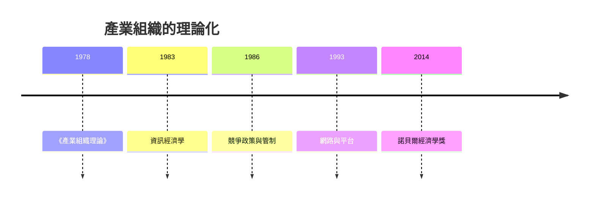

# 2014 · 懸案：怎樣管制巨頭，又不扼殺創新？

> **2014 諾貝爾經濟學獎（瑞典央行紀念獎）：讓·馬塞爾·皮埃爾·梯若爾 Jean Marcel Pierre Tirole（法國，1953– ）— 表彰他「對產業組織與對強勢企業的管制理論的貢獻」（for his contributions to the theory of industrial organization and the regulation of dominant firms）。**

---

## 懸案（案情提要）

2014 年的案件是純理論的，但問題極其現實：Google、Apple、Microsoft、歐洲的電信商、醫療集團、鐵路、航空——**當一家企業強大到可以左右規則時，該怎麼管？**

疑點五連：

1. **壟斷的福利損失怎麼算？** 傳統福利經濟學給出「半三角形」（deadweight loss triangle）：壟斷的價格提高造成效率損失。但**壟斷者往往也有創新與投資**——這部分收益傳統分析完全不算；
2. **創新與競爭的取捨**：在位者投資於創新，還是被挑戰者以顛覆性創新破局？**哪一種更有利於社會？** 答案取決於「在哪裡競爭」——在位者擅長的市場 vs 全新市場；
3. **平台與雙邊市場**：若平台對一邊使用者補貼、對另一邊收費，價格結構無法簡單判定掠奪；
4. **資料與網路效應**：數位經濟的規模報酬與資料回饋，讓「市場力量」的來源與傳統產業不同；
5. **管制的設計**：直接管制（價格上限）可能抑制投資；間接管制（資訊揭露、競爭政策、併購審查）各有代價。

梯若爾的答案是**把產業組織從「結構—行為」的靜態分類，改造為一套包含創新、競爭動態與管制的統一理論**。

---

## 前因

| 年份 | 事件 |
|---|---|
| 1967–1975 | 梯若爾在巴黎 Dauphine 與 MIT 學習（導師包括 Jean-Jacques Laffont 與 Kenneth Arrow）；博士後在 MIT 任教 |
| 1978 | 梯若爾論《產業組織理論》（*A Theory of Industrial Organization*）：**產業組織的第一次系統理論化** |
| 1983 | 梯若爾論《信息經濟學》（*The Theory of Industrial Organization* 與 *Collective Decisions*）；維克里（1996 案）的「資訊經濟學」對稱者 |
| 1986 | 梯若爾與 Jean-Jacques Laffont 合著《競爭條款與管制》（*Competition Policy and Regulation*） |
| 1988 | 梯若爾論《競爭政策與產業重組》；對歐洲電信管制的分析 |
| 1993 | 梯若爾主編《Winning the Internet Game》——對微軟案的產業組織分析 |
| 1996 | 梯若爾與 Kreps 的產業組織理論教材（** Kreps 與 Tirole**），成為產業組織的標準教科書 |
| 2003 | 梯若爾論述數位市場的管制（platforms）與「網路中立性」 |
| 2011–2013 | 歐盟對 Google 的反壟斷處分（2013 年 6 月 18 億歐元罰款，2014 年上訴維持） |
| 2014 | 得獎；評審委員會特別提到他對「強勢企業管制」與「不妨礙創新的管制」兩方面的貢獻 |

---

## 調查

### 線索一：產業組織的基本解剖（1978）

梯若爾 1978 年的第一項工作是把產業組織建立在**最適契約理論**之上。模型骨架：

- 上下游的縱向關係：上游（原料或零組件）向下游（製造商或最終需求）供貨；
- 每個環節有成本 $c_i(q_i)$，利潤最大化的加權總成本（Efficient Component Pricing, ECP 條件）：

$$
\max_{\{q_i\}} \; \sum_i P_i q_i - \sum_i c_i(q_i)
$$

- 一階條件給出加權的邊際成本相等：

$$
P_i = c_i'(q_i) + \sum_{j \ne i} \text{(上游的加權邊際成本項)}
$$

這套語言使「產業鏈的縱向結構」「雙邊壟斷」「掠奪性定價」等問題可以被嚴格分析。

### 線索二：資訊經濟學（1983）與「向下擴張」的原則

梯若爾 1983 年的《資訊經濟學》處理的是**資訊不對稱**下產業結構的設計，其核心是「**向下擴張（downward expansion）原理**」：

> **製造商若在其下游建立零售環節，將不會對下游競爭者構成傷害——因為它只是增加一種供應管道。**

證明的關鍵在於：若製造商 $M$ 直營零售且下游獨立零售商 $R$ 也存在，則 $M$ 限制其對 $R$ 的供應量不是它的占優策略——因為那只是在為競爭者減少供給。這個簡潔的命題成為反壟斷法中的重要判準（「混合結構不損害競爭」）。

### 線索三：創新與競爭——「在哪裡競爭」決定一切

梯若爾最著名的理論貢獻（1980s–90s）是把**創新**放進產業組織。他的問題：當在位者面對新技術，它應該 (a) 在位競爭（自己開發新產品並保衛現有市場），還是 (b) 選擇另一個市場（讓舊業務萎縮，重心移往新市場）？

**答案取決於市場結構與需求成長**。他的理論給出三種「策略互動」的結果：

1. **在位者最優選擇是「自我破壞」**——當舊產品需求成長慢且新市場利潤高時，在位者應主動放棄舊業務；
2. **在位者可能選擇「策略性壓制」**（限制對競爭者的供給或威脅不斷創新），這在特定結構下是理性的；
3. **當競爭發生在「在位者擅長的市場」時，進入門檻低，創新更容易發生**——因此**競爭政策應促進「新市場」上的競爭**（例如解除對新進入者的結構性障礙），而非保護在位者。

這套理論直接支撐了 1990s 的反壟斷改革邏輯：微軟案（1993 年梯若爾的專著《Winning the Internet Game》）的主張不是「拆解微軟」，而是**防止其利用在作業市場的壟斷地位阻擋新市場的競爭**——這正是「結構性分離（structural separation）」主張的理論源頭。

### 線索四：雙邊市場與平台——「掠奪性定價」如何判定

數位經濟帶來的新難題：平台對一邊免費、對另一邊收費。此時：

$$
P_A + P_B \neq P
$$

因此「加權平均價格（Weighted Average Price, WAP）」傳統測試失效。梯若爾的框架把平台視為**多邊市場的組織者**，並提出判準：

- **補貼可以正當**（若一邊的網路效應需要用戶規模來建立）；
- **掠奪性補貼的判定**需要檢驗「排除效應」與「價格回收（price recoupment）」；
- 平台的**差別待遇**若具有**正的網路效應外部性**，則不必是反競爭的。

這套語言成為 2010s 對 Google（搜尋與廣告）、Amazon（平台與賣家）、Uber（司機與乘客）反壟斷訴訟的理論工具箱。

### 線索五：管制的設計——四種工具的比較

梯若爾與 Laffont（1986）的《競爭條款與管制》是管制的理論教科書，對管制工具做系統比較：

| 管制工具 | 優點 | 缺點 |
|---|---|---|
| **價格管制（上限）** | 直接對抗掠奪性定價 | 若管制過緊，削弱投資誘因（RPI 公式的設計正是為此） |
| **資訊揭露** | 不干預決策 | 資訊處理成本高、消費者未必理解 |
| **競爭條款**（禁止排他行為） | 針對具體行為 | 執行困難、可能錯殺效率行為 |
| **所有權結構調整**（拆分） | 一次性解決結構問題 | 成本高、可能喪失協同 |

核心命題：**沒有一種管制工具在所有情境下都優越**；選擇必須針對「市場失敗的特定來源」：

$$
\text{管制工具} = f(\text{市場失敗的類型：資訊、掠奪、外部性、網路效應})
$$

### 線索六：網路中立性與「可攜性」的經濟學

梯若爾 2010s 的分析（尤其與 Rohlfs 與 Green 的合作）提供了**網路中立性**的經濟學框架：若上網路與應用層被垂直整合，則具有瓶頸壟斷能力的整合者會**掠奪創新**（限制創新應用的接入或抽取其價值）。因此：

$$
\text{競爭政策} \Rightarrow \text{確保瓶頸環節的「中立」或「可攜」}
$$

這成為 2010s 美國「網路中立性」規則辯論（及其後被司法部推翻的過程）背後的理論骨架。

---

## 理論裁決

**裁決一**：產業組織的基本結構是**最適契約理論 + 縱向關係**；產業鏈的均衡由加權邊際成本條件決定：

$$
P_i = c_i'(q_i) + \sum_j (\text{上游加權邊際成本})
$$

**裁決二**：競爭與創新的關係取決於**競爭發生在哪個市場**；促進新市場進入的政策，往往比保護現有市場的政策更有利於創新：

$$
\text{創新激勵} \approx f(\text{競爭的「位置」}, \text{在位者的既有优势})
$$

**裁決三**：**向下擴張原理**：垂直整合的下游延伸一般不損害競爭，除非製造商以排他方式限制對競爭者的供應。

**裁決四**：**雙邊／多邊市場的價格結構不能被簡化為單一價格**；掠奪性行為的判定必須依據**排除效應**與**價格回收**，並考慮網路效應的正當性。

**裁決五**：**管制工具沒有普遍優劣**；正確做法是依市場失敗的類型（資訊、掠奪、外部性、瓶頸）選擇工具，並設計激勵相容的機制（RPI 型價格上限就是「時間不一致性」的制度解——與 2004 案對話）。

---

## 後果

| 領域 | 影響 |
|---|---|
| 政策應用 | 微軟案的理論影響；歐盟對 Google 的反壟斷（2013–2018）與 DMA（數位市場法）；網路中立性規則；平台責任；電力與電信管制改革 |
| 學術 | 產業組織成為理論經濟學的主導學科；資訊經濟學成為縱向關係的標準語言；2010s 的「多邊市場」文獻 |
| 跨領域 | 對應作者與「監管科技」的經濟學分析（2010s 的科技平台治理）；創投與併購審查 |
| 爭議 | 梯若爾本人多次批評歐盟對 Google 的處分「建立在錯誤的理論上」（2014 年諾貝爾講座後的公開聲明引發廣泛批評，被指「得獎後立刻反對實際執法」）；拆分 vs 行為救濟的產業政策之爭 |
| 跨獎 | 1982 Stigler（管制俘虜）、2007 機制設計（管制機制的設計）、2010 搜尋摩擦（產業與職業選擇）、2008 Krugman（集聚與結構） |

---

## 關聯

- [1982-Stigler管制與資訊經濟學](1982-Stigler管制與資訊經濟學.md)：管制俘虜理論與產業組織的芝加哥傳統（本書續寫中）。
- [1991-Coase交易成本與產權](1991-Coase交易成本與產權.md)：縱向一體化與交易成本的對照（本書續寫中）。
- [2007-機制設計三人組](2007-機制設計三人組.md)：IC/IR 與規制的激勵設計（本書續寫中）。
- [2005-Aumann與Schelling冲突与合作](2005-Aumann與Schelling冲突与合作.md)：策略互動與競爭動態（本書續寫中）。
- [2009-Ostrom與Williamson治理](2009-Ostrom與Williamson治理.md)：企業邊界與治理結構（本書續寫中）。
- [2018-Nordhaus與Romer長期增長](2018-Nordhaus與Romer長期增長.md)：創新與競爭的長期回報（本書續寫中）。
