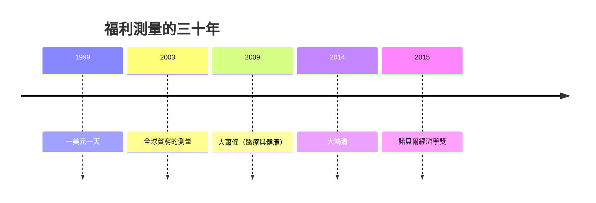

# 2015 · 懸案：貧窮、幸福與增長該怎麼量？——把「福利」變成可計算的東西

> **2015 諾貝爾經濟學獎（瑞典央行紀念獎）：安格斯·斯圖爾特·迪頓 Sir Angus Stewart Deaton（英國／美國，1945– ）— 表彰他「對消費、貧困與福祉的分析」（for his analysis of consumption, poverty and well-being）。**

---

## 懸案（案情提一）

「幸福」能不能被測量？「貧窮」該用哪條線？「增長」帶來了多少福利？三個老問題在 2010s 有了新的技術條件（大量微觀資料、隨機實驗、心理學量表），迪頓的答案是：

1. **幸福的測量**：自陳的生活滿意度（life satisfaction）能否與效用理論對接？怎麼避免「文化差異」與「適應（adaptation）」的干擾？
2. **貧窮的測量**：一條收入線（poverty line）——但這線該畫在哪？絕對還是相對？線以下的家庭，缺的是什麼？
3. **發展的評估**：GDP 上升 10%，是不是每個人都變好了？（尤其在**不平等**上升時）
4. **增長與貧窮的關係**：經濟增長是否必然減少貧窮？迪頓在《貧窮與飢荒》的姊妹作《經濟不平等與貧窮》中回答：**不一定**——中國與印度的減貧成就，與**初始不平等**有關。

---

## 前因

| 年份 | 事件 |
|---|---|
| 1965–1975 | 迪頓在劍橋、MIT 受訓（與 Richard Stone 的國民帳戶傳統近緣，但走的是另一條路） |
| 1970s–80s | 迪頓在芝加哥與普林斯顿；研究美國的種族收入差距（The Income of the American Negroes, 1966）與非洲的發展 |
| 1983 | 迪頓的《過度富足之路》後，長期研究印度 |
| 1988 | 迪頓與 Kish 的多重隨機化（multiple randomization）方法；與 Sizable 的《一美元一天》（1999–2000） |
| 1995–2002 | 「死亡、疾病與教育」三個研究計畫（普林斯顿的「Arrow Profits」），帶回印度的實證資料 |
| 1998 | 《飢荒與數學論》之後的印度研究 |
| 2003 | 迪頓與case的《全球貧窮的測量》（後續每年更新） |
| 2008 | 迪頓與Case 的《健康與幸福》（*The Global Health Corner*） |
| 2009 | 迪頓〈大蕭條〉（《NEJM》）：醫療進步與壽命的關係 |
| 2014 | 迪頓的《大鴻溝》（*The Great Escape*） |
| 2015 | 得獎；委員會稱其「對消費、貧困與福祉的開創性分析」 |

---

## 調查

### 線索一：幸福的測量——把自陳量表接到經濟理論上

迪頓的技術起點是**卡尼曼的幸福經濟學**（2006 年與 Krueger 的專著《Well-Being and the Income Distribution》）：把「生活滿意度」$\text{LS}_i$ 與收入 $y_i$ 聯結：

$$
\text{LS}_i = \alpha + \beta \ln(y_i) + \varepsilon_i
$$

迪頓的貢獻是**嚴謹地處理測量誤差與不可比性**：

1. **生命事件與適應（adaptation）**：短期情緒（如失偶）與長期生活滿意度的關聯不同，必須區分。迪頓估計「適應半衰期」約在一年左右——**適應是存在的，但不會完全抹平變化**（這是幸福研究的一個關鍵事實）；
2. **報告與顯示偏好（revealed preferences）的對照**：迪頓指出，**顯示偏好量表（Disney 選擇題）與自陳量表（smiley scale）測的不是同一件事**：
   - 顯示偏好測的是「**當前生活中最差的方面**」；
   - 自陳量表測的是「**整體生活滿意度**」。

   兩者的相關性隨「生活條件惡化的程度」而變——這解釋了為何兩種方法對「窮人的快樂」的結論不同（窮人報告的自陳滿意度較低，但在顯示偏好量表中他們的壞處與富人的差距較小）。

3. **文化與基因的影響**：迪頓強調跨國比較需要處理「基因」（genetic）與「文化」（cultural）差異，以及「解釋權」的問題：同一個生活標準在不同國家被評價 differently（收入相同的人在窮國更滿意，因為比較基準不同）。他因此主張：**跨國福祉比較應以「同一國家內的分配」為主軸**，而非跨國的絕對水準比較。

### 線索二：貧窮的測量——一條線、兩種貧窮

迪頓與 Case 的《全球貧窮的測量》（每年更新）建立了一套可操作的口徑：

1. **絕對貧窮線**：以一個窮國的典型消費籃子為基準（如 1990 年的 1.90 美元／天，後調整為 2017 PPP 的 2.15 美元／天）：

$$
\text{貧窮率} = \frac{\text{消費（或收入）低於 poverty line 的人口}}{\text{總人口}}
$$

2. **相對貧窮（relative poverty）**：在已開發國家，用**收入分布的某個百分位**（如中位數的 50% 或 60%）作為貧窮線：

$$
\text{相對貧窮率} = \frac{y_i < 0.6 \times \text{median}(y)}{\text{總人口}}
$$

3. **多維貧窮（Multidimensional Poverty Index, MPI）**：聯合國 human development 的做法，把健康、教育與生活水準三個維度合成：

$$
MPI = \sum_{d=1}^{3} w_d \times \frac{\text{在維度 } d \text{ 被剝奪的人口比例}}{1 - \text{維度 } d \text{ 的平均剝奪程度}}
$$

**關鍵的實證發現（Deaton–Case 的「悲觀曲線」）**：**全球貧窮率在 1980–2000 年間幾乎沒有下降**，然後在 2000 年後急劇下降（主要是中國與印度）。這修正了「全球化必然帶來減貧」的敘事，也顯示**增長的減貧效果取決於起點的不平等**。

### 線索三：增長、不平等與貧窮——「誰得到了好處」

迪頓的《經濟不平等與貧窮》（2009，Economics of Inequality）提出核心機制：

$$
\text{增長} \xrightarrow{\text{分配}} \begin{cases} \text{貧窮（底端）} \\ \text{中產（中間）} \\ \text{頂端} \end{cases}
$$

**關鍵命題**：增長的減貧效果，取決於**增長發生在哪一段收入分布**：

- 若增長集中在**底端**（如中國 1980–2008），貧窮率急劇下降；
- 若增長集中在**頂端**（如美國 1980–2008），底端幾乎沒有受益——**長期貧窮率停滯**。

這解釋了「為什麼同樣是 2% 的成長，不同國家有不同的減貧效果」，也解釋了「為何美國的貧窮率自 1970s 起幾乎不動」。政策含義：**發展政策必須針對分配（教育、健康、轉移）而非僅針對增長**。

### 線索四：GDP 與福祉——迪頓的「成長會計」批評

迪頓指出：**GDP 增長的 $1/3$ 到 $2/3$ 對應的「生活水準」改善並不出現在官方 GDP 中**——因為 GDP 不包含：

- 健康與醫療的改善（1960–2000 年美國人的期望壽命增加約 7 年）；
- 品質調整（quality adjustment，如藥物的臨床效果）；
- 家庭生產（無酬照護）；
- 環境品質。

因此他主張**修正後的「真實消費」測量**：

$$
\text{真實消費} = \text{官方消費} + \text{健康改善} + \text{環境改善} + \text{時間使用}
$$

而 2020 年的疫情讓這個問題再度尖銳化：**在家工作、線上教育、兒童照護的價值都不在 GDP 裡**。

### 線索五：貧窮的「動態」與健康

迪頓與 Case 的核心批評之一：官方貧窮統計是**靜態的年度截面**，卻被用來描述「窮人如何變化」。但窮人的收入軌跡高度波動（許多人只在某年落入貧窮線），且**陷入貧窮的長期後果**（健康、兒童發展）與短期不同。迪頓因此主張用**面板資料的流動分析（churn）**而非截面比例來描述貧困。

### 線索六：流行病學與經濟學的「第二場戰爭」

《貧窮與飢荒》的姊妹作《全球健康的不平等》（2009）與《大鴻溝》（2014）：把健康與經濟發展放在同一個因果框架裡：

$$
\text{健康} \;\longrightarrow\; \text{勞動生產力} \;\longrightarrow\; \text{收入} \;\longrightarrow\; \text{健康（迴饋）}
$$

以及「疾病貧窮陷阱」：健康惡化 $\rightarrow$ 收入下降 $\rightarrow$ 無法負擔醫療 $\rightarrow$ 健康更差。

---

## 理論裁決

**裁決一**：**福祉可以被測量**，但必須處理三件事：適應（adaptation）、生命事件與長期滿意度的區分、以及跨國比較時的基因—文化差異；顯示偏好與自陳量表測的是**不同的東西**，應並用。

**裁決二**：**貧窮線本身是政策選擇**：絕對線（全球貧窮）、相對線（已開發國家的相對剝奪）、多維線（健康、教育、生活水準）回答不同的問題。

**裁決三**：**增長不自動減貧**；減貧效果取決於增長在收入分布上的落點：

$$
\frac{\partial \text{貧窮率}}{\partial g} \;\text{的符號，取決於} \; \text{增長的分配位置}
$$

**裁決四**：**官方 GDP 低估了生活水準的改善**；一個更完整的福祉測量必須納入健康、環境與時間使用：

$$
\text{真實福利} = \text{GDP 消費} + \text{健康} + \text{環境} + \text{時間}
$$

**裁決五**：貧窮是**動態的**（流動而非族群），且有**長期後果**；政策評估必須使用面板與生存分析。

---

## 後果

| 領域 | 影響 |
|---|---|
| 政策應用 | 聯合國 SDG（尤其 SDG 1 與 SDG 3）的測量框架；HDI 與 MPI 的方法論影響；美國的官方貧窮線爭論；疫情後的福祉核算 |
| 學術 | 幸福經濟學成為正式分支；發展政策評估從「增長」轉向「分配 $\times$ 增長」；健康經濟學與發展經濟學結合 |
| 跨獎 | 1998 Sen（能力與福利的哲學基礎）、1971 Kuznets（結構轉型與不平等）、2019 RCT 三人組（減貧的隨機實證）、2023 Goldin（性別工資與分配） |
| 爭議 | 迪頓 2020 年在《紐約時報》發表的〈降低全球貧窮〉與隨後的「貧窮線應上調」之爭（$2.15 vs $3.65 美元之爭，2022–2023）；被批「用西方主觀量表評價窮國」；2016 年後的「脫貧數字政治」 |
| 公共論述 | 「貧窮的動態圖像」進入公共討論；2020 年後 GDP 與福祉之辯的基礎 |

---

## 關聯

- [1998-Sen福利與社會選擇](1998-Sen福利與社會選擇.md)：能力方法與福利的哲學框架（本書續寫中）。
- [1971-Kuznets國民帳戶與增長長卷](1971-Kuznets國民帳戶與增長長卷.md)：國民帳戶與不平等曲線（本書續寫中）。
- [1984-Stone國民帳戶體系](1984-Stone國民帳戶體系.md)：GDP 的官方定義與口徑（本書續寫中）。
- [2019-Banerjee-Duflo-Kremer RCT反貧困](2019-Banerjee-Duflo-Kremer RCT反貧困.md)：減貧的隨機實證證據（本書續寫中）。
- [2023-Goldin女性勞動市場](2023-Goldin女性勞動市場.md)：分配的另一個維度（本書續寫中）。
- [2016-Hart與Holmstrom契約理論](2016-Hart與Holmstrom契約理論.md)：不完全資訊下的市場與組織（本書續寫中）。
