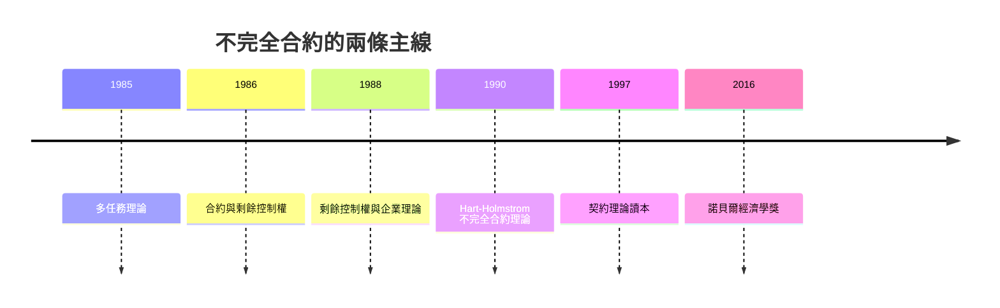

# 2016 · 懸案：合約寫不完，剩餘權利該給誰？

> **2016 諾貝爾經濟學獎（瑞典央行紀念獎）：奧利弗·西蒙·達西·哈特 Sir Oliver Simon D'Arcy Hart（英國／美國，1948– ）與本特·羅伯特·霍姆斯特倫 Bengt Robert Holmström（芬蘭，1949– ）— 表彰他們「對契約理論的貢獻」（for their contributions to contract theory）。**

---

## 懸案（案情提要）

契約理論要回答：簽約之前，人們能寫下什麼？寫不下來的部分怎麼辦？疑點四連：

1. **未來狀態無法窮舉**：合約不可能涵蓋所有可能情形（1940s 的「Schelling 點」與 Coase 1960 年的傳統）；
2. **剩餘控制權（residual rights）**：無法寫入合約的決策權歸誰？若歸**雇主**，工人就有動機在事後偷懶（道德風險）；若歸**工人**，雇主就不敢投資（hold-up 問題）；
3. **事後的資訊不對稱**：事情發生後，雙方對狀態的觀察不同（可能一方比另一方更清楚），誰來決策？
4. **專用性投資與「套牢」**：一旦一方做了不可移轉的投資，另一方就握有「重新談判的籌碼」——如何防止事後的敲竹槓？

哈特與霍姆斯特倫在 1990 年代的兩篇論文裡給出了一套**精確而分離**的理論：**剩下的權利配置與資訊結構各自解決不同的問題**。

---

## 前因

| 年份 | 事件 |
|---|---|
| 1979 | Holmström 在斯坦福（Milgrom 網絡）；開始研究契約理論 |
| 1982 | Milgrom–Roberts 的不完全資訊契約理論 |
| 1985 | Holmström 的《多任務與委託—代理理論》；**多任務理論**的開端 |
| 1986 | Holmström 的《信息與合約理論》（*Information and Contract Theory*）；Hart 的《合約與剩餘控制權》（*Contracting and the Residual Control Rights*） |
| 1988 | Hart–Moore 的《不完全合約理論》；Grossman–Hart 的產權理論（1986–1990） |
| 1989 | Grossman–Hart–Moore 的「金融契約理論」 |
| 1990 | Hart–Holmström〈契約理論與管制理論的關聯〉（《Review of Economic Studies》）：**不完全合約理論**的系統表述 |
| 1992 | Hart 的《企業與市場的法律關係》；Hart–Moore 的「剩餘控制權與企業理論」 |
| 1994 | Hart 的《企業理論：經濟學的新紀元》（*The Firm and the Market*）；Hart–Moore 的「法律與經濟學的關聯」 |
| 1997 | 《Hart, Holmström & Milgrom 的契約理論讀本》（*Contract Theory*）問世 |
| 2010s | 契約理論進入金融學（CDS、違約、破產）、公司法（董事責任）、平台治理（2016 案的核心遺產） |
| 2016 | 得獎；委員會稱其對「契約理論」有奠基性貢獻 |

---

## 調查

### 線索一：四項要素——一筆交易的完整解剖

哈特與霍姆斯特倫把一筆交易分解成四個可分析的問題：

1. **交易（what）**：什麼被交換？
2. **合約（how）**：能寫下的條款；
3. **剩餘控制權（who）**：寫不下時誰決定；
4. **資訊結構（when）**：決策時，各方知道什麼。

**核心洞見**：這四項中，**合約條款**往往無法解決所有問題，於是**剩餘控制權的配置**與**資訊結構**必須承擔其餘的工作——而**這兩者解決的是不同的難題**。

### 線索二：剩餘控制權——防禦「道德風險」與「套牢」

在**完全合約**世界裡，權利配置無關緊要（Coase 的財權定理）；在**不完全合約**世界裡，權利配置決定效率。兩種「權利配置」方案：

**方案 A：把剩餘控制權給雇主（資本方）**
- 優點：雇主的決策不受工人的「道德風險」困擾（工人無法在事後偷懶，因為雇主可重新指派）；
- 缺點：工人怕事後被「重新談判」（hold-up），因此**在事後不敢做專用性投資**。

**方案 B：把剩餘控制權給工人**
- 優點：工人的投資意願高（他能分享投資收益）；
- 缺點：雇主擔心工人事後偷懶（道德風險），因此**事後投資不足**。

於是**效率要求剩餘控制權配置與投資類型相匹配**：

$$
\text{剩餘控制權} \;\text{應配置給} \; \text{對該類投資} \; \frac{\partial (\text{投資收益})}{\partial (\text{努力/參與})} \; \text{最大的一方}
$$

這解釋了許多現實制度：**土地租賃**把剩餘權給地主（因為土地投資需要長期維護，租戶偷懶的風險高）；**家庭農場**把剩餘權給農夫；**加盟連鎖**把剩餘權留給加盟主（因加盟主做店內努力），而總部掌握關鍵的「總部權」（brand、supply chain）；**專利授權**——Hart–Moore 的經典結論：若專利權人是**互補資產**的所有者，授權可達成效率；若專利與其餘資產是**替代**的，則合併（垂直整合）才有效率。

### 線索三：資訊結構——防禦「隱蔽行動」與「隱蔽資訊」

霍姆斯特倫的部分聚焦於**決策之時的資訊**：

- 若決策者對狀態有**私人資訊**（如工人私下知道今天身體狀況），則**剩餘控制權應給他**（因為只有他能正確評估狀態）；
- 若決策涉及**多項任務**（多-task principal-agent），且不同任務的度量成本不同，則**剩餘權應給「度量成本低」的一方**——這解釋了為何「高薪聘用的 CEO」比「按件計酬的工人」更適合處理複雜任務、而按件計酬適合重複性工作。

**多任務理論的正式表述**：在激勵相容的條件下，

$$
\frac{\text{激勵強度}_1}{\text{激勵強度}_2} = \frac{\text{度量成本}_1}{\text{度量成本}_2} \cdot \frac{\text{邊際產出}_1}{\text{邊際產出}_2}
$$

於是**當度量成本差異大時，激勵強度必須差異化**——否則會誘發「搭便車」（把努力從可度量的任務轉向不可度量的任務）。

### 線索四：Hart–Moore 的「觀點」與 Grossman–Hart 的企業理論

哈特的**契約觀點（contractual view of the firm）**與 Grossman–Hart 的產權理論（1986–1990）構成 1990 年代企業理論的主流解釋：

**企業存在的理由**不是市場失靈（Coase 1937 的解釋），而是：

$$
\text{企業} = \text{把剩餘控制權集中於一方的治理結構}
$$

於是：

- **合併（vertical integration）**的收益 = 避免 hold-up 造成的投資扭曲；
- **合併的代價** = 失去「挑選最好管理者」的市場機制（Q 理論：規模報酬遞減使多個獨立組織能挑選最優管理者，合併則失去此功能）；
- 因此企業邊界由兩者比較決定：

$$
\text{合併} \iff \text{投資扭曲的損失} > \text{選擇效率的損失}
$$

這正是 1991 年 Coase 案的問題在**不完全合約**版本下的答案，也是 2009 年 Williamson 案的治理結構理論的對話版本。

### 線索五：合約理論與宏觀金融——2010s 的延伸

契約理論在 2008 危機後被大量用於解釋金融系統：

- **CDS 與系統性風險**：若金融機構之間的合約無法窮舉尾部事件，則「剩餘控制權」與「資訊結構」決定了誰承擔損失——這直接通向 2022 年 Bernanke–Diamond–Dybvig 案的「擠兌」理論（銀行的負債合約 + 資訊不對稱）；
- **破產法**：美國破產法第 11 章的「控制權」安排（債務人自主權）就是剩餘控制權配置的制度實例；
- **契約理論中的「弱形式可實施性」**：哈特與 Moore 提出的「可實施性」概念（1979 年 Hart 的文章就是題為〈能否實施契約？〉）——若無法強制執行，就不能依賴合約。

---

## 理論裁決

**裁決一**：契約必然不完全；**剩餘控制權的配置**與**資訊結構**是兩套不可替代的制衡機制，分別對應「隱蔽行動」與「隱蔽資訊」兩種難題。

**裁決二**：剩餘控制權應配置給對該類投資的**邊際貢獻（努力敏感度）最高**的一方：

$$
\text{剩餘權} \to \arg\max_{i} \frac{\partial V}{\partial e_i}
$$

這解釋了土地租賃、家庭農場、加盟連鎖、專利授權的制度設計。

**裁決三**：多任務環境下，激勵強度必須與**度量成本**成比例；否則出現搭便車與「量能不到」的問題。

**裁決四**：企業的邊界由「避免投資扭曲的收益」與「失去選擇效率的代價」之比較決定；**企業理論是產權理論的延伸**，而非市場失靈理論的延伸。

**裁決五（方法論）**：任何理論（保險、稅制、金融監管、公司治理）若依賴「合約可以寫全」的假設，都應被重新檢視；**可實施性（implementability）是經濟學的一級考量**。

---

## 後果

| 領域 | 影響 |
|---|---|
| 政策應用 | 金融危機後的銀行破產法與存款保險設計（2017 美國的「problem bank」規則）；公司治理與董事責任；專利授權與平台條款；加盟與授權經營的合約設計 |
| 學術 | 契約理論成為組織理論、公司金融、經濟法學的共同語言；2000s 的「法律經濟學」復興 |
| 跨學科 | 法學（Hart–Moore 對法律與經濟學的推動）、組織理論（Milgrom–Roberts 的組織經濟學）、金融穩定理論 |
| 爭議 | 交易成本的可測性批評（2021 年 Oliver Hart 在諾貝爾演講中特別回應「交易成本難以測量」的批評，強調其**比較靜態**的正確性）；契約理論被批過度形式化 |
| 跨獎 | 1991 Coase（交易成本與產權）、2009 Williamson（治理結構）、2014 Tirole（產業組織中的縱向關係）、2022 Bernanke 等（金融合約與擠兌） |

---

## 關聯

- [1991-Coase交易成本與產權](1991-Coase交易成本與產權.md)：產權理論的起點（本書續寫中）。
- [2009-Ostrom與Williamson治理](2009-Ostrom與Williamson治理.md)：治理結構理論的另一條血脈。
- [2001-Akerlof-Spence-Stiglitz不對稱信息](2001-Akerlof-Spence-Stiglitz不對稱信息.md)：資訊不對稱與道德風險的前案。
- [2014-Tirole產業組織與管制](2014-Tirole產業組織與管制.md)：縱向關係與垂直整合（本書續寫中）。
- [2022-Bernanke銀行與金融危機](2022-Bernanke銀行與金融危機.md)：金融合約與擠兌的現代版（本書續寫中）。
