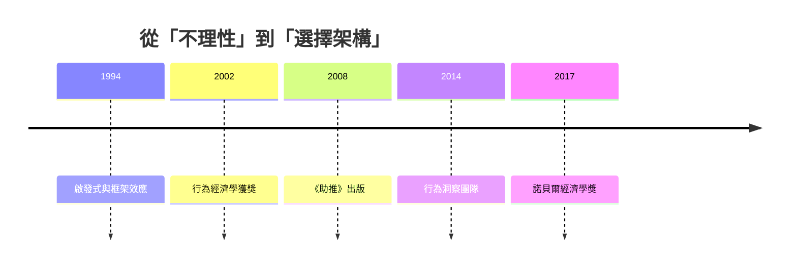

# 2017 · 懸案：明知對己有利，為何人們就是不選？——「助推」能不能改寫行為？

> **2017 諾貝爾經濟學獎（瑞典央行紀念獎）：理查德·哈羅·塞勒 Richard H. Thaler（美國，1945– ）— 表彰他「對行為經濟學的貢獻」（for his contributions to behavioural economics）。**

---

## 懸案（案情提要）

塞勒的偵查起點是一個「常識上的不可能」：

1. **明擺著的好處，為什麼人不要？** 雇主提供「自動加入」的401(k)退休計畫，員工不加薪就享有；結果**多數員工選擇不參加**（美國 401(k) 的參加率長期低於 50%）；
2. **同樣的選擇，只是呈現方式不同，結果就不同？** 醫療保險的選擇架構實驗顯示，預設選項（auto-enrollment）能讓參與率從 40% 升到 90%；
3. **自由選擇的市場，為何系統性地做出次優決策？** 如果這是系統性的（而非少數人的無知），經濟學的模型前提就需要修正。

塞勒的答案是**「助推（nudge）」**：不改變選擇集合、不改變經濟誘因，只改變**呈現方式（choice architecture）**——而這能在低成本下改變行為。

---

## 前因

| 年份 | 事件 |
|---|---|
| 1960s | 塞勒在加州大學柏克萊分校讀法律（1967），在麻省理工（1968–1971）讀經濟學博士（導師 Franco Modigliani） |
| 1974 | 塞勒與 Modigliani 合著《消費者剩餘與消費者信用》；塞勒論「挖角」 |
| 1979 | 塞勒論「流動性約束」下的消費者行為（Hawkins–Simon 的批評） |
| 1980s | 塞勒與 Shefrin 的《消費者的儲蓄與消費》（*An Economic Theory of Self-Control*）：**結構性偏誤（structural vs. myopic）**的分析 |
| 1981 | 塞勒與 Shefrin 的「心理一生」（*An Economic Theory of Life-Cycle Consumption*） |
| 1986 | 塞爾與 Lynch 的**心理所得表（Psychological Income Table）** |
| 1994 | 塞勒的「心理學與經濟學的對話」（*The Psychology of Preferences and the Economic Structure of the Choice*）：**啟發式（heuristic）**與「框架效應」進入經濟學 |
| 1997 | 塞勒的《Doing Economics》；「有錢人的選擇」系列（Munger 論文） |
| 2002 | 與卡尼曼共同獲獎（2002 案）——行為經濟學的奠基 |
| 2008 | 塞勒與 Sunstein 的《助推》（*Nudge*）：**選擇架構**的概念普及化 |
| 2014 | 英國政府設立「行為洞察團隊」（Behavioural Insights Team）；美國的「智慧選擇」（SmartChoices） |
| 2017 | 得獎；委員會稱其「對行為經濟學的貢獻」，並特別提到「助推」的實務影響 |

---

## 調查

### 線索一：經濟人與「有限理性經濟人」的差別

塞勒對經濟學的挑戰不在於人「不理性」，而在於**經濟人的三個假設需要修正**：

1. **完全自控（complete self-control）**：經濟人不會系統性偏誤；塞勒區分：
   - **結構性偏誤（structural）**：偏誤來自**激勵結構**（如契約設計、時間不一致的貼現）；
   - **短視偏誤（myopic）**：偏誤來自**偏好的不一致**（現在偏好吸菸、將來偏好健康）。

   $$\text{偏誤} = \underbrace{\text{激勵設計}}_{\text{可用契約修正}} + \underbrace{\text{偏好不一致}}_{\text{需靠預設與架構}} + \underbrace{\text{認知偏誤}}_{\text{需靠資訊與提示}}$$

2. **一致的偏誤（consistent biases）**：人不是隨機地犯錯，而是**系統性、可預測地**犯錯（可預測性正是助推可行的前提）；
3. **有限理性下的「滿意解」**（承接 Simon 1978 案）。

### 線索二：框架效應與三種偏誤的清單

塞勒整理並命名了行為經濟學的核心偏誤，這些偏誤**每一條都有可複製的實驗**：

| 偏誤 | 內容 | 政策含義 |
|---|---|---|
| **呈現（framing）** | 同一結果以不同語言表述會改變選擇 | 衛生政策的溝通方式（存活 vs 死亡） |
| **現狀偏誤（status quo bias）** | 不改變任何事被偏好；選擇預設項被系統性高估 | 預設選項（自動加入） |
| **損失厭惡（loss aversion）** | 損失的權重約為收益的 2 倍 | 投資者不實現虧損（處置效應） |
| **心理账户（mental accounting）** | 相同的錢因來源不同而被賦予不同意義 | 「退稅」被當成「意外之財」而花掉 |
| **參與者—觀察者不對稱** | 解釋他人行為時歸因外部，解釋自己時歸因內部 | 責任制的設計 |

**心理账户**是塞勒最具政策影響力的概念之一：它解釋了為何**稅制的「心理成本」**不同——同樣的稅，以「附加費」形式出現比以「稅」形式出現更令人反感（2010 年美國的「TARP ux tax」實驗）；也解釋了為何「分開的兩筆 10 元比一筆 20 元更容易花掉」。

### 線索三：助推（nudge）——選擇架構的設計原則

塞勒與 Sunstein 定義**助推**：

> **選擇架構的任何 aspect，若改變會顯著改變人們的行為方向，則該 aspect 就是助推。**

**助推的邊界（很重要）**：

| 助推（可以） | 操縱（不可以） |
|---|---|
| 改變呈現方式、預設項、資訊提供 | 改變經濟誘因（價格、稅、罰則） |
| 假設選擇者理性且自由 | 限制選擇集合 |
| 容易實施、成本低 | 難以逆轉、需大量資源 |
| 透明、可辯護 | 隱蔽、誤導 |

**核心的道德命題**：由於人的偏誤是**可預測的**，社會有責任**設計更好的選擇架構**——正如建築規範要求防滑地板面，不是為了限制自由，而是為了讓自由可被真正行使。

### 線索四：預設選項的實證力量

塞勒最著名的大型實證（2016 年發表於《QJE》）是**美國 401(k) 自動加入實驗**：

- 實驗對象：兩個跨國公司（一家為美國員工提供傳統選擇，另一家為澳洲員工提供自動加入）；
- 設計：把「不參加」變成**預設選項**（opt-out），而非預設「不參加」（opt-in）；
- 結果：自動加入使退休計畫參加率從 **37% 提高到 86%**（澳洲公司），美國公司的參加率從 41% 提高到 98%；且**低工資者受益更多**。

這是「助推」最嚴謹的證據：**只是把預設項翻轉，就改變了數百萬人的長期財務行為**。塞勒並強調，自動加入必須搭配「主動選擇退出」的機制（否則即是不義）。

### 線索五：助推的三個案例類型

1. **預設選項（defaults）**：自動加入、器官捐獻預設「同意」（但拒絕權必須便利）；
2. **資訊與提示（informative nudges）**：提供「社會規範」（多數人已完成申報、繳稅）——塞勒 2008 年的「tax nudge」實驗顯示，加入「多數人如實申報」的提示能顯著提高誠實申報率；
3. **對抗重複錯誤的「選擇規範」（choice rules）**：如預設「漲跌幅停損」的投資方案（Engle 與 Arlette 的實驗顯示，停損設定能顯著降低散戶的損失）。

### 線索六：助推的理論位置——「選擇的經濟學」

塞勒 2015–2017 年的理論整合（諾貝爾講座《The Economic Possibilities of Behavioural Economics》）：

- **選擇的經濟學（economics of choice）**：研究對象從「選擇集合與誘因」擴展到**「選項的呈現」**；
- **自由與家長式的關係**：助推**不排斥自由**——「家長式」（paternalism）若限於「選擇架構」且尊重退出權，就不侵犯自主；
- **偏誤是「理性的無關項」嗎？** 塞勒的回應：偏誤會導致**社會的（非私人的）錯誤**——當個人忽略環境外部性、或個人的時間偏好造成資源過度使用時，社會有理由介入；
- **行為經濟學不是反市場**：塞勒強調市場需要「選擇的自由」與「正確的框架」兩者；行為經濟學與自由市場並不對立（他本人是芝加哥學派的市場擁護者）。

### 線索七：經濟學家的「模型錯誤」與「心理學的啟發式」

塞勒的總結性公式（諾貝爾講座中著名的「倒 U 型」表述）：

$$
\text{經濟學的啟發式} = \text{心理學的啟發式} \quad \text{（市場均衡時）}
$$

$$
\text{經濟學的啟發式} \ne \text{心理學的啟發式} \quad \text{（市場失靈時）}
$$

即：在**市場運作良好**的領域，個體的直覺近似正確（演化讓那些「有效直覺」存活）；但在**市場失靈（外部性、資訊不對稱、公共品）**的領域，個體的偏誤會導致系統性錯誤——**這才是政策介入的正當理由**。

---

## 理論裁決

**裁決一**：人的偏誤是**系統性、可預測、一致**的；因此經濟學必須把「認知偏誤」納入模型與政策設計：

$$
\text{偏誤} = \text{激勵設計} + \text{偏好不一致} + \text{認知偏誤}
$$

**裁決二**：**選擇架構**（呈現方式、預設項、資訊）是經濟學的合法研究對象；改變架構可以大幅改變行為而不改變誘因。

**裁決三**：**助推的邊界**：改變架構、保留誘因與選擇集合、尊重退出權——三者同時成立才為正當；否則即為操縱。

**裁決四**：**預設選項具有強大的因果效果**（401(k) 實驗：37% $\rightarrow$ 86%），但必須與便利的退出權搭配。

**裁決五**：行為經濟學介入的正當性來自**市場失靈**；在市場運作良好的領域，個體直覺是可靠的（倒 U 型關係）。

---

## 後果

| 領域 | 影響 |
|---|---|
| 政策應用 | 退休金自動加入（美國 2006 年 ERISA 法案的 auto-enrollment 條款直接引用塞勒的研究）；器官捐獻的「預設同意」（美國多州、歐洲多國）；健康與菸草的資訊設計；退稅退款與「退稅抵免」的用途限制；2017 年後的「沙維斯—奧登鮑姆」債法改革 |
| 學術 | 行為經濟學從「異端」成為主流分支；選擇架構研究成為實驗經濟學與政策評估的固定環節；「行為公共政策」成為獨立領域 |
| 爭議 | 「 nudged autonomy（被助推的自主）」的哲學批評（尤其歐洲的自主權傳統）；操縱與自由邊界的模糊；2010s 對 Facebook 的「個性化定價」與 dark pattern 的倫理爭論；塞勒本人 2017 年被「川普經濟學顧問」的標籤困擾，並在《華盛頓郵報》撰文澄清（2017） |
| 跨獎 | 2002 Kahneman–Smith（行為經濟學的奠基）、2017 同年 Thaler（政策化）、2006 Phelps（跨期權衡）、2015 Deaton（福祉測量） |

---

## 關聯

- [2002-Kahneman與Smith行為與實驗](2002-Kahneman與Smith行為與實驗.md)：行為經濟學與實驗方法的共同起點。
- [1978-Simon有限理性決策](1978-Simon有限理性決策.md)：有限理性的理論祖宗（本書續寫中）。
- [2006-Phelps跨期宏觀權衡](2006-Phelps跨期宏觀權衡.md)：跨期不一致性與助推的理論接口（本書續寫中）。
- [2015-Deaton消費與貧困](2015-Deaton消費與貧困.md)：福祉測量與行為偏誤的交會（本書續寫中）。
- [2010-Diamond-Mortensen-Pissarides搜尋摩擦](2010-Diamond-Mortensen-Pissarides搜尋摩擦.md)：求職與福利政策的行為版本（本書續寫中）。
- [2019-Banerjee-Duflo-Kremer RCT反貧困](2019-Banerjee-Duflo-Kremer RCT反貧困.md)：行為偏誤在發展政策中的隨機實證（本書續寫中）。
