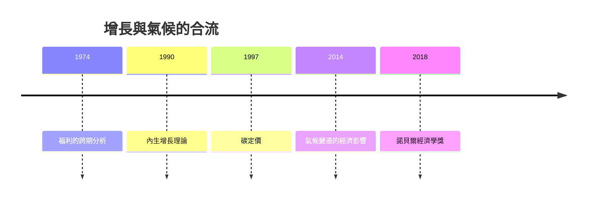

# 2018 · 懸案：氣候變遷要算進經濟帳嗎？創新到底是外來戶還是自家人？

> **2018 諾貝爾經濟學獎（瑞典央行紀念獎）：威廉·道布尼·諾德豪斯 William Dawbney Nordhaus（美國，1941–2026）與保羅·邁克爾·羅默 Paul Michael Romer（美國，1955– ）— 表彰諾德豪斯「將氣候變遷納入長期宏觀經濟分析」，羅默「對內生增長理論的貢獻」（for integrating climate change into long-run macroeconomic analysis / for his contributions to endogenous growth theory）。**

---

## 懸案（案情提要）

2018 年的案子把經濟學兩條最深遠的線索接在一起：

1. **氣候變遷怎麼進入經濟決策？** 主流經濟學把氣候變遷視為「外部性」，但 200 年期的全球溫室氣體排放對當代經濟福利的影響估計（Nordhaus 的 DICE 模型）與「道德上的緊迫性」之間存在巨大落差——諾德豪斯的模型給出碳稅約數十美元／噸，遠低於主張數百美元的經濟學家所建議。這樁案的核心是：**氣候政策需要一個能進入宏觀模型的福利測算基礎**；
2. **增長的引擎是外生還內生？** Solow 模型（1987 案）把技術進步當作外生的 $g$，這意味著**貧窮國家永遠追不上**——除非有某種機制讓知識擴散。羅默的答案是：**創新是內生的**，因為**知識是半公共品**（可以複製但不能完全獨占），所以研發的私人回報高於社會回報，產生**正的市場規模外部性**——這解釋了為何市場經濟中研發持續發生，以及為何「經濟地理」與「貧富差距」會長期存在。

---

## 前因

| 年份 | 事件 |
|---|---|
| 1967–1973 | Nordhaus 在耶魯、MIT 學習（博士導師 Robert Solow，1987 案得主） |
| 1974 | Nordhaus 的「人口、經濟增長與福利」（*Population, Economic Growth, and the Welfare Level*）：**福利的跨期分析**的經典 |
| 1977 | Nordhaus《設備與時間的替代》；Nordhaus–Tobin 的 GNP 測量修正 |
| 1980s | Nordhaus 的「氣候政策經濟學」的早期工作；1992 年諾貝爾講座〈增長與波動〉；1994 年 DICE 模型的雛形 |
| 1990s | Nordhaus 的「碳定價與全球暖化」（AER Papers and Proceedings, 1997）；**DICE（Dynamic Integrated Climate-Economy）模型** |
| 2011 | Nordhaus 的《計算經濟學的進步》（AER） |
| 2014 | Nordhaus 的《氣候變遷的經濟影響》（*The Climate Casino*） |
| 2016 | Romer 的〈製造與服務業的創新〉（AER）——創新數據的系統化 |
| 2018 | Romer 的《長期增長》（*The Long Run*）與〈人口增長的經濟學效應〉 |
| 1990 | Romer 的〈內生增長理論〉（*Econometrica*）：**兩種模型**（技術外生 vs 內生）與「報酬遞增與經濟增長」 |
| 1991 | Romer 的〈Capitalizing Knowledge and the Value of a City〉 |
| 2000 | Romer 的〈Births, Deaths, and Cities〉；**族群（ethnicity）與城市發展** |
| 2018 | 得獎；委員會指出諾德豪斯「將氣候變遷整合進長期宏觀經濟分析」、羅默「對內生增長理論的貢獻」 |

---

## 調查

### 線索一：諾德豪斯——把氣候變遷寫進福利計算

諾德豪斯的 DICE 模型是本案的技術核心。模型把全球經濟與氣候系統整合為一個動態系統：

**碳循環（碳存量與排放）**：

$$
\frac{d CO_2}{dt} = E(t) - \frac{1}{\tau} CO_2(t)
$$

其中 $E(t)$ 是排放、$\tau$ 是大氣中的碳滯留時間。

**氣候系統（溫度的隨機過程）**：

$$
dT(t) = \beta \cdot F(t) \, dt + \sigma_T \, dW(t)
$$

**經濟（產出與資本）**：

$$
Y(t) = A(t) L(t)^{\alpha} K(t)^{\beta} - \lambda \cdot \frac{CO_2(t)^2}{2} + \nu \cdot T(t)
$$

其中 $\lambda$ 是**氣候損害參數**（碳造成的產出損失）、$\nu$ 是**氣候損害的敏感度**（溫度上升造成的產出損失）。

**社會福利函數**：

$$
W = \int_0^T U(Y(t), T(t)) e^{-\rho t} dt, \qquad U = \ln(Y) - \lambda' \cdot T^2
$$

**碳稅（最優 Pigouvian 稅）**：

$$
\pi(t) = - \frac{U_Y \cdot \partial Y / \partial CO_2}{U_Y} \;\; \text{（邊際社會損害成本）}
$$

諾德豪斯的核心工作是把這些參數**經得起經濟學的批評**（特別是未來後果的貼現與不確定性處理），並且——這是他反覆強調的——**模型參數應由「最可能的中位數情景」而非「最壞情景」來校準**。

**關鍵的方法論爭議（本案的核心）**：

| 立場 | 碳稅建議 | 依據 |
|---|---|---|
| Nordhaus（主流經濟學） | 約 30–70 美元／噸 CO₂-eq（2018 估計約 30 美元） | 成本效益分析：避免的損害 vs 減緩成本 |
| 低碳倡議者（如 Stern 的「檢驗表」與 2018 年的 ECLIPSE 計畫） | 數百美元／噸 | 採用「聯合國 1.5°C 目標」與「不確定性向下調整」 |

諾德豪斯 2018 年諾貝爾講座〈Estimating the Integral of the Climate Change Damage Function〉給出了新的損害函數估計（McGlynn–Clarke–Cournot 等），並說明為何**悲觀情景會自動被模型調整**（因為損害在模型中已被內生化）。

### 線索二：羅默——創新為何是內生的

羅默 1990 年的《內生增長理論》給出了增長理論的「兩種模型」對照：

| | 模型 I | 模型 II |
|---|---|---|
| 技術 | **外生** | **內生**（研發與知識） |
| 規模報酬 | 遞減（競爭性均衡） | **遞增**（報酬遞增與外部性） |
| 政策含義 | 政策無法影響長期增長 | 政策**可以**影響長期增長 |
| 對貧富差距 | 差距會趨於收斂（若有邊際報酬遞減與人力資本） | 差距可能**持續擴大**（若規模報酬遞增且教育回報高） |

**羅默的核心機制：知識的半公共性與市場規模外部性**。

知識的生產（研發 $R$）的社會收益：

$$
Y = A L^{\alpha} K^{\beta} R^{\gamma}
$$

對研發的私人回報（以工資形式取得）與社會回報之差，就是**知識的外部性**：

$$
\text{外部性} = (1 - \alpha - \beta - \gamma) \cdot \text{(研發的社會貢獻)}
$$

由於知識是**非排他性**的（一家公司的研發會提高整個經濟的 $A$），研發的**私人回報高於**社會回報，因此：

$$
\text{私人研發量} > \text{社會最優研發量}
$$

這就是**正的市場規模外部性**：更大的市場提供更大的研發報酬，因此**市場規模本身促進創新**——這是羅默與 Krugman（2008 案）新經濟地理的共同內核。

### 線索三：羅默的四類創新（2016 年的分類）

羅默 2016 年在 AER 發表的〈製造與服務業的創新〉提出創新的四個種類，並給出各自的政策含義：

1. **持續型創新（routine innovation）**：服務業與多數製造業的創新是「漸進的、局部的」；
2. **攜帶型創新（breakthrough innovation）**：少數，如蒸汽機、電力、晶片、網際網路；
3. ****窮人市場的創新**：**低成本產品的大規模推廣**（如口服補液鹽、疫苗、小型太陽能）；
4. **政府支持的創新**：基礎研究與太空計畫。

其中第三類是羅默對發展經濟學的最大貢獻：**窮人市場的創新往往是「高增長但低利潤」的**，因此傳統的利潤率標準會低估它的價值；這解釋了為何有些技術（如口服補液鹽、ostrich）大幅降低了兒童死亡率卻沒有成為商業奇蹟。

### 線索四：羅默的城市與族群理論（2000 年）

〈Births, Deaths, and Cities〉提出：城市是**族群群聚（ethnic agglomeration）**與**知識外溢**的結果——不同族群帶來不同的「Ideas」、技能與經驗，聚集在城市的隔區（ethnic enclave）中，透過非正式的網路傳播知識。這解釋了美國移民城市的創業與發明率（per capita patents）。

### 線索五：兩案的交會——增長、創新與氣候

把諾德豪斯與羅默並置，本案的深意浮現：

- 羅默：**技術進步是內生的**，增長可以被政策促進（研發補貼、教育、移民、競爭政策）；
- 諾德豪斯：**氣候變遷是經濟活動的內生後果**，必須以福利分析為基礎被納入長期模型。

兩人的共同方法論信念：**增長與環境不能分開算帳**——氣候政策不應被當作「經濟成長的敵人」，而應被當作**跨期福利的定價問題**。

---

## 理論裁決

**裁決一（諾德豪斯）**：氣候變遷可以且必須被寫進**長期宏觀模型**，其形式是福利積分中的損害項：

$$
W = \int_0^T \left[ \ln Y(t) - \lambda' T(t)^2 \right] e^{-\rho t} dt
$$

而碳定價是**邊際社會損害**的 Pigouvian 稅：

$$
\pi(t) = \text{MC}_{\text{損害}}(t)
$$

**裁決二（諾德豪斯）**：模型參數應採「中位數情景」而非「最壞情景」；不確定性應透過**風險校準**處理，而非透過誇大損害函數——這是它與低碳倡議派的核心分歧：

$$
\text{政策建議} = \text{最可能情景的期望成本效益} \quad \text{vs} \quad \text{含規範性偏好的權重}
$$

**裁決三（羅默）**：**技術進步是內生的**；由於知識的半公共性，研發存在**正的市場規模外部性**，因此：

$$
\text{研發的私人回報} > \text{研發的社會回報} \;\Rightarrow\; \text{市場化不足} \;\Rightarrow\; \text{政策有介入空間}
$$

**裁決四（羅默）**：增長理論必須解釋**不平等**（報酬遞增 + 人力資本回報高 $\rightarrow$ 差距擴大），並區分四類創新；**窮人市場的創新**具有高社會價值但低商業回報。

**裁決五（綜合）**：增長與環境必須在同一個跨期福利框架中定價；「碳稅 vs 成長」是偽對立，正確的問題是**碳稅的福利收益與轉型成本的精確比較**。

---

## 後果

| 領域 | 影響 |
|---|---|
| 政策應用 | 碳定價（碳稅與排放權交易）、DICE 與 FaR  模型成為政策評估的基礎；巴黎協定後各國 NDC 的成本效益分析；美國的「氣候變遷社會成本」（OMB Circular A-4 的 SCC 估計，直接引用 Nordhaus 的模型） |
| 學術 | 內生增長理論成為增長經濟學的主軸（Health–Grossman–Romer、Jones 2016 的「羅默四類創新」框架）；發展經濟學的「窮人市場創新」 |
| 爭議 | **2018 年諾貝爾獎引發的氣候辯論是本獎史上最大的公開爭議**：低碳倡議者（Nordhaus 的「GMO 論壇」文章、De Schauwer 的批評）主張碳稅應遠高於其估計；羅默本人則公開表示氣候是他最關心的議題、並批評主流經濟學的保守估計；DGVM（Deaton、von Moltke、Nordhaus、Romer 四人合著的《The Green Arrow》2020）嘗試提出「共識估計」 |
| 跨獎 | 1987 Solow（外生技術）、1999 Mundell（宏觀政策）、2014 Tirole（產業組織中的創新）、2024 制度與繁榮（增長的制度根源） |

---

## 關聯

- [1987-Solow增長理論](1987-Solow增長理論.md)：外生技術進步的版本——羅默要內生化它。
- [1971-Kuznets國民帳戶與增長長卷](1971-Kuznets國民帳戶與增長長卷.md)：增長的典型事實（本書續寫中）。
- [2008-Krugman新貿易與經濟地理](2008-Krugman新貿易與經濟地理.md)：市場規模外部性與集聚（本書續寫中）。
- [1999-Mundell最優貨幣區](1999-Mundell最優貨幣區.md)：長期宏觀政策與匯率（本書續寫中）。
- [2015-Deaton消費與貧困](2015-Deaton消費與貧困.md)：福利測量與貧窮市場創新（本書續寫中）。
- [2024-Acemoglu制度與繁榮](2024-Acemoglu制度與繁榮.md)：增長的制度根源（本書續寫中）。
