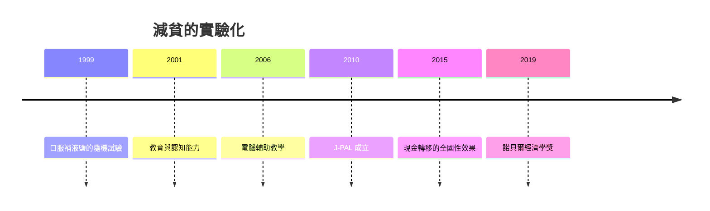

# 2019 · 懸案：減貧政策，究竟有沒有效？

> **2019 諾貝爾經濟學獎（瑞典央行紀念獎）：阿比吉特·維納亞克·班納吉 Abhijit Vinayak Banerjee（印度／美國，1961– ）、艾絲特·卡羅琳·迪弗洛 Esther Caroline Duflo（法國／美國，1972– ）與麥可·羅伯特·克雷默 Michael Robert Kremer（美國，1964– ）— 表彰他們「以實驗方法緩解全球貧窮」（for their experimental approach to alleviating global poverty）。**

---

## 懸案（案情提要）

減貧是經濟學最古老的目標之一，但 2019 年之前，政策評估的方法極為脆弱：

1. **觀察性資料無法回答因果問題**：實施某項援助計畫的地區，本來就可能更窮——於是「援助與貧窮的相關」既可能是政策有效，也可能是政策被需要（選擇偏誤）；
2. **反事實不可觀察**：要知道「沒有援助會怎樣」，必須知道同一群人在另一條歷史分支上的表現；
3. **政治障礙**：政策實驗需要隨機化，但選民、官員都會抵制（1990 年前的隨機化實驗多集中在醫療與微觀信貸）；
4. **理論懷疑**：隨機實驗得到的「局部效果」，能否推廣？實驗結論常被批為「不切實際」或「無法擴展」。

三人的答案是：**把減貧變成一門實驗科學**——用隨機對照實驗（RCT）建立因果證據，並把「制度性障礙」（資訊、激勵、缺失的市場）納入政策設計。

---

## 前因

| 年份 | 事件 |
|---|---|
| 1990s | 1990s 醫學隨機試驗的黃金時代；Abel–Glaeser（1991）證明「選擇偏誤」在都市研究中的嚴重性 |
| 1995 | Banerjee 在印度做動態研究的博士論文（《 Poor Economics》，2002 出版） |
| 1996 | Duflo 與 Banerjee 相遇（MIT）；Duflo 的博士論文（1999，MIT，關於印尼學校的水分缺乏與缺席） |
| 1999 | Duflo 的〈柯曲拉與班加羅的營養〉：**微觀隨機試驗**：口服補液鹽（ORS）對兒童腹瀉死亡率的影響 |
| 2000 | Kremer 在 MIT 的「Development Innovation Lab」 |
| 2001 | Banerjee、Duflo 与 Esther Duflo 的「Kerala  Teachers」實驗；「Schooling and Cognitive Ability」（1996）——教育不是提高「一般智力」 |
| 2003 | 「Progresa（CONDOR）計畫」評估：墨西哥的現金轉移計畫；**政策改革的政治經濟學**（Duflo 的「改革要對抗既得利益者」的命題） |
| 2003 | 「Scholarships for Girls in Kenya」（女性教育回報的田間實驗） |
| 2004 | 「Buring the Money: Teacher Incentives」（印度 cameras 對缺勤的抑制） |
| 2005 | 「The Battle of the Sexes」（印度男性HIV的經濟學） |
| 2006 | 「Active Learning, Technical Assistance, and the Development of Educational Technology」（印度的電腦輔助教學，$15/$) |
| 2007 | 「Incentives and Sanitation」（印度 sanitation 補貼，帶來更高出席率） |
| 2010 | Kremer 的「Development Lab」的組織化；J-PAL（Abdul Latif Jameel Poverty Action Lab）成立（2003 創辦，2010 正式成立） |
| 2015 | 「General Equilibrium Effects of Cash Transfers」（巴西的 Bolsa Família，帶來顯著的全國性勞動市場效果） |
| 2019 | 得獎；委員會稱其「以實驗方法緩解全球貧窮」。** Banerjee 與 Duflo 是夫妻，並成為史上第六對共同獲諾貝爾經濟學獎的夫妻 |

---

## 調查

### 線索一：RCT 的方法論骨架

隨機對照實驗的估計量：

$$
\hat{\tau} = \overline{Y}_{T} - \overline{Y}_{C}
$$

其中處理組 $T$ 與對照組 $C$ 被**隨機分配**。隨機化給出兩個性質：

1. **無混淆（no confounding）**：$E[Y(1) - Y(0) | D = 1] = E[Y(1) - Y(0) | D = 0]$；
2. **SUTVA**（無干擾、處理無溢出）。

估計量的**抽樣分佈**正是 1989 年 Haavelmo 案給出的 Davison–Haavelmo 定理（1981 案）。

**三人的方法論貢獻（使 RCT 可用於政策）**：

1. **把「理論」放進實驗**：實驗不是盲目的效果測量，而是**檢驗經濟學的機制假設**。例如「微型企業的貸貸限制是發展的障礙」$\rightarrow$ 實驗：**隨機給予微型企業貸款額度**，觀察投資與生存率；
2. **處理一般均衡效應（BAN 2015）**：巴西 Bolsa Família 的 RCT 發現，**全國性現金轉移確實降低了勞動供給（正當性 labor supply）**，提高了均衡工資——這說明**局部的實驗效果不能直接外推到全國規模**；
3. **一般化的實驗（general equilibrium）與「規模問題」**：實驗樣本佔市場的比例若太小，則缺乏一般均衡效果；若太大，則外部有效性受限。Kremer 的組織化工作（Development Innovation Lab）試圖解決「**規模化（scale-up）**」問題——同一方法在多國複製。

### 線索二：駭人的發現——「微觀的、無關緊道的細節」決定生死

三人最著名的發現，是「最便宜的救命技術竟然沒被採用」：

1. **口服補液鹽（ORS）**：Duflo 與 Banerjee（2004，*American Economic Review*）在孟加拉的隨機實驗證明：推廣 ORS 可以**大幅降低腹瀉造成的兒童死亡率**，代價極低，但推廣率極低——**障礙不是技術，而是資訊與信任**；
2. **除蟲藥（deworming）**：在肯亞的實驗顯示，給予學童除蟲藥能改善**出勤率**（attendance）——但**對測驗成績沒有效果**（因為蟲病影響的是「現有的健康狀態」，而非「認知能力」）；
3. **飲水與缺席**：Duflo 的博士研究發現，學校供水（toilets for girls）能減少女童缺席；
4. **微量營養素（缺碘、缺鐵、維生素 A）**：這些「低成本、高影響」的營養補充在發展中國家的兒童智力與健康上有巨大效果。

**核心命題**：發展的障礙常常不是「資源不足」，而是**激勵錯位**：教師不願意教（在缺勤率高的班級教學成本高）、家長不願意投資（因為孩子的健康與營養問題不在學校解決）、企業不願意採用技術（因為客戶窮且風險高）。

### 線索三：從「識別」到「機制」——三個機制實驗

1. **資訊機制**：Kremer 的「student achievement and incentives」系列：
   - **相機監控（cameras）**：印度政府的 Biometric Attendance System（BAMS），隨機在部分學校引入，相機監控教師缺勤的結果：**缺席率下降約 21 個百分點，學習成績上升**——這是「監控」而非「物質獎勵」的效果；
   - **教師賞金（teaching incentives）**：印度「Teaching at the Right Level」（TARL）的隨機實驗發現，**把報酬與學習成果掛鈎**（而非與出席掛鈎）顯著提高學習，但**對最低表現的學生無效甚至有害**（因為他們無法達到目標）；
2. **市場機制**：Kremer 的**豆類與玉米的價格與營養**實驗顯示，若學校周邊缺乏豆類供給，即使提高學校的營養餐標準，孩子仍會在回家後吃不對；**營養政策必須配合市場結構**；
3. **制度機制**：Duflo 的 Progresa 評估顯示，**現金轉移的政治經濟學**決定了改革能否持續——Progresa 的成功不只在於設計（明確的受益人資格、醫療與教育投資），也在於它**繞過了既得利益者並建立了新的支持聯盟**。

### 線索四：規模化與「制度缺口」

Kremer 的核心問題：實驗成功，但無法擴展。他提出的解方是**Development Innovation Lab 的組織模式**：

$$
\text{研究} \to \text{政策試點} \to \text{政策採納} \to \text{證據的累積}
$$

以及「**證據的累積（cumulative culture of experimentation）**」——國家的實驗能力本身是一種**制度資本**。

### 線索五：窮人市場的創新（與 2018 案的對話）

2018 年羅默案提出「窮人市場的創新」；2019 年的實驗工作正是它的實證面：

- ORS、除蟲藥、小型太陽能、微型保險、農業技術——**都是高社會價值、低商業回報**的創新；
- 實驗證明其**需求彈性高但供給側受資訊與風險約束**；
- 政策含義：**政府或補貼者應成為這些創新的最後需求者**（procurement、subsidies），這正是 Mo Ibrahim Prize 與 Gavi、UNICEF 的疫苗採購模式。

---

## 理論裁決

**裁決一**：**隨機對照實驗是減貧政策因果證據的金標準**；其統計基礎是 Davison–Haavelmo 的抽樣分佈定理（1981 案的深遠影響）：

$$
\hat{\tau} = \overline{Y}_{T} - \overline{Y}_{C} \;\xrightarrow{a.s.}\; E[Y(1) - Y(0)]
$$

**裁決二**：經濟學的**機制假設可以被隨機實驗檢驗**；實驗不只估計效果，更檢驗「為什麼有效」——這使減貧從「許願」變成「工程」。

**裁決三**：發展的瓶頸常常是**激勵錯位**（教師、家長、雇主的激勵與結果脫節），而不是資源不足；因此政策的正確對象是**機制**。

**裁決四**：**局部的實驗效果不能直接外推到全國規模**——必須考慮一般均衡效果（如現金轉移的全國性勞動供給效應）：

$$
\text{局部效果} \neq \text{一般均衡效果} \quad (\text{當處理佔市場比例足夠大時})
$$

**裁決五**：**實驗能力本身是發展的制度資本**；窮國的貧窮不只因為資源少，也因為**缺少「用實驗找出有效政策」的制度能力**。

---

## 後果

| 領域 | 影響 |
|---|---|
| 政策應用 | 世界銀行的「業務手冊」以實驗證據為基礎；UNICEF、蓋茨基金會的現金轉移與疫苗政策；美國的 ACA 與 2010s 的大型隨機實驗（OPE）；India 的 MGNREGA 的評估 |
| 學術 | 發展經濟學的實證方法革命；J-PAL 與 IPA 的全球網絡；「證據驅動的政策」（evidence-based policy）成為國際組織的核心話術 |
| 爭議 | 外部有效性（external validity）與「實驗室的貧窮」之批；對「大規模轉移」的質疑（Abhijit 的名言：「大規模社會政策有時會失敗，是因為人們不嘗試」）；性別與家庭規範的介入被批為「文化殖民」；2018 年後對「實驗經濟學的帝國主義」的檢視 |
| 跨獎 | 1989 Haavelmo（統計基礎）、2000 Heckman–McFadden（選擇偏誤）、2021 Card–Angrist–Imbens（因果推斷方法論）、2018 Romer（窮人市場的創新） |

---

## 關聯

- [1989-Haavelmo概率論基礎](1989-Haavelmo概率論基礎.md)：RCT 的抽樣分佈定理血統（本書續寫中）。
- [2000-Heckman與McFadden選擇模型](2000-Heckman與McFadden選擇模型.md)：選擇偏誤——RCT 要繞過的對象。
- [2015-Deaton消費與貧困](2015-Deaton消費與貧困.md)：貧窮與福祉的測量（本書續寫中）。
- [2018-Nordhaus與Romer長期增長](2018-Nordhaus與Romer長期增長.md)：窮人市場創新的理論對話（本書續寫中）。
- [2010-Diamond-Mortensen-Pissarides搜尋摩擦](2010-Diamond-Mortensen-Pissarides搜尋摩擦.md)：求職介入與市場摩擦（本書續寫中）。
- [2021-Card-Angrist-Imbens因果推斷](2021-Card-Angrist-Imbens因果推斷.md)：因果方法論的完整版（本書續寫中）。
