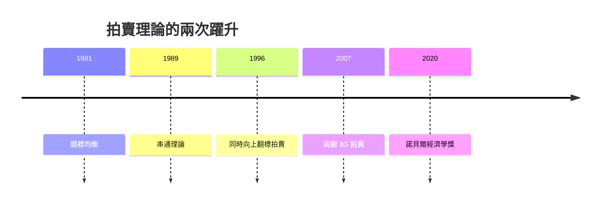

# 2020 · 懸案：拍賣能不能設計得更公平、又不被操縱？

> **2020 諾貝爾經濟學獎（瑞典央行紀念獎）：保羅·羅伯特·米爾格羅姆 Paul Robert Milgrom（美國，1948– ）與羅伯特·巴特勒·威爾遜 Robert Butler Wilson Jr.（美國，1937– ）— 表彰他們「改進拍賣理論並發明新的拍賣形式」（for improvements to auction theory and inventions of new auction formats）。**

---

## 懸案（案情提要）

拍賣是人類最古老的市場形式之一，也是 1996 年維克里案（第一價格 vs 第二價格）之後最需要被重新設計的機制。2020 年的案子處理四個疑點：

1. **賣方只有一個物件、買方很多、而且彼此是替代品**（頻譜、礦權、石油開採權）——維克里拍賣在這裡會流標，如何設計？
2. **買方的估值彼此相關**（不獨立），拍賣的策略行為會更複雜；
3. **不完全資訊下的拍賣**：賣方也不知道買方的估值（暗拍 auction）——此時拍賣能不能仍然把物品給「最高估值者」？
4. **拍賣能不能防禦串通（collusion）與競標者的延遲策略**？

米爾格羅姆與威爾遜的答案是：**拍賣理論的完整化 + 新型拍賣格式的發明**，並以「**拍賣理論的定理化**」與「**最佳實務的設計**」雙管齊下。

---

## 前因

| 年份 | 事件 |
|---|---|
| 1960s | Wilson 在哈佛（Ronald Coase 的學生）與史丹佛；開始研究拍賣與競標理論 |
| 1967–1970 | Wilson 的「競標理論的均衡分析」（*Competitive Bidding Strategies*）：**不完全資訊下的競標均衡** |
| 1972 | Milgrom 加入史丹佛（Wilson 的學術後輩與合作者） |
| 1980s | Milgrom–Weber（1982）的《買方壟斷的強迫拍賣》，1984 年美國 HMOs 的拍賣制度設計 |
| 1980s–90s | Milgrom 的「**競標人的串通（bidding rings）**」理論（1989、1991）；**橫向關聯**（linkage）與拍賣設計的穩健性 |
| 1987 | Milgrom 的〈物品所有權與拍賣理論〉 |
| 1990s | Wilson 的「**策略性招標（strategic bidding）**」理論：招標者的「偷瞄（shading）」 |
| 1992 | Wilson 的《拍賣理論與競爭性採購》（*The Theory of Auctions and Competitive Procurement*） |
| 1994–1997 | **美國頻譜拍賣**：FCC 1994–1995 的「無權拍賣（holistic auction）」失敗（拍賣只有兩名以上競標者參與）；1996–97 的「同時向上翻標拍賣（simultaneous ascending clock auction）」成功 |
| 1997–1998 | 歐洲拍賣的「歧視性（discriminatory）競標」的問題（European auction struggles） |
| 1998 | Milgrom–Wilson 的〈拍賣理論的革命與計程網路頻譜拍賣的理論〉：**同時向上拍賣**的理論基礎 |
| 2007 | 英國的「3G 頻譜拍賣」（eu)——**同時向上翻標拍賣的實際應用**，拍出 228 億英鎊 |
| 2010s | 醫療藥物的「反向拍賣」、碳排放權拍賣、紐約的「磁磚（concession）拍賣」 |
| 2020 | 得獎；委員會稱其「改進拍賣理論並發明新的拍賣形式」 |

---

## 調查

### 線索一：拍賣理論的基本結構

賣方有物件 $v$（價值 $v$ 對買方），$n$ 個買方 $i$ 各有私人估值 $v_i$，估值獨立同分布（密度 $f$，分布 $F$）。

**第一價格拍賣**：勝者支付自己的報價。買方 $i$ 的最佳回應：

$$
b_i(v_i) = v_i - \int_{v_i}^{\bar{v}} \left( \frac{f(x)}{F(x)} \right)^{n-1} dx
$$

（Myerson 的虛擬值是此處的鏡像：$b_i = v_i - \frac{F(v_i)}{f(v_i)} \cdot$ 對應項。）

**第二價格拍賣**（維克里）：勝者支付第二高報價，誠實報價為占優策略（1996 案）。

**米爾格羅姆與威爾遜的核心推進**是：**把這兩個基本模型之間的整個「設計空間」系統化**，並分析**賣方不知道估值分布**（拍賣之前估值未知）時的結果：

### 線索二：不完全資訊下的拍賣——「拍賣還能保證把物品給最高估值者嗎？」

在暗拍（bids sealed，賣方不知估值分布）的情況下：

- **第一價格拍賣**：勝者的期望支付**低於**第二價格拍賣的期望支付（賣方偏好第一價格）；
- **但第一價格拍賣有「贏家的 Curse」**：勝者往往是**高估了自己**的估值者，賣方的收入**低於**其在完全資訊下的收入（因為存在 winner's curse 的折損）。

**米爾格羅姆–Wilson 的關鍵定理**：在不完全資訊下，**第二價格拍賣的期望收入低於**完全資訊下的收入，且其**「效率損失」（把物品給錯人的機率）**高於第一價格拍賣：

$$
\text{暗拍第一價格} : \; \text{收入較高但效率較低}; \qquad \text{暗拍第二價格} : \; \text{收入較低但效率較高}
$$

他們證明了**第二價格拍賣的「效率」特性在暗拍下會失效**——這解釋了為何實務上不完全資訊的拍賣多用第一價格或混合格式。

### 線索三：拍賣設計的四大支柱（Milgrom–Wilson 的實務綱領）

兩人與合作者（Ayau、Green、Ibarra、Tauber）在 1990s–2000s 建立的設計原則，是本案的實務核心：

1. **歧視性競標（discriminatory bidding）**：允許對不同競標者設定不同的底價或條款——這在**賣方有資訊優勢**（如知道污染歷史的地塊）時能提高收入；但必須防止資訊被用於**排除**競標者；
2. **「打包與分拆」（bundling vs. unbundling）**：美國 1994–95 的「無權拍賣」把多個頻譜頻段綁在一起賣，結果競標人太少、拍賣失敗（只有兩名以上競標人）；1996–97 改成**同時向上翻標拍賣**（同時拍賣多個頻段，但分開定價）後大成功。**教訓：拍賣設計必須保證足夠的競標人數**；
3. **競標者的「情報成本」（information cost）**：拍賣設計得越複雜，競標者進入的成本越高——若競標人太少，拍賣會失敗。**簡單性是拍賣的資產**；
4. **防禦串通與「聯合競標（bidding rings）」**：Milgrom 的理論證明，**拍賣規則對串通的抵抗力**取決於規則的細節（例如是否公開競標者的身份、是否有「交叉禁令」、市場是否狹小）；他的核心命題是：**沒有任何拍賣格式能完全防止串通，但可以大幅提高串通的成本**。

### 線索四：同時向上翻標拍賣（the ascending clock auction）

這是兩人「**發明新拍賣格式**」的代表作，其結構為：

- **多個物品同時拍賣**，但**價格分別上升**；
- 每輪每個物品的價格上升**一個固定的增量**；
- 競標者對每個物品**分別報價**（在該輪結束前不可撤回）；
- 每次報價後，**未被接受報價的競標者被逐一淘汰**（直到價格高到只剩一人對某物品有興趣）。

**優點**：

1. **同時性**讓競標者無法在觀察他人行為後再決策（消除策略性延遲）；
2. **逐步的價格發現**減少了「贏家的詛咒」與估值錯配（因為價格是逐步上升的）；
3. **競標人數的自我維持**：多物品同時拍賣使得**競標者可以「用未得標的物品的報價」來保留在市場上**，維持競爭厚度。

**實戰成績**：

| 拍賣 | 結果 |
|---|---|
| 英國 3G（2000–2001） | 228 億英鎊，超過原估 100 億；引發「拍賣主持人是英國財政部的財政政策工具」的爭議 |
| 美國 1996–97 無線頻譜（同時向上翻標） | 成功；相較 1994–95 的無權拍賣（流標） |
| 歐洲 1998–2000（歧視性競標） | 大多流標，因競標人太少（情報成本高、賣方壟斷拍賣） |

**關鍵教訓**：拍賣的收入可能**遠高於**政府原本的預算需求（英國的案例引發是否「把拍賣收入當作財政收入」的倫理辯論），而且**拍賣的設計錯誤會導致流標——這不是市場失靈，是設計失敗**。

### 線索五：Milgrom–Wilson 的理論整理與「最佳實務」的對話

Milgrom 在 2020 年的諾貝爾講座《Putting Auction Theory into Practice》中提出的核心命題，是**拍賣理論作為「可執行的工程」**：

- **拍賣理論可計算**：給定競標人的估值分布，拍賣的期望收入可以用積分算出；
- **設計的目標是「在資訊不對稱下最大化收入，同時維持競標厚度」**；
- **「最佳實務」的指導原則**：
  1. 設計要**鼓勵競標者進入**（降低情報成本、避免過度複雜）；
  2. 設計要**讓資訊不對稱的損失最小**（例如允許歧視性競標以利用賣方資訊）；
  3. 設計要**防禦串通**（公開競標者身份、禁止交叉）；
  4. 拍賣規則應**定期檢討**（因競標者會學習與演化，規則會被套利）。

---

## 理論裁決

**裁決一**：拍賣理論的核心是**資訊不對稱下的收入最大化與效率損失的權衡**；在暗拍中，第二價格拍賣的「效率優先」特性會被打破：

$$
\text{暗拍：第二價格} \Rightarrow \text{收入較低、錯配機率較高}
$$

**裁決二**：拍賣格式的選擇必須考慮**競標厚度**（競標人數）、**競標者的情報成本**、以及**賣方的資訊優勢**——三者是拍賣成功的必要條件。

**裁決三**：**歧視性競標**在賣方有資訊時可以提高收入，但必須以「不排除合格競標者」為界線。

**裁決四**：**沒有拍賣格式能根除串通**，但規則可以顯著提高串通成本；公開競標者身份與禁止交叉是有效的防禦。

**裁決五**：**拍賣理論是可執行的工程**：設計 $\rightarrow$ 計算期望收入 $\rightarrow$ 檢驗規則 $\rightarrow$ 依競標者演化迭代修訂。

---

## 後果

| 領域 | 影響 |
|---|---|
| 政策應用 | 頻譜拍賣（全球 60 餘國，累計數千億美元收入）；碳排放權拍賣（EU ETS、紐約、加州）；礦產與油氣開採權拍賣；醫療採購（英國 NHS 的反向拍賣）；電力容量市場 |
| 學術 | 拍賣理論成為機制設計的實驗室；「拍賣設計的四大支柱」成為公共採購的標準檢查表 |
| 公共討論 | 2012 年英國 3G 拍賣的「財政工具」辯論；2016–17 年紐約的醫療與保險招標；2020–21 年疫情期間的疫苗採購拍賣 |
| 爭議 | 「頻譜拍賣的收入應歸誰」（公共資產私有化的批評）；2010s 拍賣中「暗競標（sealed-bid）」的隱私爭議；寡頭市場中拍賣的競爭問題（當只有兩三個競標者時，拍賣的競爭性不足） |
| 跨獎 | 1996 Mirrlees–Vickrey（IC/IR 與拍賣的原型）、2007 機制設計（拍賣作為機制）、2012 Roth–Shapley（市場設計的另一面）、2014 Tirole（拍賣作為產業組織工具） |

---

## 關聯

- [1996-Mirrlees與Vickrey不對稱信息](1996-Mirrlees與Vickrey不對稱信息.md)：維克里拍賣與 IC/IR 的原型（本書續寫中）。
- [2007-機制設計三人組](2007-機制設計三人組.md)：拍賣作為最優機制的理論框架（本書續寫中）。
- [2012-Roth與Shapley匹配市場](2012-Roth與Shapley匹配市場.md)：拍賣 vs 匹配：兩種市場設計（本書續寫中）。
- [2014-Tirole產業組織與管制](2014-Tirole產業組織與管制.md)：拍賣作為產業組織中的分配機制（本書續寫中）。
- [1991-Coase交易成本與產權](1991-Coase交易成本與產權.md)：拍賣作為產權初始分配的工具（本書續寫中）。
- [1990-Markowitz-Miller-Sharpe金融經濟學](1990-Markowitz-Miller-Sharpe金融經濟學.md)：拍賣理論在金融與私有化中的應用（本書續寫中）。
