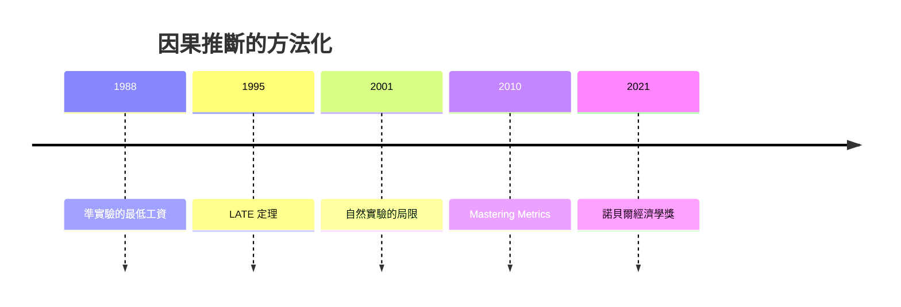

# 2021 · 懸案：沒有隨機實驗時，如何證明「是政策造成的」？

> **2021 諾貝爾經濟學獎（瑞典央行紀念獎）：大衛·愛德華·卡爾德 David Edward Card（加拿大／美國，1956– ）— 表彰他「對勞動經濟學的實證貢獻」；喬舒亞·大衛·安格里斯特 Joshua David Angrist（以色列／美國，1967– ）與吉多·威廉·赫爾梅斯·因本斯 Guido Wilhelmus Imbens（荷蘭／美國，1955– ）— 表彰他們「對因果關係分析方法論的貢獻」。**

---

## 懸案（案情提要）

2021 年的案子處理實證經濟學最核心的難題——**因果推斷**：

1. **當政策不是隨機分配時，怎麼知道效果？** 觀察資料裡，處理組與對照組在政策前就不同（選擇偏誤）；
2. **「準實驗」的證據力有多少？** 雙重差分、工具變數、斷點設計——它們各自的假設是什麼？假設被違反時怎麼知道？
3. **勞動經濟學的核心爭論**：最低工資提高會不會減少就業？移民會不會「吃掉」_native 的工作？
4. **異質性**：同一政策的平均效果，可能掩蓋了對不同群體的巨大差異（誰受益、誰受害）。

卡爾德的答案是**自然實驗的紀律**；安格里斯特與因本斯的答案是**方法論的系統化**——他們把「假設—推論—局限」寫成可被審查的文本。

---

## 前因

| 年份 | 事件 |
|---|---|
| 1980s | Card 進入普林斯顿（Ashenfelter 的指導） |
| 1988 | Card 的〈自然實驗的最低工資研究〉——**1984 年聖地牙哥最低工資的一時效性變動**提供了「準實驗」 |
| 1990 | Card & Krueger《Minimum Wages and Employment》（美國 NJ 與 PA 的餐飲業）：**差異的差異（DiD）**的經典 |
| 1994 | Card 的〈 immigrants and the minimum wage〉 |
| 1995 | Card 的《_selection bias in labor market studies》 |
| 2000 | Card 的《北愛爾蘭移民與勞動市場》（對「移民搶工作」論的自然實驗反駁） |
| 2004 | Card 的「處理效應異質性」的文獻 |
| 2007 | Card 的反對「同工同酬要求的歧視證據」爭議（《新經濟學家》），引發長期的政治風波 |
| 1990s | Angrist 在普林斯顿（Ashenfelter 指導），Imbens 在史丹佛 |
| 1995 | Imbens & Angrist〈Identification and Estimation of Local Average Treatment Effects〉：**LATE 定理** |
| 1999 | Angrist & Imbens 的《Identification and Estimation of Causal Effects of Interventions on a Treated Population》 |
| 2001 | Angrist 的《Necessary but Not Sufficient: The Limitations of Natural Experiments in Policy Evaluation》 |
| 2009 | Angrist & Pischke《Mostly Harmless Econometrics》 |
| 2010 | Angrist、Imbens、Pischke 的《Mastering Metrics》 |
| 2016 | Angrist & Imbens 的《Identification and Estimation of Causal Effects of Interventions on a Treated Population》（修訂版） |
| 2021 | 得獎；委員會同時表彰「實證貢獻」（Card）與「方法論貢獻」（Angrist、Imbens）——這在諾貝爾獎史上是首次以「方法 vs 應用」的方式切分獎項 |

---

## 調查

### 線索一：卡爾德——自然實驗的四類證據

卡爾德的核心方法論：**尋找「政策由外生規則決定」的場合**，而非依賴主觀的經濟理論。他的分類：

| 類型 | 例子 | 識別假設 |
|---|---|---|
| **歷史事件＋時間差異** | 最低工資的時效性變動、戰時配給 | 趨勢外生 |
| **地區差異＋時間差異（DiD）** | 兩州政策不同時點 | 平行趨勢 |
| **行政邊界（border design）** | 移民政策、州際邊界的稅制 | 邊界不影響流動方向 |
| **隨機化（制度性）** | H-1B 簽證的抽籤（1994 年之後）、駕照的年齡限制 | 隨機化有效 |

**卡爾德的最低工資研究（1988–1990）**：新澤西 1980–81 最低工資由 3.35 升到 3.80（低於聯邦），而賓州維持聯邦水準。DiD 設計：

$$
\hat{\beta} = \left( \Delta Y_{NJ} - \Delta Y_{PA} \right)
$$

結果：**最低工資提高沒有造成就業減少**（在受影響的產業中甚至微幅增加），與傳統理論的預測相反——這顛覆了 1990–2010 年代美國經濟學界的主流共識（Neumark–Wascher 的「Jobs Kill」研究也支持這一支）。

**Card 的移民研究（1990，1994）**：利用美國—加拿大邊界的「準隨機」地理與政策差異，發現：

$$
\text{移民流入} \;\Rightarrow\; \text{本地 native 的工資幾乎不變、就業幾乎不變}
$$

這直接反駁了「移民搶走美國人工作」的論斷——也讓卡爾德成為 2013–2016 年美國移民政策辯論中的核心人物。

### 線索二：安格里斯特與因本斯——LATE 定理

1995 年的 LATE 定理是全案最重要的技術artifact。設定：

- 工具變數 $Z$ 影響處理 $D$，但**只透過 $D$ 影響結果 $Y$**（排除性限制）；
- **獨立性**：$Z$ 與 $(Y(0), Y(1))$ 獨立；
- **單調性（monotonicity）**：$Z$ 從不使原本會接受處理的人改變接受（無「defiers」）。

則比率估計量（ Wald 估計量）收斂到：

$$
\hat{\tau}_{\text{Wald}} \xrightarrow{a.s.} \text{LATE} = E[Y(1) - Y(0) \mid D(1) = D(0) = 1]
$$

即**「順從者（compliers）」的平均處理效應**。

**LATE 的深遠含義**：當處理效應異質時，**沒有一個「平均處理效應」是可以被識別的**——我們只能識別「受工具變數影響的那部分人」的效果：

$$
\text{ATE} = \pi_C \cdot \text{LATE}_C + \pi_A \cdot \text{LATE}_A + \pi_D \cdot \text{LATE}_D
$$

其中 $\pi_C$ 是順從者比例（可由工具變數的第一階段估計），$\pi_A$ 是「永遠接受者」、$\pi_D$ 是「拒絕者」。**工具變數估計的是「局部」效果**，其外推需要假設 $\pi_C$ 與各組的 LATE 相近——這是 2021 年得獎演說的主軸。

### 線索三：安格里斯特的「必要但不充分」——自然實驗的清單

2001 年的這篇論文是實證經濟學方法的「讀者須知」，它為自然實驗提出**七個必備條件**（部分借用 Shiller 的「自然實驗十誡」）：

1. 趨勢外生性（未受處理影響）；
2. **沒有系統性挑選**（無 selection on unobservables into treatment）；
3. 沒有溢出效應（no spillovers）；
4. 沒有預期反應（anticipatory behavior）；
5. 沒有一般的均衡效應（no general equilibrium effects）；
6. 有明確的**反事實**定義；
7. **沒有測量誤差的系統性來源**。

**最關鍵的直覺（Angrist–Pischke 的說法）**：

> **當研究者選擇「令人信服的制度細節」時，多半是因為那些細節與結果無關——而如果制度細節與結果無關，它也無法用來識別因果。**

這句話是對「自然實驗」的溫和但深刻的批評：研究者往往無法說清「為何這個工具變數有效」，因此推論的穩健性必須靠**多個識別策略的三角驗證**（triangulation）與**安慰劑檢定（placebo tests）**來建立。

### 線索四：因本斯的「設計的實驗」與「因果圖」

因本斯（與 Rubin）的另一項貢獻是**因果圖（Causal Diagrams）與潛在結果框架的系統化**，以及「設計的實驗」（designed experiments）與「觀察性研究」的界線：

- **隨機化實驗**：內生性被設計消除，但有**外部有效性**問題；
- **觀察性研究**：需要**可檢驗的假設**（exchangeability / ignorability），而這類假設在本質上**不可檢驗**，只能被論證與敏感性分析支持：

$$
Y_i(d) = Y_i(1) \cdot D_i + Y_i(0) \cdot (1 - D_i)
$$

$$Y(1) \perp D \mid X \quad (\text{可忽略性 / exchangeability})$$

**因本斯的方法論核心命題**：因果推斷不是「找到正確的模型」，而是「**明確交代推論所依賴的假設，並展示結論在這些假設下的穩健性**」。

### 線索五：2021 年的分工——「實證貢獻」與「方法論貢獻」

委員會的措辭刻意分成兩半：

- **Card**：以自然實驗**重新檢驗**勞動經濟學的核心命題（最低工資的就業效果、移民對本地工人的影響），並**改變了政策討論的基礎**；
- **Angrist 與 Imbens**：**方法論的系統化**——LATE 定理、自然實驗的必備條件、因果圖、以及把「識別」提升為經濟學的核心概念。

這在諾貝爾獎史上是第一次明確區分「用方法改變世界」與「把方法本身做嚴謹」。

---

## 理論裁決

**裁決一**：因果效應的識別**必須交代其假設**；在處理效應異質時，只有「受工具變數影響者」的平均效應可被識別：

$$
\hat{\tau}_{\text{Wald}} \to \text{LATE} = E[Y(1)-Y(0) \mid D(1) = D(0) = 1]
$$

**裁決二**：**自然實驗**的力量與弱點都被系統化：它能提供外生變異，但必須滿足「必要但不充分」的七項條件；**研究者無法觀察到自己的識別假設是否成立**，因此必須靠**多策略三角驗證、安慰劑檢定與敏感性分析**來建立可信度。

**裁決三**：**隨機化不是萬靈丹**：它解決內生性，但外部有效性（scaling、general equilibrium、implementation）成為新的難題——這正是 2019 年 Banerjee–Duflo–Kremer 案的焦點。

**裁決四**：**設計的實驗與觀察研究的界線必須被明確標示**：隨機實驗推論的是「樣本中的平均效應」，觀察研究推論的是「在可忽略性假設下的效應」；兩者不可混用。

**裁決五（實證倫理）**：因果推斷的報告標準應包括——**估計量、假設、標準誤、識別策略的細節、以及在替代假設下的敏感性**；任何宣稱「政策有效」的結論，若未交代這些，就不具備政策可信度。

---

## 後果

| 領域 | 影響 |
|---|---|
| 政策應用 | 最低工資（美國多州的最低工資提高未造成顯著的就業損失）、移民政策、罪犯的「工作證」制度（Baltimore 的破除逮捕令計畫）、911 後的航空安全規則、工資補貼 |
| 學術 | 「識別」成為實證經濟學的第一主題；Angrist–Pischke 的教科書成為全世界實證工作者的聖經；LATE 與異質處理效應成為預設語言 |
| 公共論述 | 「自然實驗」的證據被用於政策辯論（Card 的移民研究被反移民者攻擊、Angrist 與 Pischke 的最低工資研究成為工會的武器）；2010s 的「實證政治」 |
| 爭議 | 學術界內部的「方法論聖戰」（2019–2021 年的 replication crisis 與 Angrist、Imbens、Imai、Keele 的辯論；Card 與 Kish 的統計之爭）；Card 的性別歧視研究引發的政治風波（2016 年遭白宮經濟顧問委員會撤稿） |
| 跨獎 | 1989 Haavelmo（抽樣理論）、2000 Heckman–McFadden（選擇偏誤）、2019 RCT 三人組（隨機化與外部有效性）、2015 Deaton（面板與結構問題） |

---

## 關聯

- [1989-Haavelmo概率論基礎](1989-Haavelmo概率論基礎.md)：LATE 定理的抽樣分佈血統（本書續寫中）。
- [2000-Heckman與McFadden選擇模型](2000-Heckman與McFadden選擇模型.md)：選擇偏誤與排除性限制（本書續寫中）。
- [2006-Phelps跨期宏觀權衡](2006-Phelps跨期宏觀權衡.md)：自然率與結構性失業——Card 的最低工資研究的政策對話（本書續寫中）。
- [2019-Banerjee-Duflo-Kremer RCT反貧困](2019-Banerjee-Duflo-Kremer RCT反貧困.md)：隨機化與外部有效性的張力（本書續寫中）。
- [2015-Deaton消費與貧困](2015-Deaton消費與貧困.md)：結構性問題與面板方法（本書續寫中）。
- [1992-Becker人力資本與經濟分析](1992-Becker人力資本與經濟分析.md)：歧視與勞動市場——Card 爭議的起點（本書續寫中）。
