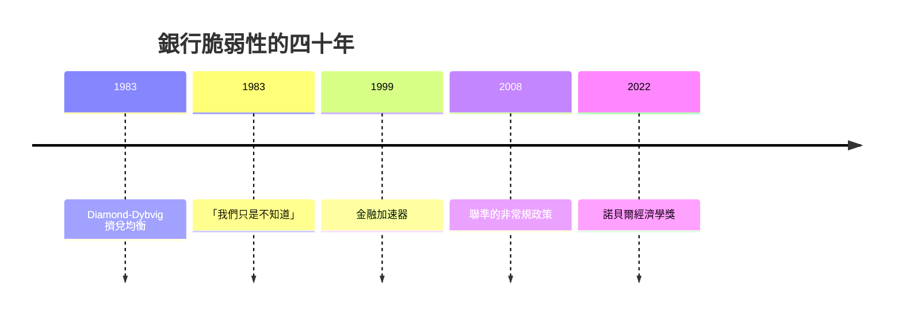

# 2022 · 懸案：銀行為什麼會同時倒？大蕭條到底是市場失靈還是政策失敗？

> **2022 諾貝爾經濟學獎（瑞典央行紀念獎）：本·沙洛姆·伯南克 Ben Shalom Bernanke（美國，1953– ）與道格拉斯·威廉·戴蒙德 Douglas William Diamond（美國，1940– ）及菲利普·哈羅爾·迪布維格 Philip H. Dybvig（美國，1955– ）— 表彰他們「對銀行與金融危機的研究」，特別是伯南克對大蕭條的分析（for research on banks and financial crises, more specifically for Bernanke's analysis of the Great Depression）。**

---

## 懸案（案情提要）

金融危機是經濟學最擅長解釋、卻最難預防的現象。2022 年的案子處理三個互相咬合的問題：

1. **銀行是什麼？** 為什麼「把錢存在銀行」會製造風險？為什麼銀行不能只把存款轉借給別人（伏德蘭的「銀行悖論」）？
2. **為什麼會出現「擠兌」——一個所有人都理性、卻所有人都在恐慌的現象？** 即使存款人知道銀行有高報酬的優質資產，理性預期下也會去提款嗎？
3. **大蕭條是市場的失敗，還是政策（央行）的失敗？**  Friedman–Schwartz（1976 案）與 Bernanke 的「金磚」論證把答案指向後者，但 Bernanke 自己在 1983 年的演講中曾說「我們只是不知道」。

三人的答案是：**銀行負債的期限結構 + 不對稱資訊**導致脆弱性；而央行作為最後貸款人（lender of last resort）可以**消除**這些脆弱性——但前提是它的權力與獨立性。

---

## 前因

| 年份 | 事件 |
|---|---|
| 1979–1983 | Diamond 在耶魯；與 Dybvig（1981–1983）合作建立「銀行脆弱性」理論 |
| 1983 | Diamond–Dybvig〈銀行危機、可能的失業與貨幣理論〉（*AER*）：**擠兌均衡** |
| 1983 | Bernanke 的「非貨幣性的大蕭條」（AER Presidential Address）：「我們只是不知道」的著名承認 |
| 1986 | Diamond 的「金融自由化與銀行危機」 |
| 1986–1990 | Diamond–Dybvig 的「銀行擠兌與貨幣政策」（1988 的貨幣政策論文） |
| 1990s | Bernanke 在普林斯顿與哈佛；Gertler–Bernanke 的金融加速器模型；Bernanke–Gilchrist（1999） |
| 1995 | Diamond 的「重新檢視金融自由化理論」；Diamond–Dybvig 的「存款保險與銀行危機的國際比較」（1996） |
| 2002–2006 | Bernanke 進入聯準會理事會（2002）、主席（2006–2014） |
| 2007–2009 | 全球金融危機；聯準的救助（Bear Stearns、AIG、量化寬鬆） |
| 2008 | Bernanke 的「金融加速器」的總結（2008 年 NBER 演講） |
| 2013 | Bernanke 與 Blanchard 的「財政與貨幣政策在危機中的互補」（QE 的理論辩护） |
| 2022 | 得獎；委員會特別強調「伯南克對大蕭條的分析」 |

---

## 調查

### 線索一：Diamond–Dybvig 模型——「擠兌」是一個理性均衡

這是本案的技術核心。模型設定：

- 家庭 $i$ 持有存款，可以選擇**消費**或**儲蓄**；
- 銀行持有兩類資產：**流動資產**（短期國庫券，收益 $R_1$）與**長期資產**（到期收益 $R_2 > R_1$ 的貸款）；
- **不對稱資訊**：家庭無法觀察銀行的投資組合，但**銀行知道**（或家庭只觀察到銀行的「選擇」）。

**關鍵的類比**：家庭持有的存款就像保險公司的保單——**索賠的發生時間是隨機的**。

**擠兌均衡的構造**：

1. 若所有人都相信**其他人會提款**，那麼銀行的長期資產被拋售，價值下跌，此時提款得到 $R_1$（低收益）；
2. 若只有「早提款者」提款（少數人），銀行只需動用流動資產，每個提款者得到 $R_1 > R_1$（每個提款者得到全额的流動資產回報）——**提款者的收益高於不提款者**；
3. 因此存在**多重均衡**：
   - **無擠兌均衡**：沒人提款，所有人都獲得 $R_2$；
   - **擠兌均衡**：所有人都提款，每個人只得到 $R_1$（但這仍是理性均衡，因為個體無法協調）。

**模型的關鍵假設**：家庭只有**兩種**可能（早提款 vs 遲提款），且**沒有任何事實能區分這兩種狀態**——這就是「資訊不對稱」的具體化。

**政策含義**：**貨幣當局作為最後貸款人**可以「印鈔票」提供流動性，消除擠兌均衡：

$$
\text{央行干預} \;\Rightarrow\; \text{家庭相信不會擠兌} \;\Rightarrow\; \text{均衡回到 } R_2
$$

這是「**最後貸款人**」理論的奠基之作，也是 2008 年後各國央行制度（存款保險、緊急流動性機制）的理論基礎。

### 線索二：Diamond 的三類脆弱性與「銀行悖論」

Diamond 的理論把銀行的脆弱性歸納為三種：

1. **流動性風險**（擠兌）：如上，來自期限錯配；
2. **信用風險**（借貸人違約）；
3. **利率風險**（資產負債的久期不匹配）。

而 **伏德蘭的「銀行悖論」**（關鍵中介的必然脆弱性）給出更深的直覺：

- 若銀行只做中介（把存款轉為貸款），且**不持有安全資產**，則任何一筆擠兌都會使銀行無法履行部分提款；
- 唯一能避免脆弱性的做法，是**持有超出存款量的安全資產**（即「持有超額準備」）——但這在經濟上是浪費。

因此：

$$
\text{銀行} \;=\; \text{流動性風險的持有者} \quad \text{（這是它的功能，也是它的宿命）}
$$

這解釋了 1980s 美國的存款保險與「影子銀行」的問題：當銀行體系的流動性風險被存款保險「解決」時，風險被轉移到**影子銀行系統**（貨幣市場基金、證券化產品），在 2008 年以更劇烈的方式爆發。

### 線索三：伯南克——大蕭條的「金磚」論證

伯南克的《美國貨幣史（1929–1933）》（與 Friedman 合著，1963）的核心發現：

1. **銀行危機的嚴重程度與貨幣收縮有關**：銀行倒闭率越高的地方，貨幣存量下降越多；
2. **關鍵機制**：1930–1933 的銀行倒閉潮，使原本「最後貸款人」不可能完全履行的貨幣擴張被**反覆撤回**——銀行系統的崩潰導致貨幣乘數的崩潰：

$$
M = m \cdot B \quad \Rightarrow\quad \text{當 } m \downarrow \text{ 且 } B \downarrow, \; M \text{ 崩潰}
$$

3. **關鍵的統計反事實**：若沒有貨幣收縮與銀行危機，**大蕭條本不會如此深重**——這是「貨幣主義對大蕭條的解釋」的核心命題。

**伯南克 1983 年的轉折**：在美國經濟學會會長演講中，他承認「我們只是不知道」——因為無法做真正的反事實實驗（無法重覆 1929）。但他隨後用兩個方法繼續推進：

- **跨國面板的「銀行危機與貨幣反應」分析**（與 Friedman 的「關鍵指標」方法）；
- **「金磚」（golden bricks）的思想實驗**：假設 1930 年的聯準做了正確的事（貼現貸款、貨幣擴張），經濟會怎樣？他的結論是：**深度衰退可以避免**。

### 線索四：金融加速器——從微觀到宏觀的橋

伯南克（與 Gertler、Gilchrist）的**金融加速器（financial accelerator）**模型把銀行的困境與實體經濟的波動聯繫起來：

$$
\text{淨worth} = N, \quad \text{借貸成本} = r(N), \quad \frac{\partial r}{\partial N} < 0
$$

當外部衝擊（技術、需求的意外）使企業的净值 $N$ 下降，借貸成本上升 $\rightarrow$ 投資下降 $\rightarrow$ 產出下降 $\rightarrow$ 企業净值進一步下降（因為產出與營業現金流下降）$\rightarrow$ **正反饋**：

$$
\text{衝擊} \rightarrow N \downarrow \rightarrow r \uparrow \rightarrow I \downarrow \rightarrow Y \downarrow \rightarrow N \downarrow \downarrow
$$

**核心洞見**：**金融市場的失灵會放大實體經濟的衝擊**——因此貨幣政策不僅是「貨幣現象」，它通過金融加速器影響產出。

這解釋了為何 2008 年後聯儲採取激進政策（QE、前瞻性指引、負利率）——Bernanke–Blanchard（2013）的模型說明：**在零利率下，財政與貨幣政策可以互補**，QE 通過**期限溢價渠道**影響經濟。

### 線索五：實證檢驗——「銀行危機的預警指標」

金磚式的思想實驗需要實證支持。相關研究顯示：

- **銀行的資產負債表結構**（短期資產支撐長期負債）是擠兌脆弱性的直接指標；
- **存款集中度**（大額存款人 vs 小額散戶）的差異解釋了不同國家的擠兌強度；
- **貨幣政策規則**（是否對存款保險、是否允許分支機銀行、是否最後貸款人有裁量權）能解釋跨國的危機嚴重性差異——Diamond–Dybvig（1996）的國際比較是這條線的經典。

**2010s 的新議題**：**數位銀行（banking）與存款的穩定性**——當存款可以瞬間轉移（Stablecoin、支付即時到帳），擠兌的速度與規模都會改變，2020–2023 年的硅谷銀行（SVB）事件正是這個議題的實戰（SVB 的問題主要是**利率風險**：持有大量長期債券而以活期存款支撐）。

---

## 理論裁決

**裁決一**：**銀行的脆弱性是內生的、不可避免的**——它們同時是期限轉換與風險承擔的提供者：

$$
\text{脆弱性} \leftrightarrow \text{功能}
$$

**裁決二**：**擠兌是理性的多重均衡**，其根源是**資訊不對稱**（無法區分「銀行真的壞了」與「別人害怕所以我也害怕」）：

$$
\text{多重均衡：}\; \{R_2, R_2, \dots\} \quad \text{vs} \quad \{R_1, R_1, \dots\}
$$

**裁決三**：**貨幣當局的最後貸款人功能可以消除擠兌均衡**，前提是它能提供**足額流動性**且公眾相信它會這麼做——因此**央行獨立性**與**明確的制度授權**是關鍵。

**裁決四（伯南克）**：**大蕭條是政策失敗的放大**：銀行崩潰 $\rightarrow$ 貨幣乘數崩潰 $\rightarrow$ 需求崩塌；貨幣政策若能在 1930 年代及時止住收縮，本可避免深度衰退。

**裁決五（金融加速器）**：金融市場的摩擦使**外部衝擊被放大**；因此貨幣政策透過金融渠道影響實體經濟，零利率下財政與貨幣政策可互補。

**裁決六（現代延伸）**：數位支付與新型存款工具改變擠兌的速度與形態；**利率風險**（SVB 型）成為與流動性風險並列的第二類脆弱性。

---

## 後果

| 領域 | 影響 |
|---|---|
| 政策應用 | 存款保險的設計與「 Narrow banking」的討論；最後貸款人機制（各國央行在 2008–2020 年的操作）；QE 與前瞻性指引的理論辯護；巴塞爾 III 的流動性與資本監管；SVB 事件後的存款風險定價改革 |
| 學術 | 銀行理論成為貨幣理論的核心；金融加速器成為 DSGE 的標準模組；「金融摩擦」進入所有宏觀模型 |
| 公共論述 | 伯南克在 2022 年 8 月的 Jackson Hole 演說公開承認** himself 「很遺憾」** 他在 2008 年前的公開寫作低估了金融系統的脆弱性與央行權力的侷限——這段話成為本獎史上最具自我批判色彩的獲獎感言；「大蕭條的教訓」成為 2020–2023 年疫情政策討論的必引文本 |
| 爭議 | 存款保險的道德風險；QE 的公平性與通脹爭議；SVB 事件後「監管失靈」與「風險模型失靈」的追責 |
| 跨獎 | 1976 Friedman（貨幣主義與貨幣史）、1997 Merton–Scholes（定價與風險）、2003 Engle–Granger（ARCH 與風險測量）、2016 契約理論（金融合約與剩餘控制權） |

---

## 關聯

- [1976-Friedman貨幣主義與永久收入](1976-Friedman貨幣主義與永久收入.md)：大蕭條的貨幣解釋（本書續寫中）。
- [1997-Merton與Scholes期權定價](1997-Merton與Scholes期權定價.md)：風險定價與金融機構的模型基礎。
- [2003-Engle與Granger時間序列](2003-Engle與Granger時間序列.md)：ARCH 模型與風險管理（本書續寫中）。
- [2016-Hart與Holmstrom契約理論](2016-Hart與Holmstrom契約理論.md)：金融合約與剩餘控制權（本書續寫中）。
- [2011-Sargent與Sims宏觀因果](2011-Sargent與Sims宏觀因果.md)：SVAR 對貨幣政策與危機的診斷。
- [2004-Kydland與Prescott實際經濟週期](2004-Kydland與Prescott實際經濟週期.md)：政策可信度與時間不一致性（本書續寫中）。
