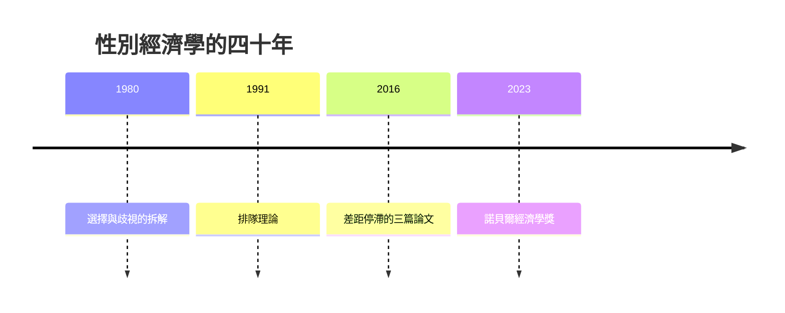

# 2023 · 懸案：性別工資差距，是歧視嗎？——一個世紀的證據

> **2023 諾貝爾經濟學獎（瑞典央行紀念獎）：克勞迪婭·黛爾·戈爾丁 Claudia Dale Goldin（美國，1946– ）— 表彰她「對女性勞動市場結果之理解的推進」（for having advanced our understanding of women's labour market outcomes）。**

---

## 懸案（案情提要）

「性別工資差距」是經濟學裡最著名、最政治化、也最常被誤讀的數字。2023 年的案子處理四個疑點：

1. **差距究竟有多大？** 未調整的差距（每美元約 0.8 美元）與調整後的差距（控制教育、經驗、職業後約 0.05–0.10 美元）差異巨大——**哪個才是「歧視」**？
2. **未調整的差距有多少來自「選擇」（選擇被歧視的行業、選擇不生育）？** 若歧視改變了**選擇本身**（occupation sorting），那麼「控制選擇後的差距」會**低估**歧視；
3. **差距如何隨時間變化？** 美國的差距在 1980 年代達於頂點後停滯——為什麼？這與「選擇」機制（女性取得更多專業學位）有關嗎？
4. **差距的「驅動因素」隨歷史變化**：過去是**教育與經驗**（女性教育不足），現在是**照顧責任與靈活性**（motherhood penalty）——政策焦點因此完全不同。

戈爾丁的答案是：**用長達兩個世紀的縱貫資料，把「選擇」與「歧視」在歷史上拆開**。

---

## 前因

| 年份 | 事件 |
|---|---|
| 1965 | 戈爾丁在芝加哥大學取得博士學位（導師 Robert Fogel，1993 案得主），研究俄亥俄州黑奴的經濟史 |
| 1970s–80s | 戈爾丁在普林斯顿（1986 年起），建立「經濟史與勞動經濟」的雙軌研究 |
| 1980s | 戈爾丁與 Eve Sonnenstein 的「經濟變遷中的女性與男性報酬」（1980–82）：**「選擇的改變」解釋了大部分的差距變化** |
| 1990 | 戈爾丁（編）《經濟中的性別〉：性別經濟學的領域建立 |
| 1991 | 戈爾丁與 Katz 的《後工業時期的工資趨勢》；「排隊論（queueing model）」：職業升遷的隊伍理論 |
| 1996 | 戈爾丁的《女性在美國經濟中的角色》 |
| 2000 | 戈爾丁獲得「Izaak Walton Killam 獎」；2013 年獲「Pioneer Award」 |
| 2008–2010 | 戈爾丁關於「母親身分懲罰（motherhood penalty）」的系列研究 |
| 2013 | 戈爾丁與 Katz 的〈種族歧視的統計：教育與收入的差距〉 |
| 2016 | 戈爾丁關於「近來的趨勢」的三篇論文（婦女勞動參與率、工時、工資差距），指出美國的差距停滯 |
| 2023 | 得獎；**史上第三位女性得主，也是首位單獨獲獎的女性** |

---

## 調查

### 線索一：分解方程——差距的兩種可能來源

性別工資差距的標準分解（Oaxaca–Blinder 1973）：

$$
\bar{w}_m - \bar{w}_f = \underbrace{(\bar{X}_m - \bar{X}_f) \hat{\beta}_f}_{\text{選擇效應（explained）}} + \underbrace{\left[ \bar{X}_m (\hat{\beta}_m - \hat{\beta}_f) \right]}_{\text{報酬效應（unexplained / 歧視）}}
$$

**戈爾丁的關鍵貢獻**是把這個靜態分解放進**動態與歷史的框架**，並指出分解本身的問題：

- 「選擇效應」中包含**因歧視而扭曲的選擇**（女性被推向低報酬職業）；
- 「歧視效應」的估計**依賴一個不可檢驗的假設**：若把歧視設為零，回歸係數會怎樣（Oaxaca 的反事實問題）。

因此她強調：**單一數字的差距分解幾乎沒有意義；有意義的是「隨時間的變化」與「機制的辨識」**。

### 線索二：選擇（sorting）是關鍵——「排隊理論」

戈爾丁與 Katz 的**排隊理論（queueing model）**：不同職業有不同的報酬與「排隊速度」（隨經驗增長的加薪斜率）。個體依據對加薪速度的預期選擇職業。歧視（如對女性的歧視性評價）會影響**選擇的分佈**，從而影響差距。

核心機制：

$$
\text{歧視} \to \text{選擇分佈改變} \to \text{平均報酬差距}
$$

這解釋了為什麼「控制職業與教育之後的差距」會**低估**歧視：歧視已經透過選擇發揮作用。

### 線線三：歷史上的關鍵轉折——「轉型期的歧視」與「教育差距的消失」

戈爾丁與 Sonnenstein 的核心發現（美國 1900–1980 的資料）：

1. **1900–1950：差距隨經驗增長而擴大**——這是「轉型期歧視（transitional discrimination）」：雇主對新進入者（女性）使用舊有的刻板印象，隨著經驗累積與資訊更新而逐漸消除歧視——**歧視是「學徒式」的**：雇主一開始低估女性，但女性的工作表現證明自己後，歧視消失。

$$
\frac{\partial \ln w}{\partial t} \text{ 在群體內隨經驗上升} \quad \Rightarrow \; \text{「工資—經驗剖面」的收斂}
$$

2. **1980 年代的轉折**：女性的教育與職業選擇大幅改變（進入法律、醫學、商學院），差距的「選擇」部分下降，於是**未調整差距下降**。

### 線索四：當代問題——「母親身分懲罰」與靈活性

戈爾丁 2010 年代的系列研究（「Neary（2020）與 Goldin 的『價格』」）揭示當代差距的來源已經轉變：

1. **母親身分懲罰（motherhood penalty）**：有子女的女性，其工資相對於無子女的女性顯著下降（美國估計約 10–15%），而父親幾乎不受影響；
2. **「選擇效應」的現代版**：選擇不生育的女性（因生育成本）進入高報酬的靈活性職業，反而使得「母親」的報酬顯著更高——這造成統計上的「選擇逆轉」；
3. **關鍵：靈活性與不可預測性有價格**——報酬遞減的直線（尤其對女性）意味著**無法全職工作的母親被排除於高報酬的「陡峭」職業之外**：

$$
\text{陡峭的報酬剖面} + \text{需要可預測工時} \;\Rightarrow\; \text{母親的選擇被限縮}
$$

4. **政策含義**：**職場的「靈活性」有對稱與非對稱的兩面**——對雇主有利、對母親不利（因為成本主要由母親承擔）。這解釋了為何「彈性工作」在 2010s 成為熱門政策（可預測的排班、非同步工作的補貼）。

### 線索五：時間序列的「停滯」與分解

戈爾丁 2016 年的三篇論文的核心發現：美國的性別差距在**過去四十年停滯**——

- 女性的教育與職業選擇改善（醫師、法律師的比例上升）；
- 但**工資差距幾乎沒有變化**；
- 因此，差距改善的**唯一**管道被堵住了，剩下的差距必須由**歧視或「母親身分懲罰」**來解釋。

這是一個極具說服力的「排除法」推論：當選擇管道已被充分改善而差距仍不動，則差距的來源必然在**報酬決定機制**（歧視、時間限制、尋求回報的差別）。

### 線索六：其他群體的對照——種族歧視與移民

戈爾丁與 Katz 對種族的研究給出另一組診斷：黑人一白人的教育差距在 1980–2010 年大幅縮小（符合「選擇效應」變動的預測），但**工資差距卻停滯**——同樣的排除法邏輯。

同時，她對移民的研究顯示：移民的「選擇效應」（選擇高報酬行業）與歧視效應之間的張力，說明**族群差距不應被歸因於單一原因**。

### 線索七：作為歷史學家的方法論優勢

戈爾丁的獨特之處在於**用兩個世紀的縱貫資料**做研究。她的方法論要點：

1. **必須使用歷史資料**：因為現代的單期截面無法區分「歧視」與「選擇」；
2. **必須使用「自然實驗」**：如戰時的勞動需求改變（1940 年代的女性進入製造業後的報酬路徑）；
3. **警惕「今天的解釋」被投射到過去**：不同歷史時期的歧視機制不同（種族歧視與性別歧視的形態不同）。

---

## 理論裁決

**裁決一**：**性別工資差距是多種機制的合成**：選擇（sorting）、歧視（discrimination）、時間限制（hours）、以及三者之間的**交互作用**；單一數字的分解（未調整 vs 調整後）無法分離它們。

**裁決二**：**歧視可以透過選擇發揮作用**，因此「控制選擇後的差距」**低估**歧視的影響：

$$
\text{歧視} \to \text{選擇} \to \text{報酬}
$$

**裁決三**：**歧視的形式隨歷史演變**：19–20 世紀初的「轉型期歧視」是資訊不足型（雇主對新手低估，隨經驗消除）；當代的主導形式是**母親身分懲罰與不可預測工時的歧視**。

**裁決四**：**「選擇改善但差距停滯」是排除法的有力證據**——它把差距的來源逼向報酬決定機制。

**裁決五**：**福利與政策的正確對象應隨機制改變**：當差距來自選擇，政策是拓寬管道（教育、專業准入）；當差距來自母職歧視，政策是**降低不可預測性與時間懲罰**（可預測排班、工作場所的育嬰支援）。

**裁決六（方法論）**：**縱貫歷史資料 + 自然實驗**是分辨「選擇」與「歧視」的關鍵；單期截面在方法上無能為力。

---

## 後果

| 領域 | 影響 |
|---|---|
| 政策應用 | 育嬰假與「工作時間可預測性」的立法（2010s 的美國加州 SB 1482 與多州的「可預測排班」法規）；「隱形工作」的社會保險覆蓋；同工同酬的證據標準（Card 2016 與 Goldin 的對話）；專業准入（法律、醫學院）的性別比例 |
| 學術 | 性別經濟學成為獨立領域；「選擇—歧視」框架成為差距研究的標準語言；經濟史與勞動經濟的融合 |
| 公共論述 | 性別差距的公共討論從「誰被歧視」轉向「機制是什麼」；Paycheck Fairness 立法與其經濟學基礎 |
| 爭議 | 差距的「不可解釋部分」的道德意義（若統計殘差被當成「純歧視」是否成立）；跨國與跨種族的機制差異；「母親身分懲罰」與「選擇逆轉」在統計上的區分困難；2023 年得獎後的輿論也帶來了對「差距是否已被解決」的樂觀與悲觀兩種解讀 |
| 跨獎 | 1992 Becker（歧視與人力資本）、1998 Sen（能力與福利）、2015 Deaton（福祉測量）、2021 Card（因果推斷）、1979 Lewis–Schultz（發展中的人力資本） |

---

## 關聯

- [1992-Becker人力資本與經濟分析](1992-Becker人力資本與經濟分析.md)：歧視的經濟學與平權行動的論證（本書續寫中）。
- [1998-Sen福利與社會選擇](1998-Sen福利與社會選擇.md)：能力與性別分工（本書續寫中）。
- [2015-Deaton消費與貧困](2015-Deaton消費與貧困.md)：福祉測量與分配的實證（本書續寫中）。
- [2021-Card-Angrist-Imbens因果推斷](2021-Card-Angrist-Imbens因果推斷.md)：性別差距研究中的方法論爭議（本書續寫中）。
- [2024-Acemoglu制度與繁榮](2024-Acemoglu制度與繁榮.md)：制度與機會分配（本書續寫中）。
- [1971-Kuznets國民帳戶與增長長卷](1971-Kuznets國民帳戶與增長長卷.md)：結構轉型的實證傳統（本書續寫中）。
