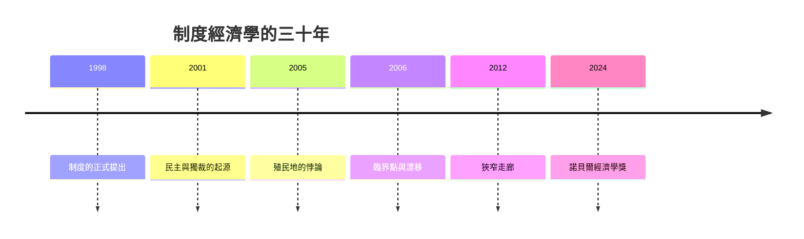

# 2024 · 懸案：殖民地的礦產，為什麼讓宗主國更富、讓殖民地更窮？——制度如何決定繁榮

> **2024 諾貝爾經濟學獎（瑞典央行紀念獎）：卡梅爾·達龍·阿西莫格魯 Kamer Daron Acemoğlu（土耳其／美國，1967– ）、西蒙·赫伯特·強生 Simon Herbert Johnson（英國／美國，1963– ）與詹姆斯·艾倫·羅賓遜 James Alan Robinson（英國／美國，1960– ）— 表彰他們「對制度如何形成並如何影響繁榮的研究」（for studies of how institutions are formed and affect prosperity）。**

---

## 懸案（案情提要）

2024 年的案子把經濟學最古老的問題之一重新推上法庭：**為什麼有些國家富有、有些貧窮？**

1. **地理決定論已被推翻**：熱帶疾病、土壤、礦產——這些曾被視為命運。諾斯（1993 案）用美國新英格兰（資源貧乏卻崛起）與澳洲（資源豐富卻停滯）作對照，但那是敘事，不是證據。
2. **殖民地的悖論**：為什麼殖民時期的制度，往往讓宗主國繁榮、讓殖民地停滯？
3. **「制度」必須可測量**：制度是抽象概念，必須被轉化為**可觀察的變數**（產權保護、司法獨立、民主參與、精英制衡），才能被檢驗。
4. **因果方向**：是制度造成繁榮，還是繁榮產生好制度？（這是「反向因果」的經典問題。）
5. **改革的可行性**：即使知道制度重要，**窮國能改變制度嗎**？（「改革失敗」的歷史記錄。）

三人的答案是：**用殖民地的歷史作為「外生變異」，用制度的跨代傳遞機制作為理論骨架**。

---

## 前因

| 年份 | 事件 |
|---|---|
| 1990s | Acemoglu 在倫敦政治經濟學院（Hayek 的傳人、Alesina 的學生）；Johnson 與 Robinson 在芝加哥政治經濟學研究中心 |
| 1998 | Acemoglu、Johnson、Robinson 的〈殖民地興衰的經濟理論〉（*AER*）：**制度理論的正式提出** |
| 2001 | Acemoglu、Johnson、Robinson 的《殖民地的經濟失敗》（*The Economic Origins of Dictatorship and Democracy*）：**民主與獨裁的制度起源** |
| 2001 | Johnson & Robinson 的「北韓的飢荒」與朝鮮的制度分析 |
| 2005 | Acemoglu、Johnson、Robinson 的〈殖民地的財富與貧窮〉（*JPE*）：**殖民地的「制度悖論」** |
| 2006 | Acemoglu 的《不完美的制度》（*Economic Origins*）：**臨界點（critical junctures）與制度漂移** |
| 2006 | Acemoglu & Robinson 的「**政治壟斷（political monopoly）**」與「**壟斷危機（monopoly crisis）**」框架 |
| 2012 | Acemoglu & Robinson 的《_the Narrow Corridor_》（《狹窄走廊》）：**國家能力與社會動員的平衡** |
| 2016 | Acemoglu & Restrepo 的「機器人與人」：**AI 與勞動需求**的議題 |
| 2020 | Acemoglu 的《NarrowCorridor》與 2024 年得獎演說《The Prize of Prosperity》 |
| 2024 | 得獎；委員會的措辭特別提及「制度如何形成」與「制度如何影響繁榮」兩部分 |

---

## 調查

### 線索一：殖民地的悖論——「殖民地的制度讓宗主國受益、讓殖民地受害」

Acemoglu–Johnson–Robinson 2005 年（JPE）的核心實證謎題：

**觀察**：殖民地時期建立的那些**在宗主國有效、在殖民地有害**的制度，為何在殖民地造成了長期貧窮？

他們給出的解釋框架：

1. **宗主國母國（metropole）的利益**決定了它建立什麼制度：**為提高宗主國的收益，殖民地被設計成「榨取型」的制度**（壟斷性租賃公司、奴隸制、強制種植、限制本地產業）；
2. 這些制度**提高了宗主國的收益**（對宗主國是「好制度」，對殖民地是「壞制度」）；
3. 因此產生一個**制度悖論**：宗主國因為推行對自己有利（在殖民地則有害）的制度而致富，而殖民地承擔了成本。

**方法論的關鍵**：他們主張用**殖民地的外生差異（殖民者的死亡率——「殖民者死亡率」假說）**作為工具變數：

$$
\text{工具變數：} \quad \text{殖民者死亡率（當地的病原環境）}
$$

- 殖民者死亡率**高**（如非洲、馬來西亞、太平洋）$\rightarrow$ 殖民者無法大量定居 $\rightarrow$ 制度偏向**榨取型** $\rightarrow$ 長期不利於發展；
- 殖民者死亡率**低**（如美國、加拿大、紐澳）$\rightarrow$ 殖民者大量定居 $\rightarrow$ 制度偏向**定居型**（建立常住的、對殖民者有利的制度，如代議制、法治）$\rightarrow$ 長期有利於發展。

這就把「殖民地的自然環境（病原體）」轉化為**制度差異的外生來源**，進而識別出制度對長期繁榮的因果效應：

$$
\text{制度} \xrightarrow{IV:\ \text{殖民者死亡率}} \text{長期人均 GDP}
$$

### 線索二：制度的形成——臨界點與制度漂移

《不完美的制度》（2006）回答「制度如何形成」：

1. **臨界點（critical juncture）**：制度在歷史的某個關鍵時刻被建立（征服、政變、殖民建立），而**之後的發展路徑依賴**這個選擇；
2. **制度漂移（institutional drift）**：制度會隨時間**無聲地衰變**——原本有助於經濟的制度，隨環境變化（技術、規模、交易對象的改變）而變成障礙。

形式化為一個**動態模型**：多個制度均衡，經濟體在其中演化；當**環境參數**（如人口密度、交易對象的規模）跨過某個臨界值時，均衡會跳到另一個制度：

$$
\dot{z} = f(z, \theta) \quad \Longrightarrow \quad \text{制度漂移} \quad \text{當 } \theta \text{ 變動}
$$

這解釋了為何**歷史上曾經繁榮、後來衰落的文明**（羅馬、威尼斯、明日 Ong 中國）——制度不是永恆的。

### 線索三：民主與獨裁的制度起源（2001）

《殖民地的經濟失敗》的另一面：民主與獨裁不是「文化」或「階級結構」的產物，而是**資產的分佈**與**革命威脅**的產物：

- 在**土地高度不均**的社會，菁英擔心被多數奪產，因此傾向**壓制多數的政治權力**（獨裁）；
- 在**土地相對均分**的社會，菁英的資產不容易被沒收，多數的革命威脅較弱，菁英願意**授予政治權力**作為妥協（民主）。

模型的核心機制：

$$
\text{資產不均} \;\xrightarrow{}\; \text{菁英的脆弱性} \;\xrightarrow{}\; \text{民主化的誘因}
$$

而**民主一旦建立，就成為「不可逆」的制度**（因為被賦予權利的多數不會放棄），這解釋了民主的「路徑依賴」與「擴張趨勢」。

### 線索四：政治壟斷與壟斷危機——改革的政治經濟學

三人最重要的理論貢獻之一，是解釋「**為什麼改革那麼難**」：

- **政治壟斷（political monopoly）**：一個菁英集團控制政治權力，並從中獲取**政治收益**（如選票、資源分配、保護）；
- **壟斷危機（monopoly crisis）**：當菁英的經濟收益（透過制度性榨取）下降時，其政治收益若也受到威脅，就會出現**改革契機**——這是 2011 年阿拉伯之春的理論解釋。

關鍵的命題：**經濟危機本身不會導致改革，只有當它同時動搖了菁英的政治權力時才會**：

$$
\text{改革的必要條件} = \text{經濟危機} \times \text{政治鬆動}
$$

這解釋了為何「大蕭條沒有帶來民主化」——因為在蕭條中，政治權力（選舉權、公共工程等制度性收益）反而被強化（紐約州擴大公共支出與選舉權）。

### 線索五：狹窄走廊——國家能力與社會動員的平衡（2012）

《狹窄走廊》是三人 2012 年後的主張，也是 2024 年得獎演說《The Prize of Prosperity》的核心：

> **繁榮需要兩股力量的平衡：國家能力（state capacity）與社會動員（social mobilization）。**

- 國家能力：政府徵稅、維持秩序、提供公共品；
- 社會動員：社會對政府的制約與參與（使能力不被用於剝奪）。

兩者必須**同時**存在：

$$
\text{能力} \uparrow \text{ 而不動員} \;\Rightarrow\; \text{專制（extractive state）}
$$

$$
\text{動員} \uparrow \text{ 而無能力} \;\Rightarrow\; \text{無政府（失敗國家）}
$$

這解釋了「為何民主化不必然帶來經濟成長」（民主化若發生在能力薄弱時，可能陷入混亂），也解釋了「為何有些高能力國家卻長期停滯」（能力但無制約）。

### 線索六：制度的度量與證據

三人的方法論核心是**把制度變成可測量的變數**：

- **Acemoglu 的網站 *The Economic History of Nations***：整理了數百個國家的多項制度指標（民主、選舉、法治、教育、壟斷），成為全領域的標準資料集；
- **Acemoglu & Johnson 的「廢奴與長期發展」研究**（2005）：利用各國廢奴時間的差異作為外生變異，發現廢奴顯著提高長期人均 GDP——這是「制度改變 $\rightarrow$ 長期繁榮」最乾淨的因果證據之一；
- **Johnson & Robinson 的「朝鮮的制度實驗」**：朝鮮的飢荒（1994–98）被解釋為**制度崩壞**的後果（資訊與激勵機制的瓦解），而其後的經濟奇蹟則被解釋為**制度的重新設計**（市場化 + 國家能力的保留）。

### 線索七：AI 與「機器人議題」（2016–2024）

三人近年來的重要延伸：當 AI 與自動化推進，**對勞動需求的衝擊**會如何影響制度與繁榮？Acemoglu & Restrepo（2020）的模型：

$$
\text{技術進步偏向} \begin{cases} \text{勞動} \to \text{工資上升、繁榮} \\ \text{資本} \to \text{勞動需求下降、收入分配惡化} \end{cases}
$$

他們主張政策應**引導技術方向**（如透過稅制、競爭政策、訓練政策）——這是「制度決定繁榮」的現代延伸：**連技術進步的果實如何分配，也是制度問題**。

---

## 理論裁決

**裁決一**：**制度是長期繁榮的決定性因素**，而制度可以被外生變異（殖民者死亡率、廢奴時點）識別：

$$
\text{制度} \to \text{長期人均產出}, \qquad \text{識別：} \quad \text{IV} = \text{殖民者死亡率}
$$

**裁決二**：制度對宗主國與殖民地的效應**方向相反**——「對宗主國有效的榨取制度，正是殖民地長期貧窮的來源」。

**裁決三**：**制度如何形成**：由**臨界點**決定初始形態，之後隨環境參數**漂移**（制度的壽命有限）；民主化的觸發條件是**資產分佈 $\times$ 革命威脅**，而民主一旦建立即具有**不可逆性**。

**裁決四（改革的政治經濟學）**：**經濟危機本身不帶來改革**；只有當菁英的政治權力同時受到威脅時，「壟獨危機」才開啟制度變遷：

$$
\text{改革} = \text{經濟危機} \times \text{政治鬆動}
$$

**裁決五（狹窄走廊）**：**繁榮 = 國家能力 $\times$ 社會動員**；兩者缺一，制度必然失敗（無能力 $\rightarrow$ 失序；有能力而無制約 $\rightarrow$ 專制榨取）。

**裁決六（度量）**：制度必須可測量（產權保護、司法獨立、民主化、社會保障等指標），因果推斷必須以制度為對象（自然實驗 + IV）。

---

## 後果

| 領域 | 影響 |
|---|---|
| 政策應用 | 發展中國家的制度議程（法治、產權、財政能力、社會保障）；國際發展援助的制度前提（世界銀行的「制度優先」）；民主化的時序建議（能力先行 vs 動員先行的辯論）；2020s 對「民主倒退」的診斷框架 |
| 學術 | 制度經濟學成為發展經濟學的主軸；政治經濟學與發展經濟學的融合；「The Economic History of Nations」成為通用資料集 |
| 公共論述 | 三人 themselves 是最積極的公共知識分子（關於民主倒退、全球化的論戰、疫情後的經濟政策）；2024 年的授獎在政治動盪的年份引發廣泛的解讀 |
| 爭議 | 「制度決定論」被批**循環論證**（制度好不好用發展水平衡量）；對制度變革的**過度樂觀或悲觀**；殖民者死亡率 IV 的排除性限制爭議；「狹窄走廊」被批難以操作化；三人對全球化、AI 與移民的立場被批為「過度樂觀的技術樂觀主義」 |
| 跨獎 | 1993 North–Fogel（制度經濟史）、1974 Myrdal（循環累積因果）、2009 Ostrom–Williamson（治理結構）、2024 同年案（制度量化與政治經濟學的綜合） |

---

## 關聯

- [1993-Fogel與North計量經濟史](1993-Fogel與North計量經濟史.md)：制度經濟學的直系前案（本書續寫中）。
- [1974-Myrdal與Hayek貨幣波動與制度](1974-Myrdal與Hayek貨幣波動與制度.md)：循環累積因果與制度（本書續寫中）。
- [2009-Ostrom與Williamson治理](2009-Ostrom與Williamson治理.md)：治理結構與制度治理（本書續寫中）。
- [2008-Krugman新貿易與經濟地理](2008-Krugman新貿易與經濟地理.md)：核心—邊緣的地理與制度根源（本書續寫中）。
- [2023-Goldin女性勞動市場](2023-Goldin女性勞動市場.md)：機會分配與制度的性別面向（本書續寫中）。
- [2015-Deaton消費與貧困](2015-Deaton消費與貧困.md)：繁榮與福祉的測量（本書續寫中）。
