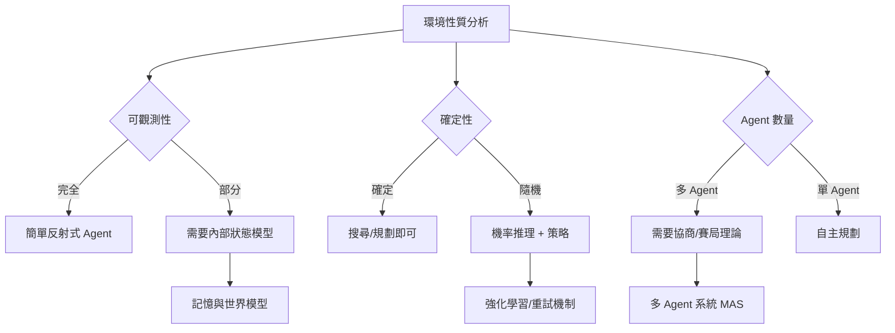
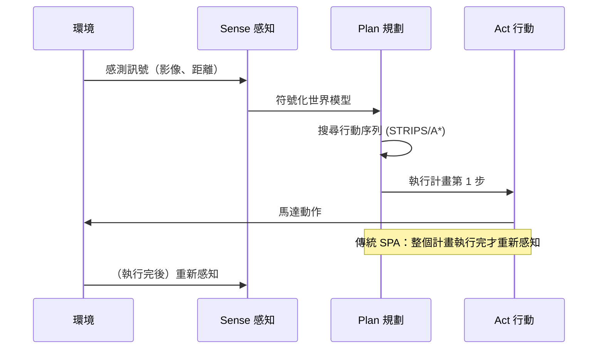

# 1.1 什麼是 Agent：Sense-Plan-Act 與理性代理（1950-1990）

## 一、歷史背景：為何「Agent」概念會誕生？

人工智慧這門學科誕生於 1956 年的達特茅斯會議（Dartmouth Conference）。當時麥卡錫（John McCarthy）、明斯基（Marvin Minsky）、香農（Claude Shannon）等人提出了一個大膽的假設：「學習的每個面向，或智慧的任何其他特徵，原則上都可以被如此精確地描述，以致於可以製造出一台機器來模擬它。」這個假設背後隱含著一個核心問題：

> **智慧不是靜態的知識，而是在環境中行動的能力。**

早期的 AI 研究者很快意識到，一個只會「計算」而不會「行動」的程式，即使再聰明，也只是在解一道封閉的題目。真正的智慧系統必須能夠：

1. **感知（Sense）**：從環境中接收資訊；
2. **思考（Plan/Think）**：根據資訊做出決策；
3. **行動（Act）**：對環境施加影響，並觀察後果。

這個「感知—思考—行動」的閉環，就是 Agent（代理人／智慧體）概念的原型。Russell 與 Norvig 在經典教科書《Artificial Intelligence: A Modern Approach》（1995）中，把整本書的架構就建立在「理性代理（Rational Agent）」之上，可見 Agent 概念在 AI 學科中的核心地位。

### 為什麼當時需要這個概念？

在 1950-60 年代，電腦主要被視為「計算器」：輸入資料、輸出結果、結束。但自動化控制的實際需求（導彈導航、工業流程控制、機器人）迫使研究者思考一個更通用的問題：

- 程式要**持續運行**，而不是跑一次就結束；
- 環境是**動態且不可完全預測**的，程式必須即時反應；
- 程式的目標是**達成任務**，而不僅僅是算出正解。

這三個需求定義了 Agent 與一般程式的根本差異。

## 二、Agent 的形式化定義

### 2.1 數學模型

一個理性代理可以用以下框架描述：

$$
Agent: \; \mathcal{P}(\text{感知歷史}) \rightarrow \text{行動}
$$

也就是說，Agent 是一個從「感知歷史（Percept History）」到「行動（Action）」的函數：

$$
f: [o_0, o_1, \dots, o_t] \mapsto a_t
$$

其中 $o_t$ 是第 $t$ 時刻的感知， $a_t$ 是第 $t$ 時刻採取的行動。

**理性（Rationality）** 的定義則依賴四個要素：

1. **效能度量（Performance Measure）**：什麼叫「做得好」；
2. **感知序列**：Agent 到目前為止知道的一切；
3. **環境知識**：Agent 對環境的內建知識；
4. **可行動作**：Agent 能執行什麼。

理性代理選擇的行動，是「在給定感知序列與內建知識下，期望效能度量最大化的行動」。注意這裡是**期望值**最大化——環境不確定時，理性的行動不等於結果最好的行動，這個區分在後世的強化學習與 LLM Agent 評估中依然極為重要。

### 2.2 PEAS 描述框架

要設計一個 Agent，先要描述它的 PEAS：

| 要素 | 全名 | 說明 | 例：自動計程車 | 例：LLM Agent |
|------|------|------|----------------|----------------|
| P | Performance | 效能指標 | 安全、快速、合法 | 任務完成率、正確性 |
| E | Environment | 環境 | 道路、行人、天氣 | 檔案系統、網頁、API |
| A | Actuators | 執行器 | 方向盤、油門、煞車 | function call、檔案寫入 |
| S | Sensors | 感測器 | 攝影機、雷達 | 使用者輸入、工具結果 |

PEAS 框架至今仍然是分析任何 Agent 系統（包括 2026 年的 Code Agent）的第一步。

## 三、環境的分類：Agent 設計的「地圖」

Agent 的架構選擇，幾乎完全由環境性質決定。Russell-Norvig 給出的環境分類軸，至今仍是分析 LLM Agent 行為的工具：

1. **完全可觀測 vs 部分可觀測**：西洋棋是完全可觀測（棋盤全知），真實網頁是部分可觀測（Agent 只看到截圖或 DOM 的一部分）。部分可觀測性正是後世 Agent 需要「記憶系統」的根本原因。
2. **單一 Agent vs 多 Agent**：西洋棋是競爭性多 Agent；多 Agent 軟體工程（如後來的 AutoGen）是合作性多 Agent。
3. **確定性 vs 隨機性**：迷宮是確定的；瀏覽器操作是隨機的（頁面可能載入失敗、廣告彈出）。隨機性迫使 Agent 需要「重試與容錯」機制。
4. **序列性 vs 片段性**：西洋棋每步影響全域（序列性）；抓取網頁各任務互不影響（片段性）。序列環境中的錯誤會累積，這是長程任務的難點之一。
5. **動態 vs 靜態**：AI 規劃時世界暫停（靜態）；真實作業系統持續運行（動態），因此 Code Agent 在跑測試時環境可能已經改變。
6. **離散 vs 連續**：棋步是離散的；機器手臂控制是連續的。



**因果鏈條**：環境越接近「部分可觀測 + 隨機 + 動態 + 序列」，Agent 需要的內部機制就越多——記憶、規劃、容錯。LLM Agent 所面對的「作業系統 + 網際網路」環境，幾乎是這條光譜上最困難的一端，這也解釋了為什麼 1990 年代設計出的各種 Agent 架構，要等到 2022 年之後 LLM 成熟才真正能用。

## 四、Sense-Plan-Act：機器人學的經典閉環

### 4.1 架構解析

Sense-Plan-Act（SPA）模型源自 1960-70 年代的機器人學（如 Stanford Cart、Shakey the Robot），是第一個被廣泛採用的 Agent 架構：

1. **Sense**：感測器（攝影機、觸碰感測器）讀取環境，轉成符號表示；
2. **Plan**：在符號世界模型中搜尋一條從現狀到目標的行動序列；
3. **Act**：把行動序列交給執行器，一次執行完畢，然後重新感知。



Shakey the Robot（SRI, 1966-1972）是 SPA 的代表作。它使用 STRIPS 規劃器，能夠規劃「推箱子到門邊」這類任務。STRIPS 的格式——**前置條件（Preconditions）、刪除效果（Delete）、添加效果（Add）**——至今仍出現在 LLM Agent 的「動作 schema」設計中（例如 OpenAI function calling 的參數描述），這是一條跨越五十年的技術血統。

### 4.2 SPA 為何失效？

SPA 在結構化環境中表現尚可，但在真實世界中遭遇了災難性失敗：

- **符號接地問題（Symbol Grounding Problem）**（Harnad, 1990）：符號「BOX-1」與真實世界中的箱子之間的對應，需要人類手工編碼，無法自動習得；
- **感知瓶頸**：真實影像難以轉成乾淨的符號，雜訊會讓規劃器直接崩潰；
- **反應遲鈍**：規劃耗時太長，等規劃完成，世界已經變了；
- **脆性（Brittleness）**：任何未預料的情況（地面濕滑、燈光改變）都會導致整個計畫作廢。

這些失敗，直接引出了下一節將談的「行為主義革命」（Brooks 的 Subsumption Architecture，1986），也埋下了「Agent 必須具備對不確定環境的魯棒性」這一持續至今的設計原則。

### 4.3 早期程式碼範例：最小 SPA 迴圈

用 Python 模擬一個迷宮中的 SPA Agent：

```python
import random

class GridWorld:
    """5x5 迷宮，(0,0) 起點，(4,4) 目標，隨機障礙物"""
    def __init__(self, size=5, obstacle_ratio=0.15, seed=42):
        random.seed(seed)
        self.size = size
        self.agent_pos = (0, 0)
        self.goal = (size - 1, size - 1)
        self.obstacles = set()
        for _ in range(int(size * size * obstacle_ratio)):
            x, y = random.randint(0, size-1), random.randint(0, size-1)
            if (x, y) not in [(0,0), self.goal]:
                self.obstacles.add((x, y))

    def sense(self):
        """感知：回傳周圍四格是否可通行（部分可觀測）"""
        x, y = self.agent_pos
        percept = {}
        for dx, dy in [(0,1),(0,-1),(1,0),(-1,0)]:
            nx, ny = x+dx, y+dy
            if 0 <= nx < self.size and 0 <= ny < self.size:
                percept[(nx,ny)] = (nx,ny) not in self.obstacles
        return percept

    def act(self, pos):
        """執行行動；若撞到障礙則留在原地（環境的隨機性）"""
        if pos not in self.obstacles and self._in_bounds(pos):
            self.agent_pos = pos
            return True
        return False

    def _in_bounds(self, pos):
        x, y = pos
        return 0 <= x < self.size and 0 <= y < self.size

    def done(self):
        return self.agent_pos == self.goal


def plan_bfs(world):
    """在已知感知上做簡單的貪婪/BFS 規劃（此處簡化為貪婪）"""
    percept = world.sense()
    x, y = world.agent_pos
    gx, gy = world.goal
    candidates = sorted(percept.keys(),
                        key=lambda p: abs(p[0]-gx) + abs(p[1]-gy))
    return candidates[0] if candidates else world.agent_pos


def run_agent(max_steps=100):
    world = GridWorld()
    path = [world.agent_pos]
    for step in range(max_steps):
        if world.done():
            print(f"達成目標！共 {step} 步，路徑：{path}")
            return path
        target = plan_bfs(world)          # Plan
        if not world.act(target):         # Act（失敗則感知重來）
            print(f"第 {step} 步：碰撞，重新規劃")
        path.append(world.agent_pos)      # Sense 發生在下輪迴圈
    print("步數耗盡，任務失敗")
    return path

run_agent()
```

這個 40 行的玩具程式，已經包含了現代 LLM Agent 的所有要素：感知（sense）、決策（plan）、行動（act）、失敗重試。差別只在於：決策模組從「手工寫的貪婪策略」換成了「大語言模型」。

## 五、理性代理理論的深遠影響

### 5.1 效能度量與獎勵函數

理性代理的「效能度量」概念，直接催生了 1980 年代的強化學習框架。 Sutton 與 Barto 將其形式化為：

$$
G_t = \sum_{k=0}^{\infty} \gamma^k \, r_{t+k+1}
$$

其中 $G_t$ 是從時刻 $t$ 起的累積折扣回報， $\gamma \in [0,1)$ 是折扣因子。這個公式把「理性」變成了可優化的目標函數，是 AlphaGo 到 RLHF 一脈相承的數學基礎。

### 5.2 賽局理論與多 Agent 的種子

1980 年代，Rosenschein 開始研究「理性協商」（Rational Negotiation），開創了分散式人工智慧（DAI）的研究，後來演變為多 Agent 系統（MAS）。這條線在第 6 章會完整展開。

### 5.3 知識表示與「意圖」層次

1987 年，Georgeff 與 Lansky 提出 PRS（Procedural Reasoning System），引入 **BDI 模型**：

- **Belief（信念）**：Agent 對世界的認知（可能錯誤）；
- **Desire（願望）**：Agent 想達成的狀態集合；
- **Intention（意圖）**：Agent 已承諾要去做的計畫。

BDI 模型承認：Agent 不可能瞬間做出最優決策，必須「承諾一個計畫並堅持一段時間」，否則會在反覆規劃中原地打轉。這個洞見在 LLM Agent 時代被重新發明——今天的 Agent 框架會把「任務清單」寫入記憶並持續維護，正是 Intention 的現代版。


## 六、跨時代的對照表

| 1980s 概念 | 2020s LLM Agent 對應物 |
|-----------|------------------------|
| Sense（感知） | Prompt 輸入、截圖、DOM、工具回傳值 |
| Plan（規劃） | Chain-of-Thought、Plan-and-Solve、ToT |
| Act（行動） | Function calling、shell 命令、API 呼叫 |
| 符號世界模型 | Context window、向量資料庫、記憶系統 |
| 效能度量 | SWE-bench、AgentBench 等基準 |
| BDI 的 Intention | TODO list / task list 的持續維護 |
| STRIPS 的動作 schema | OpenAI/Anthropic 的 function calling JSON schema |
| 部分可觀測環境 | 上下文長度限制 → RAG 與記憶壓縮 |

看懂這張表，就掌握了本書的核心論點：**LLM Agent 不是憑空出現的新事物，而是把五十年來 Agent 理論中的「決策核心」換成了一個可訓練的通用推理機**。架構的骨架——感知、規劃、行動、記憶、協作——全部來自這個時代。

## 七、本節重點

1. Agent 的本質是「感知—決策—行動」的閉環；理性代理的定義是**在給定感知與知識下最大化期望效能**，而非追求結果最好。
2. PEAS 框架（效能、環境、執行器、感測器）是分析任何 Agent 系統的起點，對 2026 年的 Code Agent 依然適用。
3. 環境的六個性質（可觀測性、確定性、Agent 數量、序列性、動態性、離散性）決定 Agent 需要的內部機制；LLM Agent 面對的是最困難的環境組合。
4. Sense-Plan-Act 與 STRIPS 是最早的完整 Agent 架構；其失敗（符號接地、脆性、反應遲鈍）教會我們：Agent 的瓶頸通常在「感知與世界模型」，而非「規劃演算法」。
5. BDI 模型的「意圖承諾」概念，預言了現代 Agent 框架中任務清單持久化的設計。
6. 強化學習的折扣回報公式，是「理性」從哲學概念變成可優化目標的數學化里程碑。

## 八、思考問題

1. 把一個 2026 年的 Code Agent（如 Claude Code）用 PEAS 框架完整描述。它的「感測器」和 1980 年代機器人的感測器，本質上有何不同？
2. LLM Agent 的 context window 是有限制的，這對應環境分類中的哪一條性質？它引出了哪些補救技術？
3. 「理性的行動不等於結果最好的行動」——請舉一個 LLM Agent 評估中的例子說明這句話。
4. BDI 模型中「堅持已承諾的計畫」與「及時根據新資訊改變計畫」是一對張力。現代 Agent 框架（如帶有 TODO list 的 Code Agent）如何在工程上處理這個張力？
5. 若你替 Shakey the Robot 換上 2026 年的多模態 LLM 作為決策核心，SPA 架構的哪個環節會徹底改變？哪個環節問題依舊？
