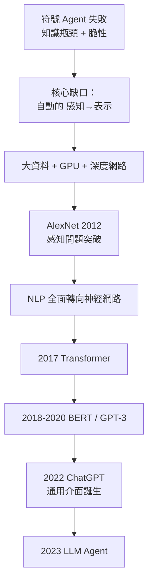
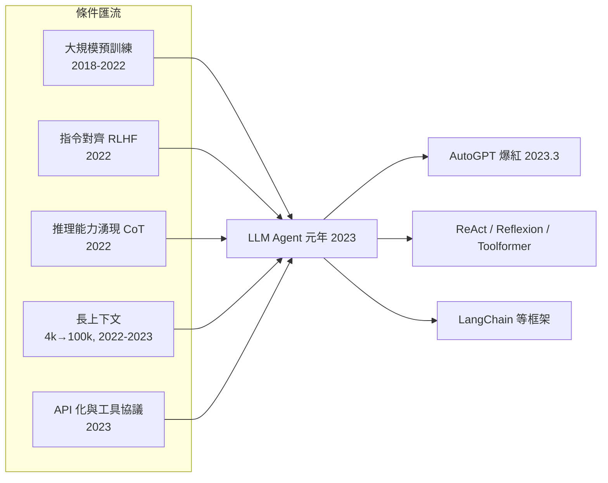

# 1.2 符號 Agent 的興衰與 LLM Agent 的誕生（1990-2022）

## 一、歷史背景：兩次寒冬與一場革命

1970-80 年代的符號 AI 遭遇第一次寒冬（Lighthill 報告，1973），專家系統在 1980 年代短暫復興後，又因維護成本爆炸而進入第二次寒冬。1990 到 2006 年是 AI 的「低谷期」，但正是在這段時間裡，三條技術線悄悄完成了積累：**統計機器學習、神經網路復興、以及網際網路帶來的大資料**。當這三條線在 2012 年匯流（AlexNet），AI 歷史轉了一個大彎——而「Agent」這個曾被符號 AI 主導的概念，將在 2022 年被 LLM 徹底重新定義。

本節的主軸是回答三個問題：

1. 符號 Agent 為什麼衰敗？（舊方法為何失效）
2. 深度學習與 LLM 如何一塊塊地拆解了 Agent 的困難子問題？（新方法如何解決）
3. 為什麼 LLM Agent 直到 2022 年底才誕生？（前因後果的匯流點）

## 二、符號 Agent 的黃金幻影與崩塌

### 2.1 專家系統：最後的輝煌

1980 年代的專家系統（如 MYCIN 醫療診斷、XCON 配置系統）把「知識」寫成成千上萬條 IF-THEN 規則：

```
IF 細菌革蘭氏染色為陽性
   AND 培養型態為球菌
   AND 患者為發燒住院
THEN 治療方案應考慮盤尼西林類（信心 0.7）
```

XCON 為 DEC 公司每年節省數千萬美元，證明了「知識就是力量」。但到 1980 年代末，問題暴露：

- **知識獲取瓶頸（Knowledge Acquisition Bottleneck）**：把專家腦中的知識寫成規則，每條都要耗費知識工程師數天；規則數量成長後，規則之間互相衝突。
- **脆性**：規則只覆蓋見過的案例，遇到邊界情況系統不是「降低信心」而是「給出荒謬答案」。
- **維護成本**：常識無法窮舉。Lenat 的 Cyc 專案（1984 起）試圖手寫數百萬條常識規則，至今未能完成，成為符號路線的悲壯墓碑。

### 2.2 符號 Agent 的根本困境

Moravec 悖論（1988）精準總結了問題：**對人類困難的事（邏輯、棋類）對電腦容易；對人類容易的事（感知、運動、常識）對電腦極難**。原因是演化的「體力勞動」——人類一億年的演化把感知與運動打磨得毫不費力，但這些能力無法被語言化、無法被寫成規則。

這意味著：**符號 Agent 缺的不是更好的推理演算法，而是缺一個「把世界變成符號」的自動化機器。** 誰能自動完成「感知→表示」這一步，誰就能解放整個 Agent 管線。

## 三、統計與學習路線的爬坡（1990-2012）

在符號 AI 沉寂的歲月裡，學習路線穩步推進：

| 年份 | 里程碑 | 對 Agent 的意義 |
|------|--------|----------------|
| 1986 | 反向傳播普及（Rumelhart 等） | 神經網路可訓練 |
| 1989-98 | LeCun 的 CNN / LeNet | 感知問題的解法出現 |
| 1995 | SVM、統計學習理論 | 機器學習成為主流方法論 |
| 1997 | Deep Blue 勝 Kasparov | 確定性全知環境中「暴力搜尋+評估」足矣 |
| 2001 | 統計 NLP 取代規則文法 | 語言處理開始「資料驅動」 |
| 2006 | Hinton 深度信念網路、ImageNet 計畫 | 深度學習與大資料就位 |
| 2009-2012 | ImageNet 競賽；AlexNet 奪冠（2012） | **感知瓶頸被打破** |

AlexNet 的意義需要放在 Agent 的脈絡下理解：它證明了「感知→表示」可以端到端地用資料學出來。這正是 1980 年代符號 Agent 缺失的那一塊。



## 四、通往 LLM 的關鍵四步（2013-2022）

### 4.1 詞向量：意義的第一次向量化（2013）

Word2Vec 證明「國王 − 男人 + 女人 ≈ 女王」——語義可以被表示為向量空間中的方向。這一步解除了符號接地問題的一半：意義不必是手寫符號，可以是學出來的座標。向量空間的思想，將在 2020 年代以「向量資料庫」的形式成為 Agent 記憶系統的地基（第 4 章）。

### 4.2 Transformer：並行化的注意力（2017）

《Attention Is All You Need》以 self-attention 取代 RNN 的循序處理：

$$
\text{Attention}(Q, K, V) = \text{softmax}\left(\frac{QK^\top}{\sqrt{d_k}}\right)V
$$

三個關鍵效果：

1. **可並行**：訓練可在整個序列上同時進行，規模化成為可能；
2. **長距離依賴**：任意兩個 token 直接建立聯繫，不再被梯度消失折磨；
3. **通用架構**：同一個架構餵什麼學什麼，為「基礎模型」鋪路。

### 4.3 GPT-3 與 In-context Learning（2020）

GPT-3（1750B 參數）發現了「湧現」現象：模型不需要梯度更新，只要在提示詞裡給幾個範例，就能模仿任務。這就是 **in-context learning**——它把「程式設計」從寫權重變成了寫文字。2022 年的 Chain-of-Thought（Wei et al.）更進一步：只要在範例中展示推理步驟，模型就會展現出逐步推理能力。

**因果鏈**：in-context learning 意味著 LLM 的行為可以被「上下文」程式化。一旦行為可程式化，讓模型「輸出結構化動作」再由外層程式執行、把結果餵回上下文——一個 Agent 迴圈就形成了。這就是 2022-2023 年 Agent 浪潮的技術起點。

### 4.4 ChatGPT：介面的革命（2022.11）

ChatGPT 本身在模型技術上只是 RLHF 對齊後的 GPT-3.5，它的革命在於**介面**：兩個月內破億使用者。這件事對 Agent 的影響是間接但巨大的：

- 證明了「自然語言是人機之間的通用 API」；
- 讓全世界工程師習慣了「以對話方式操作 AI」；
- 使 OpenAI 有動力推出 function calling（2023.6），補上 Agent 迴圈的最後一塊拼圖。

## 五、LLM Agent 誕生前的「前夜作品」（2021-2022）

在 ChatGPT 之前，已經有人開始把 LLM 當作 Agent 的大腦：

- **WebGPT（OpenAI, 2021.12）**：讓 LLM 操作文字瀏覽器回答問題，明確把 LLM 嵌入「感知（網頁內容）→行動（點擊、引用）」迴圈；
- **SayCan（Google, 2022.4）**：LLM 負責判斷「哪些機器人動作有助於任務」，可行性由價值函數評估——LLM 作為規劃器的思想雛形；
- **AutoGPT 前身的一系列實驗**（2022 下半年）：開發者用 while 迴圈包住 GPT，嘗試讓它自主完成任務。

這些作品共同的發現是：**LLM 單獨使用時做不到的事，放在一個感知-行動迴圈裡就能做到**——不是因為模型變聰明了，而是因為迴圈給了它記憶、工具與糾錯的機會。這個發現直接預演了 2023 年 ReAct 論文的正式化（第 3 章）。

## 六、為什麼是 2022/2023？匯流分析

把所有前置條件排成清單：



缺一不可：

- 沒有**規模**：沒有湧現的推理與指令遵循能力，Agent 迴圈走不到第三步；
- 沒有 **RLHF 對齊**：模型不肯聽「你的任務是……」這類指令，無法受外層程式驅動；
- 沒有 **CoT 湧現**：模型無法分解任務，只能在單步內答題；
- 沒有 **長上下文**：放不下工具回傳的結果與任務歷史；
- 沒有 **function calling 協議**：模型輸出的「行動」是自由文字，解析率低，迴圈不穩定。

## 七、程式碼範例：最小 LLM Agent 迴圈（前夜版）

以下用偽 API 展示 2022 年底開發者如何用一個 while 迴圈把 GPT 變成 Agent（即 AutoGPT 式結構的最小版）：

```python
import json

TOOLS = {
    "search_web": lambda q: f"[搜尋結果：關於 {q} 的摘要...]""",
    "write_file": lambda name, content: f"已寫入 {name}",
}

SYSTEM = """你是一個自主 Agent。每一步你必須以 JSON 回應：
{"thought": "...", "action": "工具名或 FINISH", "action_input": {...}}
工具：search_web(q), write_file(name, content)。"""

def run_agent(goal, max_steps=10):
    history = [{"role": "user", "content": f"目標：{goal}"}]
    for step in range(max_steps):
        resp = llm_api(messages=[{"role": "system", "content": SYSTEM}] + history)
        try:
            parsed = json.loads(resp)          # 解析模型的「行動」
        except json.JSONDecodeError:
            history.append({"role": "user", "content": "格式錯誤，請重新以 JSON 回應。"})
            continue                            # 失敗回饋 → 重試（Agent 迴圈的容錯）
        if parsed["action"] == "FINISH":
            return parsed["thought"]
        tool = TOOLS.get(parsed["action"])
        observation = tool(**parsed["action_input"]) if tool else f"未知工具 {parsed['action']}"
        history.append({"role": "assistant", "content": resp})
        history.append({"role": "user", "content": f"觀察：{observation}"})
    return "超過步數上限"

def llm_api(messages):
    # 佔位：實際呼叫 LLM API
    return json.dumps({"thought": "先搜尋", "action": "search_web",
                       "action_input": {"q": "LLM Agent 架構"}})

print(run_agent("寫一份 LLM Agent 調研筆記"))
```

注意這段 2023 年初風格的程式碼中所有的「補丁」：JSON 解析失敗要重試、未知工具要回錯誤、步數上限要設——這些正是 2023.6 之後 function calling 協議要一次性解決的問題。**理論上 Agent 迴圈 1950 年代就有了，工程上卻要等協議與模型同時成熟。**

## 八、本節重點

1. 符號 Agent 的衰敗根源是**知識獲取瓶頸**與**符號接地問題**；Moravec 悖論指出真正的難點在感知與常識，而非邏輯推理。
2. 1990-2012 年，統計學習與深度學習解決了「感知→表示」的自動化；2017 Transformer 解決了規模化；這兩者共同鋪掉了通往 LLM 的路。
3. GPT-3 的 in-context learning 把「程式設計」從改權重變成寫上下文，是 Agent 可被「提示詞驅動」的前提；Chain-of-Thought 使任務分解成為可能。
4. WebGPT、SayCan 等前夜作品證明：把 LLM 放進感知-行動迴圈能解鎖全新能力——LLM Agent 的本質是**迴圈**而非模型本身。
5. 2023 年 Agent 元年是五個條件（規模、對齊、CoT、長上下文、工具協議）同時匯流的結果；任何一項缺失，迴圈都會在工程上崩潰。
6. AutoGPT 式的原始迴圈暴露了自由文字「行動輸出」的脆弱性，直接推動了 2023 年 function calling 與後續協議標準化（第 4 章）。

## 九、思考問題

1. Cyc 專案想手寫常識，LLM 從文本中學常識——兩者對「知識從何而來」給出了不同答案。你認為 LLM 學到的常識有什麼符號系統不具備的優勢與劣勢？
2. 「LLM Agent 的本質是迴圈而非模型本身」——如果把迴圈套在 2020 年的 GPT-3 上，Agent 會成功嗎？請逐項檢查第七節的五個匯流條件。
3. Moravec 悖論在 2026 年是否依然成立？多模態 LLM 與機器人基礎模型的進展，是否正在瓦解這個悖論？
4. AutoGPT 在 2023 年 3 月爆紅後迅速「遇冷」，成功案例極少。對照第七節的程式碼，你認為它最脆弱的環節是哪一個？
5. In-context learning 之後，人們發現 LLM 的行為可被上下文「程式化」。這種「提示詞即程式」與傳統編程在確定性、可測試性、可維護性上的根本差異是什麼？
