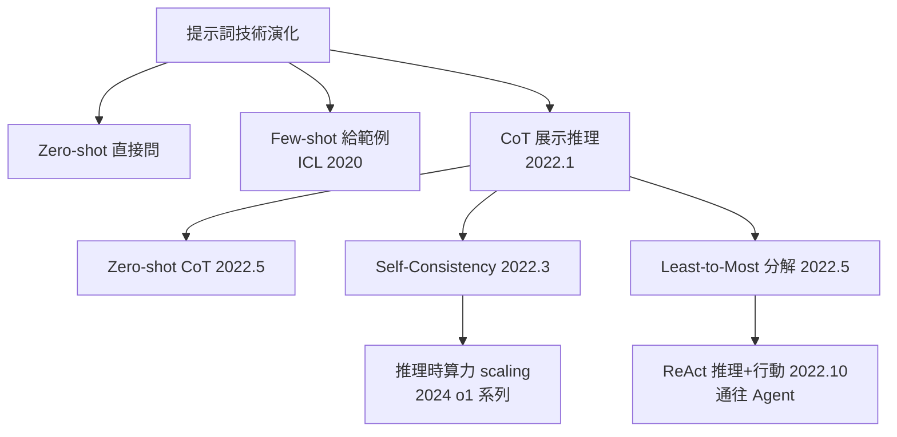

# 2.1 Prompt 即程式：In-context Learning 與 Few-shot（2022）

## 一、歷史背景：一次意外的發現

2020 年，OpenAI 在訓練 GPT-3 時原本期待的是「微調後做下游任務」，卻在論文《Language Models are Few-Shot Learners》中報告了一個意外現象：**模型在沒有任何梯度更新的情況下，僅僅因為提示詞裡出現了幾個範例，就能大幅提升任務表現**。這個現象被命名為 **in-context learning（上下文學習，ICL）**。

這個發現的震撼在於：它改變了「使用模型」的方式。在此之前，AI 應用的標準流程是「收集資料 → 訓練/微調 → 部署」；之後，變成了「寫一段文字 → 完成」。**提示詞（Prompt）成了一種新的程式語言**，而「提示工程（Prompt Engineering）」成了一門新的工程學科。

對 Agent 而言，這是決定性的前提：如果模型行為無法被上下文控制，就無法被外層迴圈驅動。ICL 是 Agent 時代的「組合語言」。

## 二、ICL 的三種模式與 Few-shot 技術

### 2.1 Zero-shot / One-shot / Few-shot

```
Zero-shot（無範例）：
Q: 什麼是光合作用？
A: ...

One-shot（一個範例）：
Q: 把「happy」翻成中文 → 開心
Q: 把「cat」翻成中文 →
A: ...

Few-shot（多個範例）：
把「happy」翻成中文 → 開心
把「sad」翻成中文 → 難過
把「angry」翻成中文 → 憤怒
把「anxious」翻成中文 →
```

Few-shot 的機制至今沒有完全定論，主流解釋有兩派：

1. **隱式梯度下降（implicit gradient descent）**： transformer 的前向傳播在內部近似地執行了一次梯度更新，範例相當於「訓練資料」；
2. **任務定位（task localization）**： 範例只是幫助模型從預訓練學到的巨大任務空間中「定位」到正確的那個任務。

不論哪派為真，工程結論一致：**範例的選擇、順序、格式，對輸出品質有巨大影響**——這正是「提示詞即程式」中「程式碼品質」的來源。

### 2.2 Few-shot 的工程原則

| 原則 | 說明 | 反例 |
|------|------|------|
| 範例格式一致 | 輸入輸出格式統一，模型才會模仿 | 範例一個用 JSON 一個用純文字 |
| 覆蓋邊界情況 | 包含難例、錯誤處理的範例 | 只放最簡單的例子 |
| 範例順序有影響 | 靠近問題尾端的範例影響最大（recency bias） | 隨機排序後結果不穩定 |
| 數量適度 | 範例太多擠壓推理空間與注意力 | 無腦堆 50 個範例 |
| 分隔符明確 | 用 `###`、XML 標籤等明確區隔 | 混亂的純文字堆疊 |

### 2.3 Chain-of-Thought：提示詞的「演算法」

2022 年 1 月，Google 的 Wei et al. 發表《Chain-of-Thought Prompting》：在 few-shot 範例中加入中間推理步驟，模型在數學、常識推理上大幅提升。這是提示詞技術史上最重要的躍遷：

```
（標準 few-shot）
Q: 羅傑有 5 球，又買 2 罐每罐 3 球。共有幾球？
A: 11  ← 模型直接猜，常錯

（Chain-of-Thought）
Q: 羅傑有 5 球，又買 2 罐每罐 3 球。共有幾球？
A: 先算買到的球：2 罐 × 3 球 = 6 球。
   再加原本的：5 + 6 = 11。答案是 11。  ← 展示推理過程，正確率大增
```

其後的變體構成了一個「提示詞演算法家族」：

- **Zero-shot CoT**（Kojima et al., 2022）：只要加一句「Let's think step by step（讓我們一步步思考）」；
- **Self-Consistency**（Wang et al., 2022）：同一問題取樣多條推理鏈，投票選最終答案，用算力換準確率；
- **Least-to-Most Prompting**：先讓模型把大問題拆成小問題，再逐個回答——這是「任務分解」的提示詞版，直接通向第 7 章的規劃技術。



## 三、提示詞即程式：一套新的軟體工程

### 3.1 對照表：傳統編程 vs 提示編程

| 傳統軟體 | 提示編程 |
|----------|----------|
| 程式碼 | 提示詞模板 |
| 函式庫 | Few-shot 範例集 |
| 編譯器錯誤 | 模型拒答/胡答 |
| 單元測試 | 評估集（eval set） |
| 版本控制 | 提示詞版本管理（如 prompt registry） |
| 重構 | 提示詞迭代優化 |
| 型別系統 | 輸出格式約束（JSON schema、structured output） |

### 3.2 模板化的提示詞程式碼範例

把提示詞當成可測試的程式碼來寫（2022-2023 年 LangChain 風格的起點）：

```python
from dataclasses import dataclass

@dataclass
class PromptTemplate:
    template: str
    required_vars: list

    def render(self, **kwargs) -> str:
        # 檢查必要變數（相當於型別檢查）
        missing = [v for v in self.required_vars if v not in kwargs]
        if missing:
            raise ValueError(f"缺少變數: {missing}")
        return self.template.format(**kwargs)


CLASSIFY_PROMPT = PromptTemplate(
    template="""你是客服工單分類器。將工單分到以下類別之一：
- billing（帳務）
- technical（技術問題）
- account（帳號管理）
- other（其他）

只輸出類別名稱，不要其他文字。

範例：
工單：我上個月被重複扣款了 -> billing
工單：App 開啟就閃退 -> technical
工單：我想修改綁定的信箱 -> account
工單：你們公司的營業時間是？ -> other

工單：{ticket} ->""",
    required_vars=["ticket"],
)

def classify(ticket: str) -> str:
    prompt = CLASSIFY_PROMPT.render(ticket=ticket)
    return llm_complete(prompt).strip().lower()

# 測試（提示詞的單元測試）
assert classify("我被重複扣款") == "billing"
assert classify("API 回傳 500") == "technical"
```

這段程式碼體現了「提示即程式」的核心思想：**提示詞要有模板、要防禦（缺變數就報錯）、要有測試**。2023 年之後的 Agent 系統，其系統提示詞動輒數千行，本身就是複雜的軟體工件。

### 3.3 湧現與規模定律

為什麼 2022 年這些技術集中爆發？因為它們大多是**湧現能力（emergent abilities）**——在小模型上幾乎不存在、超過某個規模後突然出現的能力。這與規模定律（Scaling Laws, Kaplan et al. 2020）一起，形成了 2020-2023 年的產業主旋律：

$$
L(N) \approx \left(\frac{N_c}{N}\right)^{\alpha_N}, \quad \alpha_N \approx 0.076
$$

（損失 $L$ 隨參數量 $N$ 的冪律下降。）只要加大模型，CoT、ICL、指令遵循都會更好——於是「先堆規模、再發現新能力」成為標準打法。

（附註：2024 年 Schaeffer et al. 指出部分「湧現」可能是評估指標不連續造成的假象，但 CoT 與工具使用等能力的實用性躍遷是真實的。）

## 四、上下文的「經濟學」：Context Window 的爭奪戰

ICL 把一切都塞進上下文——範例、指令、工具說明、歷史對話——於是**上下文長度成了 Agent 的「記憶體」**：

| 時間 | 主流模型上下文 | 對 Agent 的意義 |
|------|----------------|-----------------|
| 2020 GPT-3 | 2K tokens | 塞不下任何複雜任務 |
| 2022 GPT-3.5 | 4K | 塞得下 few-shot，塞不下長對話 |
| 2023 GPT-4-32k / Claude 2 | 32K / 100K | 首次可容納整份文件 |
| 2024-2026 | 128K → 1M+ | 可容納整個程式碼庫片段與長任務軌跡 |

但「上下文經濟學」的另一面是**成本與注意力稀釋**：token 是要錢的，而且「迷失在中間」（lost in the middle, Liu et al. 2023）——模型對上下文中間部分的資訊利用較差。這推動了兩條技術線：**壓縮與檢索（RAG，第 4 章）**與**記憶系統（第 7 章）**。Agent 的架構史，某種意義上就是不斷解決「上下文放不下一切」的歷史。

## 五、本節重點

1. In-context learning（2020）讓模型行為可被上下文控制而無需重新訓練，是 Agent 可被外層程式驅動的前提。
2. Few-shot 範例的選擇、順序、格式對效果有巨大影響；提示工程本質上是一門有測試、有版本、有防禦的新軟體工程。
3. Chain-of-Thought（2022）在提示詞中引入推理步驟，是提示技術最重要的躍遷；其變體（Zero-shot CoT、Self-Consistency、Least-to-Most）構成了從「問答」到「規劃」的演化鏈。
4. 湧現能力與規模定律共同塑造了 2020-2023 年「堆規模換能力」的產業邏輯；提示技術的爆發正是規模跨過臨界點的表現。
5. 上下文長度是 Agent 的記憶體；lost-in-the-middle 與成本壓力催生了 RAG 與記憶系統——Agent 架構史就是不斷對抗「上下文放不下」的歷史。

## 六、思考問題

1. 「隱式梯度下降」與「任務定位」兩種 ICL 解釋，分別會給出什麼不同的提示工程建議？你傾向哪一種？
2. Self-Consistency 用多次取樣換準確率，這與傳統演算法中「用空間換時間」有何異同？在成本敏感的生產環境中你會如何取捨？
3. 若把提示詞模板視為函式簽名，範例視為測試用例，這種類比在何處會失效？
4. 「迷失在中間」現象對 Agent 的工具回傳值擺放位置有何工程啟示？
5. 假設 2026 年模型上下文達到 1 億 token，RAG 與記憶系統還有必要存在嗎？請從成本、注意力與時效性三方面論證。
