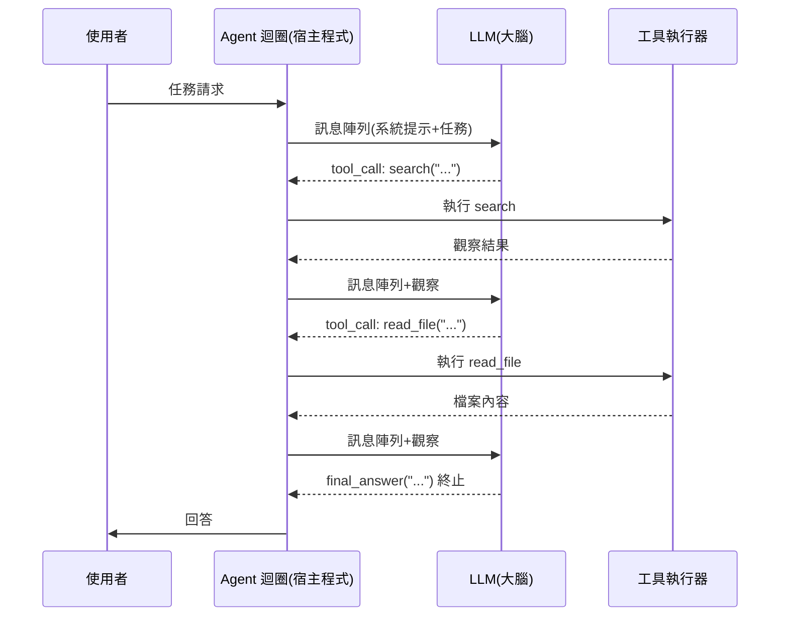
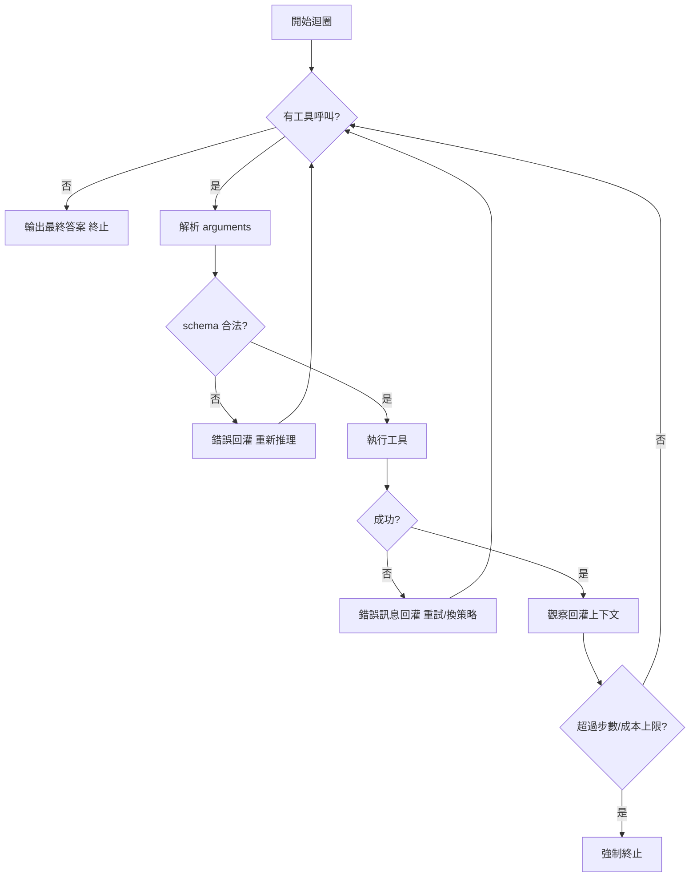

# 2.2 Agent 核心迴圈：感知-思考-行動與 function calling（2023）

## 一、歷史背景：從「一問一答」到「持續迴圈」

ChatGPT 席捲世界之後，開發者立刻撞上一堵牆：**對話式介面是一次性的**——模型給出文字，然後就停了。但真實任務需要多個步驟：搜尋 → 讀取結果 → 再搜尋 → 寫檔案 → 驗證。把任務拆給人類手動逐步餵給模型，等於人類自己成了 Agent 的執行器，既慢又荒謬。

2023 年 3 月 AutoGPT 的爆紅證明了「while 迴圈包住 LLM」的想像力，也暴露了它的脆弱：模型輸出自由文字，解析經常失敗；工具列表寫在提示詞裡，模型記不住參數格式。社群的共識是：**需要一個標準協議，讓模型輸出機器可讀的「行動呼叫」**。

2023 年 6 月，OpenAI 正式發布 **function calling**；同年 11 月 Anthropic 跟進。這個看似小小的 API 特性，實際上是 LLM Agent 從「玩具」走向「工程系統」的分水嶺：它把第 1 章的感知-思考-行動迴圈，變成了有穩定 ABI（應用程式介面）的軟體架構。

## 二、Agent 核心迴圈的架構解析

### 2.1 迴圈的五個部件

一個完整的 LLM Agent 迴圈包含：

1. **感知（Perception）**：使用者輸入、工具回傳值、環境狀態，全部以訊息形式注入上下文；
2. **思考（Reasoning）**：LLM 閱讀全部上下文，決定下一步——這是唯一「智慧」的部件；
3. **行動（Action）**：以結構化呼叫（function calling）執行工具；
4. **回饋（Observation）**：工具結果回灌上下文，成為新的感知；
5. **終止條件（Termination）**：模型宣告任務完成（`final_answer`），或觸發步數/成本上限。



### 2.2 與經典 Agent 理論的對接

這個迴圈就是第 1 章 SPA 的 LLM 版：

| SPA 經典 | LLM Agent |
|----------|-----------|
| Sense：感測器讀世界 | 訊息注入上下文（含工具回傳值） |
| Plan：符號規劃器搜尋 | LLM 在上下文中推理下一步 |
| Act：執行器動作 | function call 執行工具 |
| 世界模型 | 對話歷史即世界模型 |
| 規劃失敗重來 | 觀察錯誤訊息後自我修正 |

關鍵差異：**LLM Agent 的「世界模型」就是上下文本身**。傳統 Agent 需要顯式維護狀態（如 STRIPS 的 facts 集合），LLM Agent 把狀態「寫進對話歷史」由模型隱式記住。這帶來簡潔性，也帶來上下文爆炸問題——那是第 7 章記憶系統的主題。

### 2.3 Function Calling 的協議設計

OpenAI 2023 年 6 月的設計成為事實標準，其核心是把「工具」宣告成 JSON Schema：

```json
{
  "model": "gpt-4",
  "messages": [
    {"role": "user", "content": "台北明天天氣如何？"}
  ],
  "tools": [
    {
      "type": "function",
      "function": {
        "name": "get_weather",
        "description": "查詢指定城市的天氣。當使用者問天氣時必須呼叫此工具。",
        "parameters": {
          "type": "object",
          "properties": {
            "city": {
              "type": "string",
              "description": "城市名稱，如 '台北'"
            },
            "unit": {
              "type": "string",
              "enum": ["celsius", "fahrenheit"],
              "description": "溫度單位"
            }
          },
          "required": ["city"]
        }
      }
    }
  ]
}
```

模型回應：

```json
{
  "role": "assistant",
  "tool_calls": [
    {
      "id": "call_abc123",
      "type": "function",
      "function": {
        "name": "get_weather",
        "arguments": "{\"city\": \"台北\", \"unit\": \"celsius\"}"
      }
    }
  ]
}
```

宿主程式執行後，把結果以 `role: "tool"` 訊息回灌，模型繼續推理。注意三個設計巧思：

1. **`description` 欄位是給模型看的文檔**——工具的可用性取決於描述寫得好不好，這是「提示即程式」在工具層的延伸；
2. **參數用 JSON Schema 約束**——型別系統以 schema 的形式回歸，模型的輸出從「自由文字」變成「可驗證的結構」；
3. **`arguments` 仍是字串**——需要二次解析，解析失敗的容錯邏輯仍由宿主承擔（後來的 structured output 才強制語法合法）。

### 2.4 最小可用 Agent 迴圈（Python 完整實作）

```python
import json
from openai import OpenAI

client = OpenAI()

# ---- 工具註冊表：名稱 -> (schema, 實作) ----
def get_weather(city: str) -> str:
    return json.dumps({"city": city, "temp": 26, "condition": "陰, 濕度 78%"})

def search_web(query: str) -> str:
    return f"[搜尋結果] {query}：相關摘要內容……"

TOOLS_IMPL = {"get_weather": get_weather, "search_web": search_web}
TOOLS_SCHEMA = [
    {"type": "function", "function": {
        "name": "get_weather",
        "description": "查詢城市天氣。使用者問天氣時必須使用。",
        "parameters": {"type": "object",
                       "properties": {"city": {"type": "string"}},
                       "required": ["city"]}}},
    {"type": "function", "function": {
        "name": "search_web",
        "description": "網路搜尋，用於查詢即時或未知資訊。",
        "parameters": {"type": "object",
                       "properties": {"query": {"type": "string"}},
                       "required": ["query"]}}},
]

SYSTEM = "你是一個樂於使用工具的助理。事實性問題一律先查工具，不要憑記憶回答。"

def run_agent(user_msg: str, max_turns: int = 8) -> str:
    messages = [{"role": "system", "content": SYSTEM},
                {"role": "user", "content": user_msg}]
    for turn in range(max_turns):
        resp = client.chat.completions.create(
            model="gpt-4", messages=messages, tools=TOOLS_SCHEMA)
        msg = resp.choices[0].message
        if not msg.tool_calls:                     # 沒有工具呼叫 => 終止
            return msg.content
        messages.append(msg)                       # 思考結果入歷史
        for tc in msg.tool_calls:                  # 逐一執行行動
            name = tc.function.name
            args = json.loads(tc.function.arguments)
            try:
                result = TOOLS_IMPL[name](**args)  # Act
            except Exception as e:
                result = f"工具執行失敗: {e}"       # 失敗也要回饋，讓模型修正
            messages.append({"role": "tool", "tool_call_id": tc.id,
                             "content": str(result)})  # Observation
    return "⚠️ 達到最大回合數，任務未完成。"

print(run_agent("台北和東京今天哪個比較熱？"))
```

這 60 行就是 2023 年之後幾乎所有 Agent 框架（LangChain、AutoGen、Claude Code 的核心）的共同骨架。框架做的事情，本質上都是在這個骨架上做工程加強：更好的工具管理、歷史壓縮、平行工具呼叫、權限控制。

### 2.5 迴圈工程中的關鍵設計決策

1. **平行工具呼叫**：2023 下半年模型學會在一次回應中發出多個 tool_call，Agent 迴圈可並行執行——這是「迴圈內部的並行化」，大幅降低延遲。
2. **錯誤回饋原則**：工具失敗絕不能靜默吞掉或直接拋例外，必須把錯誤文字回灌給模型，讓它修正參數重試——這是 Agent 迴圈版的「自我修復」。
3. **步數與成本上限**：沒有終止保證的迴圈是事故來源（AutoGPT 的著名翻車原因之一就是無限循環），工程上必須雙保險。
4. **工具粒度**：工具太粗（`run_entire_task`）模型失去規劃空間；太細（`move_mouse_pixel`）迴圈步數爆炸。工具設計是一門「為模型設計 API」的新技藝——好的工具介面就像好的函式庫介面，層次分明、語義清晰。



## 三、function calling 引發的連鎖反應

### 3.1 生態：從 API 特性到 Agent 框架

Function calling 落地後的三個月內，Agent 生態爆發：

- **LangChain / LlamaIndex** 迅速支援 tools 抽象，成為最流行框架；
- **AutoGPT、BabyAGI** 從「自由文字解析」遷移到結構化呼叫，穩定性大增；
- **OpenAI Assistants API**（2023.11）把迴圈本身也封裝成雲服務——「Agent 即服務」的開端。

### 3.2 理論：工具使用成為訓練目標

Toolformer（Meta, 2023.2）證明模型可以**在預訓練資料中自動插入工具呼叫**學會用工具；Gorilla（2023.5）以 API 文檔微調提升呼叫準確率。這標誌著一個理論轉向：**工具使用從「提示詞技巧」變成「訓練目標」**——2024 年之後的前沿模型都是「原生」會用工具的，function calling 的可靠性從此不再依賴提示詞打磨。

### 3.3 問題：協議碎片化

但 2023 年的繁榮也埋下新問題：OpenAI、Anthropic、Google、開源框架各有各的 tools 格式，同一個工具要為每個平台重寫一遍適配器。工具生態的「M × N 問題」（M 個模型 × N 個工具）正是 2024 年 MCP 誕生的直接動因（第 4 章）。

## 四、本節重點

1. Agent 核心迴圈 = 感知（訊息注入）→ 思考（LLM 推理）→ 行動（結構化呼叫）→ 觀察（結果回灌）→ 終止；LLM 的「世界模型」就是對話歷史本身。
2. Function calling（2023.6）是 Agent 從玩具到工程系統的分水嶺：JSON Schema 讓模型輸出從自由文字變成可驗證結構，`description` 欄位則是「給模型看的文檔」。
3. 迴圈的工程鐵律：錯誤必須回饋給模型而非靜默處理；必須設步數/成本上限；工具粒度要「為模型設計」，如函式庫介面般分層清晰。
4. Toolformer 與 Gorilla 標誌著工具使用從提示詞技巧轉為訓練目標，2024 年後模型「原生」會用工具。
5. Function calling 解決了單一平台的迴圈問題，卻製造了跨平台 M×N 碎片化，直接催生 2024 年的 MCP 標準化浪潮。

## 五、思考問題

1. 「把錯誤訊息回灌給模型」與傳統程式的「快速失敗（fail fast）」原則似乎相反。為什麼在 Agent 迴圈中，前者反而是正確設計？
2. 工具粒度設計中，你認為判斷「一個工具該多大」的準則是什麼？請用「訂機票」這個場景設計 3-5 個工具並說明粒度取捨。
3. Function calling 的 `arguments` 是字串，需要二次 JSON 解析。Structured output（強制語法合法）徹底解決了這個問題嗎？語義錯誤（如日期格式不對）呢？
4. 若把第 1 章 PRS/BDI 模型映射到本節的迴圈：對話歷史對應 Belief，那 Desire 與 Intention 對應什麼？在迴圈的哪個部件中體現？
5. M×N 碎片化問題在 2023 年有多嚴重？上網查一下 2023 年 LangChain 的 tools 抽象與 OpenAI 的 tools 格式有何差異，體會標準化前工程師的痛點。
