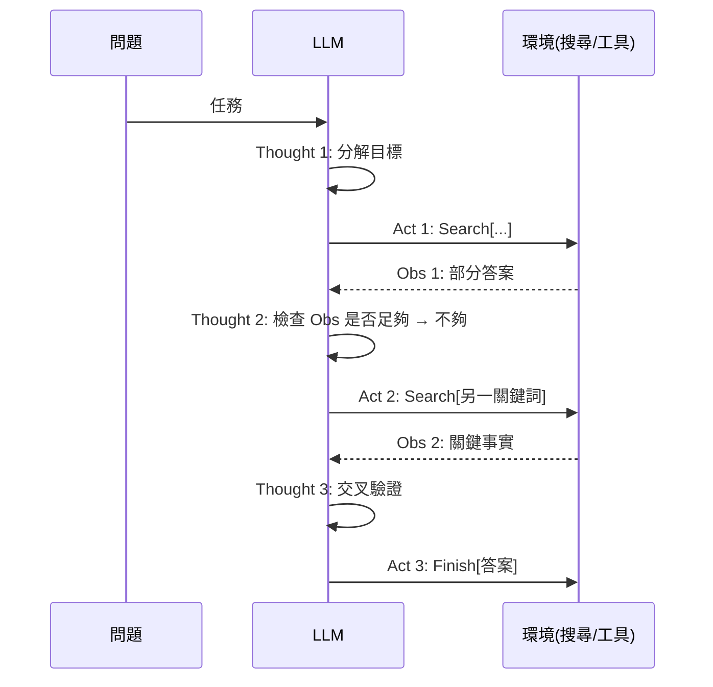

# 3.1 ReAct：推理與行動交錯（2022）

## 一、歷史背景：兩條路線的合流

2022 年中，LLM 界存在兩條看似競爭的路線：

1. **推理路線**：Chain-of-Thought 證明模型「內部獨白」能提升推理，但模型被關在上下文裡，只能用訓練時見過的知識，遇到時效性或私有資訊就幻覺連連；
2. **行動路線**：WebGPT、SayCan 讓模型操作外部環境，但模型執行動作時是「一步接一步硬做」，遇到複雜任務時容易盲目行動、無法回頭。

普林斯頓與 Google Brain 的研究者在 2022 年 10 月發表的《ReAct: Synergizing Reasoning and Acting in Language Models》指出：**這兩條路線不該競爭，而該交錯**。讓模型在每一步行動之間穿插顯式推理（「我剛搜尋的結果沒有提到日期，我應該再搜尋一下」），既保留 CoT 的規劃能力，又用行動從環境獲取真實資訊。這篇論文成為 LLM Agent 時代被引用最多的奠基之作——「Agent 迴圈」從工程實踐（AutoGPT）變成了有嚴格消融實驗的科學方法。

## 二、ReAct 架構解析

### 2.1 核心格式

ReAct 把模型輸出限制在一個簡單的交替格式：

```
Thought（思考）：我需要先找出這部電影的導演
Act（行動）：Search[星際效應 導演]
Obs（觀察）：星際效應（Interstellar）是克里斯多福·諾蘭執導……
Thought（思考）：好的，導演是諾蘭。現在要找他拍過的電影數量
Act（行動）：Search[克里斯多福·諾蘭 作品列表]
Obs（觀察）：諾蘭執導了 12 部長片……
Thought（思考）：我已有足夠資訊
Act（行動）：Finish[克里斯多福·諾蘭，12 部]
```

宿主程式解析 `Act` 行、執行動作、把觀察結果插入 `Obs` 行、再呼叫模型。**Thought 是給模型自己的「工作草稿」，Act 是對外的行動，Obs 是環境的回饋**——三者的交錯構成了一個外化的思考迴路。

### 2.2 為什麼交錯有效？三個機理

論文用消融實驗證明了三個關鍵機理，這是它超越工程經驗、成為科學貢獻的原因：

1. **Reasoning-only（只有 CoT、無行動）**：模型只能靠內部知識，幻覺率最高——它會「一本正經地編造」；
2. **Acting-only（只有行動、無 Thought）**：模型像無頭蒼蠅，重複搜尋、忘記目標——行動缺乏規劃；
3. **ReAct（交錯）**：Thought 讓模型在行動前「審視」已獲資訊、規劃下一步，並在觀察異常時及時改道（例如發現某百科頁面不存在，就換關鍵詞）——**推理提供可控性，行動提供事實性**。

```
模型表現（HotpotQA 式多跳問答，示意）：
標準 prompting     ████████░░░░░░  約 28%
CoT-only           █████████░░░░   約 29%（幻覺多）
Act-only           █████████░░░░   約 25%（盲動多）
ReAct              ████████████░░  約 35%（交錯最優）
ReAct + 自我一致性  █████████████░  更高
```

### 2.3 與人類認知的映射

ReAct 論文刻意引用了心理學中的「言語推理（verbal reasoning）」研究：人類在解決複雜問題時會自言自語（inner speech），言語化本身就能改善行為決策。ReAct 的 Thought 行就是模型的「自言自語」，而這個類比有實際工程意義：**讓模型把意圖寫出來，錯誤的計畫就會在執行前被觀察到（無論被自己還是被監督者）**——這是後世所有 Agent「可觀測性/可解釋性」設計的起點。



### 2.4 完整 ReAct 實作

```python
import re

REACT_SYSTEM = """你使用以下格式回答問題，每步只產生一個 Thought 或一個 Act：

Thought: <你的推理>
Act: <動作之一：Search[關鍵詞] / Lookup[詞語] / Finish[最終答案]>

可用工具：
- Search[關鍵詞]：網路搜尋
- Lookup[詞語]：在最近文件中查找詞語出現處

範例：
Question: 科羅拉多造山運動延伸到的山脈範圍的東端在哪？
Thought: 我需要先查「科羅拉多造山運動」覆蓋哪些山脈
Act: Search[科羅拉多造山運動]
Obs: 科羅拉多造山運動塑造了落磯山脈的一段……
Thought: 覆蓋的是落磯山脈，現在查落磯山脈的東端
Act: Search[落磯山脈 東端]
Obs: 落磯山脈東端是美國中西部大平原……
Thought: 答案是大平原
Act: Finish[美國中西部大平原]
"""

def react_loop(question: str, llm, tools, max_steps: int = 8) -> str:
    scratchpad = f"Question: {question}\n"
    for step in range(max_steps):
        out = llm(REACT_SYSTEM + scratchpad + "Thought:")
        out = "Thought:" + out
        m = re.search(r"Act:\s*(\w+)\[(.+?)\]", out, re.S)
        if not m:                      # 格式錯誤 → 提示重來
            scratchpad += out + "\n（格式錯誤，請輸出 Act）\n"
            continue
        action, arg = m.group(1), m.group(2)
        if action == "Finish":
            return arg
        try:
            obs = tools[action](arg)   # 執行行動
        except KeyError:
            obs = f"未知工具 {action}，可用：{list(tools)}"
        scratchpad += out + f"\nObs: {obs}\n"   # 觀察回灌
    return "步數耗盡"

def search(q: str) -> str:
    # 佔位：實際接搜尋引擎
    return f"[關於 {q} 的搜尋摘要]"

tools = {"Search": search, "Lookup": lambda k: f"[查找 {k} 的位置]"}
# answer = react_loop("..., llm=my_llm, tools=tools)
```

### 2.5 ReAct 與 function calling 的關係

有一個常見誤解要澄清：**ReAct 是「提示詞協議」，function calling 是「API 協議」**。2022 年 ReAct 只能用自由文字 + 正則解析；2023 年 function calling 出現後，ReAct 的思想被保留，但 Act 層改用結構化呼叫。今天你幾乎不會再手寫 `Act: Search[...]` 的解析器，但**每一次 Agent 迴圈中「模型邊想邊做」的模式，本質上都是 ReAct**。甚至可以說：function calling 之所以在 2023 年被發明，正是為了給 ReAct 提供更可靠的行動通道。

## 三、ReAct 的失敗模式與後續改進

ReAct 開啟了 Agent 時代，也暴露了新一代問題——每一個失敗模式都催生了一個後續研究方向：

| 失敗模式 | 表現 | 催生的後續技術 |
|----------|------|----------------|
| 幻覺行動 | 編造不存在的工具/參數 | Function calling schema、structured output |
| 走入死巷 | 反覆嘗試同一失敗路徑 | Reflexion（自我反思，第 3.2 節） |
| 單路徑局限 | 貪婪地一次走一條路，無法回溯 | Tree of Thoughts（第 3.2 節） |
| 上下文膨脹 | 長軌跡擠爆 context window | 記憶壓縮與摘要（第 7 章） |
| 無終止 | 迴圈不收斂 | 步數上限、成本預算（第 2 章工程鐵律） |

**因果鏈**：ReAct 證明了交錯有效 → 但貪婪單線執行在難題上不夠 → 研究者把「搜尋樹」引入思考過程（ToT）→ 又發現單次嘗試的失敗沒有被利用 → 引入跨嘗試記憶（Reflexion）→ 這些能力需要更好的工具生態 → MCP。Agent 技術的演化是一條環環相扣的鏈，每一環都因上一環的瓶頸而生。

## 四、本節重點

1. ReAct（2022.10）把推理（CoT）與行動（工具）交錯，用消融實驗證明：推理提供可控性，行動提供事實性，缺一不可。
2. Thought-Act-Observation 三元組是 Agent 的基本原子操作；Thought 的工程價值在於「外化意圖」，讓錯誤計畫在執行前可被觀察。
3. ReAct 是提示詞協議，function calling 是 API 協議；後者繼承了前者的思想並提供更可靠的行動通道。
4. ReAct 的四大失敗模式（幻覺行動、走入死巷、單路徑局限、上下文膨脹）分別催生了結構化輸出、Reflexion、ToT 與記憶壓縮——Agent 技術是一條環環相扣的問題驅動鏈。
5. 邁向 Agent 的關鍵躍遷不是模型更聰明，而是「讓模型與環境互動」的迴圈被科學化了。

## 五、思考問題

1. 消融實驗顯示 Act-only 的表現甚至低於 CoT-only。為什麼「有工具可用」反而可能比「純內部推理」更糟？
2. ReAct 的 Thought 是外化意圖的關鍵。在 2026 年的 Code Agent（如 Claude Code）中，對應的機制是什麼？它們如何讓使用者觀察到「模型正打算做什麼」？
3. 若環境回饋有延遲（如網頁載入 3 秒），ReAct 迴圈的哪個環節需要重新設計？「平行工具呼叫」能否部分緩解？
4. 論文用「言語推理改善人類行為」類比 Thought 的作用。你認為這個類比在哪些地方成立、哪些地方可能誤導？
5. 設計一個消融實驗：如何在你的 Agent 系統中測量「Thought 的存在」帶來的增益？需要注意哪些混淆變數（如 token 成本、步數差異）？
