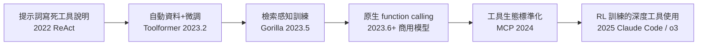
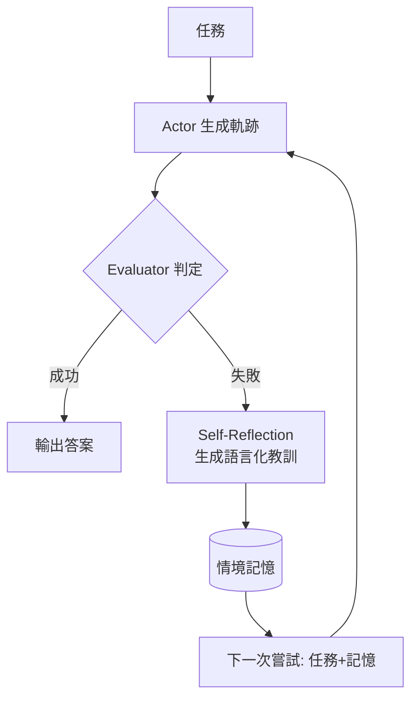
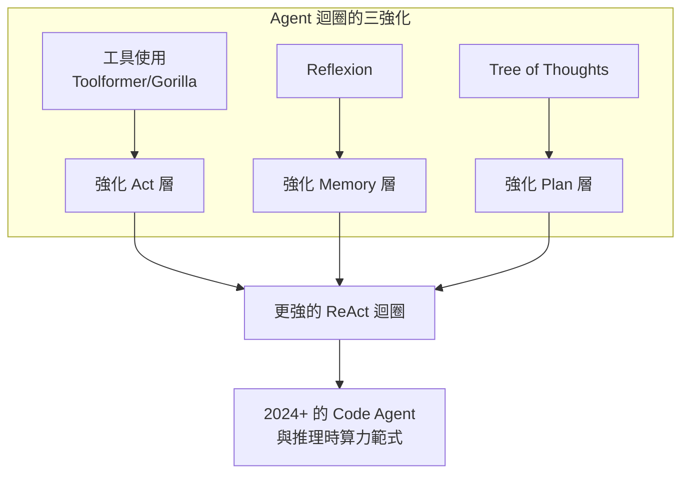

# 3.2 工具使用、Reflexion 與 Tree of Thoughts（2023）

## 一、歷史背景：ReAct 之後的三個瓶頸

ReAct 證明了交錯迴圈有效，但 2023 年初的實踐者面對三個明顯瓶頸：

1. **模型不會「選工具」**：工具多了之後，模型要從幾十個候選中挑對工具、給對參數，錯誤率驚人；
2. **失敗不累積經驗**：ReAct 的一次失敗軌跡就丟掉了，下次重蹈覆轍——沒有「從錯誤中學習」；
3. **貪婪解碼走單路**：模型一次只走一條推理路徑，遇到需要「試錯、回溯」的問題（如規劃、數學、程式設計）就卡死。

2023 年是這三個瓶頸被逐一攻破的一年：Toolformer / Gorilla 解決工具能力、Reflexion 解決經驗累積、Tree of Thoughts 解決搜尋與回溯。本節把這三者放在同一張圖中理解：它們分別強化了 Agent 迴圈的「行動」「記憶」「規劃」三個部件。

## 二、工具使用的躍遷：從提示到訓練

### 2.1 Toolformer：讓模型自己學會在哪裡呼叫 API（2023.2）

Toolformer（Meta AI）的巧思在於**自動生成訓練資料**：

1. 取大量普通文本，用 few-shot 提示 GPT-J「在合適的地方插入 API 呼叫」，生成候選；
2. 執行這些 API 呼叫，**只保留「插入呼叫後，後續 token 的損失明顯下降」的樣本**——即呼叫結果真的有幫助的樣本；
3. 用過濾後的語料微調模型。

結果：模型學會在寫作中主動插入日曆、計算器、搜尋等呼叫，且不需要任何人工標註。這確立了一個重要原則：**工具使用能力可以被自動化地訓練出來，且「有用與否」可以用損失變化自動判定**。

### 2.2 Gorilla：以 API 文檔為訓練料（2023.5）

Gorilla（UC Berkeley）專攻「給了 API 文檔就能正確呼叫」：以 APIBench（Torch Hub / TensorFlow Hub / HuggingFace）微調，並引入**檢索感知訓練（retriever-aware training）**——訓練時把 API 文檔放進上下文，模型學會「查文檔後再呼叫」。這直接預示了今天的實踐：Agent 使用陌生 API 時，正確做法是「先讀文檔再呼叫」，而這個行為本身可以被訓練。

### 2.3 工具學習的譜系



理論要點：這條演化鏈的主線是**工具使用的「定位」不斷下沉**——從提示詞層（靠上下文臨場學）到訓練層（權重裡自帶能力），再到生態層（標準協議）。每一層下沉都讓上一層的脆弱性消失。

## 三、Reflexion：把失敗變成記憶（2023.3）

### 3.1 核心思想

ReAct 的一個隱性浪費：整條失敗軌跡（包含寶貴的「哪裡錯了」資訊）被丟棄。Northeastern 與 MIT 的 Reflexion 論文提出：**不更新權重，而用語言形式的自我反思做強化學習**。

流程：

1. Actor（LLM）基於任務+記憶生成軌跡，完成嘗試；
2. Evaluator（評估器/測試）判定成敗；
3. Self-Reflection 模型閱讀整條軌跡，生成一句自然語言的「教訓」（例如：「上次失敗是因為我沒有先跑測試就提交了」）；
4. 教訓寫入**情境記憶（episodic memory）**；
5. 下一次嘗試時，記憶連同任務一起餵給 Actor。



### 3.2 與 RLHF 的對照：無梯度的強化學習

Reflexion 自我定位為「verbal reinforcement learning（言語強化學習）」。對照表：

| 機制 | RLHF / RL | Reflexion |
|------|-----------|-----------|
| 更新對象 | 權重 | 上下文中的記憶 |
| 訊號形式 | 標量獎勵 | 自然語言教訓 |
| 學習成本 | 需訓練基礎設施 | 每次多幾次 LLM 呼叫 |
| 記憶範圍 | 永久（權重內） | 會話內（上下文中） |
| 可解釋性 | 差 | 好（教訓是人話） |

在 HumanEval（Python 程式合成）上，Reflexion 達到 91%，超過當時 GPT-4 單次嘗試的 80%——**證明「多嘗試 + 記住教訓」可以替代「更強的模型」**。這是 2024-2026 年 Code Agent「自我修正迴圈」（跑測試→讀錯誤→修改→再跑）的直接理論祖先。

### 3.3 最小 Reflexion 實作

```python
def reflexion_solve(task: str, eval_fn, llm, max_attempts: int = 5) -> str:
    memory = []
    for attempt in range(max_attempts):
        prompt = f"任務：{task}\n"
        if memory:
            prompt += "你過去的失敗教訓：\n" + "\n".join(f"- {m}" for m in memory) + "\n"
        prompt += "請直接給出解答（Python 程式）："
        solution = llm(prompt)
        ok, feedback = eval_fn(solution)          # 執行測試，取得成敗與錯誤訊息
        if ok:
            return solution
        lesson = llm(
            f"任務：{task}\n上次解答：\n{solution}\n"
            f"測試失敗訊息：{feedback}\n"
            "用一句話總結失敗原因與下次應該改變的做法（不要寫程式）：")
        memory.append(lesson)                     # 教訓入記憶
    raise RuntimeError("多次嘗試後仍失敗")
```

## 四、Tree of Thoughts：把「思考」變成搜尋（2023.5）

### 4.1 從鏈到樹

CoT 與 ReAct 都是「鏈」：線性、貪婪、不可回溯。Yao et al.（與 Reflexion 同一作者群）與 Google 深度的兩篇論文（同名，2023.5）提出 **Tree of Thoughts（ToT）**：把中間推理步驟視為樹上的節點，允許——

1. **分支**：一個狀態生成多個候選下一步（思維束搜尋）；
2. **評估**：用 LLM 自己為每個候選狀態打分（「這個思路有希望嗎？」）；
3. **搜尋**：用 BFS/DFS 在思考空間中探索，必要時回溯。

```
        [問題]
        /    \
   [思路A]  [思路B]     ← 一次生成多個候選
    /   \      \
 [A1好] [A1差] [B1好]   ← LLM 自評打分
   |            |
 [A2]→回溯 [B2]          ← DFS：A 路線評分低就放棄
```

### 4.2 為什麼 ToT 有效：搜尋的視角

ToT 的本質是把 LLM 從「一次性函數」變成「可搜尋的生成器」。用形式化語言說：

- CoT： $y = f(x)$ ，單次前向；
- Self-Consistency： $y = \text{vote}\{f_i(x)\}$ ，平行取樣後投票，但**各分支互不通氣、也不能在中途利用彼此資訊**；
- ToT： $y = \text{Search}(f, \text{eval}, x)$ ——思考過程本身成為一個搜尋問題，評估函數由 LLM 擔任。

這正是 2024 年「推理時算力（inference-time compute）」範式（o1/o3 系列、DeepSeek-R1 的長鏈思考）的思想前身：**答案品質不僅取決於模型大小，還取決於思考時花費的算力**。ToT 在 Game of 24（24 點）上把 GPT-4 的解題率從 4% 拉到 74%——單純靠「試很多路、及早放棄壞路」。

### 4.3 ToT 式規劃的骨架

```python
def tot_search(state, depth, llm, evaluate, max_branch=3):
    if depth == 0 or evaluate(state) == "確定可行":
        return state
    candidates = llm(f"狀態：{state}\n請提出 {max_branch} 個不同的下一步思路：")
    scored = []
    for c in candidates:
        score = llm(f"狀態：{state}\n候選：{c}\n這條路有希望嗎？給 1-10 分，只輸出數字：")
        scored.append((int(score), c))
    scored.sort(reverse=True)              # 評估後排序（束搜尋）
    for _, c in scored[:2]:                # 只深入最有希望的 2 條
        result = tot_search(state + "\n" + c, depth - 1, llm, evaluate)
        if result:
            return result
        # 深入失敗 → 自動回溯到下一個候選（DFS）
    return None
```

### 4.4 三者的統一視角

把 2023 年的三項技術放回 Agent 迴圈的部件圖，可以看到清晰的分工：



## 五、本節重點

1. 2023 年三大瓶頸（不會選工具、失敗不累積、貪婪單路）分別被 Toolformer/Gorilla、Reflexion、Tree of Thoughts 攻破，分別強化 Agent 的行動、記憶、規劃三層。
2. Toolformer 用「損失變化自動判定工具呼叫有無幫助」自動生成訓練資料；Gorilla 的檢索感知訓練確立「先讀文檔再呼叫」的行為可被學習——工具能力從提示詞層下沉到訓練層。
3. Reflexion 是「言語強化學習」：不更新權重，用自然語言教訓寫入情境記憶，讓下一次嘗試更聰明；它是 Code Agent 自我修正迴圈的理論祖先。
4. ToT 把思考變成樹搜尋：分支、LLM 自評、DFS 回溯；它是 2024 年「推理時算力」範式（o1、R1 長思考）的思想前身。
5. 三項技術共同指向一個範式：**能力不只來自更大的模型，也來自更聪明的迴圈設計**——為第 5 章的 Code Agent 和第 7 章的規劃系統鋪路。

## 六、思考問題

1. Toolformer 用「插入 API 呼叫後損失下降」判定有用性。這個判準在什麼情況下會誤殺「短期看似無用、長期必要」的工具呼叫（例如先查天氣再決定行程）？
2. Reflexion 的教訓存在會話記憶中，會話結束即消失。若要把教訓跨會話累積，需要哪些機制（提示：考慮第 7 章長期記憶與教訓去重、過期、衝突）？
3. ToT 的評估函數由 LLM 自任，這引入了「評估者的偏差」。請舉一個可能發生的系統性偏差，並提出緩解方法。
4. Self-Consistency 與 ToT 都用多次取樣，但前者不能中途互通資訊。請設計一個任務，證明「中途互通」是必要的。
5. 「能力來自迴圈而非僅來自模型」——這對 2026 年「買更好的模型 vs 投入更好的 Agent 工程」的企業決策有何啟示？請給出一個判斷框架。
