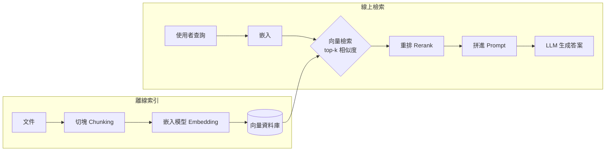
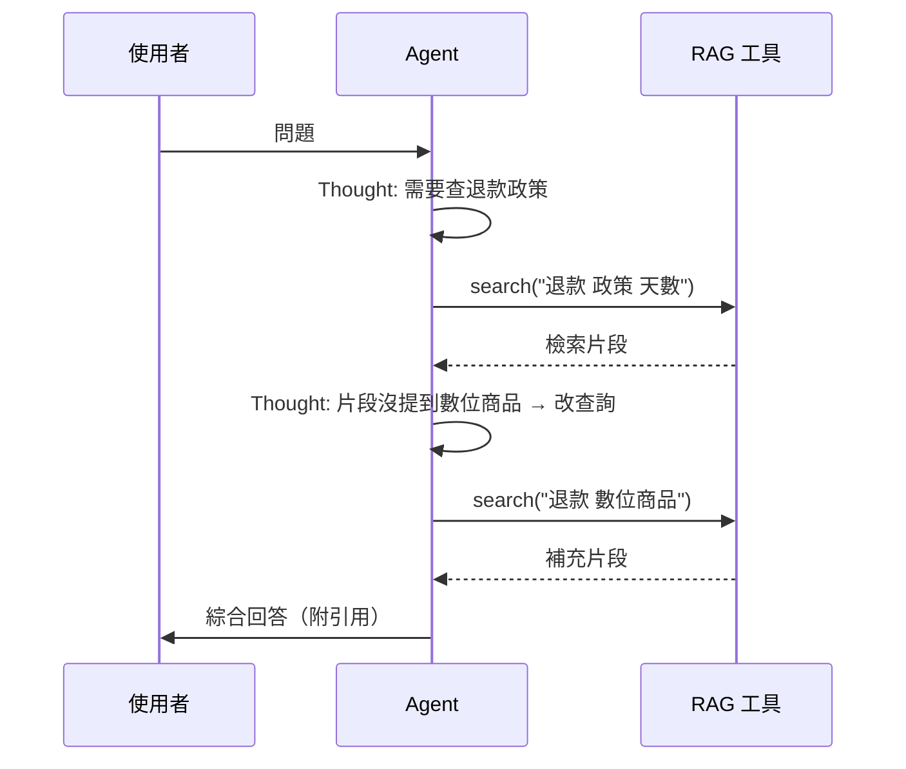

# 4.1 RAG、向量資料庫與知識接入（2020-2023）

## 一、歷史背景：兩個「知識牆」

LLM 時代初期，工程師撞上了兩堵牆：

1. **知識截止牆（knowledge cutoff）**：模型只認識訓練資料日期之前的世界，問「今天的新聞」「我們公司內部文件」，它要麼不知道、要麼幻覺；
2. **上下文牆（context wall）**：即使想「把資料塞進提示詞」，context window 也只有幾千 token，塞不下整個文件庫；
3. **（隱藏的第三堵牆）私有性牆**：把企業資料拿去微調，成本高、週期長、資料治理困難，且每更新一次知識就要重訓。

解法不是「更大模型」，而是 2020 年 Facebook AI（Lewis et al.）提出的 **RAG（Retrieval-Augmented Generation，檢索增強生成）**：把「知識」從「參數」中分離出來——生成時先從外部知識庫**檢索**相關段落，再把段落放進上下文讓模型閱讀後作答。到 2023 年，RAG 成為企業 LLM 應用最廣泛的架構，也是 Agent「感知外部知識」的基礎設施。

## 二、RAG 架構解析

### 2.1 兩階段管線



**離線**：文件 → 切塊（chunk）→ 嵌入成向量 → 存入向量資料庫。
**線上**：查詢 → 嵌入 → 近鄰搜尋取 top-k → （可選重排）→ 拼進提示詞 → LLM 作答。

### 2.2 嵌入與相似度：數學核心

嵌入模型把文字映射到高維空間，語義相近的文本距離近。相似度常用餘弦相似度：

$$
\text{sim}(u, v) = \frac{u \cdot v}{\|u\| \, \|v\|} \in [-1, 1]
$$

向量檢索就是在 $N$ 個向量中找餘弦相似度最高的 $k$ 個。 $N$ 到億級時暴力比對（ $O(N \cdot d)$ ）不可行，於是有了 **ANN（近似最近鄰）索引**：

- **HNSW（分層可導航小世界圖）**：多層跳表式圖結構，查詢 $O(\log N)$ ，2023 年後成為主流（FAISS、Milvus、pgvector 皆用）；
- **IVF（倒排檔案）**：聚類後只搜尋最近的幾個簇；
- **PQ（乘積量化）**：壓縮向量，降低記憶體。

### 2.3 切塊：被低估的關鍵環節

Chunking 的粒度直接決定檢索品質：

| 策略 | 說明 | 風險 |
|------|------|------|
| 固定長度 | 每 500 token 一塊 | 可能把句子攔腰切斷 |
| 遞迴分隔 | 依段落→句子→字元層層切 | 需調參 |
| 語義切塊 | 相鄰句嵌入相似度驟降處切開 | 成本較高 |
| 結構感知 | 按 Markdown 標題、程式碼函式邊界切 | 需要解析器（Code Agent 必用） |

工程要點：**塊要自足**（一塊離開上下文也能被理解）、**帶元資料**（檔名、標題層級、時間）以便過濾。對程式碼而言，「按函式邊界切」遠優於固定長度——這是第 5 章 Code Agent 檢索程式碼庫的基本功。

### 2.4 從「檢索」到「重排」：兩階段漏斗

工業級 RAG 幾乎都是兩階段：先快速召回（top-50），再用交叉編碼器重排（top-5）。原因是雙塔（bi-encoder）嵌入查詢快但精度有限，交叉編碼器（cross-encoder，把 query 與候選拼一起過模型）精度高但慢。漏斗結構兼顧兩者——這與資訊檢索領域數十年來的「召回-排序」傳統一脈相承。

### 2.5 最小 RAG 實作

```python
import numpy as np

# ---- 離線索引 ----
DOCS = [
    "refund policy: refunds accepted within 30 days",
    "vacation: 15 days per year plus carryover",
    "api: rate limit is 60 requests per minute",
]

def embed(text: str) -> np.ndarray:
    # 佔位：實際用 embedding API；此處 hash 向量僅示意
    v = np.zeros(64)
    for tok in text.lower().split():
        v[hash(tok) % 64] += 1
    n = np.linalg.norm(v)
    return v / n if n else v

INDEX = [(doc, embed(doc)) for doc in DOCS]

def retrieve(query: str, k: int = 2) -> list:
    qv = embed(query)
    sims = [(doc, float(qv @ dv)) for doc, dv in INDEX]  # 餘弦相似度
    sims.sort(key=lambda x: -x[1])
    return [d for d, s in sims[:k] if s > 0.15]          # 閾值過濾

def rag_answer(question: str, llm) -> str:
    ctx = "\n".join(retrieve(question))
    if not ctx:
        return "知識庫中無相關資料，請勿臆測。"
    return llm(f"僅依以下資料回答，若不足請說不知道。\n資料：\n{ctx}\n\n問題：{question}")
```

真實系統會把 `embed` 換成 API（如 OpenAI text-embedding、BGE、GTE），把列表換成 FAISS/pgvector/Milvus，並加重排器。

### 2.6 評估 RAG：RAGAS 三指標

RAG 的失敗是「鏈式」的，必須分段測量（RAGAS 框架，2023）：

1. **Context Precision（檢索精確率）**：檢回的段落裡有多少真的相關；
2. **Context Recall（檢索召回率）**：答案所需的事實有多少被檢回；
3. **Faithfulness（忠實度）**：回答是否忠於檢索到的資料（反幻覺）；
4. **Answer Relevancy**：回答是否切題。

分段測量的價值：若 Faithfulness 低但 Context Precision 高，問題在生成端（提示詞/模型）；若 Recall 低，問題在索引/切塊端。**不歸因的 RAG 調優是瞎調。**

## 三、RAG 與 Agent 的匯流：Agentic RAG

2023 下半年起，RAG 從「固定管線」演化為「Agent 的一個工具」：

- **單輪 RAG**：檢索一次，生成一次；
- **迭代式 RAG（Self-RAG、FLARE）**：模型判斷「檢到的夠不夠」，不夠就改寫查詢再檢——把 ReAct 思想注入 RAG；
- **Agentic RAG**：Agent 決定何時檢索、檢哪個庫（程式碼庫、文件庫、資料庫）、檢幾次，檢索只是眾多工具之一。



這條演化線的深層意義：**RAG 解決「知識從哪來」，Agent 解決「知識何時需要、怎麼用」**。兩者匯流後，LLM 終於有了「按需取用世界知識」的能力——為第 5 章 Code Agent「在百萬行程式碼中找到該改哪一行」提供了基礎設施。

## 四、本節重點

1. RAG 誕生於三堵牆（知識截止、上下文、私有性）的夾擊；核心思想是把知識從參數中分離，生成時按需檢索。
2. 向量檢索的數學核心是餘弦相似度 + ANN 索引（HNSW/IVF/PQ）；切塊品質與元資料設計往往比模型選擇更影響最終效果。
3. 工業級 RAG 是「召回-重排」兩階段漏斗；評估必須分段（RAGAS：檢索精確率/召回率、忠實度、切題度），不歸因的調優是瞎調。
4. RAG 與 ReAct 匯流成 Agentic RAG：檢索從固定管線變成 Agent 按需呼叫的工具，實現「知識何時需要、怎麼用」的自主決策。
5. RAG 是「參數化知識」與「非參數化知識」的分界線；這條分界線是 MCP（第 4.2 節）能標準化知識接入的理論前提。

## 五、思考問題

1. 微調 vs RAG：若企業的知識每週更新一次、資料涉密，你選哪個？若知識是「公司特有的術語風格」而非「事實」，答案會變嗎？
2. 「迷失在中間」對 RAG 的啟示：檢回 10 塊與檢回 3 塊再生成，哪個更好？請設計實驗驗證。
3. 對程式碼庫做 RAG，按「函式邊界」切塊比固定 500 token 好在哪？什麼情況下函式內的上下文不夠（提示：呼叫鏈、跨檔案引用）？
4. 若嵌入模型對中文長文檔的表現不佳，你能提出哪三個層面的補救（模型、切塊、查詢改寫）？
5. Agentic RAG 讓模型自主決定「要不要檢索」，但也帶來「該檢不檢」的失敗模式。如何評估與改進這個決策？（提示：第 8 章評估方法）
