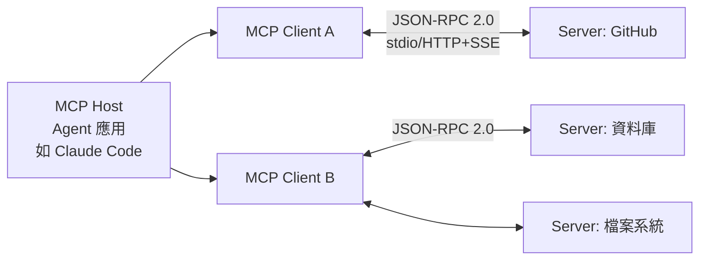
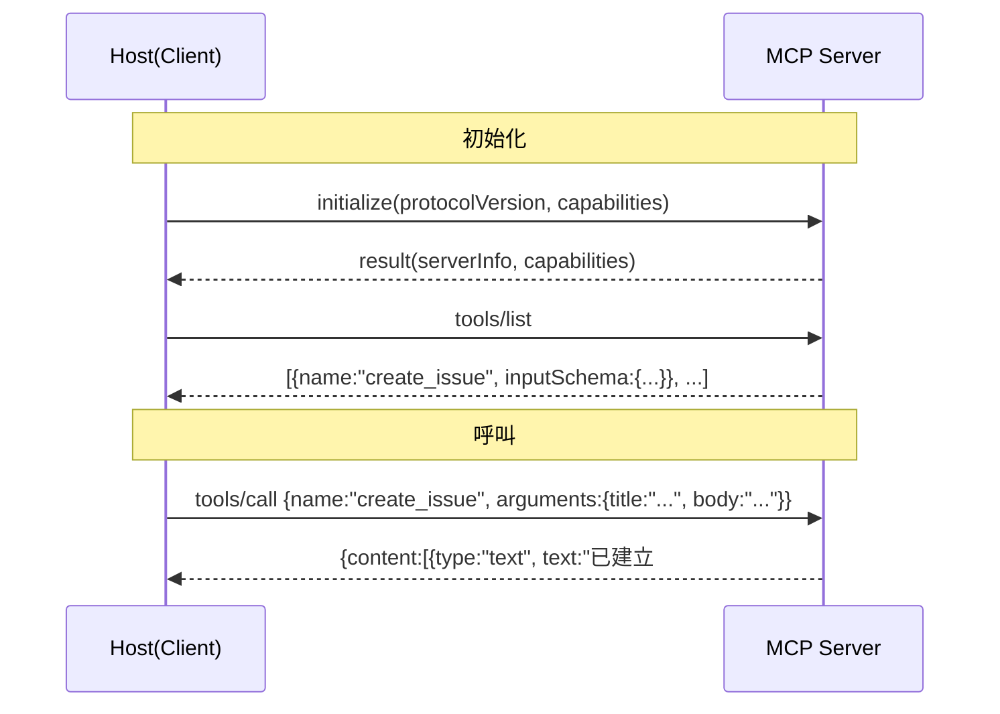
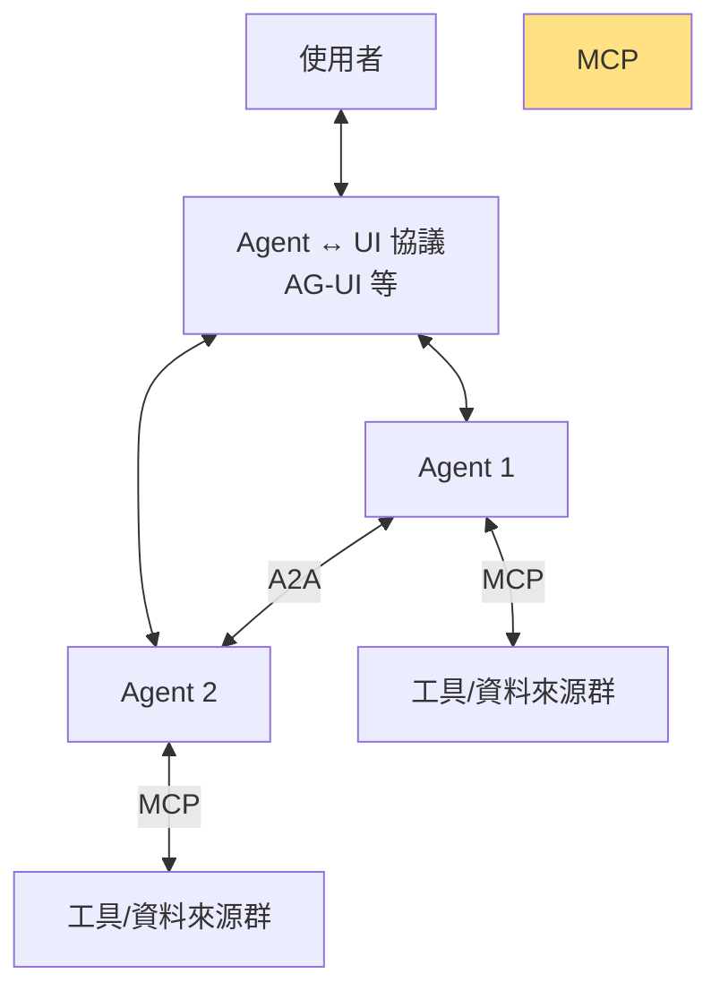

# 4.2 Model Context Protocol：Agent 的 USB-C（2024-2026）

## 一、歷史背景：M×N 碎片化危機

2024 年中的 Agent 生態表面繁榮，底層卻是一團亂麻。工程師要為同一個資料來源（如 GitHub）寫 N 套整合：給 Claude 用一套格式、給 GPT 一套、給 LangChain 一套、給自研框架一套；反過來，一個 Agent 應用要接入 M 個資料來源（檔案、Slack、資料庫、瀏覽器），就要寫 M 套客製程式碼。這是經典的 **M×N 整合爆炸**問題——與 2000 年代初「每個設備都要專屬線纜」的亂象如出一轍。

2024 年 11 月 25 日，Anthropic 開源 **Model Context Protocol（MCP）**，自比為「AI 應用的 USB-C」：定義一個開放協議，任何模型/Agent（M 端）與任何工具/資料來源（N 端）之間只需各實作一次，即可互聯——M×N 變成 M+N。OpenAI（2025.3）與 Google DeepMind（2025.4）先後宣布支援，MCP 在一年內成為事實上的業界標準。

## 二、協議架構解析

### 2.1 三個角色



- **Host**：Agent 應用本體（Claude Code、IDE、自研 Agent）；
- **Client**：Host 內部為每個 Server 維護一個連接；
- **Server**：輕量程式，透過協議暴露三類能力，1 個 Server 可服務所有支援 MCP 的 Host。

### 2.2 三類能力原語（Primitives）

| 原語 | 由誰控制 | 用途 | 例子 |
|------|----------|------|------|
| **Tools**（工具） | 模型決定（model-controlled） | 執行動作、產生副作用 | `create_issue`、`run_query` |
| **Resources**（資源） | 應用決定（app-controlled） | 唯讀上下文資料 | `file://…`、`postgres://…` |
| **Prompts**（提示模板） | 使用者決定（user-controlled） | 預封裝的複雜工作流 | 「審查這個 PR」的模板 |

這個三分法的理論深意在於**控制權的明確分層**：Tools 由模型自主呼叫（Agent 的行動能力）；Resources 由應用程式決定注入什麼上下文（資料接入）；Prompts 由使用者觸發（人的意圖入口）。安全模型（第 9 章）也建立在此分層上——不同原語有不同的信任與授權要求。

### 2.3 協議細節：JSON-RPC 與傳輸層

MCP 建立在 JSON-RPC 2.0 之上，支援 stdio（本機子程序）與 Streamable HTTP（遠端）兩種傳輸。一次工具呼叫的時序：



工具的 `inputSchema` 就是 JSON Schema——與 2023 年 function calling 一脈相承，但被**協議層標準化**了：模型無關、框架無關、語言無關。

### 2.4 一個最小 MCP Server（Python SDK）

```python
from mcp.server.fastmcp import FastMCP

mcp = FastMCP("demo-server")

@mcp.tool()
def create_issue(title: str, body: str = "") -> str:
    """在問題追蹤系統建立 issue。title 為標題，body 為描述。"""
    # 實際呼叫 GitHub API 等
    return f"已建立 issue: {title}"

@mcp.tool()
def search_code(query: str, repo: str) -> str:
    """在指定 repo 中搜尋程式碼片段。"""
    return f"[{repo}] 關於 '{query}' 的搜尋結果…"

if __name__ == "__main__":
    mcp.run()          # 預設 stdio 傳輸
```

十幾行就完成一個可被所有 MCP Host 使用（任何支援 MCP 的 Agent 都能呼叫）的工具伺服器——這正是 M+N 取代 M×N 的威力。

### 2.5 Host 端設定（設定檔即接線）

```json
{
  "mcpServers": {
    "github": {
      "command": "npx",
      "args": ["-y", "@modelcontextprotocol/server-github"],
      "env": { "GITHUB_TOKEN": "ghp_xxx" }
    },
    "postgres": {
      "command": "npx",
      "args": ["-y", "@modelcontextprotocol/server-postgres"],
      "env": { "DATABASE_URL": "postgres://..." }
    }
  }
}
```

Host 啟動時拉起各 Server 子程序、列舉工具、合併進 Agent 可用工具表——**接線工作從寫程式變成改設定檔**。

## 三、MCP 如何改變了 Agent 生態

### 3.1 產業鏈的重新分工

| MCP 之前 | MCP 之後 |
|----------|----------|
| SaaS 廠為每個 Agent 平台寫外掛 | SaaS 廠發布一個 MCP Server 即觸達全部平台 |
| Agent 框架各自定義工具格式 | 框架間透過協議互操作 |
| 整合費用工時與 M×N 成正比 | 成本與 M+N 成正比 |
| 工具品質參差、無發現機制 | Server 註冊中心（registry）與市場興起 |

### 3.2 對 Code Agent 的直接影響（連結第 5 章）

Claude Code、OpenCode 等 Code Agent 是 MCP 最大的受惠者：

- **資料庫 Server**：Agent 直接查 schema、跑唯讀查詢，理解資料模型後再改程式；
- **瀏覽器 Server（如 Playwright MCP）**：改完前端後自動開頁驗證；
- **監控 Server（如 Sentry MCP）**：讀線上錯誤堆疊，直接定位並修復；
- **設計工具 Server（如 Figma MCP）**：讀設計稿生成/校對 UI 程式碼。

「寫程式」因此從閉環的文本任務，變成可以觸達整個軟體工程上下文（需求、資料、測試、監控、設計）的開環任務。MCP 是 Code Agent 從「自動補全」躍升為「工程隊友」的基礎設施。

### 3.3 MCP 之後的協議競爭（2025-2026）

MCP 的成功也啟動了 Agent 協議層的完整拼圖競賽：

- **MCP** 解決「Agent ↔ 工具」（垂直整合）；
- **A2A（Agent2Agent，Google 2025.4 提出，後捐贈 Linux 基金會）** 解決「Agent ↔ Agent」（水平協作）——跨廠商 Agent 之間的任務委派與狀態交換；
- **AG-UI、ACP** 等處理「Agent ↔ 使用者介面」。



理論上，這一層「Agent 網路的 TCP/IP」正在成形——正如 1970-80 年代的網路協議標準化催生了網際網路，Agent 協議的標準化正在催生「Agent 網際網路」的底座。

## 四、本節重點

1. MCP（2024.11）解決 M×N 整合爆炸：開放協議使 M 個 Agent 與 N 個工具只需 M+N 次實作；OpenAI、Google 相繼跟進使其成為事實標準。
2. 架構上 Host-Client-Server 三角色、JSON-RPC 2.0 訊息、stdio/HTTP 傳輸；工具 schema 沿用 JSON Schema，是 function calling 的協議級繼承。
3. 三原語（Tools/Resources/Prompts）的本質是控制權分層：模型控制的行動、應用控制的上下文、使用者控制的模板——安全模型也建立在此分層上。
4. MCP 使 Code Agent 觸達完整工程上下文（資料庫、瀏覽器、監控、設計稿），從「自動補全」升級為「工程隊友」。
5. MCP（垂直）與 A2A（水平）共同構成「Agent 網路協議棧」，正如 TCP/IP 之於網際網路——協議標準化是生態起飛的前提。

## 五、思考問題

1. 「USB-C 類比」在哪裡成立、在哪裡失真？提示：USB 有硬體認證與供電協商，MCP 的「信任」問題由誰負責？
2. Tools 由模型自主呼叫、Resources 由應用控制——若一個 Resource 的內容包含惡意指令（提示注入），控制權分層如何被繞過？（連結第 9 章）
3. 若你為一家公司設計 MCP Server 串接內部 ERP，工具粒度該如何設計？哪些操作必須要求「人類確認」？
4. MCP 與 A2A 分別對應網路協議棧的哪一層？「Agent 之間互相委派任務」會引入哪些 MCP 不需要面對的新問題（身分、計費、責任）？
5. 2023 年 function calling 已能讓單一 Agent 用工具，為什麼「標準化」還是必然發生的？請用網路效應與生態經濟學論證。
