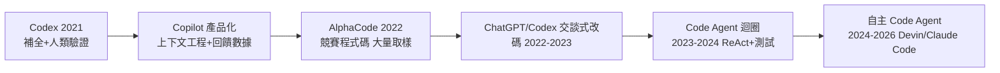
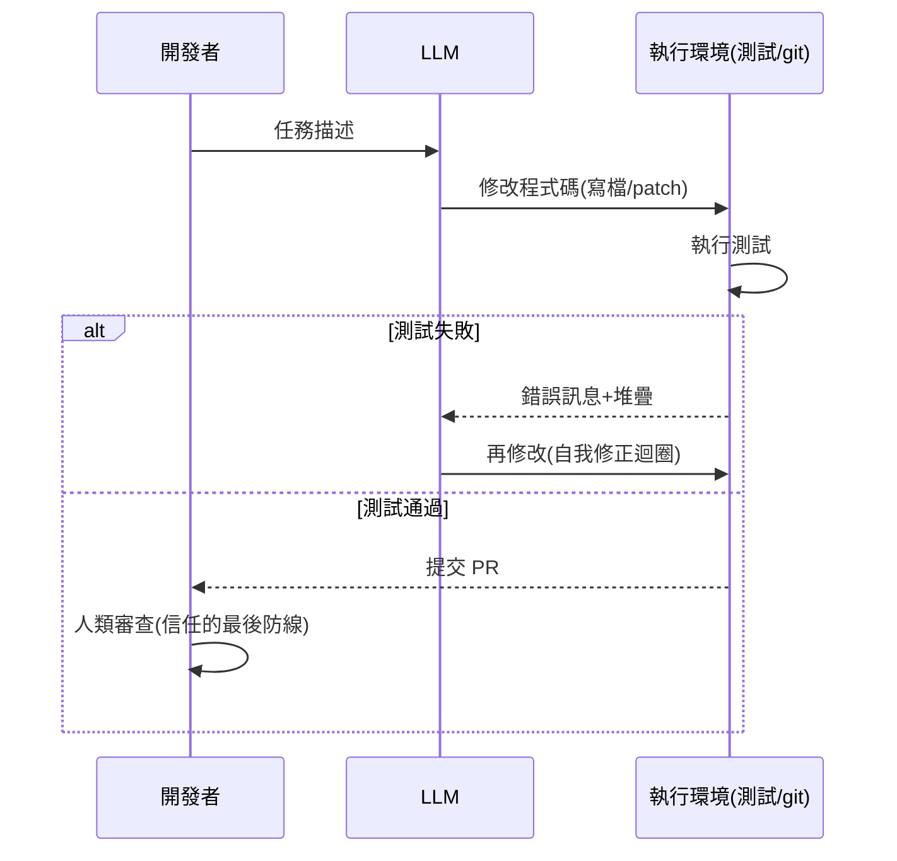

# 5.1 從 Copilot 到程式生成：程式碼即通用工具（2021-2022）

## 一、歷史背景：為什麼是「程式碼」先行？

2021 年 6 月，GitHub 發布 **Copilot**——第一個大規模商用 LLM 開發者工具，基於 OpenAI Codex（GPT-3 在 54TB 公開程式碼上的微調版）。這件事的意義遠超「自動補全」：它證明了一個深刻的命題——

> **程式碼是 LLM 最可驗證、最結構化、回饋最即時的輸出形式，因此成為 Agent 化的最佳突破口。**

回顧 2021 年之前 LLM 的應用場景（寫文章、客服、摘要），共同缺陷是**難以客觀驗證好壞**。而程式碼天然具備三個特性：

1. **可執行**：程式對不對，編譯器與測試會告訴你——客觀回饋訊號免費可得；
2. **結構化**：語法嚴格，錯了立刻暴露，不似散文好壞見仁見智；
3. **迭代性**：跑→錯→改→再跑的迴圈天然存在，正是 Reflexion 式自我修正（第 3 章）的理想舞台。

因此，程式碼不只是 LLM 的一個應用領域，而是通往 Agent 的**訓練場與試金石**：在程式碼上驗證的技術（測試回饋、自我修復、檢索程式庫），後來全部泛化為通用 Agent 能力。理解這一點，才能理解為何 2024 年後最成熟的 Agent 都是 Code Agent。

## 二、Copilot 與 Codex：補全範式的巔峰

### 2.1 Codex 的訓練思路

Codex（2021.8 論文）的關鍵發現：

- **程式碼語料同時提升「寫程式」與「自然語言推理」**——程式碼裡蘊含精確的邏輯結構，學程式碼等於學邏輯；
- 在 HumanEval（164 題手寫 Python 函式）上，12B 的 Codex 通過率 28.8%（pass@1），遠超同級 GPT-3；
- **pass@k 指標**成為程式生成領域標準評估：

$$
\text{pass@}k = \mathbb{E}_{\text{問題}}\left[1 - \binom{n-c}{k}\Big/\binom{n}{k}\right]
$$

（生成 $n$ 個樣本、$c$ 個通過時，隨機取 $k$ 個至少一個通過的機率。）pass@k 的存在暗示了後來的一切：**取樣多次 + 挑選，就能大幅提升通過率**——單次生成不完美沒關係，只要「驗證-挑選」機制在。

### 2.2 Copilot 的產品形態：人在環中的「行內 Agent」

Copilot 最初形態是 IDE 內的 ghost-text 補全：模型讀當前檔案與游標上下文，逐 token 生成建議，開發者按 Tab 接受。嚴格說它不是 Agent（無自主行動、無多步迴圈），但它在三個方向上為 Agent 鋪了路：

1. **上下文工程**：如何在有限窗口內挑選最相關的程式碼片段（鄰近檔案、import 圖、當前函式）——這是後世 Code Agent 檢索策略的雛形；
2. **接受率作為回饋訊號**：開發者接受/拒絕建議成為數據飛輪，暗示了「人類偏好可用於改進模型」（後來的 RLHF 在產品側的鏡像）；
3. **信任校準**：開發者學會「審視 AI 的代碼」——人機協作的心智模型被建立起來。

## 三、AlphaCode：大量取樣 + 過濾的先聲（2022.2）

DeepMind 的 AlphaCode 針對 Codeforces 競賽題，展現了另一條路：**對每題生成多達百萬個候選程式**，然後：

1. 用題目樣例輸入輸出過濾（執行候選，留下樣例全對者）；
2. 對剩餘候選按「行為聚類」（同一組樣例輸出視為等價），每簇只提交一個，控制在提交次數限制內。

達到前 54% 的參賽者水準。它的方法論價值：**驗證訊號（樣例）+ 取樣 + 聚類去重**，是「推理時算力換能力」的最早大規模演示，直接預演了 2024 年 o1 式的思考 scaling 以及 Code Agent 的「多方案並行探索」。

## 四、程式碼作為通用工具：三個深層論證

### 4.1 論證一：程式碼是「行動的形式語言」

LLM 的輸出要對世界產生作用，需要形式化通道。function calling 是一種，但**程式碼本身是表達力最強的行動語言**：一段 Python 可以呼叫任意 API、組合任意邏輯、處理任意資料。2023-2024 年的諸多系統（如 CodeAct、各種「code interpreter」）證明：與其預定義幾十個工具，不如讓 Agent 直接寫程式呼叫工具——**寫程式就是使用工具的母語**。這是「Code Agent」超越「工具 Agent」的理論根據：程式碼空間是所有工具組合的超集。

### 4.2 論證二：測試是免費的獎勵函數

強化學習最缺的是密集獎勵訊號。程式碼領域天然供給三層訊號：

| 層次 | 訊號 | 成本 |
|------|------|------|
| 語法 | 編譯/解析錯誤 | 零 |
| 語義 | 執行錯誤、樣例輸出 | 零 |
| 行為 | 單元測試、整合測試 | 已存在於所有軟體工程 |

這使 Code 成為**唯一一個「RL 可規模化」的通用領域**——2024-2026 年各家的 Code RL（Anthropic、OpenAI 的程式碼強化訓練）正是在這個免費獎勵場上訓練出了最強的推理模型。程式碼之於 Agent，如同棋盤之於 AlphaGo：**一個可以自動產生無窮練習題與自動判卷的沙盒**。

### 4.3 論證三：Git 工作流是現成的 Agent 骨架

軟體工程已內建了一整套「隔離—驗證—合併」的流程：branch（隔離實驗）→ commit（快照）→ test（驗證）→ PR（審查）→ merge（合併）。Agent 幾乎不需要發明新機制，只要「學會」這套流程就能安全行動——版本控制天然提供了回滾與並行實驗能力。這是其他領域（法律、醫療）不具備的現成安全基礎設施。

## 五、2022-2023 的過渡：從補全到對話到迴圈

### 5.1 Chat 化：Copilot Chat 與「解釋-修改」能力

2023 年，補全升級為對話：開發者用自然語言要求「重構這個函式」「解釋這段程式」。模型的角色從「建議者」變成「可以承擔子任務的合作者」。但仍由人類執行每一步（複製、貼上、跑測試）——**人類是 Agent 的手**。

### 5.2 迴圈化：Code Interpreter 與測試驅動修復

2023 年的三個標誌事件閉合了迴圈：

- **OpenAI Code Interpreter（2023.3）**：模型寫 Python、後端執行、把結果（含錯誤）回灌——第一次面向大眾的「LLM 執行程式碼」產品；
- **Aider 等開源工具**：把 git 整合進 LLM 工作流，模型改碼→自動 commit→跑測試→按結果再改，實現了 Reflexion 思想的工程化；
- **SWE-bench 發布（2023.10）**：以真實 GitHub issue 為題（見第 8 章），使「修真實 bug」第一次可量化排名，為 2024 年的 Code Agent 競賽提供了賽道。

## 六、本節重點

1. 程式碼是 LLM 輸出中「可執行、結構化、可迭代」的特例，因此成為 Agent 化的突破口：驗證回饋免費、迭代迴圈現成。
2. Codex/Copilot（2021）確立了補全範式與上下文工程；pass@k 指標預示了「取樣+驗證+挑選」的推理時算力路線。
3. AlphaCode（2022）以百萬候選+樣例過濾+行為聚類，首次大規模演示「算力換程式能力」，是 o1 思考 scaling 的先聲。
4. 程式碼作為通用工具的三層論證：程式碼是行動的形式語言（工具組合的超集）；測試是免費獎勵函數（RL 可規模化）；Git 工作流是現成的 Agent 安全骨架。
5. 2023 年三事件（Code Interpreter、Aider 式 git 迴圈、SWE-bench）把「人類是 Agent 的手」升級為「Agent 自己動手」，直接開啟 2024 年自主 Code Agent 時代。

## 七、思考問題

1. 為什麼「程式碼」而非「法律文書」或「醫療診斷」成為第一個成熟的 Agent 領域？請用本節三特性（可執行、結構化、迭代性）逐一對照其他領域的欠缺。
2. pass@k 指標暗示「多次取樣能換通過率」。在真實工程中，取樣的障礙是什麼（成本、部署、審查負擔）？聚類去重（AlphaCode）能否解決？
3. 「寫程式是使用工具的母語」——若 Agent 能寫任意程式，function calling 還有存在的必要嗎？兩者在安全與可控性上有何差異？
4. Git 工作流為 Agent 提供了隔離與回滾。請設計一個「Agent 在 branch 上實驗、失敗即丟棄」的工作流，並指出人類審查應插入哪些節點。
5. Copilot 的「接受率」是人類回饋的粗糙訊號。相比 RLHF 的顯式偏好資料，這種隱式訊號有什麼偏差（如選擇偏差、位置偏差）？
