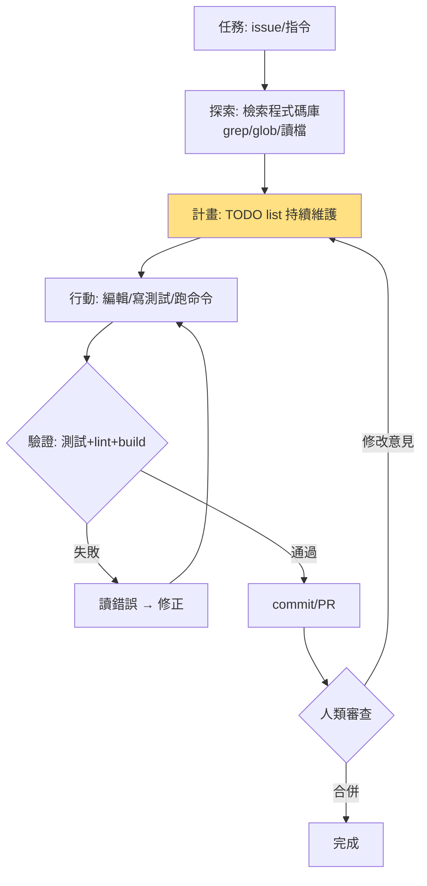

# 5.2 Devin、Claude Code 與 OpenCode：自主寫程式的 Agent（2024-2026）

## 一、歷史背景：SWE-bench 點燃的競賽

2023 年 10 月 SWE-bench 發布後，「修真實 GitHub issue」成為 Code Agent 的公共賽道。2024 年 3 月，Cognition 發布 **Devin** 的宣傳影片，宣稱「第一個 AI 軟體工程師」，引爆了公眾想像；儘管其實際能力隨後受到質疑（Upwork 任務的成功率與演示差距），但它確立了一個產品範式：**Agent 擁有自己的終端機、瀏覽器與編輯器，自主完成從讀 issue 到提 PR 的全流程**。

2024-2025 年，真正的生產級突破來自 Anthropic 的 **Claude Code**（2025.2 發布，基於經 Code RL 訓練的 Claude 模型）與開源社群的 **OpenCode、Gemini CLI、Codex CLI** 等終端 Agent。到 2026 年，SWE-bench Verified 的頂尖系統從 2024 年初的約 3% 攀升至 70%+，Code Agent 成為 AI 滲透真實工作最深的方向。

本節解析這一代 Code Agent 的架構共通點、工程差異與開放的難題。

## 二、架構解析：Code Agent 的共同骨架

### 2.1 迴圈 + 工具 + 檢索 + 權限



核心部件：

1. **程式碼庫感知（codebase grounding）**：用 ripgrep/glob/AST 檢索代替全庫讀入——Code Agent 的「RAG」是工程化的檢索（精確 grep 優先於向量檢索，因為符號名可精確匹配）；
2. **計畫持久化（TODO list）**：把任務分解寫入清單並隨執行更新——BDI 的 Intention 在工程上的實現，也是使用者可觀測性的來源；
3. **驗證迴圈（test loop）**：跑測試→讀失敗→修正，Reflexion 的生產級實現；
4. **沙盒與權限**：檔案寫入與 shell 命令分級授權（唯讀自動、寫入/網路需批准或沙盒內自動）。

### 2.2 Claude Code 的關鍵設計

Claude Code（終端 Agent）的影響力來自幾個設計決策：

- **極簡介面**：終端機裡的自然語言對話，不造 IDE——把複雜性藏在迴圈裡；
- **工具集精簡**：Read、Write、Edit、Bash、Grep、Glob、TodoWrite 等十餘個，每個皆「為模型設計」的粒度；
- **CLAUDE.md 慣例**：專案根目錄的說明檔自動載入上下文——專案級的「系統提示詞」，讓 Agent 學會團隊慣例；
- **子 Agent（subagent）與技能（skills）**：把隔離上下文的子任務、可複用的工作流封裝成組件，是多 Agent 思想（第 6 章）在單機的落地；
- **Agentic 檢索策略**：先 grep 縮小範圍、再精讀少數檔案——「檢索-閱讀-行動」的 ReAct 節奏。

### 2.3 Devin 的範式貢獻與教訓

Devin 的長期記憶、瀏覽器+編輯器+終端一體化工作區、以及「規劃→執行→驗證」的產品敘事影響深遠；但它 2024 年演示與實效的落差（如 Upwork 任務約 3/20 成功、被指「演示中出現輔助性引導」）成為行業的重要教訓：

> **Agent 的能力評估必須基於第三方基準與真實任務，而非廠商演示。**（第 8 章的主題。）

### 2.4 開源路線：OpenCode 與終端 Agent 群像

2025 年起，終端 Code Agent 開源化成為趨勢：OpenCode、Codex CLI、Gemini CLI 等以「本地執行、模型無關、MCP 原生」為賣點。其意義：

- **模型層與 Agent 層解耦**：同一個 Agent 殼可接 Claude/GPT/Gemini/本地模型——MCP 與標準 API 使「大腦可替換」；
- **本地隱私與成本控制**：程式碼不出內網的需求推動開源 Agent + 自託管模型；
- **生態創新加速**：社群以 skill/plugin 形式快速沉澱工作流（如 review、deploy、test skill）。

### 2.5 對話即工程的介面範式

2025-2026 年 Code Agent 的互動哲學逐漸收斂為：

```text
使用者：修復 issue #142，登入頁在手機上排版錯誤
Agent：
  1. 先看 issue 與相關檔案（grep "login" + 讀 3 個檔）
  2. TodoWrite: [重現 bug, 修改 CSS, 加響應式測試, 跑驗收]
  3. 修改 → 跑測試 → 失敗 → 修正 → 通過
  4. git commit + 請求審查，附上改動說明
```

人類的角色從「寫程式的人」變成「下任務、定驗收標準、做最終審查的人」——軟體工程的分工被重新劃分。

## 三、訓練層：Code RL 如何鑄造了 Agent 模型

2024-2026 年 Code Agent 的躍升一半來自工程，一半來自**訓練範式的變革**：

1. **可驗證獎勵的 RL（RLVR）**：以「測試通過與否」為獎勵，對真實 repo 的 issue 修復任務做強化學習——第 5.1 節「免費獎勵函數」論證的兌現；
2. **長鏈思考（o1/R1 範式）**：把 ToT 式的探索內化到模型的鏈式思考中，推理時算力可自由伸縮；
3. **Agent 化訓練環境**：把多步工具呼叫（grep→read→edit→test）納入 RL episode，訓練的是「整個迴圈的策略」而非「單步補全」；
4. **從 SWE-bench 到生產任務**：訓練環境從 2294 題 benchmark 擴展到持續更新的真實 repo，緩解「過擬合基準」。

**因果鏈**：Codex 證明碼力可訓（2021）→ Copilot 證明產品化可行（2021-23）→ SWE-bench 證明可評估（2023）→ Devin 證明範式有想像空間（2024）→ RLVR+長思考證明可訓練成超強碼力（2024-25）→ Claude Code/OpenCode 證明可規模化交付生產力（2025-26）。每一環都是下一環的必要條件。

## 四、開放難題：2026 年的 Code Agent 還不能做什麼

| 難題 | 描述 | 現狀 |
|------|------|------|
| 長程一致性 | 跨數千行的重構，前後語義一致 | 中型重構可行，架構級仍需人類 |
| 需求歧義 | issue 描述含糊時，Agent 猜錯方向 | 依賴人類澄清與 CLAUDE.md 約定 |
| 跨系統上下文 | 需求在 Slack、設計在 Figma、資料在 DB | 靠 MCP 拼接，整合深度參差 |
| 業務知識 | 「為什麼這樣寫」的歷史決策脈絡 | Git 歷史與文件可檢索，但隱性知識缺失 |
| 安全面 | 提示注入、惡意依賴、過度授權 | 沙盒+人審為主防線（第 9 章） |

這些難題共同指向本書最後兩章的主題：評估（第 8 章）與安全（第 9 章）。

## 五、本節重點

1. 2024-2026 年 Code Agent 的共同骨架：工程化檢索（grep 優先）、TODO 計畫持久化、測試驗證迴圈、分級授權沙盒。
2. Claude Code 的關鍵設計（精簡工具集、CLAUDE.md 慣例、子 Agent 與技能）把「提示詞工程」升級為「工作流封裝」；開源終端 Agent（OpenCode 等）實現了模型層與 Agent 層解耦。
3. Devin 的範式貢獻與演示落差並存，教訓是：能力判斷必須基於第三方基準與真實任務，這是第 8 章評估的出發點。
4. 訓練範式（RLVR、長鏈思考、Agent 化訓練環境）是 Code Agent 躍升的另一半動力；程式碼的「免費獎勵函數」特性使 RL 得以規模化。
5. 人機分工被重構：人類下任務、定驗收、做審查；Agent 探索、實現、驗證、迭代。剩餘難題（長程一致性、需求歧義、安全）指向評估與對齊的邊界。

## 六、思考問題

1. 為什麼 Code Agent 的檢索「grep 優先於向量檢索」？在什麼任務上向量檢索反而更必要（提示：跨語言、概念式搜尋）？
2. CLAUDE.md 這類「專案說明檔」實質上是把團隊慣例編碼給 Agent。它與第 1 章 BDI 模型中的哪個成分對應？若兩個團隊慣例衝突，Agent 該如何行為？
3. Devin 演示爭議與 SWE-bench 分數飛漲可以並存。請分析「基準分數」與「真實生產力」之間可能出現的落差來源（環境差異、資料汙染、任務選擇偏差）。
4. 「測試通過」作為獎勵訊號，會不會訓練出「只討好測試」的模型（如測試覆蓋不到的回歸）？工程上如何補救？
5. 若你是一家 50 人公司的技術負責人，要在 2026 年導入 Code Agent：你會設計怎樣的授權分級（哪些自動、哪些需審查）？用第 5.1 節的「Git 安全骨架」論證你的方案。
